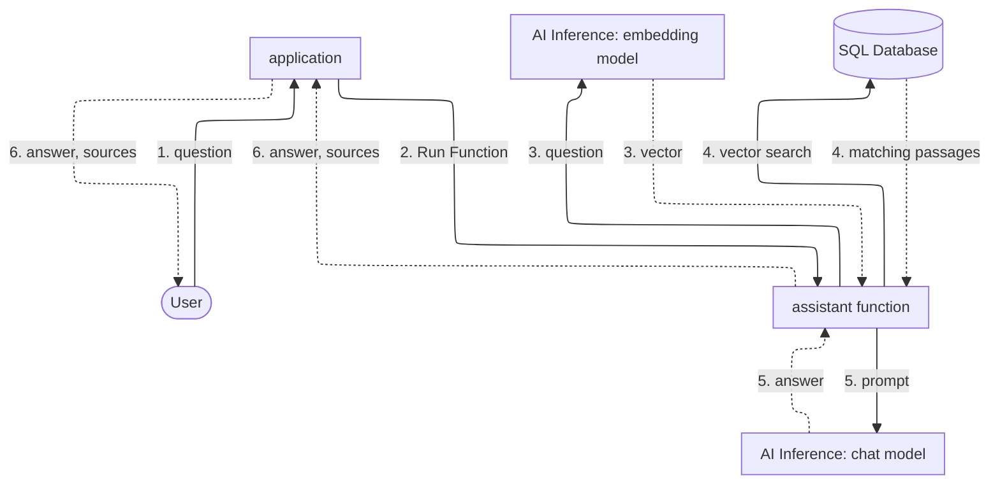

import FrameBox from '@aziontech/webkit/frame-box'
import ItemList from '@aziontech/webkit/item-list'
import DocItem from '@aziontech/webkit/doc-item'

A copilot is an assistant that sits inside a product and answers questions about it in plain language. It guides a user through a complex task instead of returning a list of search results. What it answers depends on what that user is doing. This design builds one with retrieval-augmented generation (RAG): a function retrieves the passages that match a question, and a model answers from them. Use it when the answers live in your own documents and data rather than in a model's training set. The design implements the use case [Build and run customer support AI assistants](/en/documentation/use-cases/build-and-run-ai-workloads/build-and-run-customer-support-ai-assistants/).

The assistant makes one pass per question. It embeds the question, retrieves the nearest passages, and calls the chat model once, so every answer takes the same three calls. It runs no agent loop, in which a model chooses tools and decides when to stop. For that design, refer to [Build AI agents](/en/documentation/use-cases/build-and-run-ai-workloads/build-ai-agents/).

---

## Architecture diagram

Solid arrows carry the request, and dotted arrows carry the response. Each label starts with the number of the dataflow step it belongs to.

### Dataflow

1. A user sends a question to the application that hosts the copilot, and a data center near the user receives the request.
2. The application runs its rules, and a rule runs the assistant function with the _Run Function_ behavior.
3. The function sends the question to the embedding model on AI Inference, which returns the question's vector.
4. The function asks the vector index in SQL Database for the passages nearest to that vector, and the database returns them.
5. The function sends the passages and the question to the chat model on AI Inference, which returns an answer written from them.
6. The function returns the answer and its sources to the application, which delivers them to the user.

The function reads the database once and calls each model once per question, in an order fixed in its code. No step depends on a decision the model makes. A model call that fails ends inside the function, so the failure flow stays inside Azion.

---

## Components

- [Applications](/en/documentation/platform/applications/): builds and hosts the application that answers the user's request from Azion's distributed infrastructure. The rules you configure here run before the function does, so a request can be authenticated or rejected before it reaches your code.
- [Functions](/en/documentation/platform/functions/): runs the assistant function close to the end user. The function embeds the question, retrieves the passages, assembles the prompt, and calls the chat model. One execution holds the whole pass, so retrieval and generation sit in the same place.
- [AI Inference](/en/documentation/platform/ai-inference/): runs the embedding model that turns the question into a vector, and the chat model that writes the answer. The function reaches both with `Azion.AI.run`, so its code names no host and holds no model credential.
- [SQL Database](/en/documentation/platform/sql-database/): a SQL solution designed for serverless applications. It holds the knowledge base the function reads. That is what keeps the answers tied to your own data rather than to what the model learned in training.
- [Vector search](/en/documentation/platform/sql-database/vector-search/): lets you implement semantic search engines over the records in SQL Database. A question and a passage match here when they mean the same thing, so the function retrieves context that a keyword query would miss.
- **Azion's distributed infrastructure**: the highly distributed architecture every part above runs on. The design has no region to choose. A data center near the user answers the request, and you select none of them.

---

## Implementation

- [Build and run customer support AI assistants](/en/documentation/use-cases/build-and-run-ai-workloads/build-and-run-customer-support-ai-assistants/) - builds this design end to end, with the passages table, the ingestion function, and the assistant function.
- [Applications quickstart](/en/documentation/platform/applications/quickstart/) - creates the application that receives the request.
- [Create a database](/en/documentation/guides/application-development/data/manage-sql-database/) - creates the SQL Database the assistant reads.
- [Functions quickstart](/en/documentation/platform/functions/quickstart/) - writes the function that carries the assistant's logic.
- [Instantiate functions](/en/documentation/guides/application-development/getting-started/instantiate-functions/) - attaches that function to the application.
- [Vector search guide](/en/documentation/guides/application-development/data/sql-database-vector-search/) - builds the semantic queries the function runs against the knowledge base.

---

## Related resources

<FrameBox>
<ItemList>
  <DocItem title="AI Inference" href="/en/documentation/platform/ai-inference/">The models Azion runs, for the embedding and the answer this design depends on.</DocItem>
  <DocItem title="Model invocation" href="/en/documentation/platform/ai-inference/model-invocation/">The request body a function sends when it calls a model.</DocItem>
  <DocItem title="SQL Database" href="/en/documentation/platform/sql-database/">The store that holds the knowledge base and its embeddings.</DocItem>
  <DocItem title="Real-Time Metrics" href="/en/documentation/platform/real-time-metrics/">The traffic and performance of the application that serves the copilot.</DocItem>
  <DocItem title="Real-Time Events" href="/en/documentation/platform/real-time-events/">The individual requests and logs to read when an answer comes back wrong.</DocItem>
</ItemList>
</FrameBox>
