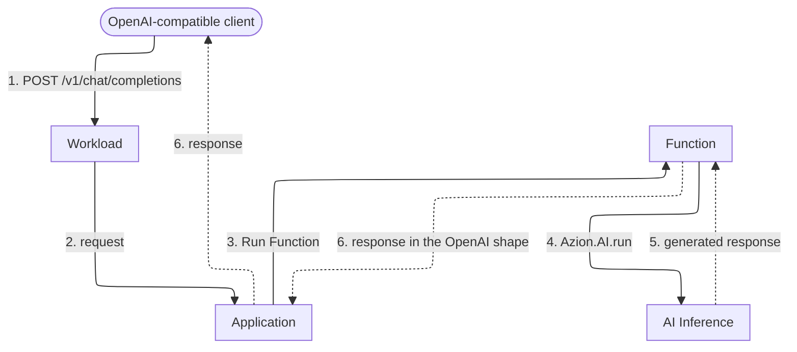

import FrameBox from '@aziontech/webkit/frame-box'
import ItemList from '@aziontech/webkit/item-list'
import DocItem from '@aziontech/webkit/doc-item'

A client that calls a model needs one address to post to and one response shape to read. This design puts that address on an Application you deploy: the Application is the inference endpoint, and the model runs behind it. Use it when your team already serves an HTTP API and wants inference to be one more path on it. You own the domain, and no inference server stays running. The design implements the use case [Add AI features to existing applications](/en/documentation/use-cases/build-and-run-ai-workloads/add-ai-features-to-existing-applications/).

[How AI Inference works](/en/documentation/platform/ai-inference/how-it-works/) covers the hand-offs inside a single call. This page describes the shape you deploy around them.

---

## Architecture diagram

Solid arrows carry the request, and dotted arrows carry the response. Each label starts with the number of the dataflow step it belongs to.

### Dataflow

1. A client posts an OpenAI-compatible request to `/v1/chat/completions` on a domain of the Workload.
2. A data center near the client receives the request, and the Workload's deployment sets the Application that handles it.
3. The Application runs its rules, including any authentication check you add, and a rule runs the Function with the _Run Function_ behavior.
4. The Function builds the request body and calls the model with `Azion.AI.run`.
5. AI Inference runs the model and returns the generated response to the Function.
6. The Function shapes that response and returns it to the client along the same path.

The client knows nothing about Azion. It posts JSON to a URL and reads JSON back, as it would against any OpenAI-compatible service. Behind the domain, one execution does the rest, and the Function holds the request open until the model responds. No arrow leaves for an inference host, because the Function passes no base URL and names no host. It passes a model id, and Azion places the call.

---

## Components

- [Workloads](/en/documentation/platform/workloads/): receives the request on its domains, the workload domain or a custom domain, and its deployment sets the Application. The address the client posts to belongs to the Workload.
- [Applications](/en/documentation/platform/applications/): runs its rules on the request before any of your code runs. The path the Function answers and any authentication in front of it are set in those rules. `Azion.AI.run` takes no credential, so an endpoint with no check of its own answers anyone who finds it.
- [Functions](/en/documentation/platform/functions/): holds the inference logic and issues the model call. Your code runs nowhere else in the design, so the prompt, the model id, the context retrieved from a store, and any external service the call needs all sit in one execution.
- [AI Inference](/en/documentation/platform/ai-inference/): runs the model, which is what removes the inference server from the design. You load no model and size no cluster, and the id from [AI models](/en/documentation/platform/ai-inference/models/) is the only address the Function needs.
- **Azion's distributed infrastructure**: runs every part above. It is why the design has no region to choose. A data center near the client answers the request, and you select none of them.
- [Real-Time Metrics](/en/documentation/platform/real-time-metrics/): reports the traffic and performance of the Application that serves the endpoint. A design with no inference server of your own still needs a view of what the endpoint carried.
- [Real-Time Events](/en/documentation/platform/real-time-events/): tracks individual requests, raw data, and logs. When a response is wrong, the request that produced it is what you read here.

:::note
On the Hobby and Pro plans, AI Inference is available upon request, subject to approval. For the access each plan gives, refer to [AI Inference limits](/en/documentation/platform/ai-inference/limits/).
:::

---

## Implementation

- [Add AI features to existing applications](/en/documentation/use-cases/build-and-run-ai-workloads/add-ai-features-to-existing-applications/) - builds this design end to end, with the summarization function and the API route.
- [AI Inference quickstart](/en/documentation/platform/ai-inference/quickstart/) - deploys the design and posts a first request to a model on the domain it assigns.
- [How to deploy the AI Inference Starter Kit template](/en/documentation/guides/application-development/frameworks/ai-inference-starter-kit/) - creates the Workload with its deployment, the Application, and the Function this page describes, in one deployment.
- [Model invocation](/en/documentation/platform/ai-inference/model-invocation/) - carries the request body both interfaces accept, and the `curl` form for the HTTP endpoint.

---

## Related resources

<FrameBox>
<ItemList>
  <DocItem title="How AI Inference works" href="/en/documentation/platform/ai-inference/how-it-works/">The invocation chain hand-off by hand-off, and where Azion's part ends.</DocItem>
  <DocItem title="AI models" href="/en/documentation/platform/ai-inference/models/">The id to pass, and what each model accepts.</DocItem>
  <DocItem title="AI Inference limits" href="/en/documentation/platform/ai-inference/limits/">The ceilings a model call runs against, and when Azion deprovisions a model.</DocItem>
  <DocItem title="SQL Database" href="/en/documentation/platform/sql-database/">The store a Function reads context from before it calls a model.</DocItem>
  <DocItem title="Vector search" href="/en/documentation/platform/sql-database/vector-search/">The embedding queries that build the context a prompt carries.</DocItem>
</ItemList>
</FrameBox>
