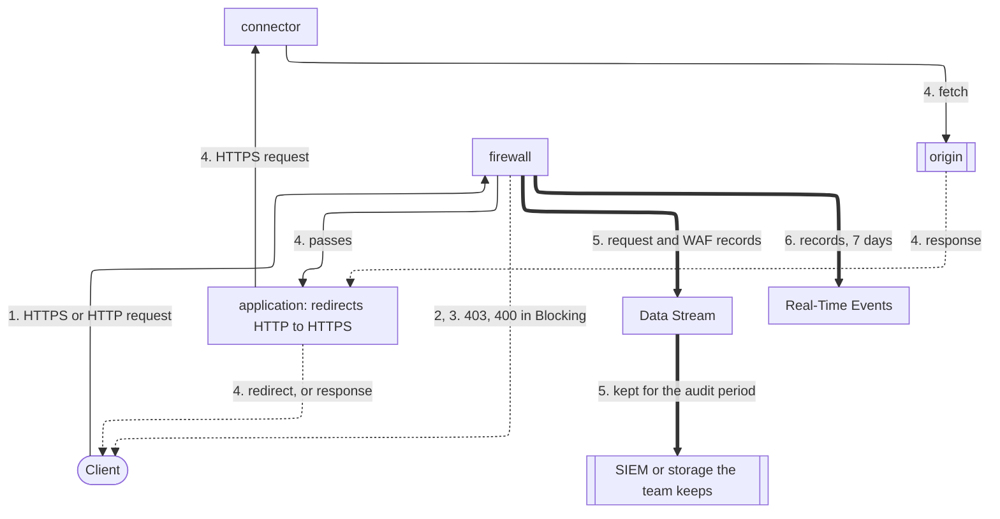

import FrameBox from '@aziontech/webkit/frame-box'
import ItemList from '@aziontech/webkit/item-list'
import DocItem from '@aziontech/webkit/doc-item'

This design serves security and compliance teams that must show auditors the controls in front of a regulated application. That application handles card or personal data under a standard such as PCI DSS, SOC 2, LGPD, or GDPR. [Certificate Manager](/en/documentation/platform/workloads/#certificate-manager) holds the TLS certificates, and the [application](/en/documentation/platform/applications/) redirects all traffic to HTTPS. A [firewall](/en/documentation/platform/firewall/) applies [WAF](/en/documentation/platform/firewall/#waf) rules, [Network Shield](/en/documentation/platform/firewall/#network-shield) lists, and geographic restrictions before requests reach the origin through a [connector](/en/documentation/platform/connectors/). [Data Stream](/en/documentation/platform/data-stream/) exports every request record, with its WAF decision, to a SIEM or storage the team keeps for the period its standard requires. Under the [Shared Responsibility Model](/en/documentation/fundamentals/shared-responsibility/), Azion secures the platform, and the team configures and evidences these controls. The design implements the use case [Prepare regulated web applications for security audits](/en/documentation/use-cases/secure-applications-and-networks/prepare-regulated-web-applications-for-security-audits/).

## Architecture diagram

Solid arrows carry the request, dotted arrows carry the response, and thick arrows carry the evidence, which runs apart from any request. Each label starts with the number of the dataflow step it belongs to.

### Dataflow

1. A client connects over HTTPS, and the workload presents the certificate that Certificate Manager holds for the domain. [DDoS Protection](/en/documentation/platform/workloads/#ddos-protection) assesses the traffic before any firewall rule runs.
2. Firewall rules read Network Shield lists and answer `403` in two cases. One is a client from a country outside the served list, and the other a request for `/admin` from outside the team's network.
3. WAF scores every request and, in _Blocking_, answers `400` to a request whose score reaches the threshold of a threat family.
4. A request that passes reaches the application, which redirects plain HTTP to HTTPS and forwards the request to the origin through the connector.
5. Data Stream exports the record of every request, with its WAF variables, to a SIEM or storage. That destination keeps the evidence for the period the standard requires.
6. Real-Time Events keeps each record for 7 days, for the review of a recent incident.

A refusal starts at the firewall and goes straight to the client, because the application never receives a refused request. The evidence leaves from the firewall, which every request crosses, refused requests included. Every control on the request leaves a record in the evidence, at the destination and in [Real-Time Events](/en/documentation/platform/real-time-events/).

## Components

- **Certificate Manager**: the Platform Resource that holds the TLS certificates a workload presents. The team uploads its own certificate, or Azion requests one from Let's Encrypt and renews it.
- **application**: the Platform Resource that redirects plain HTTP to HTTPS and delivers the requests the firewall lets through.
- **firewall**: the Platform Resource where every control runs, each as a named rule that the team can map to an audited control.
- **DDoS Protection**: the Feature that mitigates DoS and DDoS attacks on every workload. It is always on, with nothing to configure.
- **WAF**: the application-layer control. It scores each request against eight threat families, and in _Blocking_ it refuses an attack pattern.
- **Network Shield**: restricts access by country and by network, through lists that deny rules read with the _Network_ criterion. The administration path reads an `ip_cidr` list, because country resolution can be wrong for some addresses.
- **connector**: the Platform Resource that reaches the origin.
- **Data Stream**: exports the request records, with the WAF variables, for retention outside the platform. Its _Activity History_ data source also exports the configuration changes that users make in Azion Console. The [Activity History](/en/documentation/fundamentals/activity-history/) page itself shows only the last 30 days.
- **Real-Time Events**: holds each request record for 7 days, for incident review. Evidence for a longer audit period comes from the destination.
- **SIEM or storage**: the integration that holds the evidence for the period the standard of the team requires.

## Implementation

- [Prepare regulated web applications for security audits](/en/documentation/use-cases/secure-applications-and-networks/prepare-regulated-web-applications-for-security-audits/) - builds this design end to end, with the HTTPS redirect, the country and address rules, the stream of security events, and the checks for each.
- [Request a Let's Encrypt certificate](/en/documentation/guides/application-security/tls-and-certificates/how-to-generate-a-lets-encrypt-certificate/) - has Azion request and renew a certificate for the domains of the workload.
- [Certificate Manager quickstart](/en/documentation/platform/workloads/certificate-manager/quickstart/) - uploads a certificate of your own and binds it to a workload.
- [Redirect HTTP to HTTPS](/en/documentation/guides/application-security/tls-and-certificates/redirect-http-to-https/) - creates the application rule that redirects every plain HTTP request to HTTPS.
- [Bind a firewall to a workload](/en/documentation/guides/application-security/firewall-and-waf/firewall-protect-your-domain/) - names the firewall in the deployment of the workload, so it inspects the requests to every domain.
- [Apply a rule set to every request](/en/documentation/guides/application-security/firewall-and-waf/apply-rule-set/) - applies the WAF rule set, the application-layer control an audit asks for.
- [Deny requests from a list of countries](/en/documentation/guides/application-security/bots-and-network/deny-countries/) - creates the list of served countries and the rule that refuses every other country.
- [Allow only the addresses in a list](/en/documentation/guides/application-security/bots-and-network/allowlist/) - creates an address list and a rule that refuses every client outside it.
- [Guard one path with a network list](/en/documentation/guides/application-security/bots-and-network/guard-one-path/) - joins a path criterion to the _Network_ criterion, so the administration rule acts only on `/admin`.
- [Stream request and WAF records to a SIEM](/en/documentation/guides/platform/observability/stream-request-and-waf-records-to-siem/) - exports every request with its WAF variables to the destination that keeps the evidence.

## Related resources

<FrameBox>
<ItemList>
  <DocItem title="PCI Compliance" href="/en/documentation/fundamentals/pci-dss-certification/">Azion's own PCI DSS attestation, for the vendor side of an audit.</DocItem>
  <DocItem title="SOC Compliance" href="/en/documentation/fundamentals/soc/">Azion's own SOC reports, for the vendor side of an audit.</DocItem>
  <DocItem title="Endpoints" href="/en/documentation/platform/data-stream/endpoints/">The destinations a stream can send the evidence to.</DocItem>
  <DocItem title="Best practices for Data Stream" href="/en/documentation/platform/data-stream/best-practices/#watch-the-status-code-of-every-send-in-real-time-events">How to confirm that every send reached the destination, so no evidence goes missing.</DocItem>
</ItemList>
</FrameBox>
