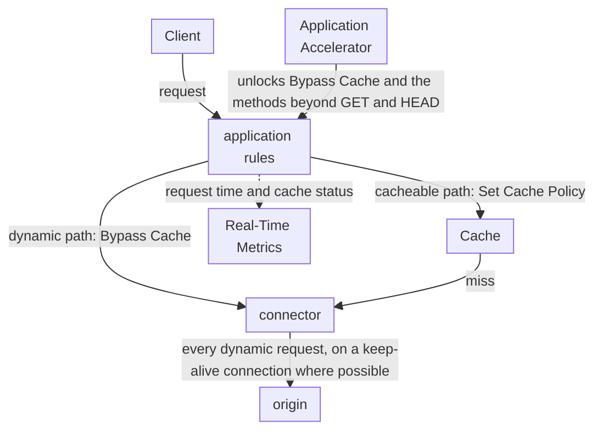

import FrameBox from '@aziontech/webkit/frame-box'
import ItemList from '@aziontech/webkit/item-list'
import DocItem from '@aziontech/webkit/doc-item'

This design serves teams whose API responses are personalized or transactional and cannot be cached. The application bypasses the cache on those paths, so every call reaches the origin through a connector. Application Accelerator unlocks that bypass and the `OPTIONS`, `POST`, `PUT`, `PATCH`, and `DELETE` methods an API needs. The cacheable paths of the same site keep their cache rules. The design implements the use case [Accelerate websites and APIs with a CDN](/en/documentation/use-cases/improve-performance-and-reliability/accelerate-websites-and-apis-with-a-cdn/).

## Architecture diagram

The diagram splits one site at the rules of the application. A request on a dynamic path skips the cache and reaches the origin through the connector. The origin's response time is therefore part of every response on that path. A request on a cacheable path tries Cache first and reaches the same connector only on a miss. Nothing on a dynamic path is stored, so that path has no TTL to set and nothing to purge. It also has no copy to serve when the origin fails, so [Keep an application online when an origin fails](/en/documentation/use-cases/improve-performance-and-reliability/keep-an-application-online-when-an-origin-fails/) adds a standby origin behind the same connector to keep those paths answering. The decisions are which paths bypass the cache and how the connector reaches the origin.

### Dataflow

1. A client sends a request to the domain of a workload, and the workload's deployment names the application.
2. The application runs its Request Phase rules in order. A rule that matches a dynamic path, such as `/api/`, carries the **Bypass Cache** behavior.
3. **Bypass Cache** sends the request to the origin through the connector that a **Set Connector** rule names, and Azion stores no copy of the response. A response to a request sent with `Pragma: azion-debug-cache` reports `BYPASS` in its `x-cache` header.
4. The connector reaches the origin with the protocol its settings decide. Where possible, the bypassed request travels on a keep-alive connection to the origin.
5. A request on a cacheable path takes the cache setting that a **Set Cache Policy** rule applies. Cache answers from a valid copy, and a miss reaches the origin through the same connector.
6. Real-Time Metrics records every request to the domain. On a dynamic path, the request time always includes the time the origin takes to answer.

## Components

- **application**: the Platform Resource that holds the per-path rules. A Request Phase rule with **Bypass Cache** matches each dynamic path, and **Set Cache Policy** rules apply cache settings to the other paths. A **Max Age** of `0` does not replace the bypass. It merges parallel requests for one object into one origin request, so two simultaneous callers receive the same answer.
- **Application Accelerator**: the Product that lets the application accept `OPTIONS`, `POST`, `PUT`, `PATCH`, and `DELETE`, beyond the `GET` and `HEAD` it accepts natively. It also unlocks **Bypass Cache**. A request that **Bypass Cache** sends to the origin keeps protocol optimizations and, where possible, a keep-alive connection to it. Its switch belongs to the application and is off on a new one.
- **connector**: the Platform Resource that carries the origin's address and shapes each request to it, for every dynamic request and every cache miss. Its **Transport Protocol Policy** sets the protocol to the origin: forcing HTTPS protects that leg and costs a TLS handshake on every new connection. Without Load Balancer, the connection's timeouts follow platform defaults and are not settings.
- **Cache**: stores the responses of the paths that stay cacheable, under the cache setting each path's rule applies. **Bypass Cache** does not reach the Tiered Cache layer. An application whose cache settings have Tiered Cache on keeps caching objects there for the minimum TTL.
- **Real-Time Metrics**: shows how long the application takes to answer a request, filtered to the domain. The **Requests** dashboard charts **Average Request Time**, and a filter on **Upstream Cache Status** set to `BYPASS` keeps only the bypassed requests. In the GraphQL API, the `upstreamResponseTime` field of [`workloadMetrics`](/en/documentation/devtools/graphql/gql-real-time-metrics-fields/#workloadmetrics) sums the time Azion takes to receive the origin's responses.

## Implementation

- [Accelerate websites and APIs with a CDN](/en/documentation/use-cases/improve-performance-and-reliability/accelerate-websites-and-apis-with-a-cdn/) - builds the caching reverse proxy for a site and its API, bypasses the cache on `/api/`, and compares that design with this one.
- [Configure cache policies for an application](/en/documentation/guides/application-performance/cache-and-purge/cache-settings/) - turns on Application Accelerator, then bypasses the cache for one path or for several paths and a session cookie.
- [Create a cache setting](/en/documentation/guides/application-performance/cache-and-purge/tune-cache-settings/) - creates the cache setting of the cacheable paths and the rule that applies it.
- [Applications quickstart](/en/documentation/platform/applications/quickstart/) - creates the connector to your origin, the application, the rule that sends every request to the connector, and the workload that serves it.
- [Add a custom domain to a workload](/en/documentation/guides/platform/migration/configure-a-domain/) - lists your domain on the workload and points the domain at it.
- [Check the cache status of a response](/en/documentation/guides/application-performance/cache-and-purge/check-page-cache-time/) - reads the `x-cache` header, which reports `BYPASS` on a dynamic path and the cache status on the other paths.

## Related resources

<FrameBox>
<ItemList>
  <DocItem title="Cache variation" href="/en/documentation/platform/applications/application-accelerator/cache-variation/#bypass-cache-and-a-ttl-of-0">How Bypass Cache differs from a Max Age of 0, and what each one costs the origin.</DocItem>
  <DocItem title="Application Accelerator settings" href="/en/documentation/platform/applications/application-accelerator/settings/#http-methods">The methods and the Rules Engine behaviors that Application Accelerator adds to an application.</DocItem>
  <DocItem title="How Connectors works" href="/en/documentation/platform/connectors/how-it-works/#connection-reuse-and-timeouts">The timeout and idle defaults of the connection from Azion to the origin, and when they become settings.</DocItem>
  <DocItem title="Build dashboards" href="/en/documentation/platform/real-time-metrics/build-dashboards/#requests">What Average Request Time and the other charts of the Requests dashboard measure.</DocItem>
</ItemList>
</FrameBox>
