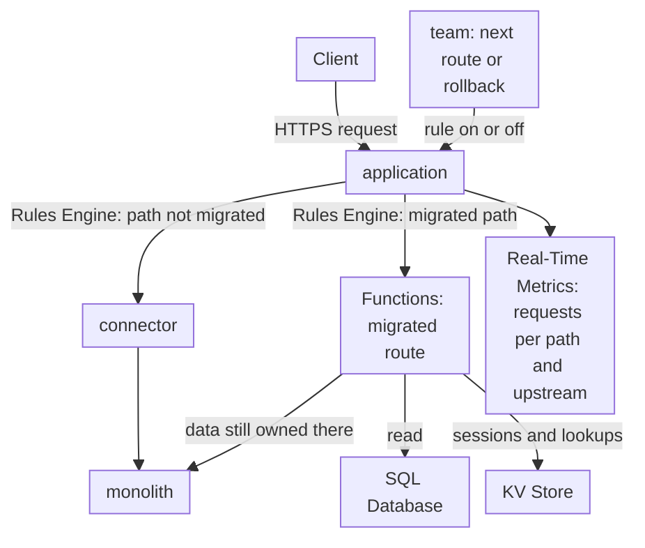

import FrameBox from '@aziontech/webkit/frame-box'
import ItemList from '@aziontech/webkit/item-list'
import DocItem from '@aziontech/webkit/doc-item'

This design serves teams that replace a monolith one route at a time instead of rewriting it in one project. An application on Azion becomes the single entry point for the domain. Rules Engine sends each migrated path to a function, and every other path through a connector to the monolith. Migrated logic keeps its state in SQL Database or KV Store, or calls the monolith's APIs while the monolith still owns the data. A route rolls back when its rule is turned off. The design implements the use case [Modernize a monolithic application without a rewrite](/en/documentation/use-cases/build-and-run-applications/modernize-a-monolithic-application-without-a-rewrite/).

## Architecture diagram

The diagram has one entry point and two destinations. Every request crosses the application, where Rules Engine chooses the destination by the path of the request. Paths that no team has moved end at the monolith through the connector. A migrated path ends at a function. The function reads its state from SQL Database or KV Store, and it calls the monolith for data the monolith still owns. The team node at the bottom is the control flow: turning a rule on moves a route, and turning it off sends the route back. Real-Time Metrics records which side served each path.

### Dataflow

1. A request reaches the workload, and the application runs its Request Phase rules in order against the path and the method of the request.
2. The first rule matches every path and names the connector, so each route that has not moved still reaches the monolith.
3. One later rule per migrated route matches its path and its method, and runs a function instance. The function's response is what the client receives, and a method the rule does not match stays on the monolith.
4. The function reads the route's state from SQL Database through a read replica, or sessions and lookups from KV Store. For a table the monolith still owns, the function calls the monolith's API instead.
5. Real-Time Metrics groups the requests by path and upstream address. The share answered by Azion Runtime, recorded as `127.0.0.1:1666`, grows as routes move.
6. To move the next route, the team adds a rule. To roll a route back, the team turns its rule off, and the next request on that path matches only the first rule.

## Components

- **application**: the Platform Resource that is the single entry point for the domain. Every request crosses it, so a route changes destination with no DNS change and no client change.
- **Rules Engine**: the Feature of the application that routes per path. The first rule names the connector for every path, and one later rule per migrated route runs its function. Matching rules run in order, so the later rule decides its path.
- **Functions**: run the migrated routes on Azion Runtime, in JavaScript. The **Run Function** behavior that triggers each one requires Application Accelerator on the application.
- **connector**: the Platform Resource that is the path to the monolith. Every route that has not moved, and every route rolled back, reaches the monolith through it.
- **SQL Database**: holds the state of migrated routes. A function opens a database on its read replica, so writes go through the Azion API, or stay on the monolith until their table moves. Which side owns each table during the migration is a design decision.
- **KV Store**: a design option that holds sessions and lookups, for a route that reads a value by a key from the request, such as a session ID.
- **Cache**: stores cacheable responses from either side. A cache setting applied by a **Set Cache Policy** rule caches the monolith's responses, and a function caches its own responses through the Cache API.
- **Real-Time Metrics**: shows the traffic split and the error rate per route. It counts requests by path and upstream address, and the status codes of the application show the errors of each cut-over.

## Implementation

- [Modernize a monolithic application without a rewrite](/en/documentation/use-cases/build-and-run-applications/modernize-a-monolithic-application-without-a-rewrite/) - builds this design end to end: it moves `GET /api/stores` to a function that reads SQL Database, rolls the route back, and measures the result.
- [Applications quickstart](/en/documentation/platform/applications/quickstart/) - creates the application, the connector to the monolith, the rule that sends every request to it, and the workload.
- [Run a function on one path, and roll it back](/en/documentation/guides/application-development/functions-and-runtime/run-a-function-on-one-path-and-roll-it-back/) - creates the cut-over rule for one path, then turns it off.
- [Query a database from a function](/en/documentation/guides/application-development/data/retrieve-data-with-functions/) - creates a database and its table, and a function that returns the rows as JSON from the read replica.
- [Write rows to SQL Database from a function](/en/documentation/guides/application-development/data/write-sql-database-rows-from-a-function/) - sends the write statements of a migrated route through the Azion API, for a table the route now owns.
- [Import data with the EdgeSQL Shell](/en/documentation/guides/application-development/data/import-data-sql-database/) - loads rows into a table, such as an export of the monolith's database.
- [Break down requests by status code](/en/documentation/guides/platform/observability/break-down-requests-by-status-code/) - reads the status codes of the workload, where the error rate of a cut-over shows.

## Related resources

<FrameBox>
<ItemList>
  <DocItem title="Middleware layer over a legacy origin" href="/en/documentation/use-cases/build-and-run-applications/edge-enhanced-applications/">The other design for this use case, which keeps every path on the monolith and adds behavior around it.</DocItem>
  <DocItem title="How Functions works" href="/en/documentation/platform/functions/how-it-works/">The function, the instance, and the rule that a migrated route needs before it receives traffic.</DocItem>
  <DocItem title="Rules Engine for Applications" href="/en/documentation/platform/applications/rules-engine/">The order rules run in, and the Set Connector and Run Function behaviors that split the traffic.</DocItem>
  <DocItem title="Node.js APIs" href="/en/documentation/devtools/runtime/node/">The Node.js APIs that code moved from the monolith can call on Azion Runtime.</DocItem>
</ItemList>
</FrameBox>
