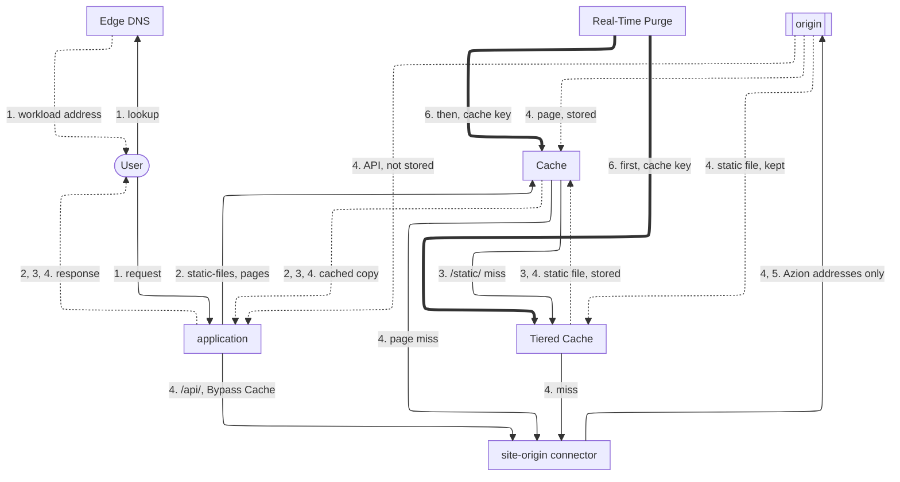

import FrameBox from '@aziontech/webkit/frame-box'
import ItemList from '@aziontech/webkit/item-list'
import DocItem from '@aziontech/webkit/doc-item'

This design serves teams whose content is mostly cacheable and lives on an origin they run, in a cloud region or a data center. Users far from that origin get slow pages, and traffic peaks overload it. Edge DNS points the domain to an application that caches responses by rule, and Tiered Cache cuts origin requests further. The application fetches each miss through a connector. Origin Shield lets the origin accept traffic from Azion only, and Real-Time Purge removes content when it changes. The design decisions are the cache keys, the TTLs, and the invalidation. The design implements the use case [Accelerate websites and APIs with a CDN](/en/documentation/use-cases/improve-performance-and-reliability/accelerate-websites-and-apis-with-a-cdn/).

## Architecture diagram

Solid arrows carry the request, dotted arrows carry the response, and thick arrows carry the purge, which runs apart from any request. Each label starts with the number of the dataflow step it belongs to.

### Dataflow

1. Edge DNS resolves the domain to the workload, and the user's request reaches the application in a nearby data center.
2. The application's rules read the path in the Request Phase and apply a cache setting. A valid copy in the cache of that data center answers the request, and the origin is not asked.
3. On a miss for a static file, the data center asks the Tiered Cache layer, which every data center shares, before it asks the origin.
4. A miss in every layer reaches the origin through the connector, and the response is stored for the next request. A call on a bypassed path, such as `/api/`, always reaches the origin, and its response is never stored.
5. The connector reaches the origin from an address on the `Azion Origin Shield` list, and the firewall of the origin refuses every other source.
6. When content changes, a cache key purge removes it from the Tiered Cache layer first and from Cache second. The next request then fetches the new version from the origin.

Every response returns through the application, which delivers it to the user. The origin allows Azion addresses only, so the connector is the single way in.

## Components

- **Edge DNS**: resolves the domain to the workload. A subdomain points at the workload domain with a `CNAME` record, and the apex points at it with an `ANAME` record.
- **application**: the Platform Resource that holds the cache rules. Each rule matches a set of paths and applies a cache setting. A rule with the **Bypass Cache** behavior keeps a path out of the cache, and that behavior requires Application Accelerator on the application.
- **Cache**: stores each response in the data center that fetched it, for the TTL of its cache setting, and answers repeated requests from that copy. The cache key is the scheme, the host, and the path, plus the variations a cache setting adds. A request that carries `Pragma: azion-debug-cache` receives the key in the `x-cache-key` header. For static files, the design keeps the TTL at 15 days (`1296000` seconds) or less, the default maximum of the [Static Cache template](/en/documentation/guides/application-development/frameworks/static-cache-template/).
- **Tiered Cache**: the Feature that adds a second cache layer between Cache and the origin, shared by every data center, in the region its topology names. It requires _Override cache behavior_ and a **Max Age** of at least 3 seconds.
- **connector**: the Platform Resource that reaches the origin on a miss in every cache layer, and on every call to a bypassed path.
- **Origin Shield**: with Origin IP ACL on the connector, the origin's firewall allows the prefixes of the `Azion Origin Shield` list and refuses every other source. Azion does not enforce the allowlist, and the list carries IPv4 and IPv6 prefixes that the allowlist needs together.
- **Real-Time Purge**: the Platform Resource that removes changed content before its TTL ends. A cache key purge takes up to 50 keys per request, and it is the only purge type that reaches the Tiered Cache layer.
- **Real-Time Metrics**: shows the share of requests and data answered from cache, the misses that reached the origin, and the misses the Tiered Cache layer absorbed.

## Implementation

- [Accelerate websites and APIs with a CDN](/en/documentation/use-cases/improve-performance-and-reliability/accelerate-websites-and-apis-with-a-cdn/) - builds this design end to end: two cache settings, Tiered Cache on static files, the API pass-through, Origin IP ACL, and purge on deploy.
- [Point a domain to a workload](/en/documentation/guides/platform/migration/point-domain-to-azion/) - points a subdomain at the workload with a `CNAME` record and checks that the hostname resolves.
- [Point an apex domain with ANAME](/en/documentation/guides/application-security/dns/access-root-domain/) - points the apex of the domain at the workload.
- [Create a cache setting](/en/documentation/guides/application-performance/cache-and-purge/tune-cache-settings/) - creates a cache setting for static files with Tiered Cache, one for pages, and the rules that apply them.
- [Configure cache policies for an application](/en/documentation/guides/application-performance/cache-and-purge/cache-settings/) - creates the rule that bypasses the cache on `/api/`, in Azion Console or with the API.
- [Configure Advanced Cache Key for an application](/en/documentation/guides/application-performance/cache-and-purge/advanced-cache-key/) - varies a cached object by a query string argument or by a cookie.
- [Restrict an origin to Azion with Origin IP ACL](/en/documentation/guides/application-security/bots-and-network/restrict-an-origin-to-azion-with-origin-ip-acl/) - turns on Origin IP ACL on the connector and allows only the `Azion Origin Shield` list at the firewall of the origin.
- [Purge cached content](/en/documentation/guides/application-performance/cache-and-purge/purge-cached-content/) - sends cache key purges to the Tiered Cache layer and to Cache, and confirms them.
- [Check the cache status of a response](/en/documentation/guides/application-performance/cache-and-purge/check-page-cache-time/) - reads the `x-cache` and `x-cache-key` headers of a response.
- [Measure cache offload for a domain](/en/documentation/guides/platform/observability/measure-cache-offload/) - reads the requests and the data answered from cache, and the misses that reached the origin.
- [Deploy the File Optimization Template](/en/documentation/guides/application-development/frameworks/dynamic-and-static-file-optimization-template/) - creates an application with standard cache policies by file extension, in front of the origin you name.

## Related resources

<FrameBox>
<ItemList>
  <DocItem title="Cache keys" href="/en/documentation/platform/applications/cache/cache-keys/">How Azion builds a cache key from a request, and what each variation appends to it.</DocItem>
  <DocItem title="Expiration and freshness" href="/en/documentation/platform/applications/cache/expiration-and-freshness/">How a TTL decides when a cached copy expires, and when an expired copy still answers.</DocItem>
  <DocItem title="Tiered Cache" href="/en/documentation/platform/applications/cache/tiered-cache/">The topologies of the second cache layer, and the settings it requires.</DocItem>
  <DocItem title="Real-Time Purge" href="/en/documentation/platform/applications/cache/real-time-purge/">The purge types, and which cache layers each one reaches.</DocItem>
</ItemList>
</FrameBox>
