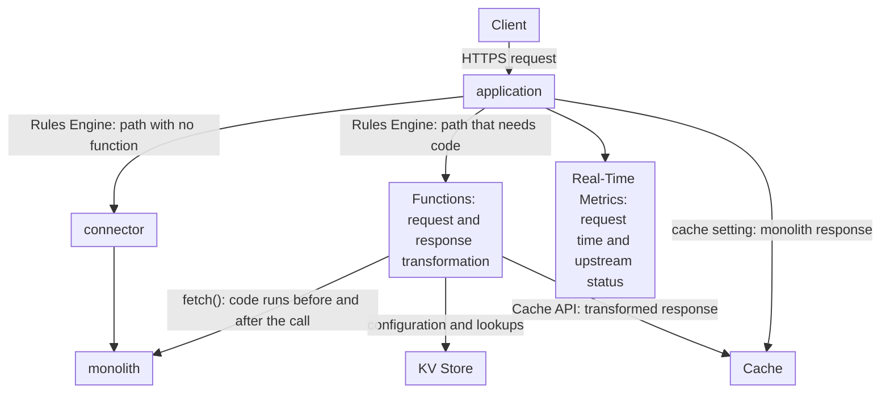

import FrameBox from '@aziontech/webkit/frame-box'
import ItemList from '@aziontech/webkit/item-list'
import DocItem from '@aziontech/webkit/doc-item'

This design serves teams that need new behavior in front of a monolith before they can move any of its code. Typical needs are authentication checks, response personalization, header or HTML rewrites, and one response composed from several legacy endpoints. Every request still reaches the monolith, and Azion adds the behavior around that call. Functions wrap the call to the monolith with code, and Cache stores the responses the layer serves. The design implements the use case [Modernize a monolithic application without a rewrite](/en/documentation/use-cases/build-and-run-applications/modernize-a-monolithic-application-without-a-rewrite/).

## Architecture diagram

The diagram has two ways to the monolith, and every path takes one of them. A path with no function reaches the monolith through the connector. A path that needs code goes to a function, which reads its settings from KV Store and calls the monolith itself. The function's code runs before that call and after it, and that is where the request and the response change. Both ways can leave a copy in Cache. Every path in the diagram leads to the monolith, so the layer adds behavior and moves no route.

### Dataflow

1. A request reaches the workload, and the application runs its Request Phase rules in order. The first rule matches every path and names the connector to the monolith.
2. On a path with no function, the request reaches the monolith through the connector. Request Phase and Response Phase behaviors can still add or remove headers and cookies on the way, with no code.
3. On a path that needs new behavior, a later rule runs a JavaScript function in the Request Phase. The function's response is what the client receives.
4. The function checks the request against the configuration and lookups it reads from KV Store. When a check fails, such as an authentication check, the function answers on its own.
5. Otherwise the function calls the monolith with `fetch()`, once or for several legacy endpoints, and returns a response built from the answers. It can keep that response in Cache through the Cache API.
6. No path is cut over, so a failure of the monolith fails every route. On a path with no function, Real-Time Metrics records the code the monolith returned as the upstream status, and `0` when a cached copy answered.

## Components

- **application**: the Platform Resource that is the entry point for the domain. Every request crosses it before it reaches the monolith, so new behavior goes live with no change to the monolith.
- **Rules Engine**: the Feature of the application that routes each request. A rule for every path names the connector, and a later rule runs a function on each path that needs code. Its behaviors can also add or remove headers and cookies with no function.
- **Functions**: transform the request and the response in JavaScript, in the Request Phase. For the Response Phase, the function instance form of Azion Console states `Only Lua functions can be used in the Response phase.` A JavaScript function therefore wraps the call: it calls the monolith with `fetch()` and builds the response from the answer. The **Run Function** behavior requires Application Accelerator, and the outbound `fetch()` calls of one invocation are capped, which bounds how many endpoints one response composes.
- **connector**: the Platform Resource that is the path to the monolith for every request that no function answers.
- **Cache**: stores the responses the layer serves. A cache setting applied by a **Set Cache Policy** rule stores the monolith's responses, and a function stores its transformed response through the Cache API.
- **KV Store**: holds the configuration and the lookups that the functions read. A function opens a namespace with `Azion.KV.open(name)`, and the namespace must already exist, because the client cannot create one.
- **Real-Time Metrics**: shows how long requests take and which errors come from the monolith. **Average Request Time** is the average time the application takes to process a request and answer it. On a path with no function, **Upstream Status** is the code the monolith returned, or `0` when a cached copy answered. On a path a function answers, the upstream address is `127.0.0.1:1666`, which marks Azion Runtime.

## Implementation

- [Modernize a monolithic application without a rewrite](/en/documentation/use-cases/build-and-run-applications/modernize-a-monolithic-application-without-a-rewrite/) - names this design beside the strangler façade, which the page builds. It does not build this design.
- [Functions quickstart](/en/documentation/platform/functions/quickstart/) - creates a function, instantiates it on the application, and adds the rule that runs it.
- [Run a function on one path, and roll it back](/en/documentation/guides/application-development/functions-and-runtime/run-a-function-on-one-path-and-roll-it-back/) - places a function rule for one path after the rule that sends every path to the connector, then turns it off.
- [KV Store quickstart](/en/documentation/platform/kv-store/quickstart/) - creates a namespace with the Azion API, then stores and reads a key from a function.
- [Configure cache policies for an application](/en/documentation/guides/application-performance/cache-and-purge/cache-settings/) - sets how long the responses of a path stay cached, through a cache setting and a rule.
- [Break down requests by status code](/en/documentation/guides/platform/observability/break-down-requests-by-status-code/) - compares the status code of each request with the code the origin returned.

## Related resources

<FrameBox>
<ItemList>
  <DocItem title="Strangler façade for legacy applications" href="/en/documentation/use-cases/build-and-run-applications/application-modernization/">The other design for this use case, which moves routes off the monolith one at a time.</DocItem>
  <DocItem title="Respond with another site" href="/en/documentation/platform/functions/respond-site/">A function that calls another site with fetch() and relays its response to the client.</DocItem>
  <DocItem title="Rules Engine for Applications" href="/en/documentation/platform/applications/rules-engine/">The behaviors each phase accepts, including the header and cookie changes that need no function.</DocItem>
  <DocItem title="Cache API" href="/en/documentation/devtools/runtime/api-reference/cache/">How a function stores the response it built, and reads it back on a later request.</DocItem>
</ItemList>
</FrameBox>
