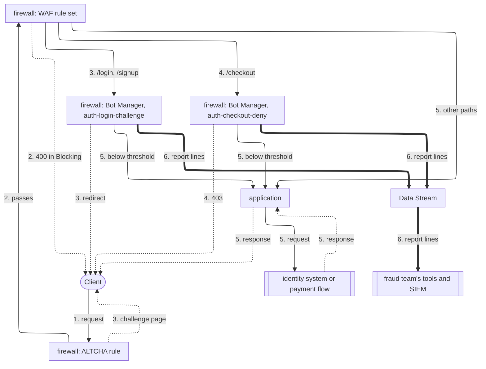

import FrameBox from '@aziontech/webkit/frame-box'
import ItemList from '@aziontech/webkit/item-list'
import DocItem from '@aziontech/webkit/doc-item'

This design serves fraud and security teams that protect sensitive transactions on login, signup, and checkout. Credential stuffing, fake account creation, and card testing all arrive on those three paths. Rules on a [firewall](/en/documentation/platform/firewall/) hand only those paths to [Bot Manager](/en/documentation/platform/firewall/bot-manager/), and each score decides whether the request passes, is challenged, or is denied. [WAF](/en/documentation/platform/firewall/waf/) filters attacks on the same paths, and [Data Stream](/en/documentation/platform/data-stream/) sends every decision to the fraud team's tools. The design implements the use case [Block account takeover on login and checkout flows](/en/documentation/use-cases/secure-applications-and-networks/block-account-takeover-on-login-and-checkout-flows/).

## Architecture diagram

Solid arrows carry the request, dotted arrows carry the response, and thick arrows carry the report lines, which run apart from any request. Each label starts with the number of the dataflow step it belongs to.

### Dataflow

1. A request reaches the firewall bound to the workload. The ALTCHA rule runs first and validates the session of a client that already solved a challenge.
2. On `/login`, `/signup`, and `/checkout`, the WAF rule set scores the request for attack payloads, such as an injection in a form field.
3. On `/login` and `/signup`, the `auth-login-challenge` instance scores the request for automation. At its threshold, the client is redirected to the ALTCHA challenge, and a person who solves it continues without a new challenge.
4. On `/checkout`, the `auth-checkout-deny` instance scores the request, and at its threshold the client receives `403`. A script testing cards has no person behind it to answer a challenge.
5. A request below the threshold, or on any other path, reaches the application, and through it the identity system or the payment flow.
6. Each instance writes a report line per request. [Real-Time Events](/en/documentation/platform/real-time-events/) holds the line, and Data Stream sends it to the fraud team's tools and SIEM.

The ALTCHA rule and the WAF rule set run before the path split, so a solved challenge is validated before any score. One instance per kind of path lets each run its own threshold and action, and requests to every other path reach the application with no score at all.

Every refusal, redirect, and challenge page starts at the firewall rule that gives it. It goes straight to the client, because the application never receives that request.

## Components

- **firewall**: the Platform Resource whose rules decide which requests Bot Manager and WAF see. Each kind of path has its own rule and its own Bot Manager instance, so login and checkout keep separate thresholds and actions.
- **Bot Manager**: scores each request for automation and runs the instance's action once the score reaches the threshold. It runs as a function instance that a firewall rule invokes, in either edition: Bot Manager, or Bot Manager Lite from Azion Marketplace. This design uses two of its seven actions: `redirect` on login and signup, and `deny`, which answers `403`, on checkout. For the other five, refer to [Arguments](/en/documentation/platform/firewall/bot-manager/arguments/#action).
- **WAF**: scores the same three paths for attack payloads, such as an injection in a login or checkout form field. Bot Manager does not inspect a request for application vulnerabilities, so WAF covers that part of every request.
- **Functions**: runs the ALTCHA challenge from Azion Marketplace ahead of Bot Manager. It also runs any custom risk check the team writes for the `firewall` execution environment on the same paths.
- **Data Stream**: sends the _Functions_ data source, which carries the Bot Manager report lines, to the endpoint the fraud team reads.
- **SIEM**: the integration where the fraud team correlates Bot Manager's decisions with its own signals.
- **Real-Time Events**: keeps the report line of each request for 7 days, with its score and the rules it matched. An analyst reads one decision there.

## Implementation

- [Block account takeover on login and checkout flows](/en/documentation/use-cases/secure-applications-and-networks/block-account-takeover-on-login-and-checkout-flows/) - builds this design end to end, with the observation window, the two instances and their thresholds, the WAF rule set, and the checks for each.
- [Run Bot Manager on selected paths](/en/documentation/guides/application-security/bots-and-network/run-bot-manager-on-selected-paths/) - creates the instances and the firewall rules that scope Bot Manager to login, signup, and checkout.
- [Run Bot Manager in observation mode](/en/documentation/guides/application-security/bots-and-network/observation-mode/) - scores the three paths without refusing a request, so the report lines can set each threshold.
- [Protect a route with an ALTCHA challenge](/en/documentation/guides/application-development/functions-and-runtime/altcha/) - instantiates ALTCHA on the firewall, with the rule that serves the challenge a flagged client is redirected to.
- [Install Bot Manager Lite](/en/documentation/guides/application-development/integrations/bot-manager-lite/) - installs the Azion Marketplace edition of Bot Manager on a firewall.
- [Create a rule set at medium sensitivity](/en/documentation/guides/application-security/firewall-and-waf/rule-set-medium/) - creates a WAF rule set with every threat family at medium.
- [Apply a rule set to every request](/en/documentation/guides/application-security/firewall-and-waf/apply-rule-set/) - applies the WAF rule set with a rule that starts in Logging.
- [Switch a rule set to blocking](/en/documentation/guides/application-security/firewall-and-waf/switch-to-blocking/) - moves the WAF rule to Blocking once Tuning holds no request that should have been served.
- [Read the report log for one instance](/en/documentation/guides/application-security/bots-and-network/read-the-report-log/) - queries the report lines behind each decision.
- [Debug functions with Data Stream](/en/documentation/guides/platform/observability/debugging-functions-data-stream/) - streams the Functions data source, which carries the report lines, to an endpoint.

## Related resources

<FrameBox>
<ItemList>
  <DocItem title="Bot scoring" href="/en/documentation/platform/firewall/bot-manager/bot-scoring/">How Bot Manager builds a score from the rules a request matches, and what the threshold decides.</DocItem>
  <DocItem title="Firewall best practices" href="/en/documentation/platform/firewall/best-practices/#run-a-stricter-bot-manager-instance-on-a-high-value-path">Where the thresholds for login, account creation, and checkout paths start.</DocItem>
  <DocItem title="SIEM-driven firewall mitigation loop" href="/en/documentation/use-cases/secure-applications-and-networks/security-automation-with-edge-computing/">How a detection in the SIEM comes back to the firewall as a block on the attacker's address.</DocItem>
  <DocItem title="API security perimeter" href="/en/documentation/use-cases/secure-applications-and-networks/implement-api-gateways-security/">The firewall design for public APIs, which this design does not cover.</DocItem>
</ItemList>
</FrameBox>
