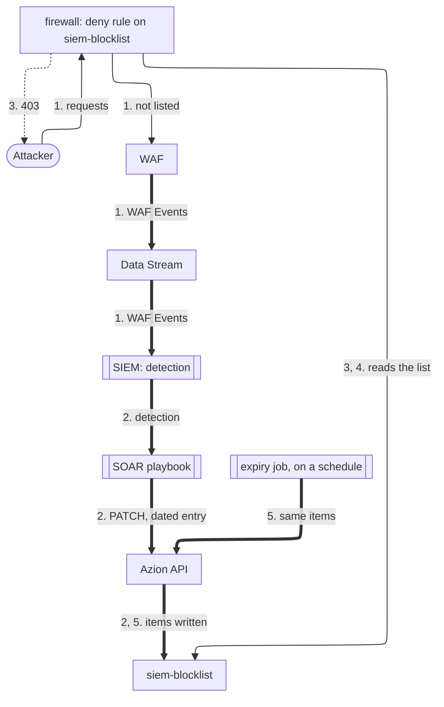

import FrameBox from '@aziontech/webkit/frame-box'
import ItemList from '@aziontech/webkit/item-list'
import DocItem from '@aziontech/webkit/doc-item'

This design serves SOC teams that detect threats in a SIEM but block by hand, so attackers keep reaching applications between detection and block. [Data Stream](/en/documentation/platform/data-stream/) sends the events of the [firewall](/en/documentation/platform/firewall/) and its [WAF](/en/documentation/platform/firewall/#waf) to the SIEM, where a detection starts a SOAR playbook. The playbook adds the attacker's address to a network list in [Network Shield](/en/documentation/platform/firewall/#network-shield) through the [Azion API](https://api.azion.com/) or the [Terraform Provider](/en/documentation/devtools/terraform/). Firewall rules that reference the list block the next requests, and an expiry job removes stale entries. The design implements the use case [Block attackers automatically from SIEM detections](/en/documentation/use-cases/secure-applications-and-networks/block-attackers-automatically-from-siem-detections/).

## Architecture diagram

Solid arrows carry the request, dotted arrows carry the response, and thick arrows carry the loop, which runs apart from any request. Each label starts with the number of the dataflow step it belongs to.

### Dataflow

1. An attacker's requests reach the firewall. WAF scores them, and Data Stream sends the WAF events to the endpoint the SIEM reads.
2. A detection in the SIEM starts a SOAR playbook. The playbook reads `siem-blocklist`, adds the address with a due date and a comment, and writes the whole list back through the API.
3. The deny rule already reads `siem-blocklist`, so the next requests from that address receive `403` once the change reaches traffic, in about 100 seconds.
4. Rules on several firewalls can read the same list, so one write blocks the address on every application those firewalls protect.
5. An expiry job writes the items of the list back on a schedule. Each write drops the entries whose due date has passed, which ends those blocks.

The deny rule reads `siem-blocklist` before WAF runs, so a new entry changes what the firewall blocks without a change to any rule, and WAF does not score the requests of a listed address.

## Components

- **Data Stream**: exports the WAF events of the firewall to the endpoint the SIEM reads. The loop starts there.
- **SIEM or SOAR**: the integration that holds the detection logic and runs the playbook. The playbook turns one detection into one write to the list, and the detection logic stays in the team's SIEM.
- **API and Terraform Provider**: the interfaces through which automation changes the list. A `PATCH` that sends `items` replaces the whole array, so the playbook reads the list before it writes. The Terraform Provider manages a network list as the `azion_network_list` resource.
- **Network Shield**: adds the _Network_ criterion, which compares each client address with a network list. An `ip_cidr` entry can carry a due date and a comment, which record when its block ends and why the address is listed.
- **firewall**: the Platform Resource that enforces the block. Its deny rule on the list holds the first position, so a listed address is refused before WAF scores it. A change to a list reaches traffic in about 100 seconds, and a new rule in 6 to 10 minutes. The loop therefore changes data, never rules.
- **WAF**: the event source. Its scores, matched rules, and actions are what the detections in the SIEM read.

## Implementation

- [Block attackers automatically from SIEM detections](/en/documentation/use-cases/secure-applications-and-networks/block-attackers-automatically-from-siem-detections/) - builds this design end to end, with the list, the deny rule, the read and the write of the playbook, the expiry job, and the checks for each.
- [WAF quickstart](/en/documentation/platform/firewall/waf/quickstart/) - applies a WAF rule set to the firewall, the source of the events the SIEM reads.
- [Stream WAF events to a SIEM](/en/documentation/guides/application-security/firewall-and-waf/integrate-siems/) - creates the stream of WAF events that the detections read, and confirms that the endpoint of the SIEM accepts it.
- [Block addresses until a date](/en/documentation/guides/application-security/bots-and-network/temporary-block/) - creates the network list with its first entry, and the rule that denies every address in it.
- [Change the order of firewall rules](/en/documentation/guides/application-security/bots-and-network/change-the-order-of-firewall-rules/) - moves the deny rule above the rule that applies WAF.
- [Update a network list from an automation](/en/documentation/guides/application-security/bots-and-network/update-network-list-from-automation/) - sends the read and the write that add a dated entry, and the scheduled write that drops expired ones.

## Related resources

<FrameBox>
<ItemList>
  <DocItem title="Network Lists" href="/en/documentation/platform/firewall/network-shield/network-lists/">The list types, the due date and the comment on an entry, and the errors a write can return.</DocItem>
  <DocItem title="Security resources" href="/en/documentation/devtools/terraform/security/">The arguments of `azion_network_list`, for a list that the Terraform Provider manages.</DocItem>
  <DocItem title="Real-Time Events data sources" href="/en/documentation/platform/real-time-events/data-sources/#http-requests">The HTTP Requests data source, where the first `403` for a listed address shows how long the loop took.</DocItem>
  <DocItem title="Bot-scoring perimeter for authentication flows" href="/en/documentation/use-cases/secure-applications-and-networks/online-fraud-prevention/">A design whose Bot Manager decisions on login, signup, and checkout also reach the SIEM.</DocItem>
</ItemList>
</FrameBox>
