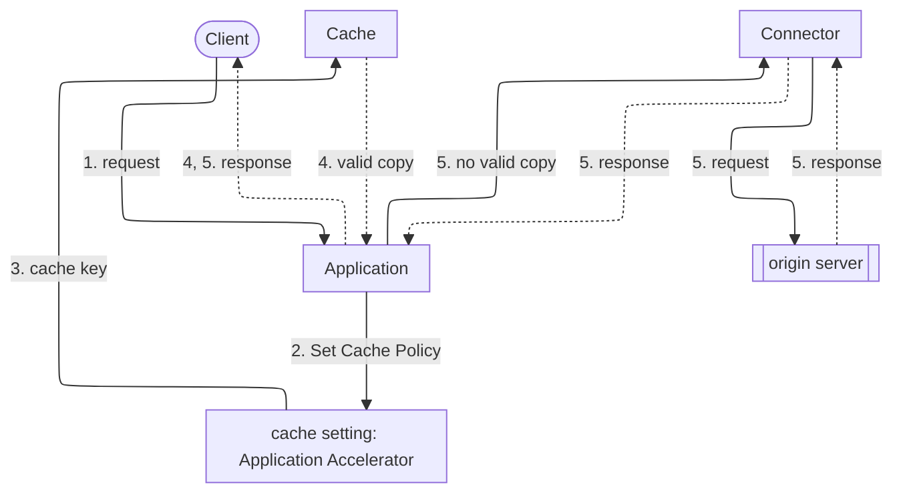

import DocButton from '~/components/webkit/DocButton.vue'
import DocCardGroup from '@aziontech/webkit/doc-card-group'
import DocCard from '@aziontech/webkit/doc-card'

**Application Accelerator** is a Platform Resource that unlocks four cache and rule capabilities on Azion's distributed infrastructure, for the requests received by an [Application](/en/documentation/platform/applications/). With it, an Application can vary the cache key by query string, cookie, [device group](/en/documentation/platform/applications/device-groups/), or request method, and cache `POST` and `OPTIONS` responses. Its cache settings accept a shorter minimum time to live (TTL), and its rules can use [Rules Engine](/en/documentation/platform/applications/rules-engine/) behaviors and variables reserved to Application Accelerator. Use Application Accelerator to cache a cookie-personalized page, a query-string API response, or a per-device catalog.

<DocButton href="/en/documentation/platform/applications/application-accelerator/quickstart/" label="Quickstart" size="medium" />
<DocButton href="/en/documentation/platform/applications/application-accelerator/reference/" label="Application Accelerator reference" kind="outlined" size="medium" />

---

## Request path

Turning on Application Accelerator leaves every cache key as it was: a variation applies only through a [Set Cache Policy](/en/documentation/platform/applications/rules-engine/#set-cache-policy) rule. That rule applies the cache setting that holds the variation to the requests it matches. A [cache setting](/en/documentation/platform/applications/cache/cache-settings/), the set of values that tell [Cache](/en/documentation/platform/applications/cache/) how to store and serve a response and for how long, holds its variations in its own `modules.application_accelerator` object.

A cache key is the index entry for a cached object. By default, Azion builds it from the scheme, the host, and the path of the request, so each path is one object in cache. Unless a cache setting varies the key by query string, every query string of a path maps to that one object. Each variation a cache setting turns on appends its input to the key with a marker, as [Cache keys](/en/documentation/platform/applications/cache/cache-keys/#key-format) details.

A request that uses any method other than `GET` or `HEAD` is a complex request, and its key carries the method as a prefix.

Solid arrows carry the request, and dotted arrows carry the response. Each label starts with the number of its step below.

1. The request reaches the Application with its scheme, host, path, and query string.
2. A _Set Cache Policy_ rule applies a cache setting to the request.
3. Cache builds the key from the request and from each variation in the cache setting.
4. When Cache holds a valid copy under that key, that copy becomes the response.
5. Otherwise, the [Connector](/en/documentation/platform/connectors/) routes the request to the origin server, and Cache stores the response under that key.

Two requests share a copy when they produce the same key, and they get separate copies when they do not.

For what turning on Application Accelerator unlocks, the cost of a variation, and purges, refer to [Cache variation](/en/documentation/platform/applications/application-accelerator/cache-variation/). That page also compares _Bypass Cache_ with a TTL of 0.

---

## Next steps

<DocCardGroup cols={2}>
  <DocCard title="Quickstart" href="/en/documentation/platform/applications/application-accelerator/quickstart/" label="Cache a listing that varies by one query-string argument." />
  <DocCard title="Cache variation" href="/en/documentation/platform/applications/application-accelerator/cache-variation/" label="See what a variation costs, how a purge reaches its copies, and how a TTL of 0 differs from Bypass Cache." />
  <DocCard title="Application Accelerator settings" href="/en/documentation/platform/applications/application-accelerator/settings/" label="Look up a variation control, an HTTP method, or a behavior that Application Accelerator unlocks." />
  <DocCard title="Guides and tutorials" href="/en/documentation/platform/applications/guides/" label="Complete a specific task, from an Advanced Cache Key to a cached POST response." />
  <DocCard title="Best practices" href="/en/documentation/platform/applications/best-practices/#application-accelerator" label="Choose the arguments and cookies that vary the key, and sort the query string." />
  <DocCard title="Limits" href="/en/documentation/platform/applications/limits/#application-accelerator" label="Look up the scope of Application Accelerator, a TTL bound, and the answer past it." />
  <DocCard title="Troubleshooting" href="/en/documentation/platform/applications/troubleshooting/#application-accelerator" label="Find the cause when the copies of a variation survive a purge, or a behavior cannot be selected." />
  <DocCard title="Glossary" href="/en/documentation/platform/applications/glossary/" label="Look up a term the Application Accelerator pages use, such as Advanced Cache Key." />
</DocCardGroup>
