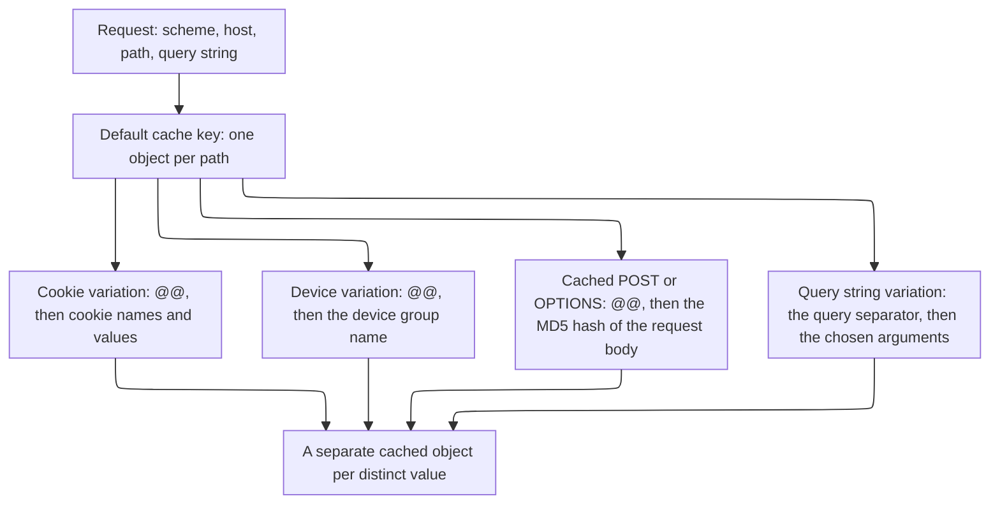

import DocButton from '~/components/webkit/DocButton.vue'
import DocCardGroup from '@aziontech/webkit/doc-card-group'
import DocCard from '@aziontech/webkit/doc-card'

A cache files each stored response under a key built from the request. When that key holds only the URL, every request for the URL receives the same copy. That copy is wrong for content that changes with a cookie, a device, or an argument. Adding that input to the key gives each of its values a copy of its own. One URL then holds several correct responses, and no visitor receives the response meant for another.

**Application Accelerator** puts those inputs into the cache key on an [application](/en/documentation/platform/applications/): a query-string argument, a cookie, the device group, or the request method. Its switch in **Main Settings** › **Modules** turns it on for that application alone. A cache setting then names the inputs that vary its copies, and a _Set Cache Policy_ rule applies that setting to the requests it matches. Use Application Accelerator to cache a personalized page, an API response that changes with a query string, a catalog that differs by device, or a response to a `POST`.

<DocButton href="/en/documentation/platform/applications/application-accelerator/quickstart/" label="Quickstart" size="medium" />
<DocButton href="/en/documentation/platform/applications/application-accelerator/settings/" label="Application Accelerator reference" kind="secondary" size="medium" />

---

## Cache setting structure

Application Accelerator acts through the `modules.application_accelerator` object of a cache setting, which [Azion Console](https://console.azion.com) shows as the **Application Accelerator** section of the setting. This cache setting keeps a product listing for 30 seconds and gives each value of its `category` argument a copy of its own, sent as the body of `POST /v4/workspace/applications/<application-id>/cache_settings`:

```json
{
  "name": "product-listing",
  "browser_cache": { "behavior": "honor" },
  "modules": {
    "cache": {
      "behavior": "override",
      "max_age": 30
    },
    "application_accelerator": {
      "cache_vary_by_querystring": {
        "behavior": "allowlist",
        "fields": ["category"],
        "sort_enabled": true
      }
    }
  }
}
```

- `modules.application_accelerator` holds the four **Cache vary by** controls: `cache_vary_by_querystring`, `cache_vary_by_cookies`, `cache_vary_by_devices`, and `cache_vary_by_method`. A control the body leaves out keeps its default, `ignore`, or an empty list for the methods.
- `behavior` takes `ignore`, `all`, `allowlist`, or `denylist`, and the device control takes `ignore` or `allowlist`. Here, `allowlist` varies the key only by the arguments in `fields`, and `sort_enabled` groups every order of them under one key.
- `max_age` set to `30` is accepted only while Application Accelerator is on. Without it, the floor is 60 seconds, and [Azion API](https://api.azion.com/) refuses a lower value with `21021`.
- The switch belongs to the application, not to the cache setting. `PATCH /v4/workspace/applications/<application-id>` turns it on with `{ "modules": { "application_accelerator": { "enabled": true } } }`, and while it is off, the API refuses any field of `modules.application_accelerator` with `21013`.

If you configured a `Vary` header or a cache-key rule elsewhere, the model transfers. You name the inputs that make two requests different, and each distinct value gets its own copy.

---

## Request path

A cache key is the index entry for a cached object. By default, Azion builds it from the scheme, the host, and the path of the request, so each path is one object in cache. While the query-string control stays at its default, `ignore`, a query string does not split that object. Each variation a cache setting turns on adds one input to the key, and each kind appends its own marker:

- A cookie variation appends the `@@` separator, then the names and values of the cookies, each followed by `;`.
- A device variation appends `@@` and the name of the device group.
- A cached `POST` or `OPTIONS` response appends `@@` and the MD5 hash of the request body.
- A query-string variation appends the query separator and the chosen arguments, in the order the request submitted them. The arguments are already part of the URL, so this variation needs no `@@`.

A request that uses any method other than `GET` or `HEAD` is a complex request, and its key carries the method as a prefix. This diagram shows what the default key is built from and what each variation adds to it:



A cookie variation on a `user` cookie produces a key shaped like `httpwww.example.com/@@user=user;`. For a cached `POST`, the key is shaped like `httpsdynamic.example.com/path@@md5_of_post_arguments`. Two requests share a cached object when they produce the same key, and they get separate objects when they do not. For the full format and every input a key carries, refer to [Cache keys](/en/documentation/platform/applications/cache/cache-keys/#key-format).

For what the switch unlocks, the cost of a variation, purges, and how _Bypass Cache_ differs from a time to live (TTL) of 0, refer to [Cache variation](/en/documentation/platform/applications/application-accelerator/cache-variation/).

---

## Scope and limits

- **Application**: the switch is off on a new application, and it belongs to the application, so one application can carry it while another does not. Turning it on changes no traffic by itself. The controls of a cache setting start at `ignore`, and a cache setting reaches a request only through a [Set Cache Policy](/en/documentation/platform/applications/rules-engine/#set-cache-policy) rule. For the switch, refer to [Main Settings](/en/documentation/platform/applications/main-settings/#products).
- **What the switch unlocks**: cache variation, the caching of `POST` and `OPTIONS` responses, and a **Max Age** as low as 0 seconds. It also unlocks seven more Rules Engine behaviors and the `${request_uri}` and `${device_group}` variables, and an application takes all of these or none. The behaviors are _Add Cookie_, _Bypass Cache_, _Capture Match Groups_, _Filter Request Cookie_, _Forward Cookies_, _Rewrite Request_, and _Run Function_. Beyond the `GET` and `HEAD` an application accepts natively, the switch adds `OPTIONS`, `POST`, `PUT`, `PATCH`, and `DELETE`. Of those, only `POST` and `OPTIONS` responses can be cached.
- **Variation size**: each distinct value of a varied input is a separate cached object. A cookie unique to each visitor gives every visitor a copy, so the number of objects grows with the audience instead of with the content. For how an allowlist and **Sort** bound that number, refer to [Cache variation](/en/documentation/platform/applications/application-accelerator/cache-variation/#the-cost-of-a-variation), and for the practices, to [Applications best practices](/en/documentation/platform/applications/best-practices/#application-accelerator).
- **Purges**: cookie and device group variations survive a URL purge. A cache key purge reaches them, and so does a wildcard purge that ends the key with `@@*`. Query-string variations are the exception. A URL purge reaches them when it sends the arguments in the order they were presented, or in alphabetical order with **Sort** on. For the purge types, refer to [Real-Time Purge](/en/documentation/platform/applications/cache/real-time-purge/#purge-content-that-varies).
- **Bypass Cache and a TTL of 0**: [Bypass Cache](/en/documentation/platform/applications/rules-engine/#bypass-cache) sends each request its rule matches to the origin and caches nothing in Azion's cache. It does not reach the [Tiered Cache](/en/documentation/platform/applications/cache/tiered-cache/) layer. A **Max Age** of 0 seconds keeps the request on the cache path, so parallel requests for one object reach the origin as one request. For when to use each, refer to [Bypass Cache and a TTL of 0](/en/documentation/platform/applications/application-accelerator/cache-variation/#bypass-cache-and-a-ttl-of-0).
- **Neighbors**: Application Accelerator decides what goes into a key, and [Cache](/en/documentation/platform/applications/cache/) then keeps a separate copy for each value. Varying the cache on the `ims` string of [Image Processor](/en/documentation/platform/applications/image-processor/) needs Application Accelerator, while processing an image does not.
- **Interfaces**: you turn on the switch in Azion Console, through Azion API at `/v4/workspace/applications/<application-id>`, and with `azion update application --application-accelerator` in [Azion CLI](/en/documentation/devtools/cli/). [`azion.config.js`](/en/documentation/devtools/cli/azion-config-js/) sets it with `applicationAcceleratorEnabled`, and [Azion Lib](/en/documentation/devtools/azion-lib/application/) with `application_acceleration` on an update. [Azion Terraform Provider](/en/documentation/devtools/terraform/) manages the application resource that carries the switch. The variation controls belong to the cache setting, at `/v4/workspace/applications/<application-id>/cache_settings` or through `azion create cache-setting` flags such as `--cache-by-query-string` and `--cache-by-cookies`. No flag of `azion create cache-setting` sets device-group variation or the cache **Max Age**, so send them in a `--file` body.
- **Observability**: with `Pragma: azion-debug-cache` on a request, the `x-cache-key` header of the response shows what each variation added to the key. A `POST` reports `-` in `x-cache` until the cache setting names _POST_ in **Cache vary by Method**. To read the same headers in a browser, refer to [Verify cache indicators](/en/documentation/guides/application-performance/cache-and-purge/check-page-cache-time/).
- **Limits**: with Application Accelerator on, **Max Age** goes down to 0 seconds, or to 3 seconds when the cache setting also has Tiered Cache on. Turning it on can generate usage-related costs. For each TTL bound, the answer past it, and what each plan includes, refer to [Applications limits](/en/documentation/platform/applications/limits/#application-accelerator), and for the rates, to [Pricing](/en/documentation/fundamentals/pricing/#application-accelerator).
- **Terms**: the [Applications glossary](/en/documentation/platform/applications/glossary/) defines the words the Application Accelerator pages give a specific meaning, such as Advanced Cache Key, allowlist, denylist, and complex request.

---

## Next steps

<DocCardGroup cols={2}>
  <DocCard title="Quickstart" href="/en/documentation/platform/applications/application-accelerator/quickstart/" label="Cache a listing that varies by one query-string argument." />
  <DocCard title="Cache variation" href="/en/documentation/platform/applications/application-accelerator/cache-variation/" label="See what a variation costs, how a purge reaches it, and how a TTL of 0 differs from Bypass Cache." />
  <DocCard title="Application Accelerator settings" href="/en/documentation/platform/applications/application-accelerator/settings/" label="Look up a variation control, an HTTP method, or a behavior the switch unlocks." />
  <DocCard title="Guides and tutorials" href="/en/documentation/platform/applications/guides/" label="Complete a specific task, from an Advanced Cache Key to a cached POST response." />
  <DocCard title="Limits" href="/en/documentation/platform/applications/limits/#application-accelerator" label="Look up a TTL bound, the answer past it, or what a plan includes." />
  <DocCard title="Troubleshooting" href="/en/documentation/platform/applications/troubleshooting/#application-accelerator" label="Find the cause when a variation survives a purge, or a behavior cannot be selected." />
</DocCardGroup>
