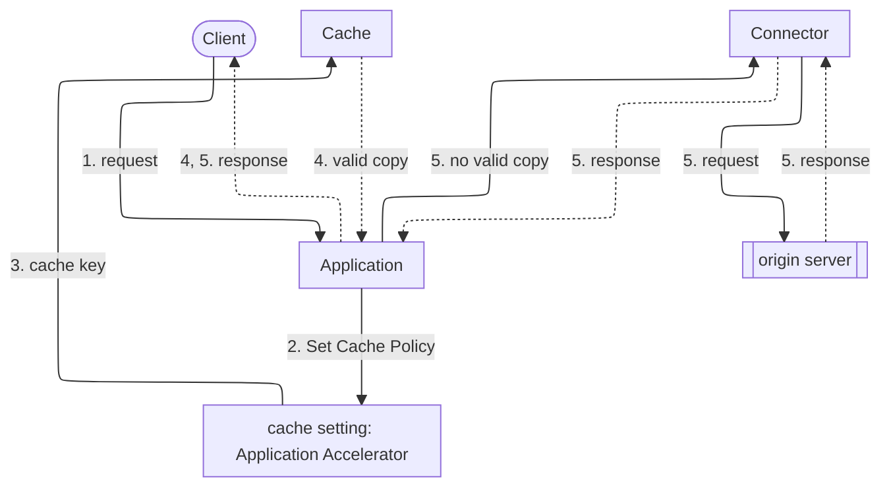

import DocButton from '~/components/webkit/DocButton.vue'
import DocCardGroup from '@aziontech/webkit/doc-card-group'
import DocCard from '@aziontech/webkit/doc-card'

**Application Accelerator** is a Platform Resource that unlocks four capabilities for the cache and the rules of an [Application](/en/documentation/platform/applications/). With Application Accelerator on, an Application can add more parts of the request to the cache key, cache `POST` and `OPTIONS` responses, and keep a response in cache for less than 60 seconds. Its rules can also use more [Rules Engine](/en/documentation/platform/applications/rules-engine/) behaviors, such as _Bypass Cache_ and _Forward Cookies_, and two more variables.

A cache files each stored response under a key built from the request. When that key holds only the URL, every visitor who requests the URL gets the same copy, even when the content changes with a cookie, a device, or an argument. Adding one of those inputs to the key gives each of its values a copy of its own. One URL then holds several correct responses, and each visitor receives the one that matches their request.

In an Application with Application Accelerator on, the key can take four inputs: a query-string argument, a cookie, the device group, and the request method. A [device group](/en/documentation/platform/applications/device-groups/) is a name and a regular expression that the Application compares with the `User-Agent` header of each request.

Application Accelerator is off in a new Application, and each Application turns it on separately, in the Application's `modules.application_accelerator.enabled` field in the API. Each [cache setting](/en/documentation/platform/applications/cache/cache-settings/) of the Application holds how long a response stays in cache. It also sets which inputs vary the key, in its own `modules.application_accelerator` object. Then a [rule](/en/documentation/platform/applications/rules-engine/) with the [Set Cache Policy](/en/documentation/platform/applications/rules-engine/#set-cache-policy) behavior applies the cache setting to the requests the rule matches. Use Application Accelerator to cache separate copies of a page personalized by a cookie, an API response that changes with its query string, a catalog that differs by device, or a `POST` response.

<DocButton href="/en/documentation/platform/applications/application-accelerator/quickstart/" label="Quickstart" size="medium" />
<DocButton href="/en/documentation/platform/applications/application-accelerator/settings/" label="Application Accelerator reference" kind="secondary" size="medium" />

---

## Cache setting structure

A cache setting holds the inputs that vary the cache key in its `modules.application_accelerator` object, which [Azion Console](https://console.azion.com) shows as the **Application Accelerator** section of the setting only while Application Accelerator is on in the Application. This cache setting keeps a product listing for 30 seconds and gives each value of its `category` argument a copy of its own. Send it as the body of `POST /v4/workspace/applications/<application-id>/cache_settings`:

```json
{
  "name": "product-listing",
  "browser_cache": { "behavior": "honor" },
  "modules": {
    "cache": {
      "behavior": "override",
      "max_age": 30
    },
    "application_accelerator": {
      "cache_vary_by_querystring": {
        "behavior": "allowlist",
        "fields": ["category"],
        "sort_enabled": true
      }
    }
  }
}
```

- `modules.application_accelerator` holds the four variation controls: `cache_vary_by_querystring`, `cache_vary_by_cookies`, `cache_vary_by_devices`, and `cache_vary_by_method`. A control the body leaves out keeps its default, `ignore`, or an empty list for the methods.
- `behavior` takes `ignore`, `all`, `allowlist`, or `denylist`, and the device control takes `ignore` or `allowlist`. Here, `allowlist` varies the key only by the arguments in `fields`, and `sort_enabled` groups every order of them under one key.
- `max_age` set to `30` is accepted only while Application Accelerator is on. Without it, the floor is 60 seconds, and [Azion API](https://api.azion.com/) refuses a lower value with `21021`.
- The Application carries a `modules.application_accelerator` object of its own, and its `enabled` field turns Application Accelerator on. `PATCH /v4/workspace/applications/<application-id>` sets it with `{ "modules": { "application_accelerator": { "enabled": true } } }`. While that field is `false`, the API refuses with `21013` a cache setting that varies the cache: a query-string, cookie, or device-group variation whose `behavior` is not `ignore`, or a method in `cache_vary_by_method`.

If you configured a `Vary` header or a cache-key rule elsewhere, the model transfers. You name the inputs that make two requests different, and each distinct value gets its own copy. Only the four variation controls set those inputs, so a request header such as `Accept-Language` cannot vary the key.

---

## Request path

A cache key is the index entry for a cached object. By default, Azion builds it from the scheme, the host, and the path of the request, so each path is one object in cache. While the query-string control stays at its default, `ignore`, every query string of a path maps to that one object. Each variation a cache setting turns on adds one input to the key, and each kind appends its own marker:

- A cookie variation appends the `@@` separator, then the names and values of the cookies, each followed by `;`.
- A device variation appends `@@` and the name of the device group.
- A cached `POST` response appends `@@` and the MD5 hash of the request body. A cached `OPTIONS` response adds only its method prefix.
- A query-string variation under `allowlist` or `denylist` appends `@@`, then `?` and the chosen arguments. Under `all`, the whole query string follows the path, before `@@`.

A request that uses any method other than `GET` or `HEAD` is a complex request, and its key carries the method as a prefix.

Solid arrows carry the request, and dotted arrows carry the response. Each label starts with the number of its step below.



1. The request reaches the Application with its scheme, host, path, and query string.
2. A _Set Cache Policy_ rule applies a cache setting to the request.
3. The key starts with the scheme, the host, and the path. Each variation in the cache setting's `modules.application_accelerator` object then appends its input, with the marker that this section lists for it.
4. When [Cache](/en/documentation/platform/applications/cache/) holds a valid copy under that key, that copy becomes the response.
5. Otherwise, the [Connector](/en/documentation/platform/connectors/) routes the request to the origin server, and Cache stores the response under that key.

A cookie variation on a `user` cookie produces a key shaped like `httpwww.example.com/@@user=user;`. For a cached `POST`, the key is shaped like `posthttpsdynamic.example.com/path@@md5_of_post_body`. Two requests share a cached object when they produce the same key, and they get separate objects when they do not. For the full format and every input a key carries, refer to [Cache keys](/en/documentation/platform/applications/cache/cache-keys/#key-format).

For what turning on Application Accelerator unlocks, the cost of a variation, and purges, refer to [Cache variation](/en/documentation/platform/applications/application-accelerator/cache-variation/). That page also compares _Bypass Cache_ with a time to live (TTL) of 0.

---

## Scope and limits

- **Application**: Application Accelerator is off in a new Application, and it belongs to the Application, so one Application can have it on while another has it off. Turning it on leaves traffic as it was: the controls of a cache setting start at `ignore`, and a cache setting reaches a request only through a [Set Cache Policy](/en/documentation/platform/applications/rules-engine/#set-cache-policy) rule. [Main Settings](/en/documentation/platform/applications/main-settings/#platform-resources) shows where to turn it on in Azion Console and the API.
- **What Application Accelerator unlocks**: cache variation, the caching of `POST` and `OPTIONS` responses, and a Max Age, the cache setting's `modules.cache.max_age` field, as low as 0 seconds. It also unlocks Rules Engine behaviors and the `${request_uri}` and `${device_group}` variables, and an Application takes all of these or none. The behaviors are _Add Request Cookie_ and _Add Response Cookie_, _Bypass Cache_, _Capture Match Groups_, _Filter Request Cookie_ and _Filter Response Cookie_, _Forward Cookies_, and _Rewrite Request_. An Application passes `POST`, `PUT`, `PATCH`, `DELETE`, and `OPTIONS` to the origin with or without Application Accelerator. Of those methods, Application Accelerator makes only the `POST` and `OPTIONS` responses cacheable.
- **Variation size**: each distinct value of a varied input is a separate cached object. A cookie unique to each visitor gives every visitor a copy, so the number of objects grows with the audience instead of with the content. For how an allowlist and sorting, the `sort_enabled` field, bound that number, refer to [Cache variation](/en/documentation/platform/applications/application-accelerator/cache-variation/#the-cost-of-a-variation), and for the practices, to [Applications best practices](/en/documentation/platform/applications/best-practices/#application-accelerator).
- **Purges**: cookie and device group variations survive a URL purge. A cache key purge reaches them, and so does a wildcard purge that ends the key with `@@*`. Query-string variations are the exception. A URL purge reaches them when it sends the arguments in the order they were presented, or in alphabetical order with `sort_enabled` on. For the purge types, refer to [Real-Time Purge](/en/documentation/platform/applications/cache/real-time-purge/#purge-content-that-varies).
- **Bypass Cache and a TTL of 0**: [Bypass Cache](/en/documentation/platform/applications/rules-engine/#bypass-cache) sends each request that its rule matches to the origin and keeps the response out of Azion's cache. It acts on Azion's cache only, so the [Tiered Cache](/en/documentation/platform/applications/cache/tiered-cache/) layer keeps caching objects for an Application whose cache settings turn Tiered Cache on. A Max Age of 0 seconds keeps the request on the cache path, and every request still reaches the origin. For how the two compare, refer to [Bypass Cache and a TTL of 0](/en/documentation/platform/applications/application-accelerator/cache-variation/#bypass-cache-and-a-ttl-of-0).
- **Neighbors**: with Application Accelerator on, the variation controls of a cache setting decide what goes into a key, and [Cache](/en/documentation/platform/applications/cache/) then keeps a separate copy for each value. To vary the cache on the `ims` string of [Image Processor](/en/documentation/platform/applications/image-processor/), add `ims` to the query-string allowlist of the cache setting that serves images.
- **Interfaces**: you turn on Application Accelerator in Azion Console, through Azion API at `/v4/workspace/applications/<application-id>`, and with `azion update application --application-accelerator` in [Azion CLI](/en/documentation/devtools/cli/). [`azion.config.js`](/en/documentation/devtools/cli/azion-config-js/) sets it with `applicationAcceleratorEnabled`, and [Azion Lib](/en/documentation/devtools/azion-lib/application/) with `application_acceleration` on an update. [Azion Terraform Provider](/en/documentation/devtools/terraform/) manages the Application resource that carries the switch. The variation controls belong to the cache setting, at `/v4/workspace/applications/<application-id>/cache_settings` or through `azion create cache-setting` flags such as `--cache-by-query-string` and `--cache-by-cookies`. `azion create cache-setting` takes device-group variation and the cache Max Age only in a `--file` body.
- **Observability**: with `Pragma: azion-debug-cache` on a request, the `x-cache-key` header of the response shows what each variation added to the key. A `POST` reports `-` in `x-cache` until the `cache_vary_by_method` field of the cache setting carries `post`. To check the cache status of one response, refer to [Check the cache status of a response](/en/documentation/guides/application-performance/cache-and-purge/check-page-cache-time/).
- **Limits**: with Application Accelerator on, the Max Age of a cache setting goes down to 0 seconds, or to 3 seconds when the cache setting also has Tiered Cache on. Turning it on can generate usage-related costs. For each TTL bound and the answer past it, refer to [Applications limits](/en/documentation/platform/applications/limits/#application-accelerator), and for the rates, to [Pricing](/en/documentation/fundamentals/pricing/#application-accelerator). [Azion pricing](https://www.azion.com/en/pricing/) lists what each plan includes.
- **Terms**: the [Applications glossary](/en/documentation/platform/applications/glossary/) defines the words the Application Accelerator pages give a specific meaning, such as Advanced Cache Key, cache variation, and device group.

---

## Next steps

<DocCardGroup cols={2}>
  <DocCard title="Quickstart" href="/en/documentation/platform/applications/application-accelerator/quickstart/" label="Cache a listing that varies by one query-string argument." />
  <DocCard title="Cache variation" href="/en/documentation/platform/applications/application-accelerator/cache-variation/" label="See what a variation costs, how a purge reaches it, and how a TTL of 0 differs from Bypass Cache." />
  <DocCard title="Application Accelerator settings" href="/en/documentation/platform/applications/application-accelerator/settings/" label="Look up a variation control, an HTTP method, or a behavior that Application Accelerator unlocks." />
  <DocCard title="Guides and tutorials" href="/en/documentation/platform/applications/guides/" label="Complete a specific task, from an Advanced Cache Key to a cached POST response." />
  <DocCard title="Limits" href="/en/documentation/platform/applications/limits/#application-accelerator" label="Look up a TTL bound and the answer past it." />
  <DocCard title="Troubleshooting" href="/en/documentation/platform/applications/troubleshooting/#application-accelerator" label="Find the cause when a variation survives a purge, or a behavior cannot be selected." />
</DocCardGroup>
