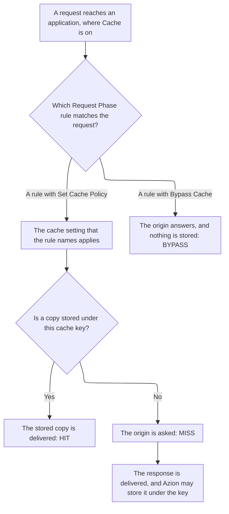

import DocButton from '~/components/webkit/DocButton.vue'
import DocCardGroup from '@aziontech/webkit/doc-card-group'
import DocCard from '@aziontech/webkit/doc-card'

A cache keeps a copy of a response, so that the server that holds the content, the origin, does not answer every request for it. The first request for an object reaches the origin, and the cache stores the answer under a key built from the request. Later requests that produce the same key get the stored copy until its time to live (TTL) ends. The origin then answers only the first request and the requests that arrive after the copy expires.

**Cache** keeps those copies for an [application](/en/documentation/platform/applications/), in the data center that fetched each response. It is on in every new application, and it stores the responses of the requests that a Request Phase rule with the _Set Cache Policy_ behavior matches. That rule names a cache setting, the object that holds the TTLs. Use Cache to keep static files near your users, serve large videos in fragments, answer while the origin is down, or remove a copy when the origin changes.

<DocButton href="/en/documentation/platform/applications/cache/quickstart/" label="Quickstart" size="medium" />
<DocButton href="/en/documentation/platform/applications/cache/cache-settings/" label="Cache reference" kind="secondary" size="medium" />

---

## Cache setting structure

Cache acts through a cache setting, which holds how long Azion and the browser keep a copy, and what Azion does with the copy around that time. This cache setting keeps each response for 300 seconds in Azion's cache and for one day in the browser, sent as the body of `POST /v4/workspace/applications/<application-id>/cache_settings`:

```json
{
  "name": "static-assets",
  "browser_cache": { "behavior": "override", "max_age": 86400 },
  "modules": {
    "cache": {
      "behavior": "override",
      "max_age": 300,
      "stale_cache": { "enabled": true },
      "large_file_cache": { "enabled": true, "offset": 1024 },
      "tiered_cache": { "enabled": true, "topology": "nearest-region" }
    }
  }
}
```

- `browser_cache` decides what a visitor's browser keeps. `honor` forwards the `Cache-Control` and `Expires` headers the origin sends, `override` replaces them with `max_age`, in seconds, and `no-cache` turns browser caching off.
- `modules.cache` decides what Azion keeps. With `behavior` set to `override`, `max_age` replaces the headers of the origin. Under `honor`, Azion keeps those headers, and it keeps a response whose origin sends no TTL for a default TTL.
- `stale_cache`, `large_file_cache`, and `tiered_cache` turn on stale cache, fragments of 1,024 kB, and a second cache layer in the region that `topology` names. A body that leaves one out gets it off, and `tiered_cache` requires the `override` behavior.
- A cache setting caches nothing on its own: a Request Phase rule applies it with `{ "type": "set_cache_policy", "attributes": { "value": <cache-setting-id> } }`. [Azion Console](https://console.azion.com) builds the same setting from **+ Cache** on the **Cache Settings** tab of an application.

If you set `Cache-Control` headers at your origin, the model transfers: `honor` keeps them, and `override` replaces them.

---

## Request path

A request reaches a cached copy through a chain of objects. This diagram shows the chain, from the request to the stored copy or to the origin:



1. A Request Phase rule matches the request and applies a cache setting through _Set Cache Policy_.
2. Azion builds the cache key from the request and from every variation the setting names.
3. When a copy is stored under that key, the data center that received the request answers from it, and the response reports `HIT`.
4. Otherwise the request goes to the origin, the response reports `MISS`, and Azion may store the response for later requests.
5. The copy answers until its TTL ends, a purge removes it, or a rule sends the request past the cache.

A rule with _Bypass Cache_ sends its requests to the origin instead, nothing is stored, and the response reports `BYPASS`. The status comes back in the `x-cache` header of a response to a request sent with `Pragma: azion-debug-cache`. For every status and the debug headers, refer to [Cache keys](/en/documentation/platform/applications/cache/cache-keys/#cache-status).

For TTL and expiration, stale cache, Large File Optimization, cache keys and variations, Tiered Cache, and purge, refer to [Expiration and freshness](/en/documentation/platform/applications/cache/expiration-and-freshness/).

---

## Scope and limits

- **Application**: Cache is on in every new application, where `modules.cache.enabled` reads `true`. Its switch in [Main Settings](/en/documentation/platform/applications/main-settings/#products) › **Modules** carries the note `Automatically enabled in all accounts.` A new application has no cache settings and no rules, so Cache stores nothing until a _Set Cache Policy_ rule names a cache setting.
- **Expired copies**: with **Stale cache** on, Azion may serve an expired copy when a revalidation with the origin fails, and the response reports `STALE`. A setting created through [Azion API](https://api.azion.com/) or [Azion CLI](/en/documentation/devtools/cli/) has it off, while Azion Console turns it on for a new setting. For when an old page is better than an error, refer to [Applications best practices](/en/documentation/platform/applications/best-practices/#cache).
- **Large files**: **Large file optimization** caches a large object in fragments of 1,024 kB, each fetched when a user reaches it and stored under a key of its own. A purge of the file therefore has to name every fragment, or use a wildcard.
- **Tiered Cache**: [Tiered Cache](/en/documentation/platform/applications/cache/tiered-cache/) adds a second cache layer between Azion's cache and the origin, turned on per cache setting and included on every plan. A data center that holds no valid copy asks that layer before it asks the origin. It requires _Override cache behavior_ and a minimum TTL, and a _Bypass Cache_ rule does not reach it.
- **Keys and variation**: Azion builds the default [cache key](/en/documentation/platform/applications/cache/cache-keys/) from the scheme, the host, and the path. One path is therefore one stored object, and the query string stays out of the key. Varying a copy by query string, cookie, device group, or method takes [Application Accelerator](/en/documentation/platform/applications/application-accelerator/). [Image Processor](/en/documentation/platform/applications/image-processor/) adds the format of a converted image to the key.
- **Purge**: [Real-Time Purge](/en/documentation/platform/applications/cache/real-time-purge/) removes a stored copy before its TTL ends, by URL, by cache key, or by wildcard. Azion queues a purge after you confirm it, because the result takes time to propagate, and lists it in the purge history once it completes. A URL purge does not reach a copy that varies by cookie, device group, or image format.
- **Code**: Cache runs no code, so a function that reads and writes cached entries calls [Cache API](/en/documentation/devtools/runtime/api-reference/cache/) instead.
- **Interfaces**: you create cache settings on the **Cache Settings** tab of an application in Azion Console, through Azion API at `/v4/workspace/applications/<application-id>/cache_settings`, and with Azion CLI commands such as `azion create cache-setting`. [`azion.config.js`](/en/documentation/devtools/cli/azion-config-js/) declares a setting as an entry of its `cache` array, [Azion Lib](/en/documentation/devtools/azion-lib/application/) creates one with `createCacheSetting`, and [Azion Terraform Provider](/en/documentation/devtools/terraform/applications/) manages one with the `azion_application_cache_setting` resource. A purge is sent from **Real-Time Purge** in Azion Console, to `POST /v4/workspace/purge/<purge-type>`, or with `azion purge`.
- **Observability**: a request sent with `Pragma: azion-debug-cache` receives `x-cache`, which carries the cache status, and `x-cache-key`, which carries the key that indexes the copy. [Real-Time Metrics](/en/documentation/platform/real-time-metrics/) shows Cache and Tiered Cache traffic, and [Real-Time Events](/en/documentation/platform/real-time-events/) carries a Tiered Cache dataset.
- **Limits**: a single cached object can reach 10 GB. **Max Age** takes 60 seconds to one year, and down to 0 seconds with Application Accelerator. For every bound of a cache setting, a cached object, and a purge request, and what each plan includes, refer to [Applications limits](/en/documentation/platform/applications/limits/#cache), and for the rates, to [Pricing](/en/documentation/fundamentals/pricing/#cache).
- **Terms**: the [Applications glossary](/en/documentation/platform/applications/glossary/) defines the words the Cache pages give a specific meaning, such as cache setting, cache key, cache status, and stale cache.

---

## Next steps

<DocCardGroup cols={2}>
  <DocCard title="Quickstart" href="/en/documentation/platform/applications/cache/quickstart/" label="Cache your first path, and read the cache status of its response." />
  <DocCard title="Expiration and freshness" href="/en/documentation/platform/applications/cache/expiration-and-freshness/" label="See how long a copy lives, and what ends it early or keeps it past its TTL." />
  <DocCard title="Cache settings" href="/en/documentation/platform/applications/cache/cache-settings/" label="Look up a field of a cache setting, with its default in each interface." />
  <DocCard title="Guides and tutorials" href="/en/documentation/platform/applications/guides/" label="Complete a specific task, from a cache policy to a purge." />
  <DocCard title="Limits" href="/en/documentation/platform/applications/limits/#cache" label="Look up a bound, the answer past it, or what a plan includes." />
  <DocCard title="Troubleshooting" href="/en/documentation/platform/applications/troubleshooting/#cache" label="Find the cause when responses stay MISS, or a purge leaves a copy behind." />
</DocCardGroup>
