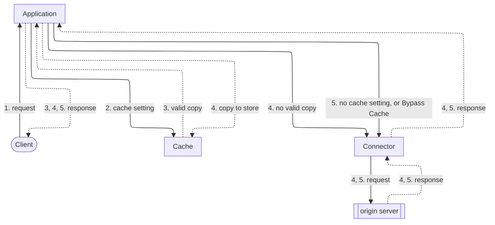

import DocButton from '~/components/webkit/DocButton.vue'
import DocCardGroup from '@aziontech/webkit/doc-card-group'
import DocCard from '@aziontech/webkit/doc-card'

**Cache** is a Platform Resource that stores copies of origin responses for your [Applications](/en/documentation/platform/applications/), in the data center that fetched each response. A cache is a store of response copies between clients and the origin, the server that holds the content. It answers repeated requests with those copies.

The first request for an object reaches the origin, and the cache stores the answer under a key built from the request. Later requests with the same key get the stored copy. The copy lasts until its time to live (TTL), a period in seconds, ends. The origin then answers only the first request and the requests that arrive after the copy expires.

Cache is on in every new Application. It stores only the responses that a [Rules Engine](/en/documentation/platform/applications/rules-engine/) rule selects with the _Set Cache Policy_ behavior. That rule applies a [cache setting](/en/documentation/platform/applications/cache/cache-settings/), which holds the TTLs and decides how Azion stores and varies each copy. Use Cache to keep static files in the data center nearest to your user, serve large videos in fragments with Large File Optimization, answer with an expired copy through stale cache while the origin is down, or remove a copy with [Real-Time Purge](/en/documentation/platform/applications/cache/real-time-purge/) when the origin changes.

<DocButton href="/en/documentation/platform/applications/cache/quickstart/" label="Quickstart" size="medium" />
<DocButton href="/en/documentation/platform/applications/cache/cache-settings/" label="Cache reference" kind="secondary" size="medium" />

---

## Cache setting structure

Cache acts through a cache setting. The setting holds how long Azion and the browser keep a copy, what Azion does with an expired copy, and what makes two requests different. To keep each response for 300 seconds in Azion's cache and for one day in the browser, send this cache setting as the body of `POST /v4/workspace/applications/<application-id>/cache_settings`:

```json
{
  "name": "static-assets",
  "browser_cache": { "behavior": "override", "max_age": 86400 },
  "modules": {
    "cache": {
      "behavior": "override",
      "max_age": 300,
      "stale_cache": { "enabled": true },
      "large_file_cache": { "enabled": true, "offset": 1024 },
      "tiered_cache": { "enabled": true, "topology": "nearest-region" }
    }
  }
}
```

- `browser_cache` decides what a visitor's browser keeps. `honor` forwards the `Cache-Control` and `Expires` headers of the origin. `override` replaces them with `max_age`, in seconds. `no-cache` turns browser caching off.
- `modules.cache` decides what Azion keeps. With `behavior` set to `override`, `max_age` replaces the headers of the origin. Under `honor`, Azion keeps those headers. When the origin sends no TTL, Azion keeps the response for the `max_age` of the setting.
- `stale_cache`, `large_file_cache`, and `tiered_cache` turn on stale cache, fragments of 1,024 kB, and a second cache layer in the region that `topology` names. Stale cache can serve an expired copy when Azion cannot confirm the copy with the origin. A body that leaves one of the three fields out gets that field off. `tiered_cache` also requires the `override` behavior.
- A cache setting acts only when a Request Phase rule applies it with `{ "type": "set_cache_policy", "attributes": { "value": <cache-setting-id> } }`. You can also build the same setting in Azion Console, as [Cache quickstart](/en/documentation/platform/applications/cache/quickstart/) shows.

If you set `Cache-Control` headers at your origin, the model transfers: `honor` keeps them, and `override` replaces them.

---

## Request path

Creating a cache setting caches nothing: a request reaches a stored copy only through a rule that applies the setting.

Solid arrows carry the request, and dotted arrows carry the response. Each label starts with the number of its step below.



1. The client's request reaches an Application, and the Application's Request Phase rules run in order.
2. When a _Set Cache Policy_ rule applies a cache setting, Cache builds the cache key from the request and from every variation the setting names.
3. When Cache holds a valid copy under that key, the data center that received the request answers from it. The response reports `HIT`.
4. Otherwise, the Connector that a _Set Connector_ rule sets routes the request to the origin, and the response reports `MISS`. Cache may store the response under the key for later requests.
5. When no rule applies a cache setting, or a _Bypass Cache_ rule matches, the request goes to the origin past Cache. _Bypass Cache_ requires [Application Accelerator](/en/documentation/platform/applications/application-accelerator/). With _Bypass Cache_, nothing is stored, and the response reports `BYPASS`.

A stored copy answers until its TTL ends or a purge removes it. The status comes back in the `x-cache` header of a response to a request sent with `Pragma: azion-debug-cache`. For every status and the debug headers, refer to [Cache keys](/en/documentation/platform/applications/cache/cache-keys/#cache-status).

For TTL and expiration, stale cache, Large File Optimization, cache keys and variations, Tiered Cache, and purge, refer to [Expiration and freshness](/en/documentation/platform/applications/cache/expiration-and-freshness/).

---

## Scope and limits

- **Application**: Cache is always on in an Application, in its `modules.cache.enabled` field in the API, which refuses `false` with `31001`. [Main Settings](/en/documentation/platform/applications/main-settings/#platform-resources) shows its switch locked on in Azion Console, with the note `Automatically enabled in all accounts.` A new Application has no cache settings and no rules, so Cache starts storing copies once a _Set Cache Policy_ rule applies a cache setting.
- **Expired copies**: with stale cache on, in the `modules.cache.stale_cache.enabled` field of a cache setting, Azion may serve an expired copy when it cannot confirm the copy with the origin. The response then reports `STALE`. A setting created through [Azion API](https://api.azion.com/) or [Azion CLI](/en/documentation/devtools/cli/) has it off, while Azion Console turns it on for a new setting. [Cache settings](/en/documentation/platform/applications/cache/cache-settings/#cache) shows where to change it in each interface. For when an old page is better than an error, refer to [Applications best practices](/en/documentation/platform/applications/best-practices/#cache).
- **Large files**: Large File Optimization, the `modules.cache.large_file_cache.enabled` field of a cache setting, caches a large object in fragments of 1,024 kB. It is off in a new cache setting. Each fragment is fetched when a user reaches it and stored under a key of its own, so a purge of the file has to name every fragment or use a wildcard.
- **Tiered Cache**: [Tiered Cache](/en/documentation/platform/applications/cache/tiered-cache/) is a Feature of Cache that adds a second cache layer between Azion's cache and the origin. Each cache setting turns it on in its `modules.cache.tiered_cache.enabled` field, and every plan includes it. A data center that holds no valid copy asks that layer before it asks the origin. Tiered Cache requires the `override` behavior and a minimum TTL. A _Bypass Cache_ rule acts on Azion's cache only, so the Tiered Cache layer keeps caching objects for the Max Age of the cache setting.
- **Keys and variation**: Azion builds the default [cache key](/en/documentation/platform/applications/cache/cache-keys/) from the scheme, the host, and the path, so one path is one stored object, and the query string stays out of the key. Varying a copy by query string, cookie, device group, or method takes [Application Accelerator](/en/documentation/platform/applications/application-accelerator/). [Image Processor](/en/documentation/platform/applications/image-processor/) adds the format of a converted image to the key.
- **Purge**: [Real-Time Purge](/en/documentation/platform/applications/cache/real-time-purge/) is a Platform Resource that removes a stored copy before its TTL ends, by URL, by cache key, or by wildcard. Azion queues a purge after you confirm it, because the result takes time to propagate. The purge history lists the purge once it completes. A copy that varies by cookie, device group, or image format survives a URL purge, and a cache key or wildcard purge reaches it.
- **Code**: code that reads and writes cached entries runs in a [Function](/en/documentation/platform/functions/) and calls [Cache API](/en/documentation/devtools/runtime/api-reference/cache/), because Cache itself cannot run code.
- **Interfaces**: you create cache settings on the **Cache Settings** tab of an Application in Azion Console, through Azion API at `/v4/workspace/applications/<application-id>/cache_settings`, and with Azion CLI commands such as `azion create cache-setting`. [`azion.config.js`](/en/documentation/devtools/cli/azion-config-js/) declares a setting as an entry of its `cache` array, [Azion Lib](/en/documentation/devtools/azion-lib/application/) creates one with `createCacheSetting`, and [Azion Terraform Provider](/en/documentation/devtools/terraform/applications/) manages one with the `azion_application_cache_setting` resource. A purge is sent from **Real-Time Purge** in Azion Console, to `POST /v4/workspace/purge/<purge-type>`, or with `azion purge`.
- **Observability**: a request sent with `Pragma: azion-debug-cache` receives two headers. `x-cache` carries the cache status, and `x-cache-key` carries the key of the copy. [Real-Time Metrics](/en/documentation/platform/real-time-metrics/) shows Cache and Tiered Cache traffic, and [Real-Time Events](/en/documentation/platform/real-time-events/) carries a Tiered Cache dataset.
- **Limits**: a single cached object can reach 10 GB. Max Age, the `modules.cache.max_age` field of a cache setting, takes 60 seconds to one year. With Application Accelerator on, Azion API accepts down to 0 seconds. For every bound of a cache setting, a cached object, and a purge request, refer to [Applications limits](/en/documentation/platform/applications/limits/#cache). For the rates, refer to [Pricing](/en/documentation/fundamentals/pricing/#cache), and for what each plan includes, to [Azion pricing](https://www.azion.com/en/pricing/).
- **Terms**: the [Applications glossary](/en/documentation/platform/applications/glossary/) defines the words the Cache pages give a specific meaning, such as cache setting, cache key, cache status, and stale cache.

---

## Next steps

<DocCardGroup cols={2}>
  <DocCard title="Quickstart" href="/en/documentation/platform/applications/cache/quickstart/" label="Cache your first path, and read the cache status of its response." />
  <DocCard title="Expiration and freshness" href="/en/documentation/platform/applications/cache/expiration-and-freshness/" label="See how long a copy lives, and what ends it early or keeps it past its TTL." />
  <DocCard title="Cache settings" href="/en/documentation/platform/applications/cache/cache-settings/" label="Look up a field of a cache setting, with its default in each interface." />
  <DocCard title="Guides and tutorials" href="/en/documentation/platform/applications/guides/" label="Complete a specific task, from a cache policy to a purge." />
  <DocCard title="Limits" href="/en/documentation/platform/applications/limits/#cache" label="Look up a bound and the answer past it." />
  <DocCard title="Troubleshooting" href="/en/documentation/platform/applications/troubleshooting/#cache" label="Find the cause when responses stay MISS, or a purge leaves a copy behind." />
</DocCardGroup>
