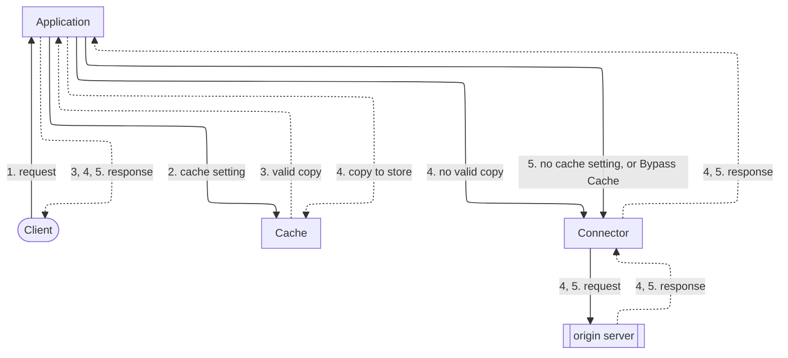

import DocButton from '~/components/webkit/DocButton.vue'
import DocCardGroup from '@aziontech/webkit/doc-card-group'
import DocCard from '@aziontech/webkit/doc-card'

**Cache** is a Platform Resource that stores copies of responses to the requests received by your [Applications](/en/documentation/platform/applications/), from the data center nearest to your user. A cache is a store of response copies, kept between clients and the origin server, that answers repeated requests without asking the origin. Cache can also remove stored copies on demand with [Real-Time Purge](/en/documentation/platform/applications/cache/real-time-purge/). Use Cache to serve static files, large videos in fragments, and expired copies during an origin outage.

In each Application, Cache can use these nested resources and features:

- [Real-Time Purge](/en/documentation/platform/applications/cache/real-time-purge/) lets you serve an update the origin already has before a copy's time to live (TTL) ends. Use it to remove an obsolete object, or to control what Azion serves for dynamic content.
- [Tiered Cache](/en/documentation/platform/applications/cache/tiered-cache/) lets an Application answer a cache miss from a second cache layer before the request reaches the origin. The origin then receives fewer requests and carries less load.

<DocButton href="/en/documentation/platform/applications/cache/quickstart/" label="Quickstart" size="medium" />
<DocButton href="/en/documentation/platform/applications/cache/reference/" label="Cache reference" kind="outlined" size="medium" />

---

## Request path

Creating a cache setting caches nothing: a request reaches a stored copy only through a rule that applies the setting. A cache setting is a set of values that tell Cache how to store and serve a response, such as its TTLs. Cache itself is on in every Application, so that rule is the one step a copy needs.

Solid arrows carry the request, and dotted arrows carry the response. Each label starts with the number of its step below.

1. The client's request reaches an Application, and the Application's Request Phase rules run in order.
2. When a rule with _Set Cache Policy_ applies a cache setting, Cache builds the cache key from the request and from every variation the setting names.
3. When Cache holds a valid copy under that key, the data center that received the request answers from it, because each copy stays in the data center that stored it. The response reports `HIT`.
4. Otherwise, the Connector that a rule with _Set Connector_ sets routes the request to the origin, and the response reports `MISS`. Cache may store the response under the key for later requests.
5. When no rule applies a cache setting, or a rule with _Bypass Cache_ matches, the request goes to the origin past Cache. _Bypass Cache_ requires [Application Accelerator](/en/documentation/platform/applications/application-accelerator/). With _Bypass Cache_, Azion's cache stores no copy, and the response reports `-` or `BYPASS` in `x-cache`.

A stored copy answers until its TTL, a period in seconds, ends. Cache stores a response whether the origin or a [Function](/en/documentation/platform/functions/) builds it. The status comes back in the `x-cache` header of a response to a request sent with `Pragma: azion-debug-cache`. For every status and the debug headers, refer to [Cache keys](/en/documentation/platform/applications/cache/cache-keys/#cache-status).

---

## Next steps

<DocCardGroup cols={2}>
  <DocCard title="Quickstart" href="/en/documentation/platform/applications/cache/quickstart/" label="Cache your first path, and read the cache status of its response." />
  <DocCard title="Expiration and freshness" href="/en/documentation/platform/applications/cache/expiration-and-freshness/" label="See how long a copy lives, and how stale cache, Large File Optimization, and purges change it." />
  <DocCard title="Cache settings" href="/en/documentation/platform/applications/cache/cache-settings/" label="Look up a field of a cache setting, with its default in each interface." />
  <DocCard title="Cache keys" href="/en/documentation/platform/applications/cache/cache-keys/" label="Read how a request becomes a cache key, and what each cache status means." />
  <DocCard title="Guides and tutorials" href="/en/documentation/platform/applications/guides/" label="Complete a specific task, from a cache policy to a purge." />
  <DocCard title="Limits" href="/en/documentation/platform/applications/limits/#cache" label="Look up a bound, the answer past it, and where Cache stops." />
  <DocCard title="Troubleshooting" href="/en/documentation/platform/applications/troubleshooting/#cache" label="Find the cause when responses stay MISS, or a purge leaves a copy behind." />
  <DocCard title="Glossary" href="/en/documentation/platform/applications/glossary/" label="Look up a word the Cache pages use in a specific sense, such as cache setting or stale cache." />
</DocCardGroup>
