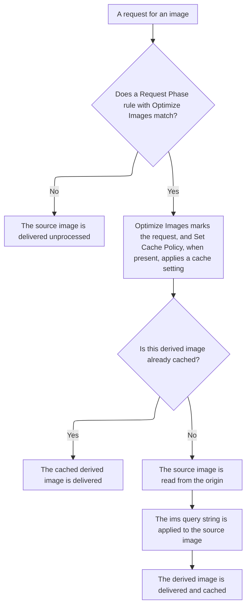

import DocButton from '~/components/webkit/DocButton.vue'
import DocCardGroup from '@aziontech/webkit/doc-card-group'
import DocCard from '@aziontech/webkit/doc-card'

Transforming an image on request builds each variant when a request asks for it, instead of ahead of time. The URL describes the variant, such as a width, a crop, a quality, or a format, and the server builds it from one original file. No variant has to be built, stored, or rebuilt ahead of time, because each one comes from that one original on request.

**Image Processor** builds that variant, the derived image, from the source image on the origin of an [application](/en/documentation/platform/applications/). The `ims` query string of the request describes it, such as `?ims=fit-in/400x400`, and the source image is never modified. It runs on the requests that a Request Phase rule with the _Optimize Images_ behavior hands it. Use Image Processor to deliver one image in several sizes, crops, qualities, or formats, such as WEBP for browsers that accept it, without a file per variant.

<DocButton href="/en/documentation/platform/applications/image-processor/quickstart/" label="Quickstart" size="medium" />
<DocButton href="/en/documentation/platform/applications/image-processor/url-parameters/" label="Image Processor reference" kind="secondary" size="medium" />

---

## Rule structure

Image Processor acts through a Request Phase rule that carries the _Optimize Images_ behavior. This rule hands every request for an image path to Image Processor and applies the cache setting that stores each derived image. It is sent as the body of `POST /v4/workspace/applications/<application-id>/request_rules`:

```json
{
  "name": "Optimize images",
  "description": "Apply the cache setting and optimize images",
  "active": true,
  "criteria": [
    [
      {
        "conditional": "if",
        "variable": "${request_uri}",
        "operator": "matches",
        "argument": "\\.(jpg|jpeg|gif|bmp|png|ico|webp|avif)"
      }
    ]
  ],
  "behaviors": [
    { "type": "set_cache_policy", "attributes": { "value": <cache-setting-id> } },
    { "type": "optimize_images" }
  ]
}
```

- `criteria` compares the path with a list of image extensions through `matches`. `${request_uri}` needs [Application Accelerator](/en/documentation/platform/applications/application-accelerator/), and `${uri}` matches the same paths without it.
- `optimize_images` takes no attributes and marks the request for Image Processor. It requires Image Processor on the application that runs the rule.
- `set_cache_policy` names the cache setting that stores each derived image. With `ims` in the allowlist of its **Cache vary by Query String** control, each distinct `ims` string gets a cache key of its own. That control needs Application Accelerator.
- Each request then carries its transformation in the URL, such as `?ims=400x`. A processed response carries `x-ims: Enabled`, and `x-original-image-size` carries the size of the source image before the transformation.

---

## Request path

A transformation does not happen because an `ims` query string is present. It happens because a Request Phase rule ran and applied the [Optimize Images](/en/documentation/platform/applications/rules-engine/#optimize-images) behavior to the request. Turning Image Processor on makes that behavior available, and it processes nothing on its own.

This diagram shows the chain from a request for an image to the derived image:



1. A request arrives for a path that holds an image.
2. The application runs its Request Phase rules. A rule for images matches on `${uri}`, or on `${request_uri}` with Application Accelerator on, against an argument such as `\.(jpg|jpeg|gif|bmp|png|ico|webp|avif)`.
3. A matching rule applies its behaviors. _Optimize Images_ marks the request for Image Processor, and _Set Cache Policy_, when the rule carries it, chooses the cache setting that holds the derived image. A rule can carry _Optimize Images_ alone, because the behavior takes no argument.
4. When the derived image is already cached, the cache delivers it, and no processing happens.
5. Otherwise, the source image is read from the origin, the `ims` query string is applied to it, and the result is delivered and stored.

Two consequences follow from step 2, and both surprise readers who expect the query string alone to do the work. A request that no rule matches is delivered unprocessed, even when it carries `ims`. When a rule matches a path that holds no image, it still runs, so the criteria decide which requests reach Image Processor. For the rule that sends image requests to Image Processor, refer to [Configure Image Processor on an application](/en/documentation/guides/application-performance/delivery-optimization/process-images/).

For how the delivered format is chosen, how the cache tells derived images apart, and where Image Processor stops, refer to [Image delivery](/en/documentation/platform/applications/image-processor/image-delivery/).

---

## Scope and limits

- **Application**: Image Processor is off on a new application, and turning it on processes nothing by itself. Its toggle in [Main Settings](/en/documentation/platform/applications/main-settings/#products) › **Modules** sets `modules.image_processor.enabled`, and a rule with _Optimize Images_ decides which requests reach it.
- **Operations**: one `ims` string can carry a resize, a crop, and a chain of filters. The operations are resize, crop, rotation, quality, watermark, format conversion, and fill, and `fit-in` fits an image inside an area without enlarging it. For the syntax and the values each one accepts, refer to [URL parameters](/en/documentation/platform/applications/image-processor/url-parameters/).
- **Parameter position**: `ims` must be the last parameter of the URL. A request with another query-string parameter after it may return `504`.
- **Formats**: Image Processor reads JPEG, GIF, PNG, BMP, ICO, WEBP, and AVIF. With no `ims` parameter, it converts an image to WEBP for a browser that supports it, and a BMP image to JPEG or WEBP. A conversion to WEBP or AVIF that a filter asks for needs `Accept: image/webp` or `Accept: image/avif`, which the _Add Request Header_ behavior can add. For how the delivered format is chosen, refer to [Image delivery](/en/documentation/platform/applications/image-processor/image-delivery/#format-negotiation).
- **Cache**: once `ims` is in the allowlist of the cache setting, each distinct `ims` string is a separate stored object. A page that asks for four fixed widths stores four objects, while a page that asks for arbitrary widths stores one per width. Once a derived image is in cache, it is delivered without processing. For the practices, refer to [Applications best practices](/en/documentation/platform/applications/best-practices/#image-processor).
- **Storage**: Image Processor stores no images and accepts no uploads. The source stays where it already lives, and no derived image becomes an asset of the account. A workflow that needs to keep a transformed file saves the response itself.
- **Neighbors**: [WASM Image Processor](/en/documentation/devtools/azion-lib/wasm-image-processor/) is a WebAssembly library that processes images inside a function on [Functions](/en/documentation/platform/functions/). It is a different surface with a different interface, and no setting of Image Processor configures it.
- **Interfaces**: you turn on Image Processor on the **Main Settings** tab of an application in [Azion Console](https://console.azion.com), and through [Azion API](https://api.azion.com/) at `/v4/workspace/applications/<application-id>`. [Azion CLI](/en/documentation/devtools/cli/) sets it with `--image-processor` on `azion create application` or `azion update application`. [`azion.config.js`](/en/documentation/devtools/cli/azion-config-js/) and [Azion Lib](/en/documentation/devtools/azion-lib/) set it with `imageProcessorEnabled`. For each field, flag, behavior, and header, refer to [Image Processor settings](/en/documentation/platform/applications/image-processor/settings/).
- **Observability**: [Real-Time Metrics](/en/documentation/platform/real-time-metrics/) has an **Image Processor** tab with request charts, and [Real-Time Events](/en/documentation/platform/real-time-events/) has an **Image Processor** dataset, which requires Image Processor on.
- **Limits**: one image takes up to 150 MB, 3840 pixels of width, and 2160 pixels of height. For every bound and what each plan includes, refer to [Applications limits](/en/documentation/platform/applications/limits/#image-processor), and for the rates, to [Pricing](/en/documentation/fundamentals/pricing/#image-processor).
- **Terms**: the [Applications glossary](/en/documentation/platform/applications/glossary/) defines the words the Image Processor pages give a specific meaning, such as derived image, source image, autocrop, and `fit-in`.

---

## Next steps

<DocCardGroup cols={2}>
  <DocCard title="Quickstart" href="/en/documentation/platform/applications/image-processor/quickstart/" label="Request your first derived image from an application." />
  <DocCard title="Image delivery" href="/en/documentation/platform/applications/image-processor/image-delivery/" label="See how the delivered format is chosen, how the cache keeps derived images apart, and where Image Processor stops." />
  <DocCard title="URL parameters" href="/en/documentation/platform/applications/image-processor/url-parameters/" label="Look up an operation of the ims query string and the values it accepts." />
  <DocCard title="Guides and tutorials" href="/en/documentation/platform/applications/guides/" label="Complete a specific task, from processing images to querying their usage." />
  <DocCard title="Limits" href="/en/documentation/platform/applications/limits/#image-processor" label="Look up the bounds of one image, or what a plan includes." />
  <DocCard title="Troubleshooting" href="/en/documentation/platform/applications/troubleshooting/#image-processor" label="Find the cause when an image comes back unprocessed or in the wrong format." />
</DocCardGroup>
