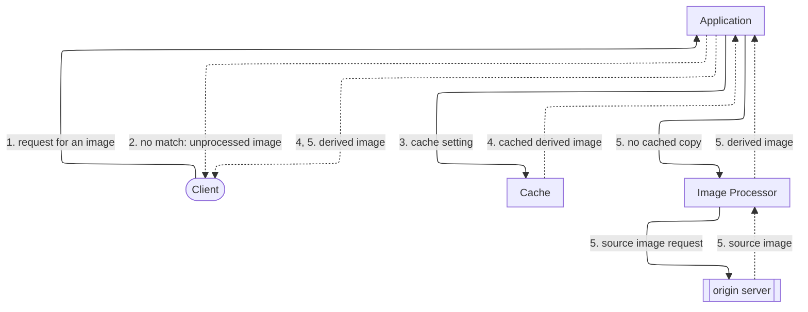

import DocButton from '~/components/webkit/DocButton.vue'
import DocCardGroup from '@aziontech/webkit/doc-card-group'
import DocCard from '@aziontech/webkit/doc-card'

**Image Processor** is a Platform Resource that builds a new image, the derived image, from an image on the origin of an [Application](/en/documentation/platform/applications/). On-request image transformation is a delivery model where the server builds each variant of an image at the time of the request. The URL of the request describes the variant, such as a width, a crop, a quality, or a format. Each variant comes from the one original, so the original is the only file you store and update.

In an Application, Image Processor reads the source image, the file on the origin, without changing it. The `ims` query string of the request describes the derived image, such as `?ims=fit-in/400x400`. Even with no `ims` query string, Image Processor can convert an image to a format the browser accepts. Image Processor processes only the requests that a Request Phase rule with the _Optimize Images_ behavior matches, and you write that rule in the Application's [Rules Engine](/en/documentation/platform/applications/rules-engine/). Use Image Processor to deliver one image in several sizes, crops, qualities, or formats, such as WEBP for browsers that accept it, without a file per variant.

<DocButton href="/en/documentation/platform/applications/image-processor/quickstart/" label="Quickstart" size="medium" />
<DocButton href="/en/documentation/platform/applications/image-processor/url-parameters/" label="Image Processor reference" kind="secondary" size="medium" />

---

## Request path

An `ims` query string does not transform an image by itself: a rule with the [Optimize Images](/en/documentation/platform/applications/rules-engine/#optimize-images) behavior has to match the request first. Turning Image Processor on in an Application only makes that behavior available to its rules.

Solid arrows carry the request, and dotted arrows carry the response. Each label starts with the number of its step below.



1. A request for a path that holds an image reaches the Application, which runs its Request Phase rules. A rule for images matches on `${uri}`, or on `${request_uri}` with [Application Accelerator](/en/documentation/platform/applications/application-accelerator/) on, against an argument such as `\.(jpg|jpeg|gif|bmp|png|ico|webp|avif)`.
2. When no rule with _Optimize Images_ matches, the source image is delivered unprocessed, even when the request carries `ims`.
3. A matching rule applies its behaviors. _Optimize Images_ marks the request for Image Processor. When the rule also carries _Set Cache Policy_, that behavior applies the [cache setting](/en/documentation/platform/applications/cache/cache-settings/) that holds the derived image. A rule can carry _Optimize Images_ alone, because the behavior takes no argument.
4. When the derived image is already cached, [Cache](/en/documentation/platform/applications/cache/) delivers it without processing.
5. Otherwise, Image Processor reads the source image from the origin and applies the `ims` query string to it. The derived image is delivered. The Application's cache stores it only when the rule applies a cache setting with _Set Cache Policy_. Without one, every request reaches Image Processor, which answers a repeated transformation from its own cache.

When a rule with _Optimize Images_ matches a path that does not return an image, the request fails with an empty `400`, so the rule's criteria have to match image paths only. To build that rule step by step, refer to [Configure Image Processor on an application](/en/documentation/guides/application-performance/delivery-optimization/process-images/).

For how the delivered format is chosen, how the cache tells derived images apart, and where Image Processor stops, refer to [Image delivery](/en/documentation/platform/applications/image-processor/image-delivery/).

---

## Rule structure

Image Processor acts through a Request Phase rule that carries the _Optimize Images_ behavior. To process every request for an image path and cache each derived image, send this rule as the body of `POST /v4/workspace/applications/<application-id>/request_rules`:

```json
{
  "name": "Optimize images",
  "description": "Apply the cache setting and optimize images",
  "active": true,
  "criteria": [
    [
      {
        "conditional": "if",
        "variable": "${request_uri}",
        "operator": "matches",
        "argument": "\\.(jpg|jpeg|gif|bmp|png|ico|webp|avif)"
      }
    ]
  ],
  "behaviors": [
    { "type": "set_cache_policy", "attributes": { "value": <cache-setting-id> } },
    { "type": "optimize_images" }
  ]
}
```

- `criteria` compares the path with a list of image extensions through `matches`. `${request_uri}` needs Application Accelerator, and `${uri}` matches the same paths without it.
- `optimize_images` takes no attributes and marks the request for Image Processor. It requires Image Processor on the Application that runs the rule.
- `set_cache_policy` applies the cache setting whose ID is in `attributes.value`, and that cache setting stores each derived image. With `ims` in the `fields` of its `cache_vary_by_querystring` allowlist, each distinct `ims` string gets a cache key of its own. That field belongs to Application Accelerator, so it needs Application Accelerator on.
- Each request then carries its transformation in the URL, such as `?ims=400x`. A processed response carries `x-ims: Enabled`, and `x-original-image-size` carries the size of the source image before the transformation.

---

## Scope and limits

- **Application**: Image Processor is off in a new Application, and each Application turns it on separately, in its `modules.image_processor.enabled` field in the API. Even when it is on, Image Processor processes only the requests that a rule with _Optimize Images_ matches. [Main Settings](/en/documentation/platform/applications/main-settings/#platform-resources) shows where to turn it on in Azion Console and the API.
- **Operations**: one `ims` string can carry a resize, a crop, and a chain of filters. The operations are resize, crop, rotation, quality, watermark, format conversion, and fill, and `fit-in` fits an image inside an area without enlarging it. For the syntax and the values each one accepts, refer to [URL parameters](/en/documentation/platform/applications/image-processor/url-parameters/).
- **Parameter position**: `ims` can sit anywhere in the query string. An `ims` value that Image Processor cannot parse returns the source image untransformed.
- **Formats**: Image Processor reads JPEG, GIF, PNG, BMP, ICO, WEBP, and AVIF. Even with no `ims` parameter, it can convert an image to a format the browser accepts, such as WEBP or AVIF, and it converts a BMP image to JPEG or WEBP. A `filters:format()` filter returns the format it names, whatever `Accept` header the request carries. For how the delivered format is chosen, refer to [Image delivery](/en/documentation/platform/applications/image-processor/image-delivery/#format-negotiation).
- **Cache**: once `ims` is in the allowlist of the cache setting, each distinct `ims` string, in each delivered format, is a separate stored object. A page that asks for four fixed widths stores four objects per delivered format, while a page that asks for arbitrary widths stores one per width and format. Once a derived image is in cache, it is delivered without processing. For the practices, refer to [Applications best practices](/en/documentation/platform/applications/best-practices/#image-processor).
- **Storage**: Image Processor returns each derived image without saving it as an asset of the account, and you cannot upload images to Image Processor. The cache holds the derived images, and the source image stays where it already lives. A workflow that needs to keep a transformed file saves the response itself.
- **Neighbors**: [WASM Image Processor](/en/documentation/devtools/azion-lib/wasm-image-processor/) is a WebAssembly library that processes images inside a [Function](/en/documentation/platform/functions/). It runs in the code of that Function, separately from the Image Processor Platform Resource and its settings.
- **Interfaces**: you turn on Image Processor on the **Main Settings** tab of an Application in [Azion Console](https://console.azion.com/), and through [Azion API](https://api.azion.com/) at `/v4/workspace/applications/<application-id>`. [Azion CLI](/en/documentation/devtools/cli/) sets it with `--image-processor` on `azion create application` or `azion update application`. [`azion.config.js`](/en/documentation/devtools/cli/azion-config-js/) and [Azion Lib](/en/documentation/devtools/azion-lib/) set it with `imageProcessorEnabled`. For each field, flag, behavior, and header, refer to [Image Processor settings](/en/documentation/platform/applications/image-processor/settings/).
- **Observability**: in Azion Console, [Real-Time Metrics](/en/documentation/platform/real-time-metrics/) has an **Image Processor** tab with request charts, and [Real-Time Events](/en/documentation/platform/real-time-events/) has an **Image Processor** dataset, which requires Image Processor on.
- **Limits**: one image takes up to 150 MB, 3840 pixels of width, and 2160 pixels of height. For every bound, refer to [Applications limits](/en/documentation/platform/applications/limits/#image-processor), and for the rates, refer to [Pricing](/en/documentation/fundamentals/pricing/#image-processor). [Azion pricing](https://www.azion.com/en/pricing/) lists what each plan includes.
- **Terms**: the [Applications glossary](/en/documentation/platform/applications/glossary/) defines the words the Image Processor pages give a specific meaning, such as derived image, source image, autocrop, and `fit-in`.

---

## Next steps

<DocCardGroup cols={2}>
  <DocCard title="Quickstart" href="/en/documentation/platform/applications/image-processor/quickstart/" label="Request your first derived image from an Application." />
  <DocCard title="Image delivery" href="/en/documentation/platform/applications/image-processor/image-delivery/" label="See how the delivered format is chosen, how the cache keeps derived images apart, and where Image Processor stops." />
  <DocCard title="URL parameters" href="/en/documentation/platform/applications/image-processor/url-parameters/" label="Look up an operation of the ims query string and the values it accepts." />
  <DocCard title="Guides and tutorials" href="/en/documentation/platform/applications/guides/" label="Complete a specific task, from processing images to querying their usage." />
  <DocCard title="Limits" href="/en/documentation/platform/applications/limits/#image-processor" label="Look up the bounds of one image." />
  <DocCard title="Troubleshooting" href="/en/documentation/platform/applications/troubleshooting/#image-processor" label="Find the cause when an image comes back unprocessed or in the wrong format." />
</DocCardGroup>
