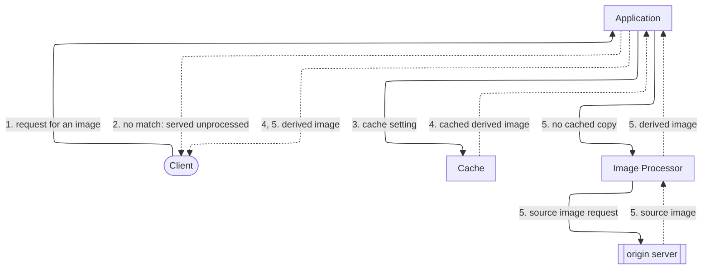

import DocButton from '~/components/webkit/DocButton.vue'
import DocCardGroup from '@aziontech/webkit/doc-card-group'
import DocCard from '@aziontech/webkit/doc-card'

**Image Processor** is a Platform Resource that builds derived images from origin images on Azion's distributed infrastructure, for the requests received by an [Application](/en/documentation/platform/applications/). On-request image transformation is a delivery model where the server builds each variant of an image at request time, as described in the request URL. Use Image Processor to serve an image in several sizes, crops, qualities, or formats, such as WEBP for browsers that accept it, from one file.

<DocButton href="/en/documentation/platform/applications/image-processor/quickstart/" label="Quickstart" size="medium" />
<DocButton href="/en/documentation/platform/applications/image-processor/reference/" label="Image Processor reference" kind="secondary" size="medium" />

---

## Request path

The `ims` query-string parameter does not transform an image by itself: a rule with the [Optimize Images](/en/documentation/platform/applications/rules-engine/#optimize-images) behavior has to match the request first. Turning Image Processor on in an Application only makes that behavior available to its [Rules Engine](/en/documentation/platform/applications/rules-engine/) rules.

Solid arrows carry the request, and dotted arrows carry the response. Each label starts with the number of its step below.

1. A request for a path that holds an image reaches the Application, which runs its Request Phase rules, such as a rule with _Optimize Images_ that matches image requests. To build that rule step by step, refer to [Configure Image Processor on an application](/en/documentation/guides/application-performance/delivery-optimization/process-images/).
2. When no rule with _Optimize Images_ matches, the source image, the file on the origin, is delivered unprocessed.
3. A matching rule applies its behaviors. _Optimize Images_ applies Image Processor to the request. When the rule also carries _Set Cache Policy_, that behavior applies the [cache setting](/en/documentation/platform/applications/cache/cache-settings/) that holds the derived image. A rule can carry _Optimize Images_ alone, because the behavior takes no argument.
4. When the derived image is already cached, [Cache](/en/documentation/platform/applications/cache/) delivers it without processing.
5. Otherwise, Image Processor reads the source image without changing it, and applies `ims` to it, such as `?ims=fit-in/400x400`. The derived image is delivered. The Application's cache stores it only when the rule applies a cache setting with _Set Cache Policy_. Without one, every request reaches Image Processor, which answers a repeated transformation from its own cache.

For how the delivered format is chosen, how the cache tells derived images apart, and where Image Processor stops, refer to [Image delivery](/en/documentation/platform/applications/image-processor/image-delivery/).

---

## Next steps

<DocCardGroup cols={2}>
  <DocCard title="Quickstart" href="/en/documentation/platform/applications/image-processor/quickstart/" label="Request your first derived image from an Application." />
  <DocCard title="Image delivery" href="/en/documentation/platform/applications/image-processor/image-delivery/" label="See how the delivered format is chosen, how the cache keeps derived images apart, and where Image Processor stops." />
  <DocCard title="URL parameters" href="/en/documentation/platform/applications/image-processor/url-parameters/" label="Look up an operation of the ims parameter and the values it accepts." />
  <DocCard title="Image Processor settings" href="/en/documentation/platform/applications/image-processor/settings/" label="Look up the switch, the rule behaviors, the response headers, and the usage data." />
  <DocCard title="Guides and tutorials" href="/en/documentation/platform/applications/guides/" label="Complete a specific task, from processing images to querying their usage." />
  <DocCard title="Best practices" href="/en/documentation/platform/applications/best-practices/#image-processor" label="Pick the quality, the resize, and the cache setting that keep a transformation cheap." />
  <DocCard title="Limits" href="/en/documentation/platform/applications/limits/#image-processor" label="Look up the scope of Image Processor and the bounds of one image." />
  <DocCard title="Troubleshooting" href="/en/documentation/platform/applications/troubleshooting/#image-processor" label="Find the cause when an image comes back unprocessed or in the wrong format." />
</DocCardGroup>
