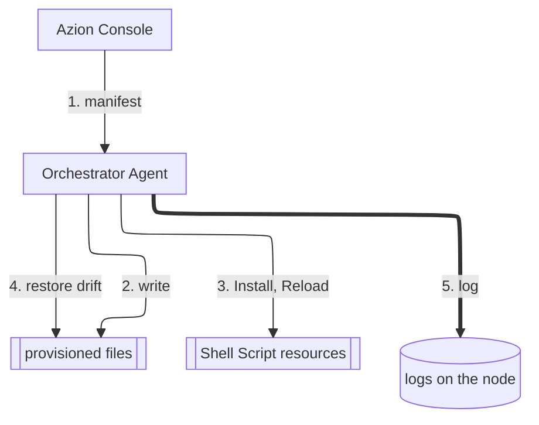

import FrameBox from '@aziontech/webkit/frame-box'
import ItemList from '@aziontech/webkit/item-list'
import DocItem from '@aziontech/webkit/doc-item'

Orchestrator installs and keeps software on machines you run yourself, such as servers, routers, and small devices. You describe the software once, as a service in Azion Console. You choose the machines that run it, and an agent on each machine applies that description and repairs any drift from it. A change to the service reaches every machine it is bound to without a login on each one.

The sections cover the agent and the node, authorization, services and their resources, the bind between a service and a node, how the agent applies a manifest, the Watcher, and the logs.

---

## The agent and the node

A machine joins Orchestrator when you install the Orchestrator Agent on it. The agent is a single binary, `edge-orchestrator`, built for FreeBSD, Linux, and macOS on several processor architectures. Its `install` command registers the agent with the machine's service manager, when the machine has one, and asks for a [personal token](/en/documentation/guides/platform/account-and-billing/personal-tokens/). The token ties the machine to your Azion account.

Once the agent is installed and started, the machine is listed as a node of your account. On its first start, the agent can also set the node's name and the groups the node belongs to. Without a name, the node takes the machine's hostname. The OS, architectures, and privileges a node needs are listed in [Node requirements](/en/documentation/platform/orchestrator/edge-node/#requirements).

The agent does the work on the node, and Azion Console holds the configuration. Azion manages the node remotely over an end-to-end encrypted channel, on local and public networks and behind NAT.

---

## Authorization

A new node appears in the **Edge Nodes** list of Azion Console with the status `Waiting Authorization`, and it receives no service until you authorize it. The list identifies each node by the hash it used to register, in the **HashId** column. After the authorization, the node can take up to 10 seconds before services can be orchestrated on it.

In Azion Console, you can authorize several nodes in one action. The steps are in [Authorize a node](/en/documentation/guides/application-development/automation/authorize-an-edge-node/).

---

## Services and resources

A service is the description of one piece of software, kept in the **Edge Services** list of Azion Console. It holds resources, and each resource is a file the agent writes to an absolute path on the node. A resource has one of two types:

- **Text**: the agent copies the content to the path as plain text. Configuration files use this type.
- **Shell Script**: the agent writes the script and runs it on the triggers you select. The agent runs the script with the interpreter in its shebang line, or with `/bin/sh` when the script has none.

A Shell Script resource runs on one or more of three triggers. **Install** runs first, when the service reaches the node. **Reload** runs after every resource of the service is installed, and again whenever the bind between the service and the node changes, for example when a variable value changes. **Uninstall** runs when the service leaves the node.

The content of a resource can carry two kinds of placeholders. A variable, written `{{ VARNAME }}`, takes a value you set, so the same service can listen on port 3306 on one node and on port 3307 on another. A fact, written `{{ FACT_NAME }}`, takes a value the agent reads from the node, such as its architecture, OS, number of CPUs, or memory. You cannot overwrite a fact. The Services reference lists the [predefined variables](/en/documentation/platform/orchestrator/edge-services/#variables) and the [facts](/en/documentation/platform/orchestrator/edge-services/#facts).

---

## The bind between a service and a node

A service runs nowhere until you bind it to a node. A bind names the service, the node, and the variable values for that node, so one service bound to many nodes runs everywhere with values that fit each machine. Only an active service can be bound.

A service changes in one place and reaches every node bound to it. When you update a service, the change is deployed to the nodes bound to it. When you change a variable value on a bind, the Reload trigger runs on that node. When you remove the bind, the Uninstall trigger runs and the service leaves that node. The steps are in [Bind a service to a node](/en/documentation/guides/application-development/automation/bind-service-node/).

---

## How the agent applies a manifest

The agent receives the configuration of its node as a manifest, which carries the resources of the services bound to the node. Each manifest has a version number, and the agent logs each version it applies. The agent applies a manifest in order, one resource at a time, and respects the dependencies between resources and the triggers they need.

The diagram shows one node receiving its manifest. Solid arrows carry the configuration and the actions the agent takes on the node, and the thick arrow carries the log the agent writes. Each label starts with the number of its step below.

1. The node receives a manifest with the resources of the services bound to it and the variable values of each bind.
2. The agent writes each resource to its absolute path, one resource at a time.
3. The agent runs the Install trigger of each Shell Script resource, then Reload.
4. The Watcher scans the provisioned files on a schedule and restores any file that drifted from the last applied manifest.
5. The agent logs the manifest version it applied and the result of each Watcher scan.

While a manifest is applied, the agent exposes two predefined variables to the scripts. `CHANGESET_ADD_PATH` names a file that lists the paths added or modified in this manifest, and `CHANGESET_RM_PATH` names a file that lists the paths removed or modified. A script can read them to act only on the files that changed.

---

## The Watcher

After a manifest is applied, the agent keeps the files in the state it describes. A part of the agent called the Watcher runs a group of workers on a schedule. The workers scan every provisioned file and compare it with the last applied manifest. A file that was modified or removed is restored.

The Watcher protects a node from drift, and that protection has a cost: the service and its binds are the only places to change a provisioned file. A local edit on the node is reverted at the next scan, and you cannot turn the Watcher off. Every change, including an urgent one, goes into the service. Files the service does not provision are outside the Watcher's scope.

---

## Logs on the node

The agent writes two logs on the node. `/var/log/azion/edge-orchestrator.log` records the agent's own work: the manifest versions it applies, its communication with Azion, and each Watcher scan, with the number of files checked and the number that drifted. `/var/log/azion/edge-services.log` records what the triggers of the bound services wrote. To read them, refer to [Watch Orchestrator logs](/en/documentation/guides/application-development/automation/watch-logs/).

---

## Related resources

<FrameBox>
<ItemList>
  <DocItem title="Nodes" href="/en/documentation/platform/orchestrator/edge-node/">Node requirements, and every command and option of the Orchestrator Agent.</DocItem>
  <DocItem title="Services" href="/en/documentation/platform/orchestrator/edge-services/">Resources, variables, facts, and triggers, field by field.</DocItem>
  <DocItem title="Install the Orchestrator Agent" href="/en/documentation/guides/application-development/automation/install-orchestrator-agent/">The steps to turn a machine into a node.</DocItem>
  <DocItem title="Create a service" href="/en/documentation/guides/application-development/automation/create-edge-service/">The steps to describe a piece of software and its resources.</DocItem>
</ItemList>
</FrameBox>
