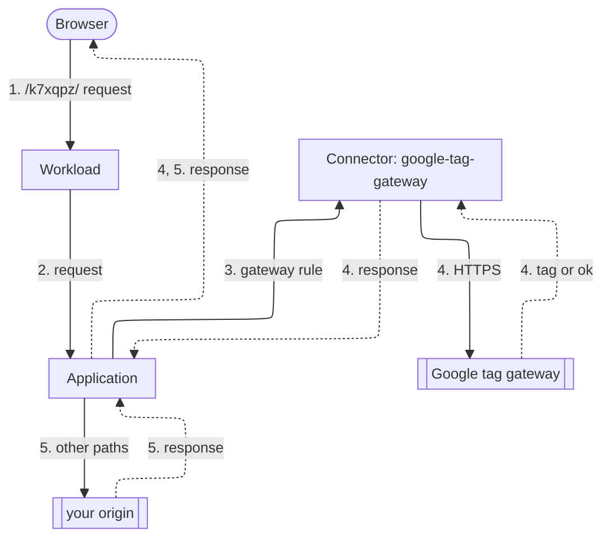

import DocCardGroup from '@aziontech/webkit/doc-card-group'
import DocCard from '@aziontech/webkit/doc-card'
import Tabs from '~/components/webkit/Tabs.vue'
import Code from '~/components/webkit/CodeBlock.vue'

Google tags, such as Google Tag Manager (GTM), Google Analytics 4 (GA4), and Google Ads, load by default from `googletagmanager.com`. Ad blockers and browsers such as Safari and Brave often block that domain, so visits and conversions happen and never reach your reports. Google tag gateway for advertisers serves the same tags from a path of your own domain, such as `www.example.com/k7xqpz/`.

On Azion, the gateway takes a [Connector](/en/documentation/platform/connectors/) that reaches Google's endpoint and one Request Phase rule on the [Application](/en/documentation/platform/applications/) that already serves your site. The rule needs [Application Accelerator](/en/documentation/platform/applications/application-accelerator/) turned on in that Application. You can configure all of it from Azion Console, the Azion CLI, or the API. The rest of the site keeps reaching your origin.

Solid arrows carry the request, and dotted arrows carry the response. Each label starts with the number of its step below.



1. The page in the browser loads the tag script, or sends an event, from the measurement path of your domain. The address bar does not change.
2. The [Workload](/en/documentation/platform/workloads/) of your domain receives the request, and the Application that this Workload's deployment sets runs its Request Phase rules.
3. The gateway rule matches the measurement path, skips the cache, adds the visitor's country and region, and sets the Connector.
4. The Connector sends the request over HTTPS to `<tag-id>.fps.goog`, and Google's answer returns through the Connector and the Application to the browser.
5. Requests for every other path keep reaching your origin through the rules that already serve the site.

---

## Prerequisites

<Tabs client:visible sharedStore="interface">
<Fragment slot="tab.console">Console</Fragment>
<Fragment slot="tab.cli">CLI</Fragment>
<Fragment slot="tab.api">API</Fragment>

<Fragment slot="panel.console">

### Console

- The tag ID, from the Google tag gateway console. With GTM, it is the container ID, such as `GTM-ABC123`.
- The measurement path, a path your site does not use, such as `/k7xqpz/`.
- An Application that serves your site through a Workload. To create one, refer to [Applications quickstart](/en/documentation/platform/applications/quickstart/).
- Access to [Azion Console](https://console.azion.com/).

</Fragment>

<Fragment slot="panel.cli">

### CLI

- The tag ID, from the Google tag gateway console. With GTM, it is the container ID, such as `GTM-ABC123`.
- The measurement path, a path your site does not use, such as `/k7xqpz/`.
- An Application that serves your site through a Workload, and its ID. To create one, refer to [Applications quickstart](/en/documentation/platform/applications/quickstart/).
- The [Azion CLI](/en/documentation/devtools/cli/), installed and authorized.

</Fragment>

<Fragment slot="panel.api">

### API

- The tag ID, from the Google tag gateway console. With GTM, it is the container ID, such as `GTM-ABC123`.
- The measurement path, a path your site does not use, such as `/k7xqpz/`.
- An Application that serves your site through a Workload, and its ID. To create one, refer to [Applications quickstart](/en/documentation/platform/applications/quickstart/).
- A [personal token](/en/documentation/fundamentals/personal-tokens/) and `curl`.

</Fragment>

</Tabs>

One GTM container covers every tag inside it. Each standalone Google tag, with an ID that starts with `G-`, takes a setup of its own. Give each container or tag its own measurement path and its own Connector. Then repeat the Connector, rule, position, and check sections for each one.

:::note
The measurement path cannot be `/`, and it holds 100 characters at most.
:::

A random string, such as `/k7xqpz/`, avoids a conflict with a path your site already serves. The examples use the tag ID `GTM-ABC123`, the path `/k7xqpz/`, and the domain `www.example.com`: replace them with your own values.

---

## Create a Connector for Google

The Connector holds the address of Google's endpoint for your tag: `<tag-id>.fps.goog`, with the tag ID in lowercase, such as `gtm-abc123.fps.goog`. The `Host` header carries the same value, because Google reads the tag from it. With the default `${host}`, Google receives your site's domain and does not recognize the tag. The endpoint accepts HTTPS only, on port 443. The Connector sends no path prefix, so the path the browser requested reaches Google unchanged.

A Connector holds the address of an origin, here Google's endpoint, and takes the place of the origins that an Application held. It changes nothing on your site until a rule sets it.

:::note
An Application that still uses origins takes the same setup. In the **Origins** tab of the Application, create an origin with the same values: **Address** and **Host Header** `gtm-abc123.fps.goog`, **Protocol Policy** _Enforce HTTPS_, and an empty **Origin Path**. In the rule, use _Set Origin_ in place of _Set Connector_.
:::

<Tabs client:visible sharedStore="interface">

<Fragment slot="panel.console">

### Console

To create the Connector in Azion Console:

1. Access [Azion Console](https://console.azion.com/) > **Connectors**.
2. Select **+ Connectors**.
3. In **Name**, enter `google-tag-gateway`.
4. In **Connector Type**, keep _HTTP_.
5. In **Host**, replace `${host}` with `gtm-abc123.fps.goog`.
6. Leave **Path** empty.
7. In **Transport Protocol Policy**, select _Force HTTPS_.
8. In **Address Management**, enter `gtm-abc123.fps.goog` in **Address**.
9. Select **Save**.

The Connector appears in the **Connectors** list, with `gtm-abc123.fps.goog` in **Address**.

</Fragment>

<Fragment slot="panel.cli">

### CLI

To create the Connector with the Azion CLI, save it as `connector.json`:

<Code client:visible lang="json" fileName="connector.json" code={`{
\x20 "name": "google-tag-gateway",
\x20 "type": "http",
\x20 "attributes": {
\x20   "addresses": [{"address": "gtm-abc123.fps.goog"}],
\x20   "connection_options": {
\x20     "transport_policy": "force_https",
\x20     "host": "gtm-abc123.fps.goog"
\x20   }
\x20 }
}`} />

Then create the Connector from the file:

<Code client:visible lang="bash" code={`azion create connector --type http --file connector.json`} />

```text
Created Connector with ID 237847
```

Your ID differs. Keep it for the rule.

</Fragment>

<Fragment slot="panel.api">

### API

To create the Connector with the API, save its body as `connector.json`:

<Code client:visible lang="json" fileName="connector.json" code={`{
\x20 "name": "google-tag-gateway",
\x20 "type": "http",
\x20 "attributes": {
\x20   "addresses": [{"address": "gtm-abc123.fps.goog"}],
\x20   "connection_options": {
\x20     "transport_policy": "force_https",
\x20     "host": "gtm-abc123.fps.goog"
\x20   }
\x20 }
}`} />

Then send a `POST` request to the Connectors endpoint with the file:

<Code client:visible lang="bash" code={`curl --request POST \\
\x20 --url https://api.azion.com/v4/workspace/connectors \\
\x20 --header 'Accept: application/json' \\
\x20 --header 'Authorization: Token [TOKEN VALUE]' \\
\x20 --header 'Content-Type: application/json' \\
\x20 --data @connector.json`} />

The API answers `202` with `"state": "pending"` and the Connector. Keep `data.id` for the rule:

```json
{
  "state": "pending",
  "data": {
    "id": 237845,
    "name": "google-tag-gateway",
    "type": "http",
    "attributes": {
      "addresses": [{"active": true, "address": "gtm-abc123.fps.goog", "http_port": 80, "https_port": 443, "modules": null}],
      "connection_options": {
        "dns_resolution": "both",
        "transport_policy": "force_https",
        "http_version_policy": "http1_1",
        "host": "gtm-abc123.fps.goog",
        "path_prefix": "",
        …
      },
      …
    },
    …
  }
}
```

</Fragment>

</Tabs>

Google also accepts the tag ID in an `X-Gtg-Tag-Id` header, which is needed only when the `Host` is the bare `fps.goog`. In the manual setup that this guide follows, the tag ID is in the address and in the `Host`, so the Connector needs no other header.

---

## Turn on Application Accelerator

The gateway rule needs [Application Accelerator](/en/documentation/platform/applications/application-accelerator/) turned on in the Application. Without it, the API refuses _Forward Cookies_ with `25047` `Missing Required Modules`. Azion Console lists _Bypass Cache_ as `Bypass Cache - Required Application Accelerator`.

<Tabs client:visible sharedStore="interface">

<Fragment slot="panel.console">

### Console

To turn on Application Accelerator in Azion Console:

1. Access [Azion Console](https://console.azion.com/) > **Applications**.
2. Select the Application that serves your site.
3. In the **Main Settings** tab, under **Modules**, turn on **Application Accelerator**.
4. Select **Save**.

After you save, the **Application Accelerator** switch is on.

</Fragment>

<Fragment slot="panel.cli">

### CLI

To turn on Application Accelerator with the Azion CLI, replace `<application-id>` with the ID of your Application:

<Code client:visible lang="bash" code={`azion update application --application-id <application-id> --application-accelerator true`} />

```text
Updated Application with ID <application-id>
```

</Fragment>

<Fragment slot="panel.api">

### API

To turn on Application Accelerator with the API, send a `PATCH` request to your Application. Replace `<application-id>` with its ID:

<Code client:visible lang="bash" code={`curl --request PATCH \\
\x20 --url https://api.azion.com/v4/workspace/applications/<application-id> \\
\x20 --header 'Accept: application/json' \\
\x20 --header 'Authorization: Token [TOKEN VALUE]' \\
\x20 --header 'Content-Type: application/json' \\
\x20 --data '{"modules": {"application_accelerator": {"enabled": true}}}'`} />

The API answers `202`, and `data.modules.application_accelerator.enabled` reads `true`.

</Fragment>

</Tabs>

---

## Route the measurement path to Google

One Request Phase rule of the [Rules Engine](/en/documentation/platform/applications/rules-engine/) sends the requests for `/k7xqpz/` and everything under it to the Connector. Each part of the rule has a job:

| Part of the rule | Why the gateway needs it |
| --- | --- |
| _starts with_ `/k7xqpz/` | Matches the path and everything under it, such as scripts and events |
| _Set Connector_ | Sends only these requests to Google |
| _Bypass Cache_ | Keeps each visitor's script and events out of Azion's cache, with no cache setting |
| _Forward Cookies_ | Delivers the `Set-Cookie` header of Google's response to the visitor |
| _Add Request Header_, country | Sends the visitor's country, such as `BR` |
| _Add Request Header_, region | Sends the visitor's region, such as `SP` |

With _is equal_ in place of _starts with_, only the exact path reaches Google, and the measurement breaks. Without _Bypass Cache_, one visitor can receive the response cached for another, and the `POST` requests of the events stop reaching Google. The `_ga` and `_gcl_*` cookies tie a visit from an ad to the purchase it leads to, so the gain of the gateway depends on them.

Because Azion sits between the browser and Google, Google receives each request from Azion's IP address and not from the visitor's. The two headers carry the visitor's location: `${geoip_country_code}` holds the ISO 3166-1 country code, and `${geoip_region}` holds the region code. Without them, GA4 reports the visitor's geography as `(not set)`, and consent rules that depend on the region can fail.

<Tabs client:visible sharedStore="interface">

<Fragment slot="panel.console">

### Console

To create the rule in Azion Console:

1. Access [Azion Console](https://console.azion.com/) > **Applications**.
2. Select the Application that serves your site.
3. Select the **Rules Engine** tab.
4. Select **+ Rule**.
5. In **Name**, enter `Google Tag Gateway`.
6. In **Phase**, keep _Request Phase_.
7. In **Criteria**, keep `${uri}` and _starts with_, and enter `/k7xqpz/` as the argument.
8. In **Behaviors**, select _Set Connector_, then select `google-tag-gateway`.
9. Select **+ Add Behavior**, then select _Bypass Cache_.
10. Select **+ Add Behavior**, then select _Forward Cookies_.
11. Select **+ Add Behavior**, then select _Add Request Header_.
12. In the field of the behavior, enter `X-Forwarded-Country: ${geoip_country_code}`.
13. Select **+ Add Behavior**, then select _Add Request Header_.
14. In the field of the behavior, enter `X-Forwarded-Region: ${geoip_region}`.
15. Select **Save**.

The rule appears last in the **Request** list of the **Rules Engine** tab, with the status `Active`.

</Fragment>

<Fragment slot="panel.cli">

### CLI

To create the rule with the Azion CLI, save it as `rule.json`. Replace `<connector-id>` with the ID of the Connector:

<Code client:visible lang="json" fileName="rule.json" code={`{
\x20 "name": "Google Tag Gateway",
\x20 "criteria": [[{"variable": "\${uri}", "conditional": "if", "operator": "starts_with", "argument": "/k7xqpz/"}]],
\x20 "behaviors": [
\x20   {"type": "set_connector", "attributes": {"value": <connector-id>}},
\x20   {"type": "bypass_cache"},
\x20   {"type": "forward_cookies"},
\x20   {"type": "add_request_header", "attributes": {"value": "X-Forwarded-Country: \${geoip_country_code}"}},
\x20   {"type": "add_request_header", "attributes": {"value": "X-Forwarded-Region: \${geoip_region}"}}
\x20 ]
}`} />

Then create the rule in the Request Phase of your Application:

<Code client:visible lang="bash" code={`azion create rules-engine --application-id <application-id> --phase request --file rule.json`} />

```text
Created Rules Engine with ID 1554059
```

</Fragment>

<Fragment slot="panel.api">

### API

To create the rule with the API, save its body as `rule.json`. Replace `<connector-id>` with the ID of the Connector:

<Code client:visible lang="json" fileName="rule.json" code={`{
\x20 "name": "Google Tag Gateway",
\x20 "criteria": [[{"variable": "\${uri}", "conditional": "if", "operator": "starts_with", "argument": "/k7xqpz/"}]],
\x20 "behaviors": [
\x20   {"type": "set_connector", "attributes": {"value": <connector-id>}},
\x20   {"type": "bypass_cache"},
\x20   {"type": "forward_cookies"},
\x20   {"type": "add_request_header", "attributes": {"value": "X-Forwarded-Country: \${geoip_country_code}"}},
\x20   {"type": "add_request_header", "attributes": {"value": "X-Forwarded-Region: \${geoip_region}"}}
\x20 ]
}`} />

Then send a `POST` request to the Request Phase rules of your Application. Replace `<application-id>` with its ID:

<Code client:visible lang="bash" code={`curl --request POST \\
\x20 --url https://api.azion.com/v4/workspace/applications/<application-id>/request_rules \\
\x20 --header 'Accept: application/json' \\
\x20 --header 'Authorization: Token [TOKEN VALUE]' \\
\x20 --header 'Content-Type: application/json' \\
\x20 --data @rule.json`} />

The API answers `202` with the rule. Its `order` is the position of the rule in the Request Phase, and a new rule takes the last one:

```json
{
  "state": "pending",
  "data": {
    "id": 1554057,
    "name": "Google Tag Gateway",
    "active": true,
    …
    "order": 1,
    …
  }
}
```

</Fragment>

</Tabs>

Use _Add Request Header_, which adds the header to the request that Google receives. _Add Response Header_ adds it to the response the browser receives, which Google never reads. _Filter Request Header_ is optional. When the browser sends a header with the same name, _Add Request Header_ replaces its value, so a visitor cannot forge a location.

The gateway needs no Response Phase rule. Check that no Response Phase rule of the Application removes `Content-Type` or `Set-Cookie`. Without them, the script reaches the browser broken, or the cookies never reach it. Removing the `Server` header does no harm.

Azion forwards the visitor's IP address to the origin in `X-Forwarded-For`, and Google requires that value intact. Check that no rule of the Application changes this header.

Google also accepts a header with the latitude, longitude, and city, `X-Forwarded-Geolocation`. The gateway works without it. The Rules Engine has no variable for latitude or longitude, so a [Function](/en/documentation/platform/functions/) can build the header if your setup requires it.

---

## Place the rule last

The Application runs its Request Phase rules in order, and when several matching rules set a Connector, the last one wins. When a rule that sends every path to your origin comes first, the gateway rule goes after it. A new rule takes the last position, so the gateway rule needs a move only when a rule comes after it.

<Tabs client:visible sharedStore="interface">

<Fragment slot="panel.console">

### Console

To move the rule in Azion Console:

1. Access [Azion Console](https://console.azion.com/) > **Applications**.
2. Select the Application that serves your site.
3. Select the **Rules Engine** tab.
4. In the **Request** list, select the down arrow next to the number of `Google Tag Gateway` until it is the last rule.
5. Select **Review Changes**.
6. In **Review Changes**, check the new positions and select **Save**.

`Google Tag Gateway` is the last rule of the **Request** list.

</Fragment>

<Fragment slot="panel.cli">

### CLI

To list the Request Phase rules with the Azion CLI:

<Code client:visible lang="bash" code={`azion list rules-engine --application-id <application-id> --phase request --details`} />

```text
ID       NAME                ORDER  PHASE    ACTIVE
1554059  Google Tag Gateway  0      request  true
1554058  site                1      request  true
```

In this example, the `site` rule was created after the gateway rule. It has the higher `ORDER` and runs later, so the gateway rule needs a move.

To move the gateway rule to the end, pass every rule ID of the phase in the new order, with the gateway rule last:

<Code client:visible lang="bash" code={`azion update rules-engine-order --application-id <application-id> --phase request --rule-ids <other-rule-ids>,<gateway-rule-id>`} />

```text
Ordered Rules Engine of Application with ID <application-id>
```

List the rules again: the gateway rule has the highest `ORDER`.

</Fragment>

<Fragment slot="panel.api">

### API

To move the rule with the API, send a `PUT` request with every rule ID of the Request Phase in the new order, the gateway rule last:

<Code client:visible lang="bash" code={`curl --request PUT \\
\x20 --url https://api.azion.com/v4/workspace/applications/<application-id>/request_rules/order \\
\x20 --header 'Accept: application/json' \\
\x20 --header 'Authorization: Token [TOKEN VALUE]' \\
\x20 --header 'Content-Type: application/json' \\
\x20 --data '{"order": [<other-rule-ids>, <gateway-rule-id>]}'`} />

The API answers `202` with the rules of the phase, and the gateway rule carries the highest `order`.

</Fragment>

</Tabs>

Before you check the gateway, open the other Request Phase rules of the Application. Three kinds of rule must not match the measurement path:

- A broad rule, such as one that matches file extensions, `/static`, or query string arguments.
- A rule that applies a cache setting with Tiered Cache on, because _Bypass Cache_ does not act on the Tiered Cache layer.
- A rule before the gateway rule that ends the processing, such as one with _Deny (403 Forbidden)_.

If the Workload's deployment sets a [Firewall](/en/documentation/platform/firewall/) with WAF or bot rules, check that they do not block `POST` requests to the measurement path.

---

## Check the gateway

Google answers two test URLs through the gateway. Wait for the changes to propagate, then open each URL in a private browser window, or request it with `curl`:

<Code client:visible lang="bash" code={`curl https://www.example.com/k7xqpz/healthy`} />

```text
ok
```

The second URL checks the country and region headers:

<Code client:visible lang="bash" code={`curl 'https://www.example.com/k7xqpz/?validate_geo=healthy'`} />

```text
ok
```

A rule reaches traffic over several minutes, and each data center applies it at its own moment. Until then, the measurement path still reaches your origin, and the answer is your site's own `404` page. A test can pass and then fail while the change propagates, because each request can reach a different data center.

:::caution
Each new edit of the rule starts the propagation again. Wait 10 to 15 minutes without changing the rule before you diagnose.
:::

A person who opens the measurement path in the browser sees only a technical answer from Google. The style of a `404` tells you where the request went. A `404` that looks like your site means the request still reaches your origin. A plain Google error page means the request reached Google, and the Connector or the headers need a fix.

---

## Update your site

The rest of the setup happens on your site and in Google's products:

1. In the Google tag gateway console, choose the manual setup.
2. Turn on the gateway with the same measurement path as the rule.
3. If GTM is written into your site's code, point the `src` of the script to the measurement path. The `<noscript>` snippet keeps pointing to `googletagmanager.com`.
4. In Tag Assistant, check that the hits your page sends go out through the measurement path.
5. Watch the results for 24 to 48 hours. GA4 fills in the visitors' geography with no `(not set)`, and [Real-Time Metrics](/en/documentation/platform/real-time-metrics/) shows no rise of `4xx` or `5xx` responses on the path.

For a GTM container, the snippet changes one line, the address of `gtm.js`:

```js
// before
j.src='https://www.googletagmanager.com/gtm.js?id='+i+dl;
// after
j.src='/k7xqpz/?id='+i+dl;
```

For a standalone Google tag, `gtag.js` moves to the measurement path:

```html
<!-- before -->
<script async src="//www.googletagmanager.com/gtag/js?id=G-12345"></script>
<!-- after -->
<script async src="/k7xqpz/"></script>
```

The gateway changes only where the tag loads from and where it sends data. The tag still runs in the browser, while server-side tagging in GTM processes the data on a server of your own. You can combine the two. Consent stays with your site and its consent management platform, and the gateway does not replace Consent Mode. The location headers help Google apply consent rules by region.

---

## Turn the gateway off

To stop the gateway, first point the `src` of the tag script back to `googletagmanager.com`, then deactivate the rule. An inactive rule does not run, so the measurement path reaches your origin again. The Connector stays in place for a later return.

<Tabs client:visible sharedStore="interface">

<Fragment slot="panel.console">

### Console

To deactivate the rule in Azion Console:

1. Access [Azion Console](https://console.azion.com/) > **Applications**.
2. Select the Application that serves your site.
3. Select the **Rules Engine** tab.
4. Select `Google Tag Gateway`.
5. In **Status**, turn off **Active**.
6. Select **Save**.

The rule shows the status `Inactive` in the **Request** list.

</Fragment>

<Fragment slot="panel.cli">

### CLI

To deactivate the rule with the Azion CLI, save the change as `deactivate.json`:

<Code client:visible lang="json" fileName="deactivate.json" code={`{"active": false}`} />

Then update the rule. Replace `<rule-id>` with the ID of the gateway rule:

<Code client:visible lang="bash" code={`azion update rules-engine --application-id <application-id> --phase request --rule-id <rule-id> --file deactivate.json`} />

```text
Updated Rules Engine with ID <rule-id>
```

</Fragment>

<Fragment slot="panel.api">

### API

To deactivate the rule with the API, send a `PATCH` request with `active` set to `false`:

<Code client:visible lang="bash" code={`curl --request PATCH \\
\x20 --url https://api.azion.com/v4/workspace/applications/<application-id>/request_rules/<rule-id> \\
\x20 --header 'Accept: application/json' \\
\x20 --header 'Authorization: Token [TOKEN VALUE]' \\
\x20 --header 'Content-Type: application/json' \\
\x20 --data '{"active": false}'`} />

The API answers `202`, and `data.active` reads `false`.

</Fragment>

</Tabs>

After the change propagates, `/k7xqpz/healthy` answers with your site's `404` page, so a snippet that still requests the measurement path stops loading the tags.

---

## Troubleshoot the gateway

Each symptom names its likely cause and the fix:

| Symptom | Cause and fix |
| --- | --- |
| A test passes, then fails | The change is still propagating. Wait 10 to 15 minutes without editing the rule |
| A `404` that looks like your site | The rule did not match. Check _starts with_, spaces in the argument, and the rule position |
| A `404` that persists after propagation | Your origin's `404` is in the cache. Purge `www.example.com/k7xqpz/*` with a wildcard purge |
| `healthy` passes and `validate_geo` fails | The location headers are missing. Check both _Add Request Header_ behaviors and their variables |
| An error page from Google | A wrong address, `Host`, or ID, such as a GA4 ID in place of the container ID. Use the ID in lowercase |
| The script arrives broken | A Response Phase rule removes `Content-Type` or changes the compression. Exclude the measurement path |

To purge by wildcard, refer to [Purge cached content](/en/documentation/guides/application-performance/cache-and-purge/purge-cached-content/).

The rule belongs to one Application, so it reaches only the domains of the Workloads whose deployment sets that Application. A staging site served by another Application needs the rule in that Application too. So does any subdomain of your purchase funnel that another Application serves. Both Applications can set the same Connector.

The criteria compare the path as the browser sends it. With _starts with_ `/k7xqpz/`, a request for `/k7xqpz` without the final slash does not match and reaches your origin. The snippets in [Update your site](#update-your-site) always request a path under `/k7xqpz/`.

---

## Next steps

<DocCardGroup cols={2}>
  <DocCard title="Rules Engine for Applications" href="/en/documentation/platform/applications/rules-engine/" label="Every behavior, variable, and operator a rule can use." />
  <DocCard title="Connector settings" href="/en/documentation/platform/connectors/settings/" label="Every connection option of a Connector, with its API field and default." />
</DocCardGroup>
