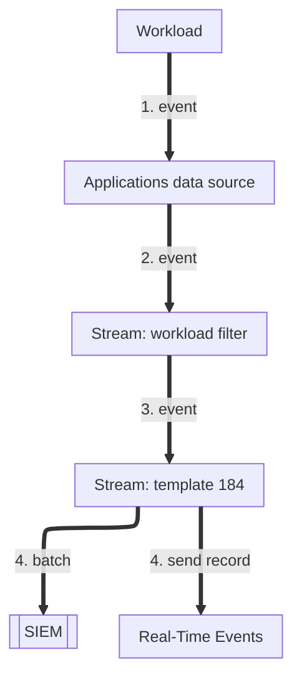

import DocCardGroup from '@aziontech/webkit/doc-card-group'
import DocCard from '@aziontech/webkit/doc-card'
import DocSteps from '@aziontech/webkit/doc-steps'
import DocStep from '@aziontech/webkit/doc-step'
import Tabs from '~/components/webkit/Tabs.vue'

You can send every request to an Application, with the WAF fields of the same request, to a security information and event management (SIEM) platform from Azion Console or the Azion API. To send only the requests WAF analyzed, refer to [Stream WAF events to a SIEM](/en/documentation/guides/application-security/firewall-and-waf/integrate-siems/).

A [Data Stream](/en/documentation/platform/data-stream/) stream on the _Applications_ data source, shaped by the _Applications + WAF Event Collector_ preset, carries the request, the response, and the client address with the WAF score, matches, and block flag of the same request. One log line then answers a question about one request, whether WAF flagged it or not. The cost is volume: the preset sends 51 keys, the most of the five presets, and Data Stream is billed on requests and data transfer.

Thick arrows carry the stream's data. Each label starts with the number of its step below.



1. Each request to a chosen Workload becomes an event of the _Applications_ data source.
2. The workload filter keeps only the Workloads you choose.
3. Template `184` renders each event as one log line with the request fields and the WAF fields.
4. The stream sends the lines to the SIEM's endpoint in batches, and [Real-Time Events](/en/documentation/platform/real-time-events/data-sources/#data-stream) records each send with a status code.

---

## Prerequisites

<Tabs client:visible sharedStore="interface">
<Fragment slot="tab.console">Console</Fragment>
<Fragment slot="tab.api">API</Fragment>

<Fragment slot="panel.console">

### Console

- The **Edit Data Stream** permission. For more information, refer to [Stream settings](/en/documentation/platform/data-stream/stream-settings/#permissions).
- A Workload whose Firewall applies a WAF rule set with a _Set WAF_ rule. To build it, refer to [Create and apply a WAF rule set](/en/documentation/guides/application-security/firewall-and-waf/create-waf-rule-set/).
- An endpoint that your SIEM reads. The examples use an Apache Kafka cluster, with the host and port of its servers and one topic. For the other endpoints, refer to [Endpoints](/en/documentation/platform/data-stream/endpoints/).
- Access to Azion Console. To sign in, refer to [Access Azion Console](/en/documentation/guides/platform/account-and-billing/how-to-access-azion-console/).

</Fragment>

<Fragment slot="panel.api">

### API

- The **Edit Data Stream** permission. For more information, refer to [Stream settings](/en/documentation/platform/data-stream/stream-settings/#permissions).
- A Workload whose Firewall applies a WAF rule set with a _Set WAF_ rule. To build it, refer to [Create and apply a WAF rule set](/en/documentation/guides/application-security/firewall-and-waf/create-waf-rule-set/).
- An endpoint that your SIEM reads. The examples use an Apache Kafka cluster, with the host and port of its servers and one topic. For the other endpoints, refer to [Endpoints](/en/documentation/platform/data-stream/endpoints/).
- A personal token. To create one, refer to [Manage personal tokens](/en/documentation/guides/platform/account-and-billing/personal-tokens/).
- The ID of the Workload.

</Fragment>

</Tabs>

The examples send the requests of the Workload `<workload-id>` to the topic `azion.requests` on `kafka1.example.com:9092` and `kafka2.example.com:9092`. Replace them with your Workload and endpoint.

---

## Create the stream

The stream takes its scope from a workload filter rather than sampling. A stream on Applications, Functions, or WAF Events carries exactly one of the two. A filter holds up to 600 Workloads, and a Workload created later is not collected until you add it.

Saving an active stream with sampling on Applications, Functions, or WAF Events deactivates every other stream on the account, except Activity History streams. A sampling rate of 1 deactivates them as a rate of 100 does, and the API returns no error.

<Tabs client:visible sharedStore="interface">

<Fragment slot="panel.console">

### Console

To create the stream in Azion Console:

<DocSteps>
  <DocStep title="Open Data Stream">

  Access [Azion Console](https://console.azion.com/) > **Data Stream**.

  </DocStep>
  <DocStep title="Select + Stream" />
  <DocStep title="Name the stream">

  In the **General** section, enter a **Name**. For example: `requests-to-siem`.

  </DocStep>
  <DocStep title="Select the Applications data source">

  In the **Input** section, select _Applications_ in **Data Source**.

  </DocStep>
  <DocStep title="Turn off Sampling">

  In the **Transform** section, turn off **Sampling** while **Option** is still _All Current and Future Workloads_.

  </DocStep>
  <DocStep title="Choose the Workload">

  Set **Option** to _Filter Workloads_. In **Available Workload**, select the Workload and move it to **Chosen Workload**. If your Console names domains where this guide names Workloads, the same control reads _Filter Domains_. The pick list then reads **Available Domain** and **Chosen Domain**.

  </DocStep>
  <DocStep title="Select the template">

  In the **Render Template** section, select _Applications + WAF Event Collector_ in **Template**. The **Data Set** field shows the keys of each log line.

  </DocStep>
  <DocStep title="Select the endpoint">

  In the **Output** section, select _Apache Kafka_ in **Connector**.

  </DocStep>
  <DocStep title="Enter the bootstrap servers">

  In **Bootstrap Servers**, enter `kafka1.example.com:9092,kafka2.example.com:9092`.

  </DocStep>
  <DocStep title="Enter the topic">

  In **Kafka Topic**, enter `azion.requests`.

  </DocStep>
  <DocStep title="Turn on TLS">

  Turn on **Enable Transport Layer Security (TLS)**.

  </DocStep>
  <DocStep title="Keep the stream active">

  In the **Status** section, keep **Active** turned on.

  </DocStep>
  <DocStep title="Select Save" />
</DocSteps>

The Console shows `Your data stream has been created`. The stream appears in the **Data Stream** list with `workloads` in the **Source** column.

</Fragment>

<Fragment slot="panel.api">

### API

To create the stream with the API, send the `workloads` data source, which is _Applications_ in the Console, with template `184`:

```bash
curl --request POST \
  --url https://api.azion.com/v4/workspace/stream/streams \
  --header 'Authorization: Token [TOKEN VALUE]' \
  --header 'Content-Type: application/json' \
  --data '{
  "name": "requests-to-siem",
  "active": true,
  "inputs": [{ "type": "raw_logs", "attributes": { "data_source": "workloads" } }],
  "transform": [
    { "type": "filter_workloads", "attributes": { "workloads": [<workload-id>] } },
    { "type": "render_template", "attributes": { "template": 184 } }
  ],
  "outputs": [{
    "type": "kafka",
    "attributes": { "bootstrap_servers": "kafka1.example.com:9092,kafka2.example.com:9092", "kafka_topic": "azion.requests", "use_tls": true }
  }]
}'
```

The API answers `201` with `state` set to `executed` and the stored stream under `data`. Keep its `id`, which every later request on the stream uses. On Applications, Functions, or WAF Events, a stream with both `sampling` and `filter_workloads` is refused with `32007`, and one with neither with `32002`.

</Fragment>
</Tabs>

After you save the stream, it can take several minutes to start collecting events, and it does not send the events from before that. Saving checks the format of each field and does not contact the endpoint, so a wrong address or topic shows only when the stream sends.

For a SIEM with its own endpoint type, select it in **Connector** in Azion Console, or send its `type` in `outputs[0]` with the API. _Splunk_ takes the HTTP Event Collector URL and token, _IBM QRadar_ a URL, and _Elasticsearch_ a URL and an encoded API key. For every field, refer to [Endpoints](/en/documentation/platform/data-stream/endpoints/).

A stream keeps one endpoint. When `outputs` lists two endpoints of the same type, the API answers `201` and keeps the last one.

In the [Prepare regulated web applications for security audits](/en/documentation/use-cases/secure-applications-and-networks/prepare-regulated-web-applications-for-security-audits/) use case, this section takes these values:

| Setting | Value |
| --- | --- |
| Name | `audit-events` |
| Workload filter | The Application's Workload |
| Endpoint | _Apache Kafka_, with `kafka1.example.com:9092` in **Bootstrap Servers**, `azion.audit` in **Kafka Topic**, and TLS on |
| `outputs` entry in the API | `"type": "kafka"`, with `bootstrap_servers` `kafka1.example.com:9092`, `kafka_topic` `azion.audit`, and `use_tls` `true` |

After you save the stream, it can take several minutes to start collecting events, and it does not send the events from before that. It sends a batch every 60 seconds, or sooner at 2,000 log lines.

---

## Confirm the delivery

Real-Time Events records every send of a stream, delivered or not, with a status code. A stream sends a batch every 60 seconds, or sooner when it reaches 2,000 log lines. A failed send does not stop the stream, and its lines are not sent again.

To give the new stream events to send:

1. Wait a few minutes after you save the stream.
2. Send a few requests to the Workload.

<Tabs client:visible sharedStore="interface">

<Fragment slot="panel.console">

### Console

To find the sends in Azion Console:

<DocSteps>
  <DocStep title="Open Real-Time Events">

  Access [Azion Console](https://console.azion.com/) > **Real-Time Events**.

  </DocStep>
  <DocStep title="Select the Data Stream data source" />
  <DocStep title="Read the latest sends">

  Find the rows whose **Endpoint Type** matches your endpoint, and read their **Status Code** and **Streamed Lines**.

  </DocStep>
</DocSteps>

A **Status Code** of `200` means the endpoint accepted the batch.

</Fragment>

<Fragment slot="panel.api">

### API

To read the sends with the API, query the `dataStreamedEvents` dataset of the Real-Time Events GraphQL API. Replace the dates with a range that covers the activation of the stream:

```bash
curl --request POST \
  --url https://api.azion.com/v4/events/graphql \
  --header 'Authorization: Token [TOKEN VALUE]' \
  --header 'Content-Type: application/json' \
  --data '{"query":"query { dataStreamedEvents(limit: 20, filter: {tsRange: {begin: \"2030-01-01T10:00:00\", end: \"2030-01-01T11:00:00\"}}, orderBy: [ts_DESC]) { ts endpointType statusCode streamedLines dataStreamed } }"}'
```

The API answers `200` with one record per send, the latest first. Each record carries the type of your endpoint in `endpointType`:

```json
{
  "data": {
    "dataStreamedEvents": [
      {
        "ts": "<time>",
        "endpointType": "<endpoint-type>",
        "statusCode": 200,
        "streamedLines": <lines>,
        "dataStreamed": <bytes>
      }
    ]
  }
}
```

An empty `dataStreamedEvents` list means the stream has not sent in the range.

</Fragment>
</Tabs>

If Real-Time Events shows no send for the stream after a minute, send another request to the Workload and check again.

A send the endpoint accepted shows `200`. A failed send can show a code the endpoint never returned, and `503` means Data Stream found the endpoint unavailable. To find the cause, refer to [Troubleshoot Data Stream](/en/documentation/platform/data-stream/troubleshooting/).

At the SIEM, each log line carries the keys of the template, named after its variables. These keys tie the security decision to the request:

- `request_id` identifies the request, and `remote_addr`, `host`, `request_uri`, and `status` describe it.
- `waf_score` and `waf_match` hold the score of the request and the infractions it matched.
- `waf_block` reads `1` when WAF blocked the request. While `waf_learning` reads `1`, WAF blocks no request, whatever `waf_block` reads.

The SIEM receives one line per request to the Workload, each with its WAF fields. The SIEM keeps the lines for as long as you configure it to.

In the [Prepare regulated web applications for security audits](/en/documentation/use-cases/secure-applications-and-networks/prepare-regulated-web-applications-for-security-audits/) use case, expect:

- **The stream delivers to the SIEM.** The sends of the stream report a status of `200` in `dataStreamedEvents`.
- **Every request leaves a record.** The SIEM receives one line per request to the Workload, with `request_id`, `status`, `waf_score`, `waf_match`, and `waf_block`.

---

## Next steps

<DocCardGroup cols={2}>
  <DocCard title="Data sources and variables" href="/en/documentation/platform/data-stream/data-sources-and-variables/#applications" label="What each variable of the Applications data source holds, and which preset carries it." />
  <DocCard title="Data Stream best practices" href="/en/documentation/platform/data-stream/best-practices/#use-the-applications--waf-event-collector-preset-to-feed-a-siem" label="When the combined preset is worth its volume, and how to send fewer variables." />
</DocCardGroup>
