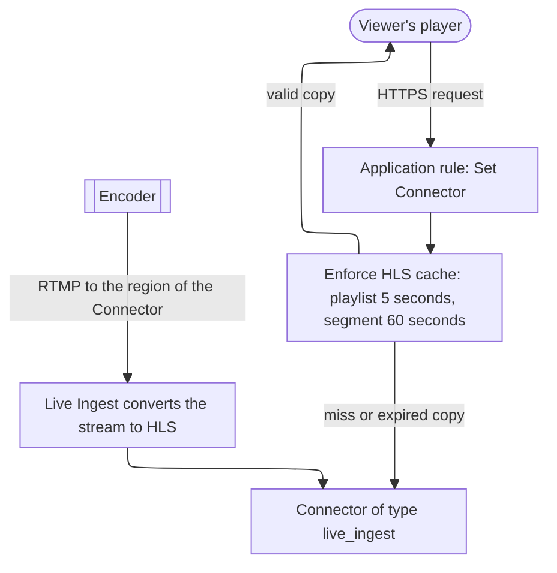

import DocCardGroup from '@aziontech/webkit/doc-card-group'
import DocCard from '@aziontech/webkit/doc-card'
import DocSteps from '@aziontech/webkit/doc-steps'
import DocStep from '@aziontech/webkit/doc-step'
import Tabs from '~/components/webkit/Tabs.vue'

You create a Connector of type `live_ingest` and a rule of your Application, from Azion Console or the API. The Connector sets the region where [Live Ingest](/en/documentation/platform/connectors/live-ingest/) receives your stream, and the rule routes the viewers' requests to Live Ingest. For an HTTP Live Streaming (HLS) stream that your own origin produces, refer to [Enforce HLS cache for live streaming](/en/documentation/guides/media-and-streaming/streaming/enforce-hls-cache/).

Your encoder pushes the stream over Real-Time Messaging Protocol (RTMP) to Live Ingest, a Platform Resource nested in Connectors. Live Ingest converts the stream to HLS: a playlist, `.m3u8`, and the segments it lists, `.ts`. Viewers never reach Live Ingest directly. They request the stream from an Application, and a rule of that Application sets the Connector.



1. The encoder pushes the stream over RTMP to Live Ingest, in the region of the Connector.
2. Live Ingest converts the stream to HLS.
3. A viewer's player requests the stream from the Application, and a rule's _Set Connector_ behavior sets the Connector.
4. The requests that the rule sends to the Connector take the live HLS cache policy of _Enforce HLS cache_: each playlist stays in cache for 5 seconds and each segment for 60 seconds.
5. A valid cached copy answers every viewer, and only an expired or missing copy is fetched through the Connector.

---

## Prerequisites

<Tabs client:visible sharedStore="interface">
<Fragment slot="tab.console">Console</Fragment>
<Fragment slot="tab.api">API</Fragment>

<Fragment slot="panel.console">

### Console

- An Application served by a Workload, with a hostname that viewers request. To create both, refer to [Applications quickstart](/en/documentation/platform/applications/quickstart/).
- An encoder that pushes RTMP with username and password authentication. Azion provides the credentials and the ingest URLs of a primary and a backup endpoint. For the requirement, refer to [Ingestion](/en/documentation/platform/connectors/live-ingest/ingestion-and-delivery/#ingestion).
- Access to Azion Console. Refer to [Access Azion Console](/en/documentation/guides/platform/account-and-billing/how-to-access-azion-console/).

</Fragment>

<Fragment slot="panel.api">

### API

- An Application served by a Workload, with a hostname that viewers request. To create both, refer to [Applications quickstart](/en/documentation/platform/applications/quickstart/).
- An encoder that pushes RTMP with username and password authentication. Azion provides the credentials and the ingest URLs of a primary and a backup endpoint. For the requirement, refer to [Ingestion](/en/documentation/platform/connectors/live-ingest/ingestion-and-delivery/#ingestion).
- A [personal token](/en/documentation/guides/platform/account-and-billing/personal-tokens/).

</Fragment>

</Tabs>

This guide does not cover how you obtain the ingest URLs and credentials, or the URL layout of the playlist that viewers request. The examples use `my-live-connector` for the Connector and `us-east-1` for the region. Replace them with your values.

---

## Create the Live Ingest Connector

A Connector of type `live_ingest` carries one setting, the region where Live Ingest receives the stream. Choose the region closest to the encoder, not to the viewers: it shortens the path the stream travels before Azion receives it. The region takes one of five values: `us-east-1`, `us-east-2`, `br-east-1`, `br-east-2`, or `br-east-3`.

<Tabs client:visible sharedStore="interface">

<Fragment slot="panel.console">

### Console

To create the Connector in Azion Console:

<DocSteps>
  <DocStep title="Open the Connectors page">

  Access [Azion Console](https://console.azion.com/) > **Connectors**.

  </DocStep>
  <DocStep title="Select + Connectors">

  The **Create Connector** page opens.

  </DocStep>
  <DocStep title="Name the Connector">

  In **General**, enter `my-live-connector` as the **Name**.

  </DocStep>
  <DocStep title="Select the Live Ingest type">

  In **Connector Type**, select _Live Ingest_.

  </DocStep>
  <DocStep title="Select the region">

  In **Region**, select _us-east-1_. The field is required.

  </DocStep>
  <DocStep title="Select Save" />
</DocSteps>

The `my-live-connector` Connector exists in your account in `us-east-1`.

</Fragment>

<Fragment slot="panel.api">

### API

To create the Connector, send its name, its type, and its region to the Connectors endpoint:

```bash
curl --request POST \
  --url https://api.azion.com/v4/workspace/connectors \
  --header 'Authorization: Token <personal-token>' \
  --header 'Content-Type: application/json' \
  --data '{
  "name": "my-live-connector",
  "type": "live_ingest",
  "attributes": { "region": "us-east-1" }
}'
```

The API answers `202` with `"state": "pending"`, and the Connector reads back with `"attributes": {"region": "us-east-1"}`. Record its `id`, which the rule holds in `attributes.value`. A request without `region` fails with `10059`, and a region outside the five values fails with `10039`.

</Fragment>
</Tabs>

The Connector exists in your account, and no viewer request reaches it until a rule of the Application sets it. A change to a Connector reaches Azion's distributed infrastructure in several minutes.

In the [Stream live events to large audiences](/en/documentation/use-cases/deliver-media-and-streaming/stream-live-events-to-large-audiences/) use case, this section takes these values:

| Setting | Value |
| --- | --- |
| **Name** | `live-ingest-us`, which the delivery rule sets |
| **Type** | _Live Ingest_, `live_ingest` in the API |
| **Region** | `us-east-1`, the region closest to the venue |

The Connector exists in your account in `us-east-1`, and no viewer request reaches it until a rule of the Application sets it.

---

## Send the viewers' requests to the Connector

A Request Phase rule with the _Set Connector_ behavior sets the Connector for the requests it matches. On an Application that serves only the stream, the rule matches every path: `${uri}` starts with `/`. When several matching rules carry _Set Connector_, only the last one runs, so keep this rule after any rule that sets another Connector for every path. A new rule goes after the rules the Application already has.

<Tabs client:visible sharedStore="interface">

<Fragment slot="panel.console">

### Console

To create the rule in Azion Console:

<DocSteps>
  <DocStep title="Open the Application">

  Access [Azion Console](https://console.azion.com/) > **Applications**, and select the Application that delivers the stream.

  </DocStep>
  <DocStep title="Select the Rules Engine tab" />
  <DocStep title="Select + Rule" />
  <DocStep title="Name the rule">

  In **General**, enter `send-to-live-ingest` as the **Name**.

  </DocStep>
  <DocStep title="Select the request phase">

  In **Phase**, select _Request Phase_.

  </DocStep>
  <DocStep title="Set the criterion">

  Under **Criteria**, select the variable `${uri}` and the operator _starts with_, and enter `/` as the argument.

  </DocStep>
  <DocStep title="Select the Set Connector behavior">

  Under **Behaviors**, select _Set Connector_.

  </DocStep>
  <DocStep title="Select the Live Ingest Connector">

  In the _Set Connector_ behavior, select `my-live-connector`.

  </DocStep>
  <DocStep title="Select Save" />
</DocSteps>

The rule appears in the **Rules Engine** tab, under the **Request** heading.

</Fragment>

<Fragment slot="panel.api">

### API

To create the rule, send it to the Request Phase rules of the Application. Replace `<connector-id>` with the `id` of the Connector:

```bash
curl --request POST \
  --url https://api.azion.com/v4/workspace/applications/<application-id>/request_rules \
  --header 'Authorization: Token <personal-token>' \
  --header 'Content-Type: application/json' \
  --data '{
  "name": "send-to-live-ingest",
  "active": true,
  "criteria": [[{ "variable": "${uri}", "conditional": "if", "operator": "starts_with", "argument": "/" }]],
  "behaviors": [{ "type": "set_connector", "attributes": { "value": <connector-id> } }]
}'
```

The API answers `202` with `"state": "pending"` and the stored rule, whose `behaviors` hold `set_connector` alone. _Enforce HLS cache_ has no API `type` to send.

</Fragment>
</Tabs>

Every request of the Application now reaches the stream through the Connector, under the live HLS cache policy. A new rule can take a few minutes to propagate.

That policy comes from [Enforce HLS cache](/en/documentation/platform/applications/rules-engine/#enforce-hls-cache): it bypasses the cache settings of the Application, and it keeps each playlist in cache for 5 seconds and each segment for 60 seconds. A _Set Cache Policy_ behavior on these requests therefore has no effect, so do not add one. One cached copy of a segment answers every viewer who requests it in that time, so a large audience does not send each of its requests to Live Ingest.

In the [Stream live events to large audiences](/en/documentation/use-cases/deliver-media-and-streaming/stream-live-events-to-large-audiences/) use case, this section takes these values:

| Setting | Value |
| --- | --- |
| **Name** | `live - send to Live Ingest`, in the Request Phase |
| **Criterion** | `${uri}` starts with `/`, because the Application on `live.example.com` serves only the stream |
| **Behavior** | _Set Connector_, setting `live-ingest-us` |

The rule sets the `live-ingest-us` Connector.

---

## Confirm that the stream answers from cache

Run these requests while the encoder is streaming. Each sends the `Pragma: azion-debug-cache` header, which makes the response carry the `x-cache` header. The examples use `live.example.com` for the hostname that viewers request. Replace it, `<stream>`, and `<segment>` with your values.

:::note
A test transmission is ingested like a real one, and it is billed. For what Live Ingest bills and the rate, refer to [Pricing](/en/documentation/fundamentals/pricing/#live-ingest).
:::

Request the playlist twice within 5 seconds:

```bash
curl -sI -H "Pragma: azion-debug-cache" https://live.example.com/<stream>.m3u8
```

The second response carries `x-cache: HIT`. The first can carry `MISS`, while the Application fetches the playlist through the Connector.

Take the name of a segment from the playlist body, and request it twice within 60 seconds:

```bash
curl -sI -H "Pragma: azion-debug-cache" https://live.example.com/<segment>.ts
```

The second response carries `x-cache: HIT`. For how to read the header, refer to [Check the cache status of a response](/en/documentation/guides/application-performance/cache-and-purge/check-page-cache-time/).

In the [Stream live events to large audiences](/en/documentation/use-cases/deliver-media-and-streaming/stream-live-events-to-large-audiences/) use case, expect:

- **Viewers can play the stream.** Load `https://live.example.com/<stream>.m3u8` in an HLS player, such as the hls.js configuration in [Connectors best practices](/en/documentation/platform/connectors/best-practices/#give-the-player-a-fallback-for-load-errors). The player starts the stream and keeps advancing as the encoder pushes it.

---

## Next steps

<DocCardGroup cols={2}>
  <DocCard title="Ingestion and delivery" href="/en/documentation/platform/connectors/live-ingest/ingestion-and-delivery/" label="How Live Ingest takes the stream in a region, and how the Application delivers it." />
  <DocCard title="Query Live Ingest connected users" href="/en/documentation/guides/platform/observability/query-connected-users-data-with-graphql/" label="Count the unique sessions of the stream per host, during and after the event." />
</DocCardGroup>
