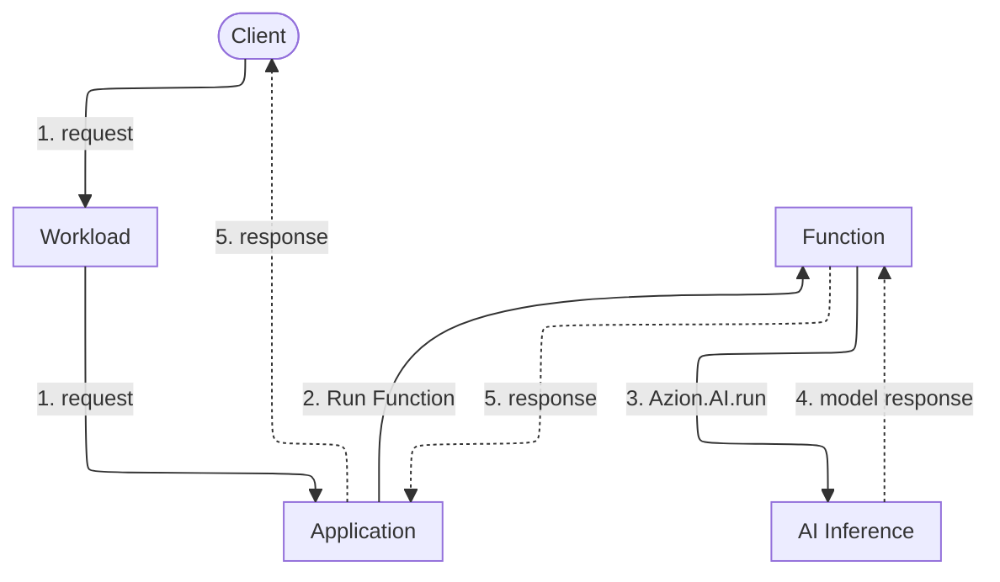

import DocButton from '~/components/webkit/DocButton.vue';
import DocCardGroup from '@aziontech/webkit/doc-card-group'
import DocCard from '@aziontech/webkit/doc-card'

**AI Inference** is a Platform Resource that runs open-source AI models on Azion's distributed infrastructure, in response to the calls your [Functions](/en/documentation/platform/functions/) send. Running a trained model on an input is called inference: the model computes an output from the weights it learned in training. That output can be generated text, a ranking, or a vector of numbers that represents the input. A model answers only after its weights sit in memory, on hardware sized for them. An inference service keeps the models in memory, so you provision no hardware for them.

A Function passes a model id and a request body to `Azion.AI.run`, then awaits the model response. Use AI Inference to generate text from a prompt, extract the text from an image, convert a document into a vector for retrieval, or rank a set of documents against a query.

<DocButton href="/en/documentation/platform/ai-inference/quickstart/" label="Quickstart" size="medium" />
<DocButton href="/en/documentation/platform/ai-inference/reference/" label="AI Inference reference" kind="secondary" size="medium" />

---

## Request path

A Function calls a model while it handles a request, so the request stays open until the model response returns. The diagram follows one request from the client to the model and back.

Solid arrows carry the request, and dotted arrows carry the response. Each label starts with the number of its step below.



1. The request reaches a data center near the client through a domain of your [Workload](/en/documentation/platform/workloads/). The deployment of that Workload sets the [Application](/en/documentation/platform/applications/) that receives it.
2. A rule of the Application runs the Function with the _Run Function_ behavior.
3. The Function passes the model id and the request body to `Azion.AI.run`.
4. AI Inference runs the model and returns its response to the Function.
5. The Function builds its response from the model response, and the Application delivers it to the client.

Workloads receives the request, Applications runs the rule, and Functions runs your code on [Azion Runtime](/en/documentation/devtools/runtime/). To see which side of that path Azion operates and which side you own, refer to [How AI Inference works](/en/documentation/platform/ai-inference/how-it-works/).

---

## Function code

This Function code sends a chat request to a model and reads the generated text:

```ts
const modelResponse = await Azion.AI.run("Qwen/Qwen3-30B-A3B-Instruct-2507-FP8", {
  "stream": false,
  "messages": [
    { "role": "system", "content": "You are a helpful assistant." },
    { "role": "user", "content": "Name three European capitals." }
  ]
})

const answer = modelResponse?.choices?.[0]?.message?.content
```

- `Azion.AI.run` takes the model id first: the string a model answers to. Ids follow no single pattern, so copy each one from the model's page in [AI models](/en/documentation/platform/ai-inference/models/).
- The request body comes second. `messages` holds the conversation, and fields such as `stream`, `max_tokens`, and `temperature` control the output. [Model invocation](/en/documentation/platform/ai-inference/model-invocation/) lists every field a body accepts.
- `Azion.AI.run` returns a promise. The Function awaits it and finds the generated text at `choices[0].message.content` of the resolved value.
- The code passes no host, no base URL, and no credential: the model id is the only address.

A request body or a response object written for the OpenAI chat completions format reads the same here, and only the call that sends it changes.

---

## Scope and limits

- **Access**: on the Hobby and Pro plans, AI Inference is available upon request, subject to approval. For the access each plan gives, refer to [AI Inference limits](/en/documentation/platform/ai-inference/limits/).
- **Models**: the catalog holds open-source large language models, vision language models that read text and images, an embedding model, and a reranker. Each model page states the id to pass and the capabilities the model supports, and `Azion.AI.models()` returns the ids your account can call. For the full list, refer to [AI models](/en/documentation/platform/ai-inference/models/).
- **Context length**: the context a model accepts varies by model, from 8k to 131k tokens across the catalog. Check the page of the model you call before you size a prompt.
- **Input**: all models accept text. A model that also accepts images reads each image from a URL, inside a content part of the message.
- **Streaming**: with `stream` set to `true`, the model streams its response instead of returning it whole. The endpoint of the AI Inference Starter Kit relays that stream as server-sent events, one `data:` line per chunk, ending with `data: [DONE]`.
- **Interfaces**: a Function calls `Azion.AI.run`, which takes no credential. Over HTTP, an Application deployed from the [AI Inference Starter Kit](/en/documentation/guides/application-development/frameworks/ai-inference-starter-kit/) template serves an OpenAI-compatible endpoint on its domain. The `model` field of the request body selects the model, and the template configures no authentication in front of the endpoint. Both interfaces carry the request body that [Model invocation](/en/documentation/platform/ai-inference/model-invocation/) documents.
- **Local testing**: under `azion dev`, `Azion.AI` is `undefined`, so test model calls on a deployed Function. For the error the local call throws, refer to [AI Inference API](/en/documentation/devtools/runtime/api-reference/ai/).
- **Management**: Azion Console has no AI Inference screen, and neither the v4 Azion API nor the Azion CLI has an operation for AI Inference or its models. The entity you create and manage is the Function that calls a model, through the interfaces [Functions](/en/documentation/platform/functions/) documents.
- **Model adaptation**: [LoRA Fine-Tune](/en/documentation/platform/ai-inference/lora-fine-tune/), an extension of AI Inference, adapts a model to a task with Low-Rank Adaptation. Each model page states whether the model accepts it.
- **Vectors**: [SQL Database](/en/documentation/platform/sql-database/) stores and queries the vectors an embedding model returns. [Vector search](/en/documentation/platform/sql-database/vector-search/) covers the semantic search a retrieval-augmented generation flow runs on them.
- **Termination**: Azion may terminate a model, without prior notice, when it consumes more than the maximum defined memory or runs longer than the maximum allowed time. A model created and not executed for more than three days may be deprovisioned. [AI Inference limits](/en/documentation/platform/ai-inference/limits/) covers each condition.
- **Model terms**: a model may carry third-party license terms, and you are responsible for complying with them and for the output the model generates. Azion does not verify that output for accuracy.
- **Observability**: because a model call runs inside a Function on an Application, its traffic shows where that Application's traffic shows. [Real-Time Metrics](/en/documentation/platform/real-time-metrics/) reports it, and [Real-Time Events](/en/documentation/platform/real-time-events/) carries the requests and the Function's console logs, `AIError` messages included.
- **Billing**: [Pricing](/en/documentation/fundamentals/pricing/#ai-inference) states how a model call is measured and charged.

---

## Next steps

<DocCardGroup cols={2}>
  <DocCard title="Quickstart" href="/en/documentation/platform/ai-inference/quickstart/" label="Send a first request to a model with no code to write." />
  <DocCard title="How it works" href="/en/documentation/platform/ai-inference/how-it-works/" label="Trace a request from your domain to the model and back." />
  <DocCard title="AI models" href="/en/documentation/platform/ai-inference/models/" label="Pick a model and copy the id it answers to." />
  <DocCard title="Model invocation" href="/en/documentation/platform/ai-inference/model-invocation/" label="Find a request field with its default and its bounds." />
  <DocCard title="AI Inference guides" href="/en/documentation/platform/ai-inference/guides/" label="Follow a guide or a reference architecture." />
  <DocCard title="Limits" href="/en/documentation/platform/ai-inference/limits/" label="Check when Azion terminates a model or deprovisions one." />
</DocCardGroup>
