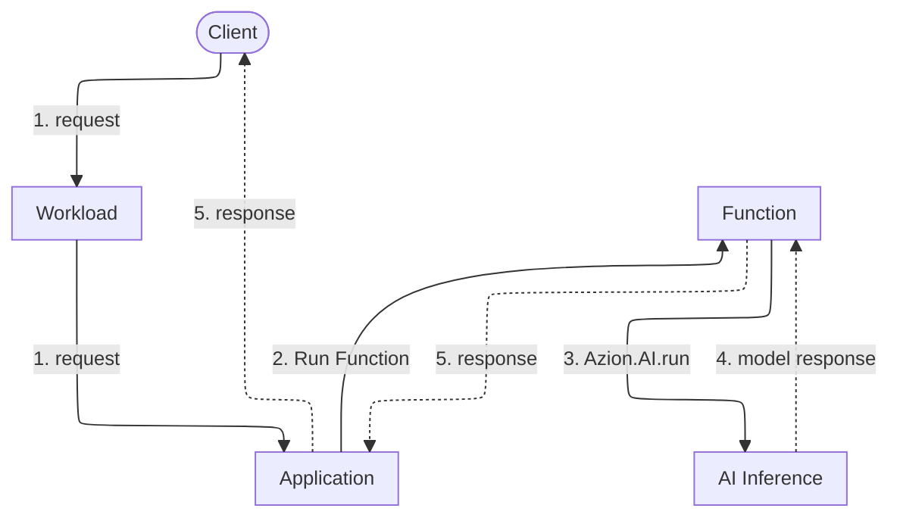

import FrameBox from '@aziontech/webkit/frame-box'
import ItemList from '@aziontech/webkit/item-list'
import DocItem from '@aziontech/webkit/doc-item'

When an application needs a model to answer something, it sends the input and holds the request open while the model generates a response. It then returns that response to the caller. Every model call has that shape. What differs from one platform to another is where the model runs and how much of it you operate.

[AI Inference](/en/documentation/platform/ai-inference/) is a Platform Resource that runs AI models, and a [Function](/en/documentation/platform/functions/) calls one with `Azion.AI.run`. That runtime binding takes a model id and a request body. The call happens inside the Function's execution, so a single piece of your code holds both the request that arrived and the answer the model produced.

Three adjacent subjects have their own pages. [LoRA Fine-Tune](/en/documentation/platform/ai-inference/lora-fine-tune/) is the extension that adapts a model with LoRA, and it names the models that accept it. The vectors an embedding model returns are stored and queried with [Vector search](/en/documentation/platform/sql-database/vector-search/) in SQL Database. For the request body field by field, refer to [Model invocation](/en/documentation/platform/ai-inference/model-invocation/).

The mechanisms are the model call itself, the invocation chain, the binding and the HTTP endpoint, what Azion runs against what you own, and what the design costs.

---

## The model call

A model call starts in the code you deploy. `Azion.AI.run` is the runtime binding that makes it, and it takes two arguments: the id of the model, and the request body. The call is asynchronous, so the Function awaits it and reads the model response from the resolved value. For a chat model, the generated text sits at `choices[0].message.content` inside that response.

The id is the only address the code passes: `Azion.AI.run` takes no base URL, no host, and no credential. Model ids do not follow a single form: some are a repository path such as `Qwen/Qwen3-30B-A3B-Instruct-2507-FP8`, and others a lowercase string such as `qwen-qwen25-vl-3b-instruct-awq`. Copy the id from the model's own page in [AI models](/en/documentation/platform/ai-inference/models/) rather than deriving it from the model name, or list the ids your account can call with `Azion.AI.models()`. A call rejects with `AIError: model not found or not allowed` when the id does not exist or when the account has no access to the model, and the error does not say which.

Around the call, the Function is ordinary code. It can preprocess the input before it invokes the model and shape what the model returns before the caller sees it. The same execution can also retrieve context from a store and reach an external service, all within one request.

---

## The invocation chain

This diagram traces one request, from the client to the model and back. Solid arrows carry the request, and dotted arrows carry the response. Each label starts with the number of its step below.

1. The request reaches a data center near the client through a domain of a [Workload](/en/documentation/platform/workloads/). The Workload's deployment sets the Application that receives the request.
2. A rule of the Application runs the Function with the _Run Function_ behavior.
3. The Function calls the model with `Azion.AI.run`, passing the model id and the request body.
4. AI Inference runs the model and returns the model response to the Function.
5. The Function builds its response from the model response, and the Application delivers it to the client.

Four Platform Resources carry that chain, on Azion's distributed infrastructure. Workloads receives the request, and the deployment of the Workload sets the Application. [Applications](/en/documentation/platform/applications/) runs the rule that calls the Function. Functions runs the code that calls the model, on [Azion Runtime](/en/documentation/devtools/runtime/). AI Inference runs the model.

---

## The binding and the HTTP endpoint

A request reaches a model through one of two interfaces, and both end at the same binding.

The first is the binding itself. Inside a Function, the code calls `Azion.AI.run` directly. The Function decides which model answers, what the request body carries, and what happens before and after.

The second is an OpenAI-compatible HTTP endpoint that an Application you deploy serves on its domain. The [AI Inference Starter Kit](/en/documentation/guides/application-development/frameworks/ai-inference-starter-kit/) template deploys such an Application. [Model invocation](/en/documentation/platform/ai-inference/model-invocation/) carries the path, the domain form, and the request the endpoint accepts.

Behind the endpoint there is still a Function, and it calls `Azion.AI.run` the way any other Function does. In the Function that the template installs, the `model` field of the request body selects the model, and the Function passes the whole body to the binding. The second interface is therefore the first one with an Application in front of it, published in a request shape that clients already speak. The template configures no authentication in front of the endpoint, so any check it performs is one you add to your Application.

---

## What Azion runs and what you own

The invocation chain crosses a line between what Azion operates and what you deploy. Where that line falls is what tells you which side a problem sits on.

Azion runs the models and the infrastructure that executes them. You load no model, size no cluster, and keep no inference server running. You also do not select which data center serves a request: Azion routes it to a data center near the client.

You own everything that decides what the model is asked. The Function is your code: the input handling, the prompt, the model id, the request body, and the response the caller finally receives. The Application in front of the Function is yours as well, along with the domain your Workload answers on and the authentication the Application checks. When a response is wrong, start with the input your Function sent.

The models also carry terms of their own. A model may be subject to third-party license terms, and you are responsible for complying with them and for the output the model generates. Azion does not verify that output for accuracy.

---

## What the design costs

Running a model from inside a Function keeps the request and the model call in one execution. Three things pay for that.

The model call happens inside one execution. The Function awaits it, so the time the model takes to generate is time the Function spends waiting, and the request stays open for both. That wait counts toward the Function's execution time, which is wall-clock time, and not toward its CPU time. The Function's own limits are in [Functions limits](/en/documentation/platform/functions/limits/), and the conditions Azion applies to a model are in [AI Inference limits](/en/documentation/platform/ai-inference/limits/).

Azion bounds the model side as well. Azion may terminate, without prior notice, a model that consumes more than the maximum defined memory, or that runs longer than the maximum allowed time. A model that is created and then not executed for more than three days may be deprovisioned. For what each of those conditions covers, refer to [AI Inference limits](/en/documentation/platform/ai-inference/limits/).

The OpenAI-compatible endpoint is a shape your Application serves. You deploy the Application that exposes it, you keep it running, and you secure it, so the endpoint is yours to change and yours to keep answering.

---

## Related resources

<FrameBox>
<ItemList>
  <DocItem title="Model invocation" href="/en/documentation/platform/ai-inference/model-invocation/">Every field the request body accepts, on both interfaces.</DocItem>
  <DocItem title="AI Inference quickstart" href="/en/documentation/platform/ai-inference/quickstart/">Deploy an Application and send a first request to a model.</DocItem>
  <DocItem title="AI Inference limits" href="/en/documentation/platform/ai-inference/limits/">The conditions under which Azion terminates or deprovisions a model.</DocItem>
  <DocItem title="Add AI features to existing applications" href="/en/documentation/use-cases/build-and-run-ai-workloads/add-ai-features-to-existing-applications/">The deployed shape around a model call, where your Application is the inference endpoint.</DocItem>
</ItemList>
</FrameBox>
