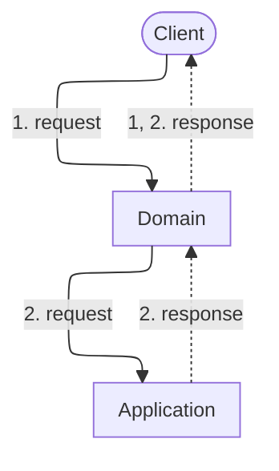

import DocButton from '~/components/webkit/DocButton.vue'
import DocCardGroup from '@aziontech/webkit/doc-card-group'
import DocCard from '@aziontech/webkit/doc-card'

**Domains** is a Platform Resource that generates and manages the domains through which requests reach your applications on Azion. A domain is the hostname your clients request, and each domain names the hostnames it serves and the application that answers them. Use Domains to get an Azion domain, list the custom domains you own, bind a digital certificate for HTTPS, or ask clients for a certificate with mTLS.

Each domain can use these features:

- [Azion domain](/en/documentation/platform/domains/reference/#environment) is the hostname that Azion generates when you build an application, in the format `xxxx.map.azionedge.net`. You can create more than one domain for an application.
- [Staging Network](/en/documentation/platform/domains/reference/#environment) is an environment for testing an application before it goes operational, with its own Azion domain in the format `xxxx.preview.azionedge.net`. It leaves the production environment untouched.
- [CNAME](/en/documentation/platform/domains/reference/#cname) lists the custom domains you own, so a domain answers your hostnames. **CNAME Access Only** closes the Azion domain to requests.
- [Digital Certificate](/en/documentation/platform/domains/reference/#digital-certificate) binds a TLS certificate to a domain that uses HTTPS. You can upload your own or have Azion manage a Let's Encrypt™ certificate.
- [mTLS](/en/documentation/platform/domains/reference/#mtls) makes a domain ask each client for a certificate during the TLS handshake and validate it against a Trusted CA certificate.

<DocButton href="/en/documentation/platform/domains/quickstart/" label="Quickstart" size="medium" />
<DocButton href="/en/documentation/platform/domains/reference/" label="Domains reference" kind="secondary" size="medium" />

## Request path

Creating a domain does not send traffic to it: a request reaches your application only when it names a hostname that the domain serves. A custom domain also needs a DNS record at your DNS provider that points the hostname at the domain.

Solid arrows carry the request, and dotted arrows carry the response. Each label starts with the number of its step below.

1. The client requests a hostname that the domain serves: its Azion domain, or a custom domain whose DNS record points at it.
2. The domain passes the request to the application it names.

## Next steps

<DocCardGroup cols={2}>
  <DocCard title="Quickstart" href="/en/documentation/platform/domains/quickstart/" label="Create your first domain and list a hostname you own." />
  <DocCard title="Domains reference" href="/en/documentation/platform/domains/reference/" label="Look up the fields of a domain, its environments, and its mTLS settings." />
  <DocCard title="Limits" href="/en/documentation/platform/domains/limits/" label="Look up the number of CNAMEs a domain takes." />
  <DocCard title="Glossary" href="/en/documentation/platform/domains/glossary/" label="Check what Azion domain, custom domain, and Azion SAN mean." />
  <DocCard title="Point a domain to a workload" href="/en/documentation/guides/platform/migration/point-domain-to-azion/" label="Create the DNS record that sends your hostname to your domain." />
  <DocCard title="Bind a certificate to a domain" href="/en/documentation/guides/application-security/tls-and-certificates/digital-certificates/#bind-the-certificate-to-a-v3-domain" label="Serve HTTPS on your hostname with a certificate you select on the domain." />
</DocCardGroup>
