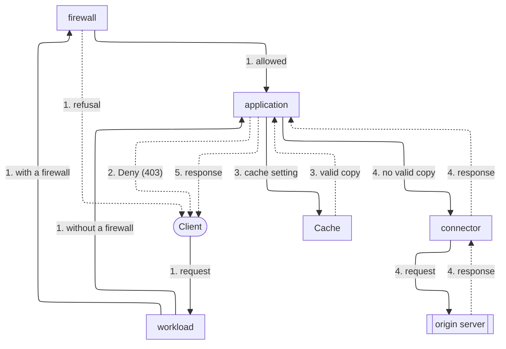

import DocButton from '~/components/webkit/DocButton.vue'
import DocCardGroup from '@aziontech/webkit/doc-card-group'
import DocCard from '@aziontech/webkit/doc-card'
import VersionRollingOut from '~/includes/snippets/versionRollingOut/en/snippet.mdx'

<VersionRollingOut>[Applications | v3](/en/documentation/platform/applications/v3/)</VersionRollingOut>

**Applications** is a Platform Resource that runs a reverse proxy for your [workloads](/en/documentation/platform/workloads/) on Azion's distributed infrastructure, from the data center nearest to your user. A reverse proxy is a server in front of your origin, the server that holds your content. It can answer each request with a cached copy of an earlier origin response, add or remove headers, run code, or route the request to your origin. Every request passes through the proxy. Your clients therefore reach a single domain, and the proxy runs the logic that each origin would otherwise repeat.

An application is the object you create in Applications. It receives the requests of the workloads whose deployment sets it. On each request, it runs its rules. A rule can set the [connector](/en/documentation/platform/connectors/) that routes the request to your origin, decide whether the response is cached, or run a function. Use Applications to route each path to its origin, cache responses, add or remove headers, rewrite requests, run your own code, or resize and convert images on demand.

<DocButton href="/en/documentation/platform/applications/quickstart/" label="Quickstart" size="medium" />
<DocButton href="/en/documentation/platform/applications/rules-engine/" label="Applications reference" kind="secondary" size="medium" />

---

## Rule structure

A rule is the unit of logic in an application. Its criteria test each request, and its behaviors run on a request that matches. To route every request to the connector that reaches your origin, send this rule as the body of `POST /v4/workspace/applications/<application-id>/request_rules`:

```json
{
  "name": "send-to-origin",
  "active": true,
  "criteria": [
    [
      {
        "variable": "${uri}",
        "conditional": "if",
        "operator": "starts_with",
        "argument": "/"
      }
    ]
  ],
  "behaviors": [
    {
      "type": "set_connector",
      "attributes": { "value": <connector-id> }
    }
  ]
}
```

- `criteria` holds groups of conditions, and each group starts with a condition whose `conditional` is `if`. Here, `${uri}` is the URI without its query string. Every path starts with `/`, so `starts_with` and `/` match every request. If the rule tests `${request_uri}` instead, which keeps the query string, the API refuses it with `400` and error `25047` while [Application Accelerator](/en/documentation/platform/applications/application-accelerator/) is off.
- `behaviors` lists the actions the rule runs on a matching request. `set_connector` routes the request to the connector whose ID is in `attributes.value`. That connector holds the address of your origin.
- `name` and `active` belong to the rule itself.
- In Azion Console, the application's **Rules Engine** tab builds the same rule from **+ Rule**, _Request Phase_, a criterion on `${uri}`, and _Set Connector_.

When you send the rule, the API answers `202` and returns it with `order` set to `0`. That value is the rule's position among the Request Phase rules of the application.

The model matches path-based routing in a reverse proxy: each criterion is a match condition, each behavior is an action, and a connector is the backend server.

---

## Request path

Creating an application routes no request to it: it receives only the requests of the workloads whose deployment sets it. It also reaches an origin only through a rule that sets a connector.

Solid arrows carry the request, and dotted arrows carry the response. Each label starts with the number of its step below.



1. The request reaches a workload through one of its domains, and the workload's deployment sets the application. In Azion Console, you set it in the **Application** field of **Deployment Settings**. A [firewall](/en/documentation/platform/firewall/) that the deployment also sets runs its rules first, and it can stop the request there.
2. The application's Request Phase rules run in order. When a behavior ends the processing, as _Deny (403 Forbidden)_ does, the application answers the client, and no later rule runs.
3. If a _Set Cache Policy_ rule applied a cache setting, [Cache](/en/documentation/platform/applications/cache/) looks for a valid copy of the origin response. When Cache holds one, that copy becomes the response, and the origin receives no request.
4. Otherwise, the connector set by a _Set Connector_ rule routes the request to the origin. If several matching rules carry _Set Connector_, only the last of them runs.
5. The application's Response Phase rules then run on the response, and the response reaches the client.

A new application starts with Cache and [Functions](/en/documentation/platform/functions/) on, Application Accelerator and [Image Processor](/en/documentation/platform/applications/image-processor/) off, and no rules.

A change does not take effect at once: it propagates, and Azion guarantees no propagation time. Until the deployment of a new workload propagates, which can take several minutes, the workload answers with Azion's placeholder `404`. During that time, answers alternate between the placeholder and the application, so repeat the request until they agree. For how the two phases work, the order of rules and behaviors, and propagation, refer to [How Applications works](/en/documentation/platform/applications/how-it-works/).

---

## Resources

Cache, Application Accelerator, and Image Processor are Products that act on the requests of an application. Each one has its own switch in [Main Settings](/en/documentation/platform/applications/main-settings/#products) › **Modules**.

### Cache

Cache stores a copy of an origin response in the data center that fetched it and answers later requests for the same object with that copy. The copy stays there until its time to live (TTL) ends. In a new application, Cache is already on. It stores nothing until a _Set Cache Policy_ rule applies a cache setting, the object that holds the TTLs. Use Cache to:

- Keep static files in the data center nearest to your user
- Serve large video files in fragments
- Answer requests while the origin is down
- Remove a copy as soon as the origin changes

The [Cache overview](/en/documentation/platform/applications/cache/) explains what a cache setting holds, how a request reaches a stored copy, and where to start.

### Application Accelerator

Application Accelerator lets a cache setting tell apart two requests for the same URL by a query-string argument, a cookie, the device group, or the request method. Cache then keeps a separate copy for each value. The Application Accelerator switch starts off in a new application. Turn it on when one URL has more than one correct response, for example:

- A personalized page
- An API response that changes with its query string
- A catalog that differs by device
- A response to a `POST`

The [Application Accelerator overview](/en/documentation/platform/applications/application-accelerator/) explains what a variation adds to the cache key, what the switch unlocks, and where to start.

### Image Processor

Image Processor builds a new image, the derived image, from an image on your origin. It follows the `ims` query string of the request, such as `?ims=fit-in/400x400`, and it never saves the derived image as an asset of the account. Its switch starts off in a new application. Even when it is on, it processes only the requests that a Request Phase rule with _Optimize Images_ sends to it. Turn it on when your pages need one image in several sizes, crops, qualities, or formats, such as WEBP for browsers that accept it. No variant then needs a file of its own to store or upload.

The [Image Processor overview](/en/documentation/platform/applications/image-processor/) explains how a request becomes a derived image, what `ims` accepts, and where to start.

---

## Scope and limits

- **Phases**: every rule belongs to one of two phases. The Request Phase acts on the request before a response exists, and the Response Phase acts on the response that the user receives. You choose the phase when you create the rule and cannot change it later, and only Request Phase rules can choose the origin and the cache setting. [Rules Engine for Applications](/en/documentation/platform/applications/rules-engine/#phases) lists the variables and behaviors of each phase and the Product each one needs.
- **Origins**: an application stores no origin of its own, so two rules with two connectors can route `/api/` to one server and every other path to another. The origin behind a connector can be a web server in your infrastructure, a cloud service, or an [Object Storage](/en/documentation/platform/object-storage/) bucket. [Use a bucket as an application origin](/en/documentation/guides/application-development/data/use-bucket-as-origin/) shows the bucket case. Through [Load Balancer](/en/documentation/platform/connectors/load-balancer/), one connector can spread traffic across several origins. Connectors replace the origins that earlier versions of Applications configured on the application.
- **Functions**: a [function instance](/en/documentation/platform/applications/functions-instances/) adds one function from [Functions](/en/documentation/platform/functions/) to the application, with its own arguments. You create it on the application's **Functions Instances** tab, and it runs only when a rule with _Run Function_ invokes it. In a new application, the **Functions** switch starts on. Only Lua functions run in the Response Phase, as the instance form in Azion Console states: `Only Lua functions can be used in the Response phase.` For the steps to add your first function, refer to [Instantiate a function on an application](/en/documentation/guides/application-development/getting-started/instantiate-functions/).
- **Cache and images in code**: code that reads or writes cached entries runs in a function and uses the [Cache API](/en/documentation/devtools/runtime/api-reference/cache/), because Cache itself runs no code. A function that processes images on its own uses the WASM Image Processor library, which is separate from the Image Processor Product. [Where Image Processor stops](/en/documentation/platform/applications/image-processor/image-delivery/#where-image-processor-stops) explains the difference.
- **Devices**: a [device group](/en/documentation/platform/applications/device-groups/) is a name and a regular expression that the application matches against the `User-Agent` header of each request. Both uses of a group need Application Accelerator on: a rule tests the group through `${device_group}`, and a cache setting can keep one copy per group. [Applications best practices](/en/documentation/platform/applications/best-practices/#match-a-device-group-on-the-words-that-only-that-device-sends) shows how to write an expression that matches only the devices you mean.
- **WebSocket**: [WebSocket Proxy](/en/documentation/platform/applications/websocket/) is a Feature of Applications that carries a WebSocket connection between your users and the origin. The connection opens with the `Upgrade: websocket` and `Connection: upgrade` headers. Azion turns the Feature on for an account only on request, and [Support guidelines](/en/documentation/support/) explains how to ask. Because Azion recycles keepalive connections about every 15 minutes, the client must reopen a WebSocket connection when it closes.
- **Workloads**: a workload holds the domains, protocols, and certificates that serve the application, so the application has no delivery settings of its own. [Test an application through the hosts file](/en/documentation/guides/application-development/getting-started/stage-applications-through-hosts-file/) shows how to request an application on your own domain from one device before you change its DNS records. _Redirect HTTP to HTTPS_ works only when the workload has HTTPS. When the connector receives a 4xx or 5xx response from your origin, [Custom Pages](/en/documentation/platform/workloads/#custom-pages) on the workload sets the error page that the client sees.
- **Interfaces**: in [Azion Console](https://console.azion.com), you create and manage applications on the **Applications** page. Each application has five tabs: **Main Settings**, **Device Groups**, **Cache Settings**, **Functions Instances**, and **Rules Engine**. The **Clone** row action of the **Applications** list creates a separate application with the settings of the original, as [Clone an application](/en/documentation/guides/application-development/getting-started/clone-applications/) shows. The [Azion API](https://api.azion.com/) serves applications at `/v4/workspace/applications`. [Azion CLI](/en/documentation/devtools/cli/) manages them with commands such as `azion create application`, `azion update application`, and `azion create rules-engine`. You can also create and configure applications with [`azion.config.js`](/en/documentation/devtools/cli/azion-config-js/), [Azion Lib](/en/documentation/devtools/azion-lib/application/), or the [Azion Terraform provider](/en/documentation/devtools/terraform/). If your account has not migrated to API v4, use [Applications | v3](/en/documentation/platform/applications/v3/).
- **Observability**: turn on **Debug Rules** in [Main Settings](/en/documentation/platform/applications/main-settings/#debug-rules), and [Real-Time Events](/en/documentation/platform/real-time-events/) and [Data Stream](/en/documentation/platform/data-stream/) show the rules that each request ran, in the `$traceback` field. Debug Rules starts off in a new application. To check one response, send the request with `Pragma: azion-debug-cache`: the response reports its cache status, such as `HIT` or `MISS`, in the `x-cache` header. Across all requests, [Real-Time Metrics](/en/documentation/platform/real-time-metrics/) shows the traffic of Cache and [Tiered Cache](/en/documentation/platform/applications/cache/tiered-cache/). [Troubleshoot Applications](/en/documentation/platform/applications/troubleshooting/) lists the tools and queries. For traffic that differs from what you see, refer to [A problem shows in traffic but not in the responses you request](/en/documentation/platform/applications/troubleshooting/#a-problem-shows-in-traffic-but-not-in-the-responses-you-request).
- **Limits**: an application accepts at most 200 rules, counting both phases. Each rule has 1 to 5 groups of 1 to 10 criteria, plus 1 to 10 behaviors. Without Application Accelerator, a cache setting needs a **Max Age** of at least 60 seconds. One cached object can be as large as 10 GB. [Applications limits](/en/documentation/platform/applications/limits/) lists every bound, what happens past it, and the bounds of each Product.
- **Billing**: a Product you turn on can add costs that depend on usage. [Azion pricing](https://www.azion.com/en/pricing/) lists the plans and the usage that each one includes, and [Pricing](/en/documentation/fundamentals/pricing/) lists the rates and the metric that each Product is billed on.
- **Terms**: the [Applications glossary](/en/documentation/platform/applications/glossary/) defines the words that the Applications pages use with a specific meaning, such as rule, phase, behavior, cache setting, cache key, and derived image.

---

## Next steps

<DocCardGroup cols={2}>
  <DocCard title="Quickstart" href="/en/documentation/platform/applications/quickstart/" label="Route every request of a new application to your origin." />
  <DocCard title="How it works" href="/en/documentation/platform/applications/how-it-works/" label="Trace a request through an application, and see where each Product acts on it." />
  <DocCard title="Rules Engine for Applications" href="/en/documentation/platform/applications/rules-engine/" label="Find a variable, an operator, or a behavior, and the Product it needs." />
  <DocCard title="Guides and tutorials" href="/en/documentation/platform/applications/guides/" label="Do a specific task, from a device group to a framework template." />
  <DocCard title="Limits" href="/en/documentation/platform/applications/limits/" label="Find a bound and what happens past it." />
  <DocCard title="Troubleshooting" href="/en/documentation/platform/applications/troubleshooting/" label="Find out why requests never reach the origin, or why a rule does not act." />
</DocCardGroup>
