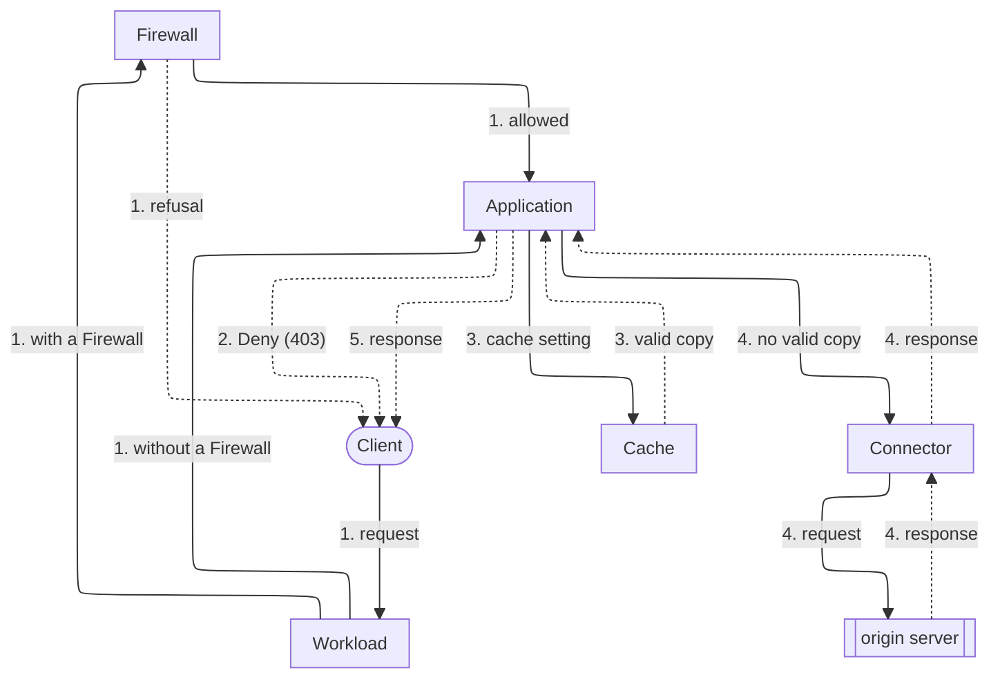

import DocButton from '~/components/webkit/DocButton.vue'
import DocCardGroup from '@aziontech/webkit/doc-card-group'
import DocCard from '@aziontech/webkit/doc-card'
import VersionRollingOut from '~/includes/snippets/versionRollingOut/en/snippet.mdx'

<VersionRollingOut>[Applications | v3](/en/documentation/platform/applications/v3/)</VersionRollingOut>

**Applications** is a Platform Resource that processes the requests received by your [Workloads](/en/documentation/platform/workloads/), from the data center nearest to your user. An Application can run serverless functions, act as a reverse proxy for your origins, or combine the two. It can also store responses with [Cache](/en/documentation/platform/applications/cache/), unlock four capabilities for the cache and the rules with [Application Accelerator](/en/documentation/platform/applications/application-accelerator/), and transform images with [Image Processor](/en/documentation/platform/applications/image-processor/). Use Applications to run a [Function](/en/documentation/platform/functions/), set the [Connector](/en/documentation/platform/connectors/) that reaches each origin, add or remove headers, or rewrite requests.

Each Application can use these nested resources and features:

- [Cache](/en/documentation/platform/applications/cache/) lets an Application answer a request with a copy of an earlier origin response. For example, your static files stay in the data center nearest to your user.
- [Application Accelerator](/en/documentation/platform/applications/application-accelerator/) is a good fit when one URL has more than one correct response, such as a personalized page or a `POST` response. Cache then keeps a separate copy for each value of a query-string argument, a cookie, the device group, or the method.
- [Image Processor](/en/documentation/platform/applications/image-processor/) fits a page that needs one image in several sizes, crops, qualities, or formats, such as WEBP for browsers that accept it. Every variant then comes from one file on your origin, so you store and upload only that file.
- [Device Groups](/en/documentation/platform/applications/device-groups/) lets an Application tell apart the devices that send its requests, so a rule or a cache setting can treat each group differently. It needs Application Accelerator turned on in the Application.
- [Rules Engine for Applications](/en/documentation/platform/applications/rules-engine/) is where you write what an Application does with each request it receives. For example, one rule can route `/api/` to one origin while a second rule routes every other path to another.
- [WebSocket Proxy](/en/documentation/platform/applications/websocket/) lets an Application carry a WebSocket connection between your users and your origin. Azion turns it on for an account only on request.
- A [Function Instance](/en/documentation/platform/applications/functions-instances/) lets an Application run one of your Functions. For example, the same Function can run in more than one Application, each Function Instance with its own arguments.

<DocButton href="/en/documentation/platform/applications/quickstart/" label="Quickstart" size="medium" />
<DocButton href="/en/documentation/platform/applications/reference/" label="Applications reference" kind="secondary" size="medium" />

---

## Request path

Creating an Application routes no request to it: a request reaches an Application only once a Workload's deployment sets that Application. The Application then reaches an origin only through a rule that sets a Connector. In place of an origin, a rule can run a Function that builds the response with no Connector.

The diagram follows a request that reaches an origin. Solid arrows carry the request, and dotted arrows carry the response. Each label starts with the number of its step below.

1. The request reaches a Workload through one of its domains, and the Workload forwards it to the Application. When the Workload's deployment also sets a [Firewall](/en/documentation/platform/firewall/), the Firewall runs its rules first and can refuse the request.
2. The Application runs its Request Phase rules in order. When a behavior, the action a rule runs, ends the processing, as _Deny (403 Forbidden)_ does, the Application answers the client, and no later rule runs.
3. A rule with _Set Cache Policy_ can apply a cache setting, the set of values that tells Cache how to store and serve a response. Cache then looks for a valid copy of the origin response. If Cache holds one, that copy becomes the response, and the origin receives no request.
4. Otherwise, the Connector that a rule with _Set Connector_ sets routes the request to the origin. If several matching rules carry _Set Connector_, only the last of them runs.
5. The Application runs its Response Phase rules on the response, and the response reaches the client.

---

## Next steps

<DocCardGroup cols={2}>
  <DocCard title="Quickstart" href="/en/documentation/platform/applications/quickstart/" label="Route every request of a new Application to your origin." />
  <DocCard title="How it works" href="/en/documentation/platform/applications/how-it-works/" label="Trace a request through an Application, and see where Cache, Application Accelerator, and Image Processor act on it." />
  <DocCard title="Main Settings" href="/en/documentation/platform/applications/main-settings/" label="Find the switches of an Application, Debug Rules, and the interfaces that manage it." />
  <DocCard title="Guides and tutorials" href="/en/documentation/platform/applications/guides/" label="Do a specific task, from a device group to a framework template." />
  <DocCard title="Best practices" href="/en/documentation/platform/applications/best-practices/" label="Configure a device group, WebSocket Proxy, or a nested resource the recommended way." />
  <DocCard title="Limits" href="/en/documentation/platform/applications/limits/" label="Look up where an Application stops, a bound, and what happens past it." />
  <DocCard title="Troubleshooting" href="/en/documentation/platform/applications/troubleshooting/" label="Find out why requests never reach the origin, or why a rule does not act." />
  <DocCard title="Glossary" href="/en/documentation/platform/applications/glossary/" label="Look up a word that the Applications pages use with a specific meaning." />
</DocCardGroup>
