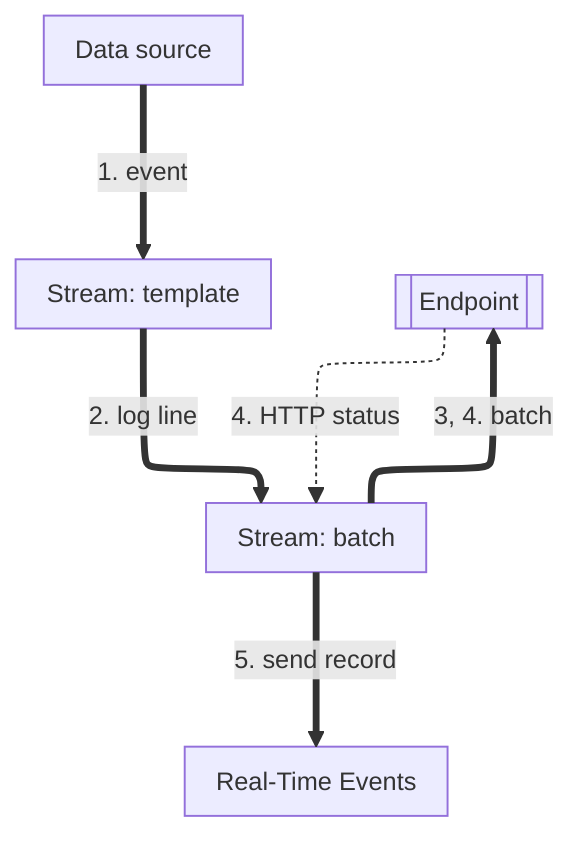

import DocButton from '~/components/webkit/DocButton.vue';
import DocCardGroup from '@aziontech/webkit/doc-card-group'
import DocCard from '@aziontech/webkit/doc-card'

**Data Stream** is a Platform Resource that sends the event logs of your account and its traffic to an endpoint you choose. A log stream is a feed of log records, pushed to a tool you run, such as a security information and event management (SIEM) system. Use Data Stream to [feed WAF events to a SIEM](/en/documentation/guides/application-security/firewall-and-waf/integrate-siems/), [keep request logs in a data warehouse](/en/documentation/guides/platform/observability/endpoint-google-bigquery/), audit account changes, or [debug your Functions](/en/documentation/guides/platform/observability/debugging-functions-data-stream/).

Each stream in Data Stream combines one of each of these parts:

- [Data sources](/en/documentation/platform/data-stream/data-sources-and-variables/) let you pick the events a stream collects: changes to your account, requests to your Applications, messages your Functions log, or requests that WAF analyzed. *WAF Events* needs a Firewall with WAF, and each data source offers its own variables.
- [Templates](/en/documentation/platform/data-stream/templates-and-payload/) set which variables each log line carries and under which keys. Azion provides five preset templates, and you write a custom template to choose your own variables.
- [Endpoints](/en/documentation/platform/data-stream/endpoints/) set where a stream delivers its log lines, such as an HTTP server or a bucket. A stream sends to one endpoint of any of the 11 types, so sending the same events to two endpoints takes two streams.

<DocButton href="/en/documentation/platform/data-stream/quickstart/" label="Quickstart" size="medium" />
<DocButton href="/en/documentation/platform/data-stream/reference/" label="Data Stream reference" kind="outlined" size="medium" />

---

## Event path

A stream does not send each event as it happens: it renders events as log lines and sends them to its endpoint in batches.

Saving a stream as active is the only activation step it needs. After you create or activate a stream, it can take several minutes to start collecting events. It does not send the events from before that.

Thick arrows carry the stream's data, and the dotted arrow carries the endpoint's answer. Each label starts with the number of its step below.

1. The data source records an event, and the stream keeps the event when it falls inside the stream's sampling rate or workload filter.
2. The template turns the event into one log line, where each key takes the value of a variable from the template's data set, such as `"status": "$status"`.
3. The log line joins a batch, which closes at a line count or at a time limit, whichever comes first, per [Data Stream limits](/en/documentation/platform/data-stream/limits/#default-limits).
4. The stream sends the batch to the endpoint, and the endpoint answers with an HTTP status. When the endpoint is unavailable or answers with an error, the log lines of that send do not reach it.
5. [Real-Time Events](/en/documentation/platform/real-time-events/data-sources/#data-stream) records the send with a status code, its number of log lines, and its size in bytes.

Saving a stream validates the format of its fields and does not contact the endpoint. The first send records in Real-Time Events show whether the endpoint accepts the batches. For each stage in depth, refer to [How Data Stream works](/en/documentation/platform/data-stream/how-it-works/).

---

## Next steps

<DocCardGroup cols={2}>
  <DocCard title="Quickstart" href="/en/documentation/platform/data-stream/quickstart/" label="Send your first logs to a bucket." />
  <DocCard title="How it works" href="/en/documentation/platform/data-stream/how-it-works/" label="Follow an event from its data source to your endpoint." />
  <DocCard title="Stream settings" href="/en/documentation/platform/data-stream/stream-settings/" label="Look up each field of a stream in Azion Console and the API." />
  <DocCard title="Data Stream guides and tutorials" href="/en/documentation/platform/data-stream/guides/" label="Complete a specific task with a stream." />
  <DocCard title="Best practices" href="/en/documentation/platform/data-stream/best-practices/" label="Scope and shape streams so that several of them run together." />
  <DocCard title="Limits" href="/en/documentation/platform/data-stream/limits/" label="Look up a batch size, a field bound, or a sampling rule." />
  <DocCard title="Troubleshooting" href="/en/documentation/platform/data-stream/troubleshooting/" label="Find why a stream sends nothing or an endpoint gets no logs." />
  <DocCard title="Glossary" href="/en/documentation/platform/data-stream/glossary/" label="Look up a term that the Data Stream pages use." />
</DocCardGroup>
