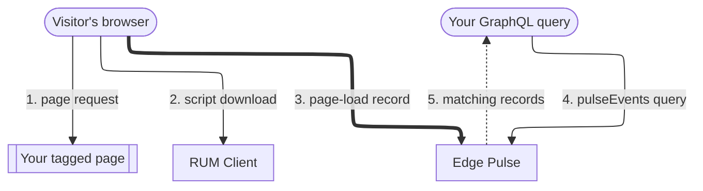

import DocButton from '~/components/webkit/DocButton.vue'
import DocCardGroup from '@aziontech/webkit/doc-card-group'
import DocCard from '@aziontech/webkit/doc-card'

**Edge Pulse** is a Platform Resource that collects page-load measurements from the browsers of the people who visit your pages. [Real user monitoring](https://www.azion.com/en/learning/observability/what-is-real-time-monitoring/) measures a site from its visitors' devices: a script in each page reports how the visit loaded, instead of a scheduled test. Use Edge Pulse to compare page load times across your pages, see which connection types your visitors have, and find pages reached through redirects.

Edge Pulse reaches your pages through one script:

- [Edge Pulse JavaScript tag](/en/documentation/platform/edge-pulse/javascript-tag/) is what you add to a page to have its loads measured, in one of two forms from Azion Console. The two forms load the script in different ways, which matters on a page with a Content Security Policy.

<DocButton href="/en/documentation/platform/edge-pulse/quickstart/" label="Quickstart" size="medium" />
<DocButton href="/en/documentation/platform/edge-pulse/reference/" label="Edge Pulse reference" kind="outlined" size="medium" />

---

## Request path

A tagged page does not report every visit: a browser sends at most one record every 30 minutes for each scheme and host. Edge Pulse receives a record only from a page that carries the tag.

The diagram follows one page load until a query reads its record. Solid arrows carry a request, the thick arrow carries the page-load record, and dotted arrows carry the response. Each label starts with the number of its step in the list.

1. A visitor's browser loads a page of yours that carries the Edge Pulse JavaScript tag.
2. The tag has the browser download the RUM Client, the script that takes the measurement. The measurement starts at least 2 seconds after the load event, so a visit that ends earlier sends nothing.
3. When 30 minutes have passed since that browser's last record for the same scheme and host, the RUM Client sends one page-load record. The time of that last record lives in the browser's local storage, so a private window starts over. The record carries the page address, the Navigation Timing values, the connection estimate, and the ID that the tag holds in its address.
4. You send a GraphQL query on the `pulseEvents` dataset to the endpoint of the Real-Time Events GraphQL API, with a token of your account.
5. The API answers with the matching records. In a test on one account, it returned the records carrying that account's client ID, about one minute after the browser sent them.

---

## Next steps

<DocCardGroup cols={2}>
  <DocCard title="Quickstart" href="/en/documentation/platform/edge-pulse/quickstart/" label="Copy the tag, add it to your pages, and find where the measurements are read." />
  <DocCard title="How it works" href="/en/documentation/platform/edge-pulse/how-it-works/" label="Follow one measurement from the tagged page to the query that reads it." />
  <DocCard title="Query Edge Pulse measurements with GraphQL" href="/en/documentation/guides/platform/observability/query-edge-pulse-measurements-with-graphql/" label="Write the queries that read load times per page." />
  <DocCard title="Real-Time Events GraphQL API fields" href="/en/documentation/devtools/graphql/gql-real-time-events-fields/" label="Look up the fields of pulseEvents and the arguments a query takes." />
  <DocCard title="Pricing" href="/en/documentation/fundamentals/pricing/#edge-pulse" label="Check which plans include Edge Pulse." />
  <DocCard title="Glossary" href="/en/documentation/platform/edge-pulse/glossary/" label="Look up a word that the Edge Pulse pages use with a specific meaning." />
</DocCardGroup>
