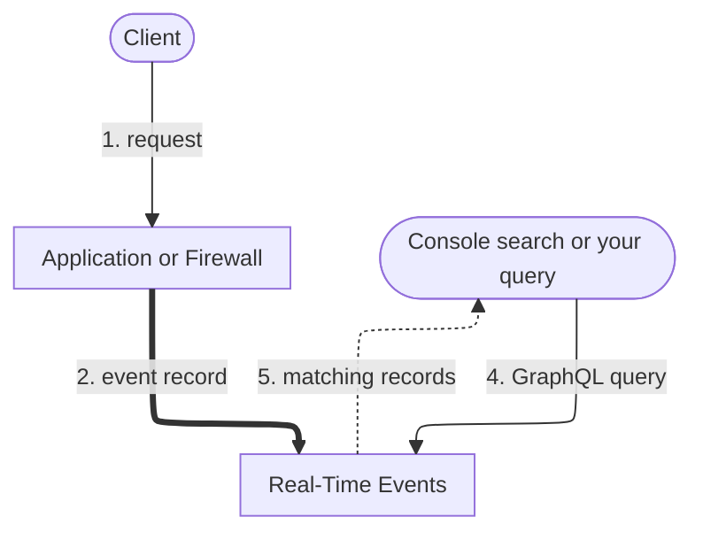

import DocButton from '~/components/webkit/DocButton.vue'
import DocCardGroup from '@aziontech/webkit/doc-card-group'
import DocCard from '@aziontech/webkit/doc-card'

**Real-Time Events** is a Platform Resource that serves your event records from Azion's distributed infrastructure, in [Azion Console](https://console.azion.com/) and through the [GraphQL API](/en/documentation/devtools/graphql/). An _event record_, or _log_, describes one request or action, such as its source address, path, and status, so you can search what happened later. Use Real-Time Events to trace a slow request through an [Application](/en/documentation/platform/applications/), inspect an attack, debug a [Function](/en/documentation/platform/functions/), or check who changed your account.

Real-Time Events sorts the records it keeps by kind of event:

- [Data sources](/en/documentation/platform/real-time-events/data-sources/) lets you find the kind of event record that answers your question, such as the requests your Applications and Firewalls receive. Each data source also names its dataset in the GraphQL API.

<DocButton href="/en/documentation/platform/real-time-events/quickstart/" label="Quickstart" size="medium" />
<DocButton href="/en/documentation/platform/real-time-events/reference/" label="Real-Time Events reference" kind="outlined" size="medium" />

---

## Request path

Real-Time Events records nothing on its own: a record exists only after a Platform Resource handles a request or an action.

The diagram follows one request until a search reads its record. Solid arrows carry a request, the thick arrow carries the event record, and dotted arrows carry the response. Each label starts with the number of its step in the list.

1. A client sends a request, and the Platform Resource that handles it, such as an Application or a Firewall, serves it.
2. That Platform Resource writes one event record for the request, with a value for each field of its data source. A request that also runs a Function leaves a record in the data source of Functions too, and other events, such as a DNS query or a change to your account, go to data sources of their own.
3. Real-Time Events keeps the record until its retention period ends, and then removes it, whether or not a search read it. The record becomes searchable some seconds after the request, so a search that runs at once can miss it.
4. A search in Azion Console and a query you write both send a GraphQL query to the same API. The query names one data source, a period, and the filters that narrow it.
5. The API answers with the records that match, and each record carries only the fields that the query selects.

---

## Next steps

<DocCardGroup cols={2}>
  <DocCard title="Quickstart" href="/en/documentation/platform/real-time-events/quickstart/" label="Search the requests of the last minutes and read one record in the Console or with one query." />
  <DocCard title="How it works" href="/en/documentation/platform/real-time-events/how-it-works/" label="Follow one record from the request that writes it to the query that reads it." />
  <DocCard title="Guides and tutorials" href="/en/documentation/platform/real-time-events/guides/" label="Filter a search, investigate a request with the GraphQL API, or export the records to CSV." />
  <DocCard title="Best practices" href="/en/documentation/platform/real-time-events/best-practices/" label="Filter before you widen a period, pick the data source, and move records out before retention ends." />
  <DocCard title="Limits" href="/en/documentation/platform/real-time-events/limits/" label="Look up what Real-Time Events covers, how long it keeps records, and its bounds." />
  <DocCard title="Troubleshooting" href="/en/documentation/platform/real-time-events/troubleshooting/" label="Find out why a search returns no record, or why a query is refused." />
  <DocCard title="Glossary" href="/en/documentation/platform/real-time-events/glossary/" label="Look up a word that the Real-Time Events pages use with a specific meaning." />
</DocCardGroup>
