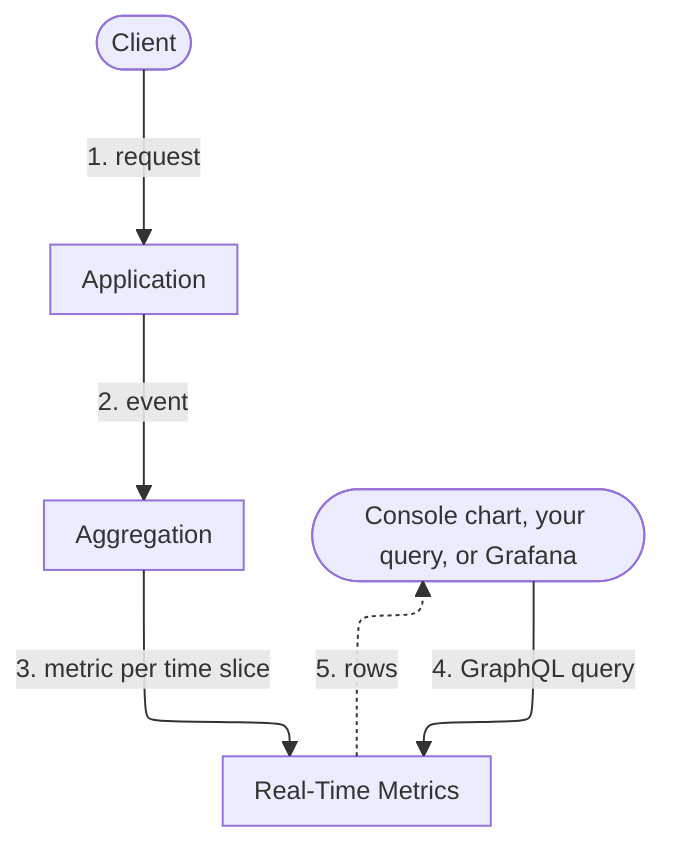

import DocButton from '~/components/webkit/DocButton.vue'
import DocCardGroup from '@aziontech/webkit/doc-card-group'
import DocCard from '@aziontech/webkit/doc-card'

**Real-Time Metrics** is a Platform Resource that shows the traffic of your Platform Resources as aggregated metrics, in [Azion Console](https://console.azion.com/) and through the [GraphQL API](/en/documentation/devtools/graphql/). A metric counts or sums many requests over a slice of time, so a chart of metrics shows a trend, not the requests behind it. Use Real-Time Metrics to measure requests and data transferred, see the bandwidth that cache saves, track status codes and threats, or compare two periods.

Real-Time Metrics groups its charts and controls on these pages:

- [Build dashboards](/en/documentation/platform/real-time-metrics/build-dashboards/) chart the requests, data, cache savings, status codes, and request times of your Applications, next to Tiered Cache, Function invocations, and Image Processor. Each chart names the field that returns its value through the API.
- [Secure dashboards](/en/documentation/platform/real-time-metrics/secure-dashboards/) count the threats that WAF identifies, the queries that Edge DNS answers, and the requests that Bot Manager classifies. They also show which IP addresses send the threats.
- [Observe dashboards](/en/documentation/platform/real-time-metrics/observe-dashboards/) chart the data that Data Stream sends to your endpoints, and the requests behind that data.
- [Filters and time range](/en/documentation/platform/real-time-metrics/filters-and-time-range/) sets the period and the filters that every chart of a dashboard follows. A chart's menu also copies the query that the chart sends, or exports its points as a CSV file.

<DocButton href="/en/documentation/platform/real-time-metrics/quickstart/" label="Quickstart" size="medium" />
<DocButton href="/en/documentation/platform/real-time-metrics/reference/" label="Real-Time Metrics reference" kind="secondary" size="medium" />

---

## Request path

Real-Time Metrics has nothing to turn on and creates no entity in your account: it is active on every account. The Platform Resources that serve your traffic record each request, and Real-Time Metrics serves the totals of what they recorded, so a chart has data only after traffic arrives.

The diagram follows one request until it is part of a point on a chart. Solid arrows carry a request or a record, and dotted arrows carry the response. Each label starts with the number of its step in the list.

1. A client sends a request, and the Platform Resource that handles it, such as an Application or WAF, records it as an event.
2. Azion adds the events of each time slice into metrics, such as a count of requests or a sum of bytes. This takes minutes, so the newest points of a chart can still rise.
3. Real-Time Metrics keeps the metrics in datasets, one dataset for each kind of traffic.
4. A Console chart, a query you write, and a Grafana dashboard each send a GraphQL query to the same API. To query the API from Grafana, refer to [Install the Azion plugin for Grafana](/en/documentation/guides/platform/observability/integrate-grafana/).
5. The API answers with the rows of the dataset, and a chart plots one point per row. Because all three read the same rows, a chart and your own query return the same numbers for the same range and filters.

---

## Next steps

<DocCardGroup cols={2}>
  <DocCard title="Quickstart" href="/en/documentation/platform/real-time-metrics/quickstart/" label="Read the requests and data transferred of your Applications in the Console or with one query." />
  <DocCard title="How it works" href="/en/documentation/platform/real-time-metrics/how-it-works/" label="Follow a request until it becomes a point on a chart, and see what sets the size of each point." />
  <DocCard title="Guides and tutorials" href="/en/documentation/platform/real-time-metrics/guides/" label="Do a specific task, from a status-code breakdown to a Grafana dashboard." />
  <DocCard title="Best practices" href="/en/documentation/platform/real-time-metrics/best-practices/" label="Pick the range, the scope, and the source to trust for each number." />
  <DocCard title="Limits" href="/en/documentation/platform/real-time-metrics/limits/" label="Look up what Real-Time Metrics covers, how long it keeps data, and its bounds." />
  <DocCard title="Troubleshooting" href="/en/documentation/platform/real-time-metrics/troubleshooting/" label="Find out why a chart is empty, a last point drops, or totals differ from Billing." />
  <DocCard title="Glossary" href="/en/documentation/platform/real-time-metrics/glossary/" label="Look up a word that the Real-Time Metrics pages use with a specific meaning." />
</DocCardGroup>
