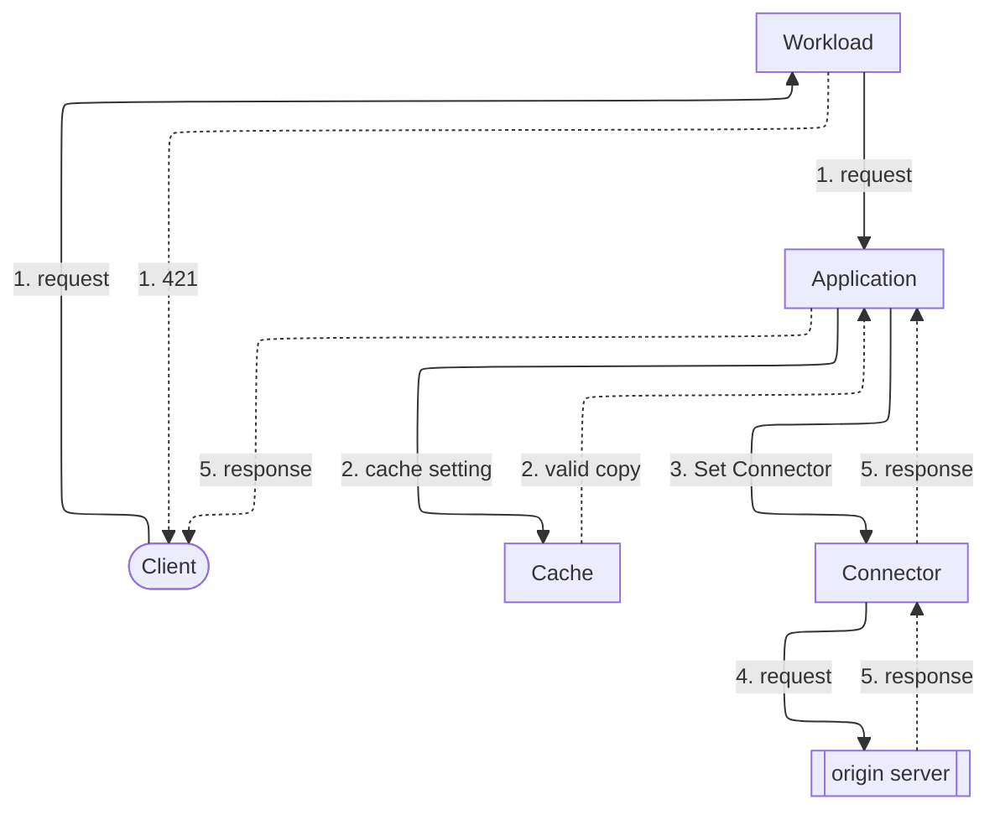

import DocButton from '~/components/webkit/DocButton.vue'
import DocCardGroup from '@aziontech/webkit/doc-card-group'
import DocCard from '@aziontech/webkit/doc-card'
import VersionRollingOut from '~/includes/snippets/versionRollingOut/en/snippet.mdx'

<VersionRollingOut>[Origins](/en/documentation/platform/connectors/origins/)</VersionRollingOut>

**Connectors** is a Platform Resource that routes requests from your [Applications](/en/documentation/platform/applications/) to the origins that hold your content, on Azion's distributed infrastructure. A Connector is the upstream of a reverse proxy: where your content is, and how each request reaches it. Connectors can balance requests with [Load Balancer](/en/documentation/platform/connectors/load-balancer/), let your origin accept only Connector requests with [Origin Shield](/en/documentation/platform/connectors/origin-shield/), and take in live streams with [Live Ingest](/en/documentation/platform/connectors/live-ingest/). Use Connectors to reach a cloud or on-premise server, serve an [Object Storage](/en/documentation/platform/object-storage/) bucket, or send the hostname and path your origin expects.

Connectors offers these nested resources and features:

- [Load Balancer](/en/documentation/platform/connectors/load-balancer/) is a good fit when your content must stay available while one origin server fails, or when no single server should carry every request. It acts on a Connector of type `http`.
- [Origin Shield](/en/documentation/platform/connectors/origin-shield/) is a good fit for a server behind your own firewall, or for a private S3-compatible bucket you serve through an Application. It also acts on a Connector of type `http`.
- [Live Ingest](/en/documentation/platform/connectors/live-ingest/) lets an Application deliver a live event, such as an e-sports match or a class, to its viewers as it happens. It works through a Connector of type `live_ingest`, which sets the region that receives your stream.
- [SNI Check](/en/documentation/platform/connectors/sni-check/) lets a Workload refuse an HTTPS request whose host its certificate does not cover, with `421 Misdirected Request`. Its enforcement has no setting in Azion Console or the API, so you ask Azion Support to turn it on.

<DocButton href="/en/documentation/platform/connectors/quickstart/" label="Quickstart" size="medium" />
<DocButton href="/en/documentation/platform/connectors/reference/" label="Connectors reference" kind="outlined" size="medium" />

---

## Request path

Creating a Connector sends it no traffic: a Connector receives requests only from an Application rule that sets it with the _Set Connector_ behavior. The rule sets it by ID, so several Applications can share one Connector, and each change to it reaches every rule that sets it.

The diagram follows a request that reaches your origin. Solid arrows carry the request, and dotted arrows carry the response. Each label starts with the number of its step below.

1. A client requests a domain of a [Workload](/en/documentation/platform/workloads/), and the Application that the Workload's deployment sets receives the request. Over HTTPS, when its enforcement is on, SNI Check can answer `421 Misdirected Request` before any Application runs.
2. The rules of the Application's Request Phase run in order. When a rule applies a cache setting and Cache holds a valid copy of the origin response, that copy answers the client.
3. Otherwise, the request goes to the Connector that a _Set Connector_ rule sets. When several matching rules carry the behavior, only the last one runs: a later rule can send `/images/` to a Connector of type `storage`.
4. The Connector opens a connection to its address and sends the request with its `Host` header, path prefix, and protocol.
5. The origin answers the Connector, the Application runs its Response Phase rules on the response, and the response reaches the client.

---

## Next steps

<DocCardGroup cols={2}>
  <DocCard title="Quickstart" href="/en/documentation/platform/connectors/quickstart/" label="Create a Connector, send one path to it with a rule, and check the response." />
  <DocCard title="How it works" href="/en/documentation/platform/connectors/how-it-works/" label="Follow a request from a rule through the Connector to your origin, with its timeouts." />
  <DocCard title="Connector settings" href="/en/documentation/platform/connectors/settings/" label="Look up a field, its default, the values it accepts, or an error code." />
  <DocCard title="Guides and tutorials" href="/en/documentation/platform/connectors/guides/" label="Do a specific task, from a bucket origin to the Host header." />
  <DocCard title="Best practices" href="/en/documentation/platform/connectors/best-practices/" label="Plan a change around propagation, or set up an origin the recommended way." />
  <DocCard title="Limits" href="/en/documentation/platform/connectors/limits/" label="Look up where a Connector stops, a bound, and what happens past it." />
  <DocCard title="Troubleshooting" href="/en/documentation/platform/connectors/troubleshooting/" label="Find out why a request fails between the rule and your origin." />
  <DocCard title="Glossary" href="/en/documentation/platform/connectors/glossary/" label="Look up a word that the Connectors pages use with a specific meaning." />
</DocCardGroup>
