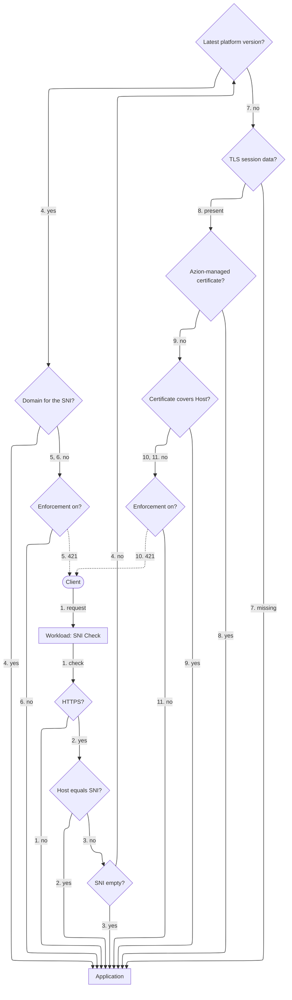

import FrameBox from '@aziontech/webkit/frame-box'
import ItemList from '@aziontech/webkit/item-list'
import DocItem from '@aziontech/webkit/doc-item'

An HTTPS client names the host it wants twice. In the TLS handshake, it sends the hostname as the Server Name Indication (SNI), before the server sends its certificate. The server uses that name to choose a certificate, so one IP address can serve many hostnames, each with its own certificate.

Each request on the connection then names a host again, in its `Host` header. When the certificate does not cover that host, the request is misdirected: it would be served under a certificate that was never issued for its host. A server can refuse such a request with `421 Misdirected Request`.

**SNI Check** is a Feature of the Azion Platform that takes this decision for each HTTPS request to a [Workload](/en/documentation/platform/workloads/). It acts before any [Application](/en/documentation/platform/applications/) or Connector runs, so a refused request never reaches your origin. For where it acts on a request, refer to the [Connectors request path](/en/documentation/platform/connectors/#request-path).

The sections cover the order of the checks, how a certificate covers a host, and enforcement.

---

## Order of the checks

SNI Check runs its checks in a fixed order, and the first check that settles the request decides the outcome. Most outcomes let the request continue to the Application that the Workload's deployment sets, and two end in a `421`.

Solid arrows carry the request, and dotted arrows carry the response. Each label starts with the number of its step in the list after the diagram.

1. The client sends a request to a domain of the Workload. A plain HTTP request skips SNI Check and continues to the Application.
2. Over HTTPS, SNI Check compares the `Host` header with the SNI value, `ssl_server_name`, without regard to letter case. When the two match, the request continues.
3. When the client sent no SNI value, so `ssl_server_name` is empty, the request continues.
4. When the Workload is on the latest platform version and has a domain for the SNI value, the request continues.
5. When the Workload is on the latest platform version, no domain matches, and enforcement is on, Azion answers `421 Misdirected Request`.
6. With enforcement off, that request continues.
7. Otherwise, when the TLS session data is unavailable, the request continues.
8. When the certificate is an Azion-managed certificate, the request continues.
9. When `X509_check_host` confirms that the certificate covers the `Host` header, the request continues.
10. When none of these checks lets the request through and enforcement is on, Azion answers `421 Misdirected Request`.
11. With enforcement off, the request continues.

---

## Host coverage by a certificate

A Workload serves HTTPS with a certificate from [Certificate Manager](/en/documentation/platform/certificate-manager/certificates/). A certificate covers the hostnames in its Common Name (CN) and in its Subject Alternative Names (SANs).

`X509_check_host`, a function of [OpenSSL](https://www.openssl.org/docs/man3.0/man3/X509_check_host.html), takes the decision of step 9. It checks whether the `Host` header falls within the CN or the SANs of the certificate. For example, a certificate for `example.com` does not cover a request for `api.other-domain.com`, so that request receives `421 Misdirected Request` when enforcement is on.

Two checks let a request through before step 9 tests its certificate. An Azion-managed certificate passes at step 8. A request without TLS session data passes at step 7, because SNI Check fails open: a transient infrastructure condition never blocks legitimate traffic. The cost is that such a request is not checked at all.

---

## Enforcement

Enforcement decides whether a failed check refuses the request. With enforcement off, steps 6 and 11 let the request continue, so SNI Check refuses nothing. Enforcement has no setting in Azion Console or in the API. To turn it on or off for your Workloads, contact [Azion Support](/en/documentation/support/).

Enforcement protects against SNI spoofing, an attack that changes the SNI value so a TLS connection runs under a certificate that does not cover the target host. With enforcement on, a request that fails the checks is refused instead of served under a certificate that does not cover its host.

The same check also refuses legitimate clients that reuse one connection for several hostnames, through connection pooling or HTTP/2 multiplexing. To find those requests and fix the certificate or the client, refer to [A request receives 421 Misdirected Request](/en/documentation/platform/connectors/troubleshooting/#a-request-receives-421-misdirected-request).

---

## Related resources

<FrameBox>
<ItemList>
  <DocItem title="Certificates" href="/en/documentation/platform/certificate-manager/certificates/">The certificates a Workload uses, and the names in each one that step 9 tests.</DocItem>
  <DocItem title="Troubleshoot Connectors" href="/en/documentation/platform/connectors/troubleshooting/">The fixes for a 421 response and for the other errors between a rule and your origin.</DocItem>
  <DocItem title="Real-Time Events" href="/en/documentation/platform/real-time-events/">The logs that show the host and the SNI value of each request.</DocItem>
  <DocItem title="Connectors" href="/en/documentation/platform/connectors/">Where a request goes after SNI Check lets it through, from the rule to your origin.</DocItem>
</ItemList>
</FrameBox>
