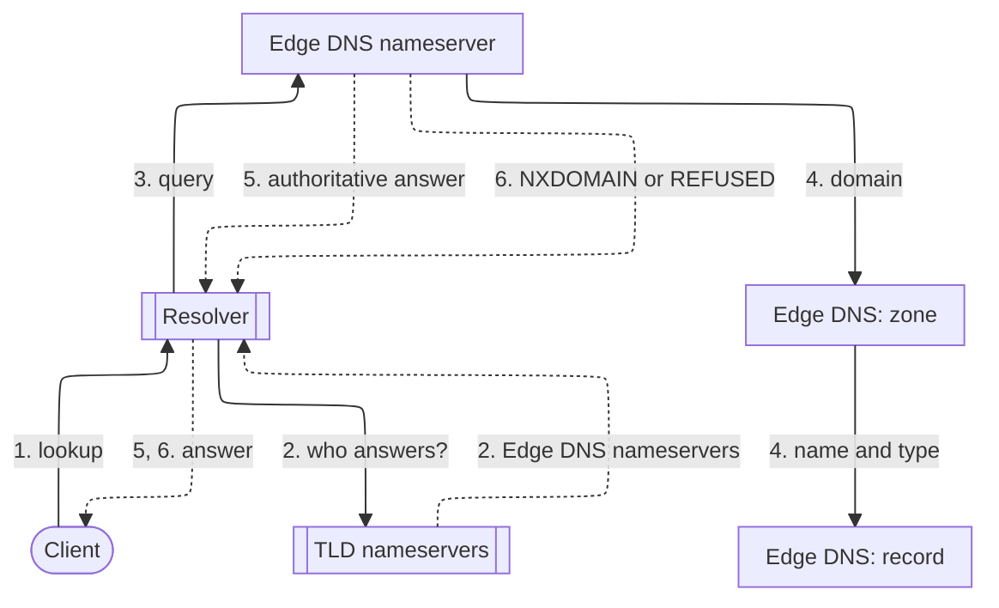

import DocButton from '~/components/webkit/DocButton.vue'
import DocCardGroup from '@aziontech/webkit/doc-card-group'
import DocCard from '@aziontech/webkit/doc-card'

**Edge DNS** is a Platform Resource that hosts the DNS records of your domains and answers the queries for them, on Azion's distributed infrastructure. An [authoritative DNS](https://www.azion.com/en/learning/dns/what-is-authoritative-dns/) service holds a domain's records, such as its website's address, and gives the final answer to each lookup for them. Use Edge DNS to point your domains at your servers or a [Workload](/en/documentation/platform/workloads/), set up records for your email services, or prove domain ownership.

Edge DNS works with these entities and settings:

- [Zones and records](/en/documentation/platform/edge-dns/zones-and-records/) hold what Edge DNS answers: a zone for each domain you host, holding the records of that domain's names. A domain can live in only one zone across every Azion account.
- [Record types](/en/documentation/platform/edge-dns/record-types/) set what a record answers, such as an address, another hostname, a mail server, or a text value. For example, an ANAME record points the apex, the zone's domain itself, at a Workload, where a CNAME record is refused.
- [DNSSEC](/en/documentation/platform/edge-dns/dnssec/) lets a zone sign its answers, so a validating resolver can tell when an answer was changed on its way to the client. Resolvers validate the signatures once your registrar publishes the delegation signer (DS) record that Azion generates for the zone.

<DocButton href="/en/documentation/platform/edge-dns/quickstart/" label="Quickstart" size="medium" />
<DocButton href="/en/documentation/platform/edge-dns/reference/" label="Edge DNS reference" kind="outlined" size="medium" />

---

## Query path

Creating a zone sends it no lookup: a domain's lookups reach its zone only after the domain's registrar delegates the domain to Edge DNS. Before then, you can build the zone and check its answers by querying an Edge DNS nameserver directly, as [Query a zone with dig](/en/documentation/guides/application-security/dns/run-the-dig-command/) shows.

The diagram follows a lookup of `www.example.com`. Solid arrows carry the query, and dotted arrows carry the answer. Each label starts with the number of its step below.

1. A client asks its own resolver, not Edge DNS, for `www.example.com`.
2. The resolver asks the nameservers of the top-level domain (TLD), here `.com`, which nameservers answer for `example.com`. They return the three nameservers that the registrar set: `ns1.aziondns.net`, `ns2.aziondns.com`, and `ns3.aziondns.org`.
3. The resolver sends the query to one of the three Edge DNS nameservers.
4. The nameserver selects the zone whose domain matches the query, then the record whose name and type match it.
5. The nameserver returns the record's values as an authoritative answer. The resolver keeps that answer for its time to live (TTL) and passes it to the client.
6. When no record matches the name, the nameserver answers `NXDOMAIN`. When the zone is inactive, or no zone holds the domain, it answers `REFUSED`.

---

## Next steps

<DocCardGroup cols={2}>
  <DocCard title="Quickstart" href="/en/documentation/platform/edge-dns/quickstart/" label="Create a zone and its first record in Azion Console, the Azion CLI, or the API." />
  <DocCard title="How it works" href="/en/documentation/platform/edge-dns/how-it-works/" label="See why a change takes minutes to answer, and how weighted records, ANAME, and DNSSEC work." />
  <DocCard title="Guides and tutorials" href="/en/documentation/platform/edge-dns/guides/" label="Complete a task, such as adding MX, TXT, or CAA records." />
  <DocCard title="Migrate nameservers to Azion" href="/en/documentation/guides/platform/migration/migrate-ns-to-azion/" label="Move a domain's DNS from another provider to Edge DNS." />
  <DocCard title="Best practices" href="/en/documentation/platform/edge-dns/best-practices/" label="Plan TTLs and changes so that new and changed records answer when you expect." />
  <DocCard title="Limits" href="/en/documentation/platform/edge-dns/limits/" label="Look up where Edge DNS stops, a bound, and what happens past it." />
  <DocCard title="Troubleshooting" href="/en/documentation/platform/edge-dns/troubleshooting/" label="Find out why a name does not answer, or still answers an old value." />
  <DocCard title="Glossary" href="/en/documentation/platform/edge-dns/glossary/" label="Look up a word that Edge DNS documentation uses with a specific meaning." />
</DocCardGroup>
