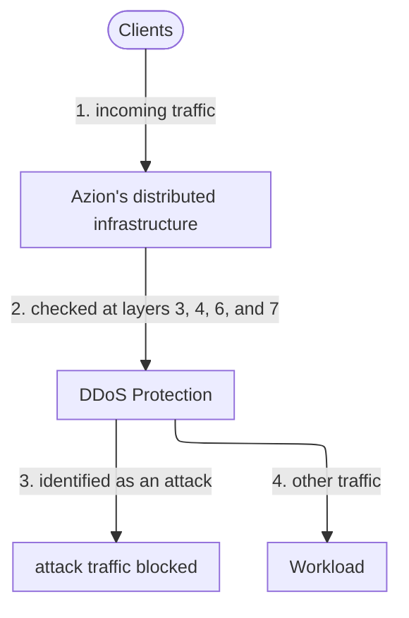

import FrameBox from '@aziontech/webkit/frame-box'
import ItemList from '@aziontech/webkit/item-list'
import DocItem from '@aziontech/webkit/doc-item'

A denial-of-service (DoS) attack floods a service with traffic until legitimate requests cannot get through. A distributed denial-of-service (DDoS) attack sends that traffic from many machines at once. Attack traffic rarely looks different from real traffic one packet at a time. What gives it away is the pattern: a flow that grows far past its normal shape, packets that break a protocol, or connections opened and never finished. A defense therefore watches every flow continuously, recognizes those patterns, and discards the matching traffic before the service has to handle it.

On Azion, that defense is [DDoS Protection](/en/documentation/platform/workloads/#ddos-protection). DDoS Protection is a Feature of the Azion Platform that mitigates denial-of-service attacks on every Workload. It is always on, and it needs no activation or configuration. For where it acts on a request, ahead of the Firewall that a Workload's deployment can set, refer to [How Workloads works](/en/documentation/platform/workloads/how-it-works/#ddos-protection). The sections below cover detection, mitigation, the attack types and techniques involved, the Security Response Team, and where attack records appear.

---

## Detection

DDoS Protection detects an attack by inspecting the network flow of incoming traffic continuously, whether or not an attack is under way. Detection runs on Azion's distributed infrastructure, so it sees traffic for a Workload before that traffic reaches the Workload.

Two families of algorithms do the inspection. Traffic analysis and signature algorithms recognize the traffic of known attacks and block it. Deep Packet Inspection (DPI) and artificial intelligence (AI) algorithms look for abnormal traffic behavior instead. That approach reduces false positives: traffic that is unusual but legitimate is less likely to be blocked.

Detection also follows each application layer of the resources Azion delivers through [Firewall](/en/documentation/platform/firewall/) and [WAF](/en/documentation/platform/firewall/waf/). The algorithms are built for automated mitigation, so a detected attack is mitigated without anyone acting on an alert. DDoS Protection detects and mitigates attacks in under 3 seconds on average. That figure is an average across attacks, not a ceiling for each one.

---

## Mitigation

DDoS Protection mitigates attacks at four layers of the Open Systems Interconnection (OSI) model: the network layer (3), the transport layer (4), the presentation layer (6), and the application layer (7).

This diagram follows incoming traffic through mitigation. Each label starts with the number of the step it belongs to.

1. Traffic for a Workload reaches Azion's distributed infrastructure.
2. DDoS Protection checks the traffic at the network, transport, presentation, and application layers.
3. Traffic identified as an attack is blocked. Azion carries out the mitigation.
4. The rest continues to the Workload.

DDoS Protection mitigates attack traffic in the data center of Azion's distributed infrastructure that the traffic reaches, before the traffic reaches the Workload. Azion takes part in the Mutually Agreed Norms for Routing Security (MANRS) initiative of the Internet Society. It applies strict AS-path (autonomous system path) filters and verifies both customer and internal network advertisements, which prevents IP spoofing.

The same protection reaches more than HTTP. DDoS Protection also protects your Domain Name System (DNS) service. For how Azion serves DNS, refer to [Edge DNS](/en/documentation/platform/edge-dns/).

Because mitigation needs no configuration, a Workload is protected from the moment it exists, and you have nothing to tune. The cost is that the automatic defense is the same for every Workload. For detection and mitigation targeted at a specific attack, you write custom rules on the [Firewall](/en/documentation/platform/firewall/) that the Workload's deployment sets. For layer 7 attacks, [WAF](/en/documentation/platform/firewall/waf/) on that Firewall strengthens the protection further.

---

## Attack types

DDoS attacks fall into two classes:

- **Volume-based attacks**, also called flood attacks, create large amounts of traffic to overload a system. They use amplification, or requests from malware and worms, and a botnet can coordinate them.
- **Protocol attacks**, also called state exhaustion attacks, exploit weaknesses in network resources. They overload the processing of critical services and infrastructure, such as security and load balancing.

The attacks Azion mitigates include the following. The list is not exhaustive:

- Bogons, IP bogons, ICMP flood, IGMP flood, malformed ICMP flood (also called ping of death), IP fragmentation, Nuke, Smurf, Spoofing, Teardrop
- TCP SYN flood, TCP SYN-ACK flood, TCP ACK flood, TCP ACK-PSH flood, TCP FIN flood, TCP RESET flood, TCP out-of-state flood, TCP fragmentation, TCP invalid, UDP flood, connection flood attacks, CLDAP amplification, NTP amplification, SSDP amplification
- HTTP floods, including well-formed HTTP `POST` and `GET` URL requests; HTTP slow reads; Slowloris; low and slow attacks; DNS flood, including well-formed DNS queries; brute force attacks; OWASP Top 10
- Botnet attacks; mixed floods, such as TCP plus UDP and ICMP plus UDP; reflected ICMP and UDP; zero-day attacks

The detection and mitigation techniques Azion employs include the following, grouped by what they act on:

| Group | Techniques |
| --- | --- |
| Lists and reputation | Allowlists, blocklists, and greylists; blocking, redirecting, or dropping requests by reputation and network lists; lists of botnets, cloud providers, malware, and proxies; dynamic IP reputation, fingerprints, and IP address plus user agent |
| Request attributes | Blocking, redirecting, or dropping requests by HTTP headers and geolocation; HTTP redirect; cookie tampering; security tokens, such as JWT; session timeout |
| Identification and scoring | Fingerprinting; signature-based and fingerprint-based blocking; pattern analysis and anomaly detection; score-based blocking |
| Bots and brute force | Bot mitigation and management techniques; challenge-response techniques; CAPTCHA and reCAPTCHA to identify human users; techniques that prevent brute force attacks |
| Request rate | Simple rate limiting, which is local, and advanced rate limiting, which is global and contextual |
| Packets and origin | Discarding malformed packets; restricting origin access to Azion IP addresses only |
| Incident response | Standby rules, used in response to incidents as they happen |

---

## Security Response Team

Azion prioritizes developing algorithms that detect and block attacks automatically. Once a threat is identified, the Azion [Security Response Team (SRT)](/en/documentation/services/security-response-team/) tracks it end to end. The SRT can apply custom rules on a Firewall to mitigate sophisticated attacks at the network, transport, presentation, and application layers.

You can engage the SRT during an attack, after one, or before one to build custom rules in advance. During or after an attack, the SRT helps track the incident, find its root cause, and put solutions in place with your team. Afterward, it gives you access to post-event analysis and investigations.

The SRT is a separate contract: a monthly package of hours. To engage it, contact the [Azion sales team](https://www.azion.com/en/contact/). For how DDoS Protection mitigation is billed, refer to [Pricing](/en/documentation/fundamentals/pricing/#ddos-protection).

---

## Attack visibility

DDoS Protection mitigates attacks without any action from you, so the records of an attack are how you learn that one happened.

[Azion Console](https://console.azion.com/) and the [Azion API](https://api.azion.com/) show the volume of attacks against your applications. For attack records and monitoring, use [Real-Time Events](/en/documentation/platform/real-time-events/) or [Real-Time Metrics](/en/documentation/platform/real-time-metrics/). To keep the records in your own systems, [Data Stream](/en/documentation/platform/data-stream/) connectors send events to Security Information and Event Management (SIEM) and big data services.

---

## Related resources

<FrameBox>
<ItemList>
  <DocItem title="How Workloads works" href="/en/documentation/platform/workloads/how-it-works/#ddos-protection">Where DDoS Protection acts on a request, ahead of the Firewall that a Workload's deployment sets.</DocItem>
  <DocItem title="Pricing" href="/en/documentation/fundamentals/pricing/#ddos-protection">How DDoS Protection mitigation is billed, including what is unmetered.</DocItem>
  <DocItem title="Firewall" href="/en/documentation/platform/firewall/">Write custom rules for a targeted attack, with WAF, Network Shield, and Bot Manager on the same Firewall.</DocItem>
  <DocItem title="Real-Time Events" href="/en/documentation/platform/real-time-events/">Review the attack records and other events of your Workloads.</DocItem>
</ItemList>
</FrameBox>
