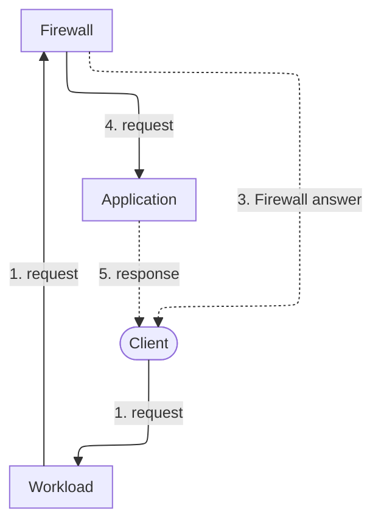

import DocButton from '~/components/webkit/DocButton.vue'
import DocCardGroup from '@aziontech/webkit/doc-card-group'
import DocCard from '@aziontech/webkit/doc-card'

**Firewall** is a Platform Resource that inspects the requests to your [Workloads](/en/documentation/platform/workloads/) before your [Application](/en/documentation/platform/applications/) receives them, on Azion's distributed infrastructure. A web firewall is a checkpoint in front of an application: it compares each request with rules and stops the requests they catch. A Firewall can match requests by source with [Network Shield](/en/documentation/platform/firewall/network-shield/), detect attacks with [Web Application Firewall (WAF)](/en/documentation/platform/firewall/waf/), and detect automated clients with [Bot Manager](/en/documentation/platform/firewall/bot-manager/). Use Firewall to deny a path or a hostname, limit each client's request rate, answer with a custom response, or run your own [Function](/en/documentation/platform/functions/).

Firewall offers these nested resources and features:

- [Network Shield](/en/documentation/platform/firewall/network-shield/) lets a rule decide by where a request comes from: a list of IP addresses and ranges, Autonomous System Numbers (ASNs), or countries. Use it to block known abusive networks, allow only your own networks, or block Tor exit nodes.
- [WAF](/en/documentation/platform/firewall/waf/) is a good fit when your Application takes input an attacker can abuse, such as a form or an API body. A rule applies it to the paths you choose, where it can log threats before it blocks them.
- [Bot Manager](/en/documentation/platform/firewall/bot-manager/) is a good fit when automation such as credential stuffing or scraping reaches an Application that also serves people. It runs as a Function on the Firewall, so a rule decides which requests it checks.
- [Functions for Firewall](/en/documentation/platform/firewall/functions/) lets a rule run your own JavaScript on a request, to deny it, drop it, answer it, or add headers. Use it when your protection logic needs more than the criteria and behaviors of a rule.

<DocButton href="/en/documentation/platform/firewall/quickstart/" label="Quickstart" size="medium" />
<DocButton href="/en/documentation/platform/firewall/reference/" label="Firewall reference" kind="outlined" size="medium" />

---

## Request path

Creating a Firewall protects nothing: a Firewall inspects only the requests of a Workload whose deployment sets it. A Firewall has no domain of its own, so several Workloads can share one, and each change to its rules reaches all of them.

The diagram follows a request through the Firewall. Solid arrows carry the request, and dotted arrows carry the response. Each label starts with the number of its step below.

1. A client requests a domain of a [Workload](/en/documentation/platform/workloads/), and the Workload's deployment sets the Firewall and the Application that serve it. The Firewall receives the request first.
2. The Firewall runs its rules in order. Each rule compares its criteria with the request, and a rule whose criteria do not match applies nothing.
3. A rule whose criteria match applies its behaviors. A behavior that stops the request, such as _Deny (403 Forbidden)_, answers the client or closes the connection, and no later rule runs. _Set WAF_ and _Run Function_ hand the request to WAF or to a [Function Instance](/en/documentation/platform/firewall/functions-instances/), and either one can stop it too.
4. A request that no rule stops reaches the Application, which never receives a request that a rule stopped.
5. The Application processes the request, and its response reaches the client.

---

## Next steps

<DocCardGroup cols={2}>
  <DocCard title="Quickstart" href="/en/documentation/platform/firewall/quickstart/" label="Create a Firewall, deny one path with a rule, and check the answer." />
  <DocCard title="How it works" href="/en/documentation/platform/firewall/how-it-works/" label="Follow a request through the rules, and see how long a change takes to apply." />
  <DocCard title="Rules Engine for Firewall" href="/en/documentation/platform/firewall/rules-engine/" label="Look up a criterion, an operator, a behavior, or an error code." />
  <DocCard title="Guides and tutorials" href="/en/documentation/platform/firewall/guides/" label="Do a specific task, from a country block to a WAF exception." />
  <DocCard title="Best practices" href="/en/documentation/platform/firewall/best-practices/" label="Plan the order of your rules, and decide when Workloads share a Firewall." />
  <DocCard title="Limits" href="/en/documentation/platform/firewall/limits/" label="Look up where a Firewall stops, a bound, and what happens past it." />
  <DocCard title="Troubleshooting" href="/en/documentation/platform/firewall/troubleshooting/" label="Find out why a rule does not act, or refuses a request it should not." />
  <DocCard title="Glossary" href="/en/documentation/platform/firewall/glossary/" label="Look up a word that the Firewall pages use with a specific meaning." />
</DocCardGroup>
