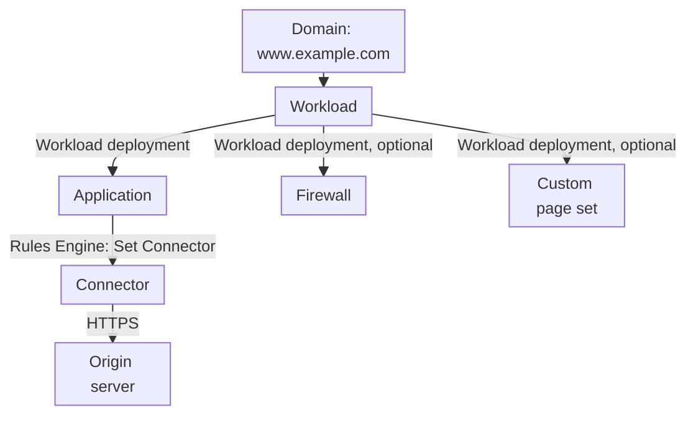
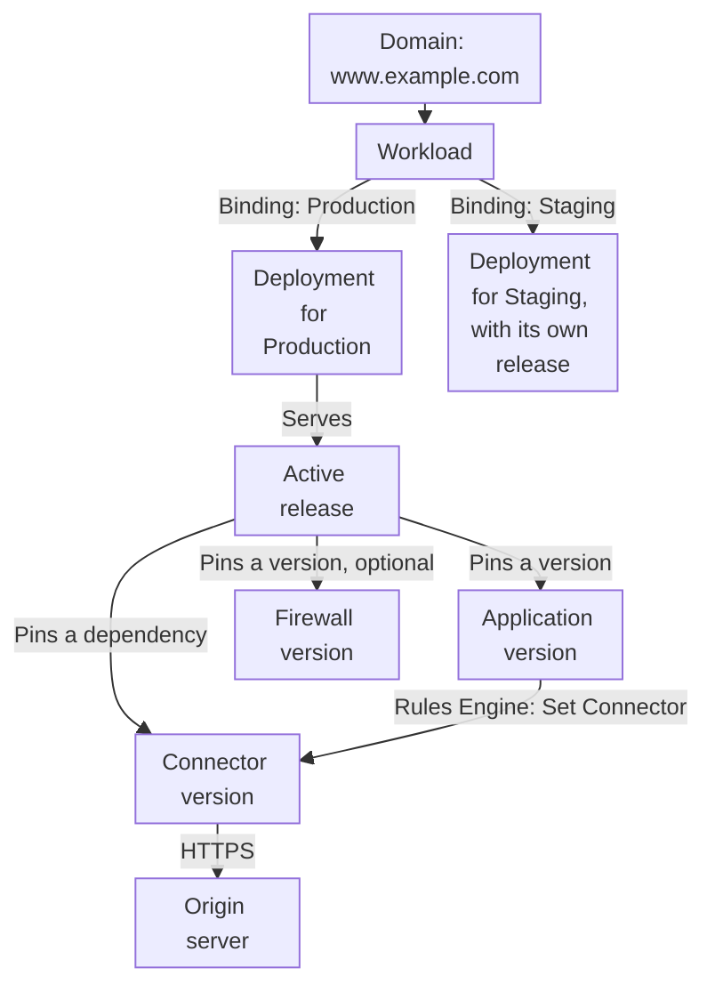
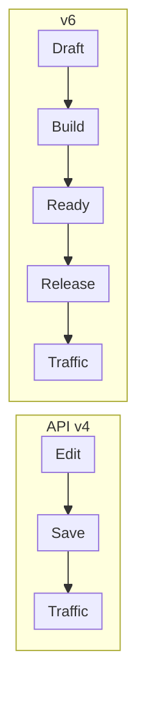
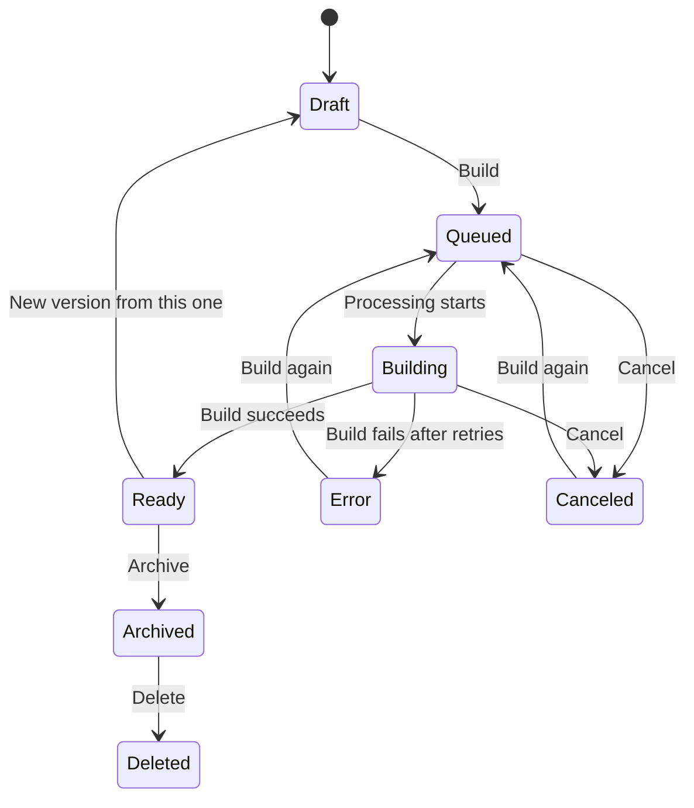
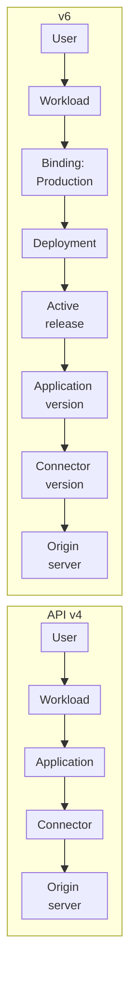

import DocSteps from '@aziontech/webkit/doc-steps'
import DocStep from '@aziontech/webkit/doc-step'
import FrameBox from '@aziontech/webkit/frame-box'
import ItemList from '@aziontech/webkit/item-list'
import DocItem from '@aziontech/webkit/doc-item'
import Tabs from '~/components/webkit/Tabs.vue'
import Tag from '~/components/webkit/Tag.vue'

<Tag severity="info">Preview</Tag>

On API v4, a saved change to an application, a firewall, or a connector reaches traffic as soon as it propagates. On v6, a save creates a version of the resource, and traffic changes only when a release puts that version into a deployment. The configuration and the moment it goes live become two separate steps.

The sections below cover the changes in the configuration model, how resources bind together, how a deploy works, the states of a version, a proxy example on both models, and what to review before the migration.

:::note
The changes on this page apply to an account only after Azion moves it to v6. Until then, the account keeps the API v4 model that [Workloads](/en/documentation/platform/workloads/) describes.
:::

---

## Migration overview

v6 keeps the resources of API v4 and adds a version lifecycle to them. Applications, Firewall, Custom Pages, Connectors, Functions, WAF, and Network Lists keep their names and their settings. What changes is how a change reaches traffic.

**Key points about the migration**:

- A save writes a **draft** version. A draft never serves traffic.
- A **build** validates the draft and turns it into a **ready** version, which no one can edit.
- A **release** pins one ready version of each resource and serves it through a **deployment**.
- An **environment**, such as Production or Staging, gives each stage its own deployment and its own versions.
- A workload no longer names an application. It binds each environment to a deployment, and the active release of that deployment names the versions.
- A previous release can serve traffic again, so a rollback does not depend on editing the configuration back by hand.

---

## What changes

| Topic | API v4 | v6 |
| --- | --- | --- |
| Unit of change | The configuration of the resource, edited in place. | A version of the resource, identified by a hash and immutable after the build. |
| What a save does | Propagates the change to traffic. | Writes a draft. Traffic does not change. |
| How a change reaches traffic | Implicitly, with the save. | Explicitly, with a build and a release in a deployment. |
| Stages | A workload runs on the Production Network or the Staging Network, chosen at creation. Both read the same application configuration. | Environments, such as Production and Staging. Each one serves the versions its own release pins. |
| From the domain to the application | The workload deployment names the application, the firewall, and the custom page set. | The workload binds an environment to a deployment. The active release names the versions. |
| Connectors, Functions, WAF, Network Lists | Referenced by the resource. An edit affects every resource that uses them at once. | Pinned by version inside each release. |
| Rollback | Edit the configuration again. | Roll back to, or redeploy, a previous release. |
| Gradual rollout | Not available. Every change reaches all traffic at once. | Gradual rollout by percentage, skew protection, and a URL per release. |
| History | The current state, with the last editor and the last change. | Every version records its author, its date, the interface that built it, and a comment. |
| Variables | Apply to the whole account. | Take a scope: an environment, a deployment, an application, or a firewall. |
| Free domain | `azion.app` | `azion.run` |

The settings inside a resource keep their place. Rules Engine and cache settings stay in the application and belong to the same version. A change to the name or the description of a resource does not create a version.

---

## Resource bindings

On API v4, the deployment of a workload points straight at the resources:

On v6, three objects sit between the workload and the resources: the environment, the deployment, and the release.

1. The domain reaches the workload, as on API v4.
2. The workload holds one binding per environment. A binding names the environment, the deployment, the domains, and the certificate.
3. The deployment serves its active release.
4. The release pins one version of the application, and optionally of the firewall and the custom page set.
5. The release also pins the versions of the dependencies it detects, such as the connector that the Rules Engine of the application uses.
6. The connector reaches the origin server.

Because each environment has its own deployment, the same application can run one version in Production and another in Staging.

### Objects that v6 adds

| Object | What it holds |
| --- | --- |
| Environment | A stage of publication, such as Production or Staging. It sets the version policy, the variables, the log verbosity, the robots policy, Git branch tracking, and an IP allowlist. |
| Binding | The link between a workload and one environment: the deployment, the domains, and the certificate of that environment. |
| Deployment | The publication settings: the version policy, which matches the environment, the binding policy, and the rollout strategy. One deployment can serve more than one workload. |
| Release | The set of versions a deployment serves: one version of each resource, with its dependencies. |

The **binding policy** of a deployment decides what a release can change. With **Strict**, the deployment keeps the application, the firewall, and the custom page set it first received, and a release changes only their versions. With **Flexible**, a release can replace the resource itself.

### Dependencies in a release

A release publishes applications, firewalls, and custom page sets. Connectors, Functions, WAF, and Network Lists have versions too, but they reach traffic only inside the release of a resource that uses them.

| Published resource | Dependencies detected in the version | Added by hand |
| --- | --- | --- |
| Application | Functions, and the connectors that Rules Engine selects with Set Connector | Connectors |
| Firewall | Functions, and the WAF and network lists that its rules use | Network Lists |
| Custom page set | The connectors of its connector pages | Connectors |

A connector or a network list that a function calls at runtime does not appear in the detected dependencies. Add it to the release by hand.

---

## Deploy

On API v4, there is no deploy step. A save to any resource propagates to every workload that uses it, and the propagation takes several minutes. For how propagation works, refer to [How Workloads works](/en/documentation/platform/workloads/how-it-works/).

On v6, a change reaches traffic through these stages:

<DocSteps>
  <DocStep title="Edit a draft">

  Every change starts in a draft. You can save a draft many times, across the settings of the resource, without any effect on traffic.

  </DocStep>
  <DocStep title="Build the version">

  The build validates the configuration and generates the version. It runs in the background, and you can cancel it. When it fails, nothing reaches traffic.

  </DocStep>
  <DocStep title="Use the ready version">

  A ready version is immutable. The same version can join the releases of several deployments and environments.

  </DocStep>
  <DocStep title="Create a release">

  Choose the target deployments and the version of each resource. A version can follow the latest ready version or stay pinned. Detected dependencies join the release on their own.

  </DocStep>
  <DocStep title="Serve traffic">

  Each deployment receives its own release, which builds in the background. The version policy of the deployment decides what happens to the previous release.

  </DocStep>
</DocSteps>

:::tip
Before the release goes live, Azion Console shows how many workloads, domains, and environments it reaches. A deployment can serve more than one workload.
:::

### Where a deploy starts

| Starting point | What the release starts with |
| --- | --- |
| A version of a resource | That resource and that version. You choose the deployments that receive it. |
| A deployment | The versions of its active release. |
| A workload | The deployments of every environment the workload binds. |

### Version policies

| Policy | Behavior |
| --- | --- |
| Single | One release serves traffic per deployment, with the **Current** traffic role. A new release replaces it. After the first deploy, the deployment keeps its application, and later releases change only its version. |
| Versioned | Each release gets its own URL, and several releases serve traffic at once, with the **Live** traffic role. Use it to review a release before you send users to it. The number of active URLs is limited. |

On a versioned environment, Azion adds a `*-` wildcard to the Azion domain of a workload. Each release answers on its own hostname.

### Rollout strategies

- **Gradual rollout** sends a percentage of the traffic to the candidate release. A cookie keeps each user on the same version during the rollout.
- **Skew protection** keeps a user on the same release for a period, one hour by default, across up to ten releases. HTML and assets from different releases do not mix.
- **Rollback** and **Redeploy** act on the release history of a deployment. Because versions are immutable, a previous release brings back exactly the configuration it served.

Workloads and deployments also have versions, but you do not build them. A save to a workload builds its version on its own. A save to a deployment records a version in a read-only history.

---

## Version states

Every version of an application, a firewall, a custom page set, a connector, a function, a WAF, or a network list moves through the same states. The actions that Azion Console offers depend on the state.

| State | Meaning | Editable | Serves traffic | Actions |
| --- | --- | --- | --- | --- |
| `draft` | A version in edition. It has no build yet. | Yes | No | Save, build, new version, delete |
| `queued` | The build waits for processing. The draft is frozen. | No | No | Cancel |
| `building` | The build validates the configuration and generates the version. It ends only after the versions it depends on are ready. | No | No | Cancel |
| `ready` | The version is immutable and can join a release. | No | Inside an active release | Deploy, promote, new version, archive, delete |
| `canceled` | The build was canceled. The version behaves as a draft. | Yes | No | Save, build |
| `error` | The build failed after its retries. Nothing reached traffic. | Yes | No | Save, build |
| `archived` | The version left the infrastructure. Archiving requires a reason and a version outside every active release. | No | No | New version, delete |
| `deleted` | The version no longer appears. | No | No | None |

A release has states of its own: `queued`, `building`, `ready`, `error`, and `canceled`. A release that serves traffic also carries a traffic role, **Current** under the Single policy and **Live** under the Versioned policy.

- A version is identified by a hash, such as `01JCA4M8`, and has no sequence number.
- A ready version cannot be built again.
- A resource holds up to 20 drafts by default.
- Archiving asks for a reason: `SUPERSEDED`, `DEPRECATED_BY_DESIGN`, `SECURITY_ISSUE`, `BUGGY_OR_UNSTABLE`, `COMPLIANCE_RETENTION`, or `USER_REQUEST`.

---

## Example: proxy to an origin

The most common setup puts a domain on Azion in front of an origin server, with cache and an optional firewall. The same setup takes four steps on API v4 and six on v6.

<Tabs client:visible>
<Fragment slot="tab.v4">API v4</Fragment>
<Fragment slot="tab.v6">v6</Fragment>

<Fragment slot="panel.v4">

<DocSteps>
  <DocStep title="Create the connector">

  Create an HTTP connector with the address of the origin, `origin.example.com`, over HTTPS on port `443`.

  </DocStep>
  <DocStep title="Create the application">

  In Rules Engine, set the default rule to the **Set Connector** behavior with the connector. Adjust the cache settings if needed.

  </DocStep>
  <DocStep title="Create the firewall">

  This step is optional. Create a firewall with WAF and network lists to inspect requests before the application.

  </DocStep>
  <DocStep title="Create the workload">

  Add the domain, such as `my-site.azion.app`, and the certificate. In the workload deployment, select the application and the firewall. After you save, the domain answers once the change propagates.

  </DocStep>
</DocSteps>

</Fragment>

<Fragment slot="panel.v6">

<DocSteps>
  <DocStep title="Create the connector">

  Create an HTTP connector for `origin.example.com`. It starts as a draft. Build it until it is ready.

  </DocStep>
  <DocStep title="Create the application">

  In Rules Engine, set the default rule to the **Set Connector** behavior with the connector. Save the draft and build it. It becomes ready only after its connector is ready.

  </DocStep>
  <DocStep title="Create the firewall">

  This step is optional. Create a firewall with WAF and network lists, and build it until it is ready.

  </DocStep>
  <DocStep title="Create the deployment">

  The Production environment exists in the account. Create a deployment with the same version policy as the environment, **Single**.

  </DocStep>
  <DocStep title="Create the release">

  Select the deployment and the ready version of the application, plus the firewall if you created one. The connector joins as a dependency. Review the impact and select **Deploy release**.

  </DocStep>
  <DocStep title="Create the workload">

  Add the domain, such as `my-site.azion.run`, and the certificate. Bind the Production environment to the deployment. The domain answers with the active release.

  </DocStep>
</DocSteps>

In Azion Console, creating an application with a new workload runs the build of the application and the last three steps for you.

</Fragment>
</Tabs>

On both models, the request reaches the origin through the connector. On v6, the path also goes through the binding, the deployment, and the active release:

### Change a cache setting after the first deploy

The difference shows on every later change. A new cache TTL for the application takes these paths:

| Model | Path to traffic |
| --- | --- |
| API v4 | Edit the application and save. The change reaches every workload that uses the application. |
| v6 | Create a version from the ready one, edit the draft, and build it. Release it to Staging, then to Production. To undo, roll back to the previous release. |

---

## Before the migration

- **Automations that edit resources**: a script or a pipeline that saves an application and expects traffic to change must also build the version and create a release.
- **Automations that read the deployment of a workload**: on v6, the workload does not name an application. Read the active release of the deployment that each binding names.
- **Workloads on the Staging Network**: a v6 workload has no Infrastructure control. Test in an environment, such as Staging, with its own deployment and release.
- **Version labels**: refer to a version by its hash. A version has no number.
- **Dependencies**: connectors, functions, WAF, and network lists have no deploy of their own. Plan their changes together with the release of the resource that uses them.

:::caution
On v6, Azion Console does not offer Azion Marketplace, templates, or the import from GitHub of the **Create** button.
:::

---

## Related resources

<FrameBox>
<ItemList>
  <DocItem title="Workloads" href="/en/documentation/platform/workloads/">The entry point that holds the domains, the certificate, and the bindings.</DocItem>
  <DocItem title="Applications" href="/en/documentation/platform/applications/">The resource that Rules Engine and cache settings belong to.</DocItem>
  <DocItem title="Connectors" href="/en/documentation/platform/connectors/">How an application reaches the origin server.</DocItem>
  <DocItem title="Firewall" href="/en/documentation/platform/firewall/">The rules that inspect a request before the application.</DocItem>
  <DocItem title="API v4 Migration" href="/en/documentation/fundamentals/api-v4-migration/">The previous migration, from Domains to Workloads and Connectors.</DocItem>
</ItemList>
</FrameBox>
