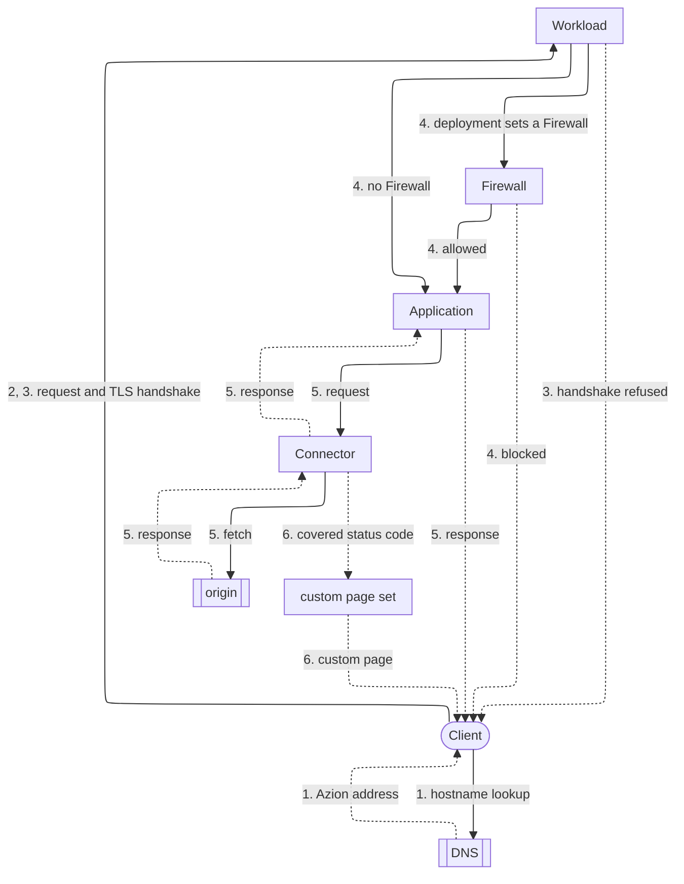

import DocButton from '~/components/webkit/DocButton.vue'
import DocCardGroup from '@aziontech/webkit/doc-card-group'
import DocCard from '@aziontech/webkit/doc-card'
import VersionRollingOut from '~/includes/snippets/versionRollingOut/en/snippet.mdx'

<VersionRollingOut>[Domains](/en/documentation/platform/workloads/domains/)</VersionRollingOut>

**Workloads** is a Platform Resource that receives the requests sent to your domains, as their entry point, on Azion's distributed infrastructure. The entry point of a website is the configuration that answers its hostnames, such as `www.example.com`. A Domain Name System (DNS) lookup sends the client to the entry point, which terminates the Transport Layer Security (TLS) connection: it decrypts the traffic of that connection. In that encrypted connection, the entry point proves with a certificate that it holds the hostname and, when the entry point requires mutual TLS (mTLS), the client also proves its identity.

A Workload holds:

- a workload domain that Azion generates;
- the domains you add;
- the TLS and mTLS settings;
- the ports and the HTTP versions it accepts;
- the infrastructure it runs on.

A deployment is the part of a Workload that sets the [Application](/en/documentation/platform/applications/) that answers its requests and, optionally, a [Firewall](/en/documentation/platform/firewall/) that inspects requests first and a custom page set that replaces error responses. After it receives a request, the Workload forwards the request to the Application that this Workload's deployment sets. That Application runs its rules on the request. Use Workloads to put an Application on your own domain, serve it over HTTPS with your certificate or one that Azion requests for you, require client certificates, or try a configuration on staging before production.

<DocButton href="/en/documentation/platform/workloads/quickstart/" label="Quickstart" size="medium" />
<DocButton href="/en/documentation/platform/workloads/settings/" label="Workload settings" kind="secondary" size="medium" />

---

## Request path

Creating a Workload serves no request: that Workload first needs a deployment that sets an Application. Until the deployment propagates, the workload domain answers `404` with Azion's HTML error page.

Solid arrows carry the request, and dotted arrows carry what goes back to the client. Each label starts with the number of the step it belongs to.



1. The client looks up the hostname, and DNS returns an address of Azion's distributed infrastructure. A custom domain, a domain of your own listed on the Workload, reaches that address through a CNAME record that points at the workload domain.
2. The Workload that lists the hostname receives the request.
3. On an HTTPS connection, the Workload completes the TLS handshake with its certificate, its minimum TLS version, and its cipher suite. With mTLS on, it also checks the client certificate. In `enforce` mode, a client with no certificate, or with one that an authority you do not trust signed, cannot complete the handshake.
4. When the deployment sets a Firewall, the Firewall's rules evaluate the request before the Application and can block that request. With no Firewall, the request goes straight to the Application.
5. The Application that the deployment sets runs its rules on the request. When a rule sets a [Connector](/en/documentation/platform/connectors/), that Connector routes the request to your origin. The response returns through the Application to the client.
6. When the Connector answers with an error status code that the deployment's custom page set covers, the client receives the custom page in place of that response.

A Workload holds at most one deployment, so every hostname of the Workload reaches the same Application. When the deployment sets a Firewall or a custom page set, the same holds for it. For each step of the path and its tradeoff, refer to [How Workloads works](/en/documentation/platform/workloads/how-it-works/). For a domain that answers `404` or a handshake that fails, refer to [Troubleshoot Workloads](/en/documentation/platform/workloads/troubleshooting/).

---

## Workload structure

The API and [Azion CLI](/en/documentation/devtools/cli/) represent a Workload as a JSON object. `azion describe workload --workload-id <workload-id> --format json` shows a new Workload, created with a name and every default, as the API stores it:

```json
{
 "active": true,
 "created_at": "2026-01-01T12:00:00.000000Z",
 "domains": [],
 "id": <workload-id>,
 "infrastructure": 1,
 "last_editor": "<your-email>",
 "last_modified": "2026-01-01T12:00:00.000000Z",
 "mtls": {
  "config": {
   "certificate": null,
   "verification": null
  },
  "enabled": false
 },
 "name": "my-workload",
 "product_version": "1.0",
 "protocols": {
  "http": {
   "http_ports": [
    80
   ],
   "https_ports": [
    443
   ],
   "quic_ports": [
    443
   ],
   "versions": [
    "http1",
    "http2",
    "http3"
   ]
  }
 },
 "tls": {
  "certificate": null,
  "ciphers": 7,
  "minimum_version": "tls_1_3"
 },
 "workload_domain": "<id>.map.azionedge.net",
 "workload_domain_allow_access": true
}
```

- `workload_domain` is the read-only hostname Azion generates at creation. `domains` holds the hostnames you add: your own domains and an optional `azion.app` hostname. `workload_domain_allow_access` decides whether clients still reach the workload domain.
- `infrastructure` is `1` for production and `2` for staging, and it sets the suffix of the workload domain.
- `protocols.http` lists the HTTP versions and the ports the Workload accepts. `tls` sets the certificate, along with the cipher suite and the minimum TLS version. With `tls.certificate` set to `null`, the Workload presents the Azion SAN certificate: Azion's own certificate, with its hostnames listed as Subject Alternative Names (SAN).
- `mtls` is off in a new Workload. Turned on, it sets a Trusted CA certificate and a verification mode. A Trusted CA certificate is the certificate of a certificate authority (CA) that you trust to sign client certificates. The Workload checks each client certificate against it.

This object holds no Application. The Workload's deployment is not part of this object: it sets the Application and can also set a Firewall and a custom page set. Because of that split, the hostnames and certificates change without any change to your application's code.

---

## Resources

Certificate Manager acts on a Workload once you bind a certificate to that Workload. Custom Pages acts on a Workload once that Workload's deployment sets a custom page set. DDoS Protection acts on every Workload from the moment it exists.

### Certificate Manager

Certificate Manager is a Platform Resource that stores the certificates a Workload uses for TLS. It stores server certificates, uploaded with their private key, and Trusted CA certificates, which verify client certificates for mTLS. It also requests Let's Encrypt certificates for the Workload's domains and renews them for you, stores certificate revocation lists (CRLs), and creates certificate signing requests (CSRs). Turn to it when a domain of your own must serve HTTPS, because the Azion SAN certificate covers only the workload domain and the `azion.app` hostname.

For the certificate types, their fields, and their statuses, refer to [Certificates](/en/documentation/platform/workloads/certificate-manager/certificates/). For how Azion requests and renews a Let's Encrypt certificate, refer to [Issuance and renewal](/en/documentation/platform/workloads/certificate-manager/issuance-and-renewal/). To bind your first certificate to a Workload, refer to the [Certificate Manager quickstart](/en/documentation/platform/workloads/certificate-manager/quickstart/).

### Custom Pages

Custom Pages is a Platform Resource that replaces the error response returned by a Connector with a page of your own, one page per error status code. For example, when a Connector returns `404` for a missing path, the client receives your own page at the URL it requested, with no redirect. A custom page set is a named list of those pages. Azion fetches the content of each page from a Connector and keeps that content in cache for the time the page sets. A page can also answer with a status code you set. Use Custom Pages when visitors must see your own page instead of the origin's error page.

For the fields of a set and its pages, and the status codes a page can replace, refer to [Custom page settings](/en/documentation/platform/workloads/custom-pages/settings/). To replace your first `404`, refer to the [Custom Pages quickstart](/en/documentation/platform/workloads/custom-pages/quickstart/). For an account that still runs API v3, refer to [Error Responses](/en/documentation/platform/workloads/custom-pages/error-responses/).

### DDoS Protection

DDoS Protection is a Feature of the Azion Platform that mitigates denial-of-service attacks on every Workload. It is always on, and it needs no activation or configuration.

A denial-of-service (DoS) attack floods a service with traffic until legitimate requests cannot get through. A distributed denial-of-service (DDoS) attack sends that traffic from many machines at once. DDoS Protection mitigates these attacks at the network, transport, presentation, and application layers. For detection and mitigation targeted at a specific attack, you write custom rules on the Firewall that the deployment sets.

For the attack types and the mitigation techniques, refer to [Attack mitigation](/en/documentation/platform/workloads/ddos-protection/ddos-mitigation/). For how DDoS Protection mitigation is billed, refer to [Pricing](/en/documentation/fundamentals/pricing/#ddos-protection).

---

## Scope and limits

- **Domains**: a Workload answers on its workload domain, `<id>.map.azionedge.net` on production and `<id>.preview.azionedge.net` on staging, as soon as its deployment propagates, before you own any domain. You add domains of your own, each a full hostname with no wildcard, and point each one at the workload domain with a CNAME record. A production Workload can also answer on one `azion.app` hostname, which [Azion Console](https://console.azion.com/) calls **Azion Custom Domain**, at no additional cost. With `workload_domain_allow_access` set to `false`, the workload domain answers `404`, and the Workload answers only on the hostnames in `domains`. That value fits a Workload whose own domains already serve traffic, and the API accepts it only while `domains` holds at least one hostname. For every rule a hostname follows, refer to [Workload settings](/en/documentation/platform/workloads/settings/#domains), and for the DNS records, refer to [Point a domain to a workload](/en/documentation/guides/platform/migration/point-domain-to-azion/).
- **DNS**: a Workload holds no DNS records. A domain's zone stays at your DNS provider, or in [Edge DNS](/en/documentation/platform/edge-dns/), and the Workload answers the hostnames it lists wherever their zone is hosted.
- **Infrastructure**: a Workload runs on one of two networks: the production network, for global availability, or the staging network, for testing with limited propagation. You pick it when you create the Workload, in the `infrastructure` field of the API: `1` for production or `2` for staging. The choice cannot change after creation, and a staging Workload takes no custom domain. For example, a configuration tested on a staging Workload reaches production as a second Workload, created on the production infrastructure. For the same choice in Azion Console, refer to [Workload settings](/en/documentation/platform/workloads/settings/#infrastructure). For how to try a change on staging first, refer to [Workloads best practices](/en/documentation/platform/workloads/best-practices/).
- **Protocols**: a Workload accepts HTTP/1.1, HTTP/2, and HTTP/3 over QUIC, which needs both earlier versions listed and, in Azion Console, **HTTPS support** on. HTTP runs on up to four ports, from `80`, `8008`, `8080`, and `8880`, with `80` by default. HTTPS runs on up to 12 listed ports, with `443` by default. For the ports, refer to [Workload settings](/en/documentation/platform/workloads/settings/#protocols-and-ports).
- **TLS**: the minimum TLS version ranges from TLS 1.0 to TLS 1.3, the default, and TLS 1.0 and 1.1 are deprecated. Eight cipher suites are available, with suite `7` by default. The Azion SAN certificate covers the workload domain and the `azion.app` hostname, and a domain of your own needs a server certificate from [Certificate Manager](/en/documentation/platform/workloads/#certificate-manager). Azion blocks TLS renegotiation by default. These settings secure the connection from the client to Azion, while the connection to your origin is set on the Connector. For the fields and the ciphers of each suite, refer to [Workload settings](/en/documentation/platform/workloads/settings/#tls).
- **mTLS**: with mTLS on, a Workload checks client certificates against a Trusted CA certificate, in `enforce` or `permissive` mode, on HTTPS connections only. It also lists up to 100 CRLs. For both modes and every requirement, refer to [mTLS](/en/documentation/platform/workloads/mtls/).
- **Deployment**: a Workload holds at most one deployment, and a Workload created through the API or Azion CLI starts with none. The deployment sets the Application that answers and can also set a Firewall and a custom page set. The published API v4 reference has no endpoint for the deployment: Azion Console, Azion CLI, and [Terraform](/en/documentation/devtools/terraform/workloads/) write it. For its fields, refer to [Workload settings](/en/documentation/platform/workloads/settings/#deployment).
- **Propagation**: a saved change to a Workload or its deployment takes several minutes to reach all of Azion's distributed infrastructure, with no guaranteed duration. Meanwhile, requests can receive the old or the new configuration. For example, right after you turn on mTLS in `enforce` mode, some data centers still answer a client with no certificate. For more information, refer to [Propagation](/en/documentation/platform/workloads/how-it-works/#propagation).
- **Interfaces**: you create and manage Workloads on the **Workloads** page of [Azion Console](https://console.azion.com/), through the [Azion API](https://api.azion.com/) at `/v4/workspace/workloads`, with [Azion CLI](/en/documentation/devtools/cli/) commands such as `azion create workload`, and with the `azion_workload` and `azion_workload_deployment` resources of [Terraform](/en/documentation/devtools/terraform/workloads/).
- **API v4**: on API v3, one Domains object carried the role of a Workload, and an Application's Main Settings held the protocol and TLS settings. On API v4, the Workload and its deployment replace the Domains object, and the Workload holds the protocol and TLS settings. For the mapping between the two models, refer to [API v4 Migration](/en/documentation/fundamentals/api-v4-migration/), and for an account that still runs API v3, refer to [Domains](/en/documentation/platform/workloads/domains/).
- **Observability**: Azion's error page carries an `x-azion-request-id` header that identifies the request. [Data Stream](/en/documentation/platform/data-stream/) collects the events of the Workloads you associate with a stream, as [Associate workloads with a stream](/en/documentation/guides/platform/observability/data-stream-associate-workloads/) shows.
- **Limits**: a Workload `name` takes up to 100 characters, and a Workload lists up to 50 domains by default. For every bound and the answer past it, refer to [Workloads limits](/en/documentation/platform/workloads/limits/).
- **Billing**: each plan includes an amount of usage before a rate applies, and [Azion pricing](https://www.azion.com/en/pricing/) lists it per plan. For the rates, refer to [Pricing](/en/documentation/fundamentals/pricing/#workloads).
- **Terms**: the [Workloads glossary](/en/documentation/platform/workloads/glossary/) defines the words the Workloads pages give a specific meaning, such as workload domain, deployment, Azion custom domain, and Trusted CA certificate.

---

## Next steps

<DocCardGroup cols={2}>
  <DocCard title="Quickstart" href="/en/documentation/platform/workloads/quickstart/" label="Create a Workload, set an Application in its deployment, and send your first request." />
  <DocCard title="How it works" href="/en/documentation/platform/workloads/how-it-works/" label="Follow a request from DNS through TLS and the deployment to your Application." />
  <DocCard title="Workload settings" href="/en/documentation/platform/workloads/settings/" label="Look up a field, its default, or the values it accepts." />
  <DocCard title="Guides and tutorials" href="/en/documentation/platform/workloads/guides/" label="Complete a specific task, such as adding a custom domain or requesting a Let's Encrypt certificate." />
</DocCardGroup>
