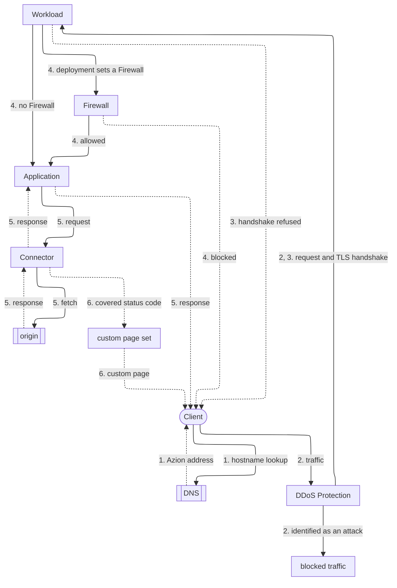

import DocButton from '~/components/webkit/DocButton.vue'
import DocCardGroup from '@aziontech/webkit/doc-card-group'
import DocCard from '@aziontech/webkit/doc-card'

**Workloads** is a Platform Resource that receives the requests sent to your domains, as their entry point, on Azion's distributed infrastructure. An entry point is the configuration that answers a site's hostnames, holds a certificate for each, and terminates their HTTPS connections. Use Workloads to put an [Application](/en/documentation/platform/applications/) on your own domain, serve that domain over HTTPS, or try a configuration on staging before production.

Each Workload has these features:

- [DDoS Protection](/en/documentation/platform/workloads/ddos-protection/ddos-mitigation/) mitigates floods of attack traffic before they reach your Workloads and the Applications behind them. For a defense aimed at one specific attack, you add custom rules to a Firewall.
- [Mutual TLS (mTLS)](/en/documentation/platform/workloads/mtls/) lets a Workload refuse, in `enforce` mode, every client without a certificate from a certificate authority you trust. It suits an API that partner systems call, such as one that must meet Open Banking requirements.

<DocButton href="/en/documentation/platform/workloads/quickstart/" label="Quickstart" size="medium" />
<DocButton href="/en/documentation/platform/workloads/reference/" label="Workloads reference" kind="outlined" size="medium" />

---

## Request path

Creating a Workload serves no request: a request reaches an Application only once that Workload's deployment sets that Application. A deployment is the part of a Workload that sets the Application and, optionally, a [Firewall](/en/documentation/platform/firewall/) and a custom page set. Until the deployment propagates, the workload domain, the hostname Azion generates for the Workload, answers `404` with Azion's HTML error page.

Solid arrows carry the request, and dotted arrows carry what goes back to the client. Each label starts with the number of the step it belongs to.

1. The client looks up the hostname, and DNS returns an address of Azion's distributed infrastructure. A custom domain, a domain of your own listed on the Workload, reaches that address through a CNAME record that points at the workload domain.
2. In the data center the client reaches, DDoS Protection inspects the traffic before the Workload sees it, and Azion mitigates the traffic it identifies as an attack. The Workload that lists the hostname receives the rest.
3. On an HTTPS connection, the Workload completes the Transport Layer Security (TLS) handshake with its certificate, its minimum TLS version, and its cipher suite. The certificate is Azion's own or one you bind from [Certificate Manager](/en/documentation/platform/certificate-manager/). With mTLS on, the Workload also checks the client certificate in this handshake and can refuse it.
4. When the deployment sets a Firewall, the Firewall's rules evaluate the request before the Application and can block that request. With no Firewall, the request goes straight to the Application.
5. The Application that the deployment sets runs its rules on the request. When a rule sets a [Connector](/en/documentation/platform/connectors/), that Connector routes the request to your origin. The response returns through the Application to the client.
6. When the Connector answers with an error status code that the deployment's custom page set covers, the client receives the custom page from [Custom Pages](/en/documentation/platform/custom-pages/) in place of that response.

Every hostname of a Workload reaches the Application, Firewall, and custom page set that its deployment sets. For each step of the path and its tradeoff, refer to [How Workloads works](/en/documentation/platform/workloads/how-it-works/).

---

## Next steps

<DocCardGroup cols={2}>
  <DocCard title="Quickstart" href="/en/documentation/platform/workloads/quickstart/" label="Create a Workload, set an Application in its deployment, and send your first request." />
  <DocCard title="How it works" href="/en/documentation/platform/workloads/how-it-works/" label="Follow a request from DNS through TLS and the deployment to your Application." />
  <DocCard title="Workload settings" href="/en/documentation/platform/workloads/settings/" label="Look up a field, its default, or the values it accepts." />
  <DocCard title="Guides and tutorials" href="/en/documentation/platform/workloads/guides/" label="Complete a specific task, such as adding a custom domain or requesting a Let's Encrypt certificate." />
  <DocCard title="Limits" href="/en/documentation/platform/workloads/limits/" label="Look up where a Workload stops and the value of each limit." />
  <DocCard title="Best practices" href="/en/documentation/platform/workloads/best-practices/" label="Test on staging, close the workload domain, and keep mTLS strict in production." />
  <DocCard title="Troubleshooting" href="/en/documentation/platform/workloads/troubleshooting/" label="Find the cause when a domain answers 404, a setting is refused, or a handshake fails." />
  <DocCard title="Glossary" href="/en/documentation/platform/workloads/glossary/" label="Look up a term the Workloads pages use, such as workload domain or deployment." />
</DocCardGroup>
