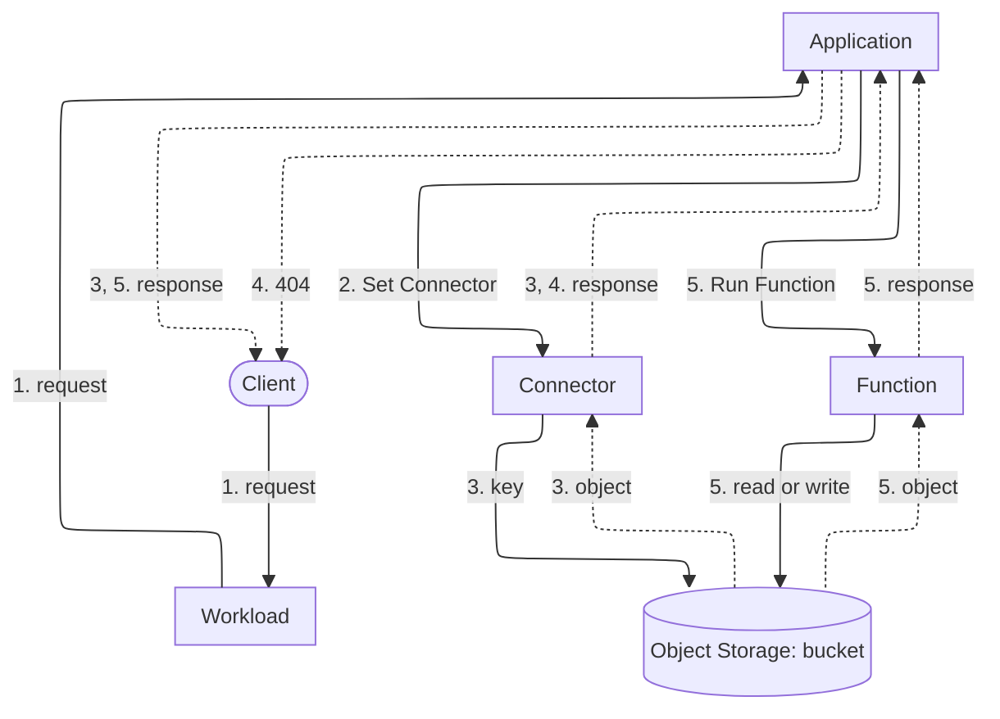

import DocButton from '~/components/webkit/DocButton.vue'
import DocCardGroup from '@aziontech/webkit/doc-card-group'
import DocCard from '@aziontech/webkit/doc-card'

**Object Storage** is a Platform Resource that stores files as objects in buckets on Azion's infrastructure and can serve them to your [Applications](/en/documentation/platform/applications/). An [object store](https://www.azion.com/en/learning/storage-database/what-is-object-storage-blob/) is a storage service that keeps each file whole, under a key of your choice, in a flat container. Use Object Storage to host a static site or a media library, keep the files your users upload, or receive [Data Stream](/en/documentation/platform/data-stream/) logs.

Object Storage offers these entities and interfaces:

- [Buckets and objects](/en/documentation/platform/object-storage/buckets-and-objects/) let you choose, for each bucket, whether your Applications can read its objects, read and write them, or neither. For example, a bucket of site assets stays `read_only`, and a bucket that a Function writes uploads to needs `read_write`.
- [Runtime API](/en/documentation/devtools/runtime/api-reference/storage/) lets a Function read, write, list, and delete the objects of a bucket during a request. A Function writes only to a bucket that lets your Applications read and write its objects.
- [S3 compatibility](/en/documentation/platform/object-storage/s3-compatibility/) lets the S3 tools and SDKs you use manage your objects with the credentials you create. Each credential holds an access key and a secret key and allows only the operations you choose, on every bucket unless you name some.

<DocButton href="/en/documentation/platform/object-storage/quickstart/" label="Quickstart" size="medium" />
<DocButton href="/en/documentation/platform/object-storage/reference/" label="Object Storage reference" kind="outlined" size="medium" />

---

## Request path

Creating a bucket publishes none of its objects: an Application rule can serve them through a [Connector](/en/documentation/platform/connectors/) of type `storage` or a [Function](/en/documentation/platform/functions/).

The diagram follows a request for `https://www.example.com/assets/logo.svg`. Solid arrows carry the request, and dotted arrows carry the response. Each label starts with the number of its step below.

1. The client sends the request to the [Workload](/en/documentation/platform/workloads/) that holds `www.example.com`, and the Workload passes it to the Application that the Workload's deployment sets.
2. A rule of the Application matches the request and sets a Connector of type `storage` with the _Set Connector_ behavior.
3. The Connector asks the bucket for the object whose key is the request path, here `assets/logo.svg`, preceded by the Connector's prefix when it has one. The bucket returns the object, and the Application sends it to the client with the content type stored with it.
4. When the bucket holds no object with that key, the client receives `404`.
5. Instead of setting a Connector, a rule can run a Function. The Function reads or writes objects through the Runtime API, within the bucket's access level, and returns its own response.

---

## Next steps

<DocCardGroup cols={2}>
  <DocCard title="Quickstart" href="/en/documentation/platform/object-storage/quickstart/" label="Create a bucket and upload your first object in Azion Console, the Azion CLI, or the API." />
  <DocCard title="How it works" href="/en/documentation/platform/object-storage/how-it-works/" label="See how keys, access levels, delivery, and deletion work." />
  <DocCard title="Guides and tutorials" href="/en/documentation/platform/object-storage/guides/" label="Complete a task, such as serving a static site from a bucket or receiving file uploads." />
  <DocCard title="Best practices" href="/en/documentation/platform/object-storage/best-practices/" label="Set access levels, content types, and keys so that objects are served as you expect." />
  <DocCard title="Limits" href="/en/documentation/platform/object-storage/limits/" label="Look up where Object Storage stops, a bound, and what happens past it." />
  <DocCard title="Troubleshooting" href="/en/documentation/platform/object-storage/troubleshooting/" label="Find out why a bucket name, a request, or an object is refused or not served." />
  <DocCard title="Glossary" href="/en/documentation/platform/object-storage/glossary/" label="Look up a word that Object Storage documentation uses with a specific meaning." />
</DocCardGroup>
