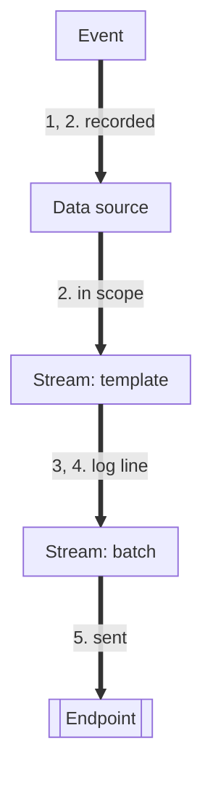
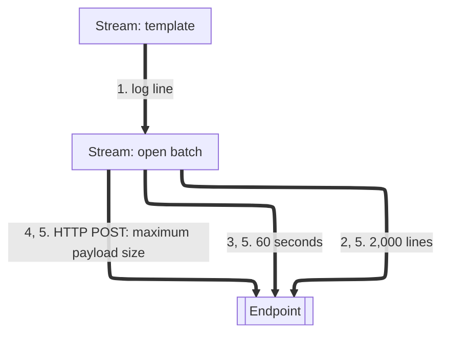
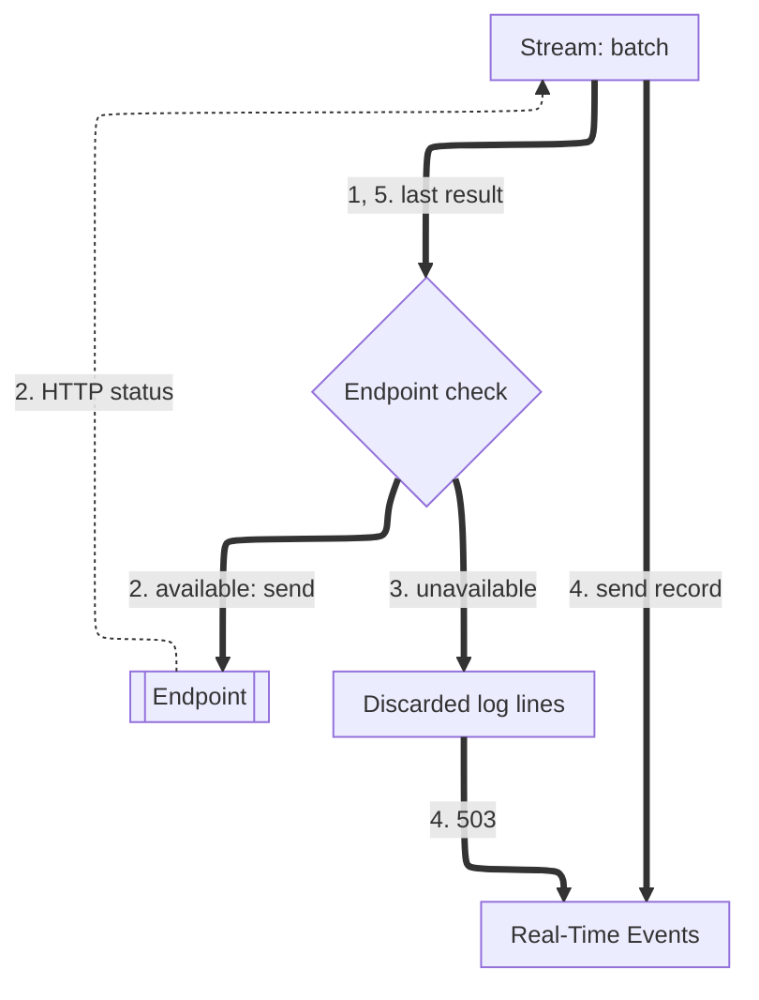

import FrameBox from '@aziontech/webkit/frame-box'
import ItemList from '@aziontech/webkit/item-list'
import DocItem from '@aziontech/webkit/doc-item'

A log stream is a feed of log records, pushed to a platform you run instead of waiting for you to ask for them. Each time something happens in your traffic or your account, a record is written, grouped with other records, and delivered in a batch. The records arrive seconds to minutes after the events. The copy of the records on your platform is only as complete as your platform was reachable.

[Data Stream](/en/documentation/platform/data-stream/) is a Platform Resource that sends the event logs of your account and its traffic to an endpoint you choose, through a stream. A stream collects the events of one data source and renders each one as a log line with a template. It groups the lines in batches and sends each batch to one endpoint, such as a SIEM, a big-data platform, or a stream-processing platform.

The fields of each part are on [Stream settings](/en/documentation/platform/data-stream/stream-settings/). To create your first stream, refer to the [Data Stream quickstart](/en/documentation/platform/data-stream/quickstart/).

The sections follow an event to the endpoint: the pipeline, sampling and workload filters, batching and delivery, endpoint availability and failures, activation and changes, and delivery records and metrics.

---

## The pipeline from an event to an endpoint

Each stream runs a one-way pipeline: Azion pushes log lines to your endpoint, and every event the stream collects becomes one log line. It has one data source, one template, and one endpoint. Sending the same events to two platforms, or the events of two data sources to one platform, therefore takes two streams.

This diagram follows one event until it reaches the endpoint. Thick arrows carry the event and the log line it becomes, and each label starts with the number of its step below.



1. Something happens. A request reaches one of your [Applications](/en/documentation/platform/applications/), a [Function](/en/documentation/platform/functions/) writes a log message, WAF analyzes a request, or a user changes the account in Azion Console.
2. The data source records the event. A stream collects from one of four: *Activity History*, *Applications*, *Functions*, or *WAF Events*, and each one offers its own variables, listed in [Data sources and variables](/en/documentation/platform/data-stream/data-sources-and-variables/). The stream keeps only the events inside its scope, set by sampling or by a workload filter.
3. The template renders the event as one log line. Its data set maps each key of the line to a variable, such as `"status": "$status"`. The stream replaces each variable with the value from the event. Data Stream uses ASCII encoding, which avoids parser issues and misread data at the endpoint. For the template format, refer to [Templates and payload](/en/documentation/platform/data-stream/templates-and-payload/).
4. The stream adds the log line to a batch, which closes at 2,000 log lines or after 60 seconds, whichever comes first. [Batching and delivery](#batching-and-delivery) gives the exceptions.
5. The stream sends the batch to its endpoint. Azion Console labels the endpoint field **Connector**, and its 11 types are listed in [Endpoints](/en/documentation/platform/data-stream/endpoints/).

When the endpoint type takes a credential, the stream authenticates to the endpoint with it. For example, with *Google BigQuery*, you provide a service account key. Data Stream then performs the Google OAuth 2.0 authentication and generates the JSON Web Tokens.

The alternative to a stream is to read the events where Azion keeps them. [Real-Time Events](/en/documentation/platform/real-time-events/) answers queries on the raw events of your products, and keeps them for 7 days and *Activity History* events for 2 years. A stream copies the events to your own platform, where your tools decide how long they stay and how they are analyzed. The cost is the usage that Data Stream bills, as listed in [Pricing](/en/documentation/fundamentals/pricing/#data-stream).

---

## Sampling and workload filters

The scope of a stream decides which events it collects, because an account can produce far more events than one platform needs. A stream on Applications, Functions, or WAF Events carries a scope: a sampling rate over all Workloads, or a filter of chosen [Workloads](/en/documentation/platform/workloads/). The API refuses such a stream with neither (`32002`) or with both (`32007`).

Azion Console offers the two scopes as two options:

- *All Current and Future Workloads* covers every Workload on the account, including Workloads created later, and shows **Sampling**. With sampling on, Data Stream collects events at random according to the percentage you set. A rate of `100` collects every event. Azion Console states that the sampling percentage is statistical and not absolutely precise.
- *Filter Workloads* collects the events of the Workloads you pick. One stream can collect the events of a single Workload or of several.

The two scopes cost different things. Sampling follows every Workload you add later with no edit to the stream. But saving an active stream with sampling on Applications, Functions, or WAF Events deactivates every other stream on the account, except Activity History streams.

A sampling rate of 1 deactivates them as a rate of 100 does. The API returns no error. Azion Console warns before it saves such a stream, and adds this sentence: `When multiple Data Streams have different sampling rates, the system uses the lowest percentage.`

A workload filter lets several streams run at once. The streams that sampling deactivates include streams with a workload filter on any of those three data sources. A stream with a workload filter that you save or activate afterward runs beside the stream with sampling until that stream is saved again. The cost is upkeep: a Workload created later is not collected until you add it to the filter.

*Activity History* events belong to the account rather than to a Workload. An *Activity History* stream takes a sampling item or no scope item, and the API refuses a workload filter on it (`10088`). Without a sampling item, the stream is accepted but sends no event. Saving one with sampling deactivates no other stream.

What the scope leaves out is the events of other Workloads, the share that sampling skips, and the events of the other data sources. A request served from cache still produces an *Applications* event, with `$upstream_status` and the upstream timing variables set to `-`. A request that WAF blocked still produces a *WAF Events* event, with `$blocked` set to `1`. For the bounds of the rate and of the filter, refer to [Stream settings](/en/documentation/platform/data-stream/stream-settings/#transform).

---

## Batching and delivery

Data Stream groups the log lines of a stream in a batch, and sends the batch when the first of its triggers fires. Sending each log line on its own would cost the endpoint one send per event. On an *AWS Kinesis Data Firehose* endpoint, the triggers differ: it receives batches of 500 log lines or 60 seconds.

This diagram shows the triggers that close a batch on the other endpoint types. Thick arrows carry the log lines, and each label starts with the number of its step below.



1. Each log line that the template renders joins the open batch of the stream.
2. When the batch holds 2,000 log lines, the stream sends it.
3. When 60 seconds pass before that, the stream sends the batch with the lines it holds.
4. On a *Standard HTTP/HTTPS POST* endpoint, a batch that reaches the maximum payload size, in bytes, is sent at that size. It is sent even when neither of the other triggers has fired. Azion Console labels that setting **Payload Max Size**.
5. The batch goes to the endpoint in one send. A *Simple Storage Service (S3)* endpoint receives one object per batch. The object name joins the object key prefix, a `/`, the time as `YYYY/MM/DD/hh/mm/`, and a unique ID, such as `activity/2026/01/01/12/02/11111111-…`.

For example, a busy stream that reaches 2,000 log lines in 13 seconds sends its batch at that moment. A quiet stream sends the lines it holds when the 60 seconds pass, even a single log line.

Batching trades delay for fewer sends. A log line does not reach the endpoint at the moment its event happens. On a quiet stream, it can wait up to 60 seconds before its batch leaves.

No field of a stream changes the 2,000-line count or the 60-second interval. The maximum payload size of a *Standard HTTP/HTTPS POST* endpoint only closes a batch earlier. For the delivery time and the other bounds, refer to [Data Stream limits](/en/documentation/platform/data-stream/limits/#default-limits).

---

## Endpoint availability and failures

A send to an endpoint that cannot take it is costly, so Data Stream checks each endpoint before it sends. The check runs once a minute and marks the endpoint available or unavailable. An endpoint is available only when every Azion server reports it available. One server that reports it unavailable is enough to stop the sends.

This diagram shows what happens to a batch after the check. Thick arrows carry the batch and its send record, and the dotted arrow carries the endpoint's answer. Each label starts with the number of its step below.



1. Once a minute, Data Stream checks each endpoint and keeps the result until the next check.
2. When the endpoint is available, the stream sends the batch, and the endpoint answers with its own HTTP status.
3. When the endpoint is unavailable, Data Stream does not send to it and discards the log lines of that interval.
4. Real-Time Events records every send with a status code, and records a discarded batch with `503`. A failed send can show a code the endpoint never returned. For example, an HTTP POST send that never reaches the endpoint can show `500`.
5. The next minute, a check runs again. When it marks the endpoint available, the stream sends the batches that form from then on.

Delivery is not guaranteed. Discarded log lines never reach the endpoint, and a send that the endpoint answers with an error is recorded with the endpoint's own status. For example, when a URL that does not accept `POST` answers `405`, no later send repeats the log lines of that batch.

When an HTTP POST endpoint passes the check but does not receive the batch within the send timeout, the send ends with `504`. The timeout is listed in [Data Stream limits](/en/documentation/platform/data-stream/limits/#default-limits).

A credential that lacks a permission can make the endpoint unavailable. An S3 endpoint on an Azion [Object Storage](/en/documentation/platform/object-storage/) bucket needs a credential with the `listBuckets` capability. Without it, every send shows `503` in Real-Time Events, and no object reaches the bucket. Real-Time Events records such a send as follows:

```json
{"ts":"2026-01-01T11:57:00Z","endpointType":"S3","statusCode":503,"streamedLines":2,"dataStreamed":2797}
```

After you add the `listBuckets` capability, the next delivered batch carries only the log lines of the events that follow. The lines of the `503` batches are not delivered. For the credential, refer to [Endpoints](/en/documentation/platform/data-stream/endpoints/#azion-object-storage).

To limit what an outage costs, keep the endpoint reachable, and watch `statusCode` in Real-Time Events for `503` and for errors from the endpoint. Real-Time Events keeps the raw events of your products for 7 days, and *Activity History* events for 2 years. During that period, you can query the events of a missed interval there, in the fields it records rather than in your template.

---

## Activation and changes

A stream has no deployment step. Saving a stream, in Azion Console or with a `POST` or `PATCH` that the API accepts, stores its settings. An active stream then starts to collect once the change takes effect.

The `active` field turns a stream on or off, and Azion Console labels its switch **Active**. An inactive stream keeps its settings and sends nothing once the change takes effect.

A change of active state can take several minutes to take effect. A stream you create or activate can take several minutes to start collecting events, and it does not send the events from before that. A stream you deactivate can keep sending for a few minutes. Logs also take a short time to show in Real-Time Events after a stream becomes active.

For example, after you activate a stream with sampling on Applications, Functions, or WAF Events, the streams it deactivates can keep sending for those minutes. The API already lists them as inactive.

An edit, such as a new endpoint credential, can take several minutes to take effect, and until then the stream keeps its previous settings. Allow for those minutes before you judge a change by what the endpoint receives.

Saving a stream checks the format of its fields, not the endpoint. The API accepts a wrong credential or an unreachable URL, and the problem shows only as failed sends in Real-Time Events. Read the first delivery records after you save, not the save response. To change, stop, or delete a stream, refer to [Edit, stop, or delete a stream](/en/documentation/guides/platform/observability/delete-data-stream/).

---

## Delivery records and metrics

A stream reports on itself in the Observe products. Each send leaves a record in Real-Time Events, and the totals of all sends reach Real-Time Metrics. Use the record to see what happened to one batch, and the totals to watch the volume a stream delivers over time.

[Real-Time Events](/en/documentation/platform/real-time-events/data-sources/#data-stream) records each send in the `dataStreamedEvents` dataset of its GraphQL API. Besides the time in `ts`, a record carries `endpointType`, which names the kind of endpoint, and the HTTP status in `statusCode`. It also carries the log lines in `streamedLines`, the bytes in `dataStreamed`, and the destination in `url`.

A rejected or discarded send is recorded like a delivered one, so a send that failed shows as a status other than `200`. For every field, refer to [Real-Time Events fields](/en/documentation/devtools/graphql/gql-real-time-events-fields/#data-streamed-events).

The **Data Stream** tab of the [Real-Time Metrics Observe dashboards](/en/documentation/platform/real-time-metrics/observe-dashboards/#data-stream) adds up the same sends. **Total Data Streamed** sums the bytes the streams of the account sent, and **Total Requests** sums their log lines. The totals cover longer periods than the raw records, but they do not show the status of a single batch. Both read the `dataStreamedMetrics` dataset, which the [GraphQL API](/en/documentation/devtools/graphql/overview/) also serves.

The usage that Data Stream bills is a third view, read from the consumption data of the account. To query it, refer to [Query Data Stream usage data](/en/documentation/guides/platform/observability/query-data-stream-usage-data-with-graphql/).

---

## Related resources

<FrameBox>
<ItemList>
  <DocItem title="Stream settings" href="/en/documentation/platform/data-stream/stream-settings/">Every field of a stream, from data source to endpoint, with its values and defaults.</DocItem>
  <DocItem title="Data Stream quickstart" href="/en/documentation/platform/data-stream/quickstart/">Create a stream that sends Activity History events to a bucket, and confirm the delivery.</DocItem>
  <DocItem title="Data Stream limits" href="/en/documentation/platform/data-stream/limits/">The batch sizes, the delivery time, the send timeout, and the bounds of each field.</DocItem>
  <DocItem title="Troubleshoot Data Stream" href="/en/documentation/platform/data-stream/troubleshooting/">What to check when a stream sends nothing, or when its endpoint answers with an error.</DocItem>
</ItemList>
</FrameBox>
