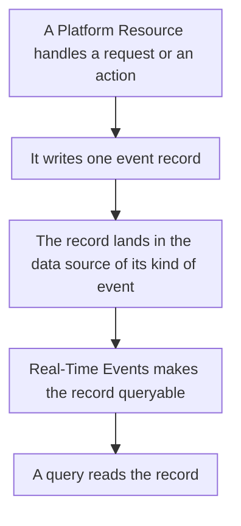
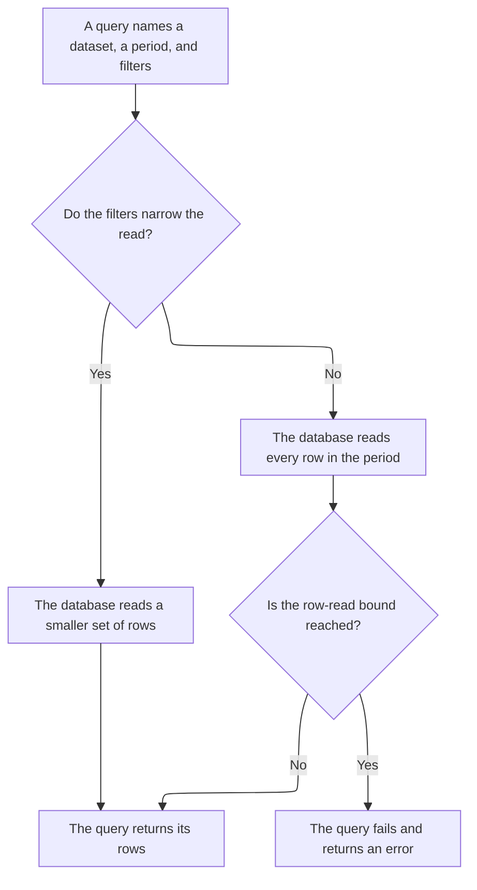

import FrameBox from '@aziontech/webkit/frame-box'
import ItemList from '@aziontech/webkit/item-list'
import DocItem from '@aziontech/webkit/doc-item'

A request that has been served leaves nothing a person can read, unless whatever served it wrote the details down. The system that handled the request records what it saw. That record holds the address the request came from, the path it asked for, the status it answered with, and the time it took. You can search the record for a period, and then it is removed.

On Azion, those records are event records, and [Real-Time Events](/en/documentation/platform/real-time-events/) is where you search them. Each Platform Resource writes its records into the data source of its kind of event. Each data source carries its own set of fields, because each kind of event records a different thing. You read the records in Azion Console, or with the Real-Time Events GraphQL API at `https://api.azion.com/v4/events/graphql`.

This page follows one record rather than listing the fields it carries. The variables of each data source are on [Data sources](/en/documentation/platform/real-time-events/data-sources/), and every bound is on [Limits](/en/documentation/platform/real-time-events/limits/). [Real-Time Metrics](/en/documentation/platform/real-time-metrics/) shows the same traffic as aggregated metrics, and [Data Stream](/en/documentation/platform/data-stream/) sends records to an endpoint you run. The sections of this page follow the path an event travels, the data sources and datasets, how a query is bounded, and retention.

---

## The path an event travels

An event record exists because a Platform Resource wrote it, and Real-Time Events observes nothing on its own. An [Application](/en/documentation/platform/applications/) that serves no request, a [Function](/en/documentation/platform/functions/) that never runs, and an account nobody touches produce no records at all. A Platform Resource writes one record for each event it handles. The event is whatever it does once: one request, one DNS query, one delivery to a configured endpoint, or one action on the account.

This diagram follows a single event, from the work that produces it to the query that reads it:

1. A Platform Resource handles one unit of work: a request, a DNS query, a delivery, or an action on the account.
2. It writes one event record for it, holding one value per field its data source defines.
3. The record is written into the data source of its kind of event. A request that also runs a Function leaves one more record in the data source of Functions.
4. Real-Time Events makes the record queryable a short time after the event, rather than at the instant of it.
5. A query names one data source, a period, and any filters, and reads the records that match.
6. The record is removed at the end of its retention period, whether or not anyone read it.

A variable is not an event of its own. One event produces one record, and the variables are the fields of that record. A request that matched a [WAF](/en/documentation/platform/firewall/waf/) rule and was served from cache is therefore one record that carries both facts. To open one record and read every variable it carries, refer to [Read an event record](/en/documentation/guides/platform/observability/understand-logs/).

The gap between the event and the queryable record is the part of this path to design around. A record written moments ago can be missing from a search that runs at once. An empty result right after a request usually means the search ran too early, so repeat the search before you conclude anything. For the delay and the other bounds, refer to [Limits](/en/documentation/platform/real-time-events/limits/).

---

## Data sources and datasets

A data source holds the records of one kind of event, such as the requests your Applications and [Firewalls](/en/documentation/platform/firewall/) receive. On a query it is the index the records are read from, so every search selects one before anything else. Real-Time Events exposes eight of them in Azion Console, and each one carries its own fields.

The classic view of Azion Console lists a field in its filter by a label, such as _Remote Address_. These pages call that label a variable. The GraphQL API holds each data source as a dataset and names the same field in camelCase, such as `remoteAddress`. The records that the classic view shows, in **Log Body** and **More Details**, use that field name too.

A variable label does not parse in a GraphQL query, so copy the field name from a record instead. A [Data Stream](/en/documentation/platform/data-stream/) payload writes the same field in snake_case. The view of Azion Console in Preview lists every field by its API name.

[Data sources](/en/documentation/platform/real-time-events/data-sources/) names the dataset and the variables of each data source. For the field list of every dataset, refer to [Real-Time Events GraphQL API fields](/en/documentation/devtools/graphql/gql-real-time-events-fields/). To get a token and send a first query, refer to [GraphQL API first steps](/en/documentation/devtools/graphql/first-steps/).

Splitting the records by kind of event keeps each one readable: an HTTP request and a DNS query have almost no fields in common. A single shared record would carry a mostly empty row for each. The price is that a question about two kinds of event takes two queries, one per data source. You join their results on a value both records carry, such as the host.

---

## How a query is bounded

A query against Real-Time Events names three things: the data source it reads, the period it covers, and the filters that narrow it. Those three decide how many rows the log database reads before it can answer, and reading is the expensive part of the work. The period is usually the largest of the three. The classic view opens on the last 5 minutes, and a search widened to the full retention window draws on far more records.

In the GraphQL API the three choices are written out. The query selects a dataset, bounds the period with `tsRange: { begin, end }`, sorts the result with `orderBy`, and caps the rows it returns with `limit`. A search in Azion Console sends the same kind of query, with its choices made through the interface.

Reading is also what one of the two billed metrics counts. Data Scan measures the volume a query reads, not the volume it returns. A wide search that answers with 10 rows can still scan a large amount. Storage, the other metric, measures the volume of records kept.

The log database bounds how many rows one query may read before it answers anything. This diagram shows which query reaches that bound:

1. A query that carries a filter reads only the rows that can match it, so the period it names costs little by itself.
2. A query that carries no filter beyond the period reads every row in that period.
3. A read that stays inside the bound returns its rows as usual.
4. A read that reaches the bound ends the query with an error instead of a partial result.

The unfiltered search over a broad period is the one case that reaches the bound. It fails rather than returning the first rows it found. One filter changes that outcome more than a shorter period does. A host, an IP address, an HTTP status code, or another parameter of the search cuts the read down.

The broadest question is the one the log database refuses, so ask it as several narrow questions instead. For the row, field, payload, and rate bounds, and for the message a refused query returns, refer to [Limits](/en/documentation/platform/real-time-events/limits/).

---

## Retention

Retention is how long Real-Time Events keeps an event record queryable. A record is kept for 7 days, which is 168 hours, and is then removed, whether or not anyone read it. Removal is permanent. Retention is therefore the outer bound of every query: a period that reaches further back returns nothing for the part outside retention.

One data source is the exception. [Activity History](/en/documentation/fundamentals/activity-history/) records the actions performed on the account rather than the traffic the account serves. Its records are kept for 2 years, far longer than those of the other seven data sources. They answer who changed a configuration long after the traffic that ran under it was removed.

A retention of 7 days is long enough to investigate a recent incident, but Real-Time Events is not a long-term store. A record you need past retention has to leave before it is removed. [Data Stream](/en/documentation/platform/data-stream/) sends the records of Activity History, Applications, Functions, and WAF to an endpoint you run, where your own retention applies instead. For both periods alongside every other bound, refer to [Limits](/en/documentation/platform/real-time-events/limits/).

---

## Related resources

<FrameBox>
<ItemList>
  <DocItem title="Data sources" href="/en/documentation/platform/real-time-events/data-sources/">The eight data sources, the variables each one carries, and the dataset that holds it in the GraphQL API.</DocItem>
  <DocItem title="Limits" href="/en/documentation/platform/real-time-events/limits/">The retention periods, the bounds one query carries, and what a query past one receives.</DocItem>
  <DocItem title="Real-Time Events quickstart" href="/en/documentation/platform/real-time-events/quickstart/">Run a first search against a data source and read what it returns.</DocItem>
  <DocItem title="Glossary" href="/en/documentation/platform/real-time-events/glossary/">What event record, data source, dataset, retention, and Data Scan mean on these pages.</DocItem>
</ItemList>
</FrameBox>
