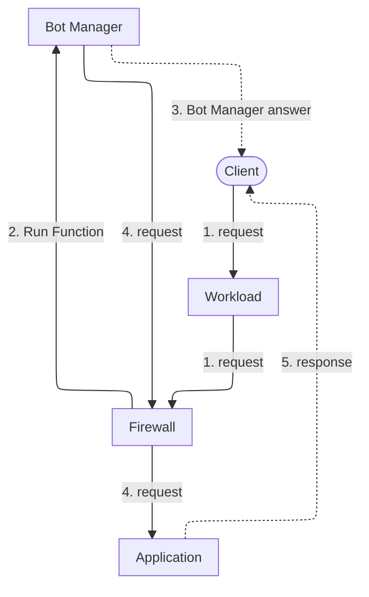

import DocButton from '~/components/webkit/DocButton.vue'
import DocCardGroup from '@aziontech/webkit/doc-card-group'
import DocCard from '@aziontech/webkit/doc-card'

**Bot Manager** is a Platform Resource nested in [Firewall](/en/documentation/platform/firewall/) that scores each request a Firewall rule runs it on for signs of automation. Bot management separates automated clients from people: it scores what each request carries, and acts when a score reaches a threshold you set. Use Bot Manager to stop credential stuffing, scraping, and vulnerability scans, or to send suspect clients to a challenge, on an [Application](/en/documentation/platform/applications/) that people use.

To run Bot Manager on your Firewall, start from these pages:

- [Bot Manager Lite](/en/documentation/platform/firewall/bot-manager/bot-manager-lite/) lists the static rules that the edition you install from Azion Marketplace scores a request against, and the defaults it ships. Start with this edition, because the full edition is in Preview and Azion enables it on request.
- [Arguments](/en/documentation/platform/firewall/bot-manager/arguments/) lists the values Bot Manager runs on, such as its threshold, its action, and its mode. Use it to spell each argument as Bot Manager reads it, because a misspelled argument is stored and ignored.
- [Logs](/en/documentation/platform/firewall/bot-manager/logs/) lists the fields of the report line that Bot Manager writes for a request. Use it to read a request's score, the rules it matched, and the action that ran, and to find where the lines surface.

<DocButton href="/en/documentation/platform/firewall/bot-manager/quickstart/" label="Quickstart" size="medium" />
<DocButton href="/en/documentation/platform/firewall/bot-manager/reference/" label="Bot Manager reference" kind="outlined" size="medium" />

---

## Request path

An installed Bot Manager [Function](/en/documentation/platform/functions/) protects no request by itself. Its [Function Instance](/en/documentation/platform/firewall/functions-instances/) on a Firewall acts only on the requests that a rule's _Run Function_ behavior runs it for. The Firewall also needs Functions on. The rule's criteria, not the Firewall, therefore choose which requests receive a score.

Solid arrows in the diagram carry the request, and dotted arrows carry what answers the client. Each label opens with the number of its step in the list that follows.

1. A client requests a domain of a [Workload](/en/documentation/platform/workloads/), and the Firewall that the Workload's deployment sets receives the request first.
2. A rule whose criteria match the request runs the Bot Manager Function Instance. Bot Manager scores the request and compares the score with the threshold that the Function Instance carries.
3. When the score is equal to or higher than the threshold, the Function Instance applies its action. The action can refuse the request, close it with no response, redirect it, or answer with a page of your own. Bot Manager can also answer with an empty response that sets two session cookies, to ask the client to carry a session.
4. A request scored under the threshold continues through the Firewall to the Application, and so does a request that no Bot Manager rule matched. An action that allows the request, or holds it for a random delay, also lets it continue.
5. The Application answers the request, and the client receives that response.

---

## Next steps

<DocCardGroup cols={2}>
  <DocCard title="Quickstart" href="/en/documentation/platform/firewall/bot-manager/quickstart/" label="Run Bot Manager Lite from a Firewall rule, and read the score of a bot-shaped request." />
  <DocCard title="Bot scoring" href="/en/documentation/platform/firewall/bot-manager/bot-scoring/" label="See how matched rules add up to a score, and what the threshold decides." />
  <DocCard title="Guides and tutorials" href="/en/documentation/platform/firewall/guides/" label="Calibrate a threshold, run Bot Manager on chosen paths, or read the report log." />
  <DocCard title="Best practices" href="/en/documentation/platform/firewall/best-practices/#bot-manager" label="Start in observation mode, and set a threshold from your own traffic." />
  <DocCard title="Limits" href="/en/documentation/platform/firewall/limits/#bot-manager" label="Look up the bounds of a Bot Manager Function Instance, and the answer past each one." />
  <DocCard title="Troubleshooting" href="/en/documentation/platform/firewall/troubleshooting/#bot-manager" label="Find out why a client receives an empty 204, or an argument has no effect." />
  <DocCard title="Glossary" href="/en/documentation/platform/firewall/glossary/" label="Look up a Bot Manager term, such as fingerprint, threshold, or under evaluation." />
</DocCardGroup>
