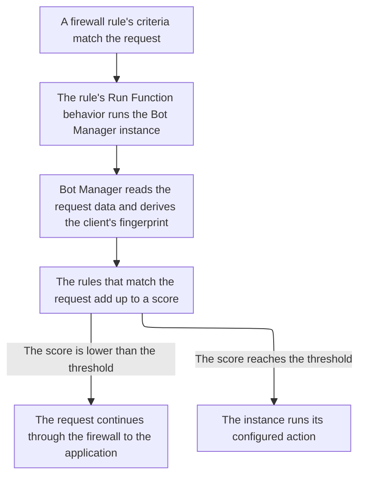

import DocButton from '~/components/webkit/DocButton.vue'
import DocCardGroup from '@aziontech/webkit/doc-card-group'
import DocCard from '@aziontech/webkit/doc-card'

Bot management tells automated clients from people. A script and a person reach an application the same way, over HTTP, so the request is all there is to judge. The check weighs what one request carries, such as its headers, its address, and its session, and each finding adds points to one score. When the score reaches a figure you set, the request is acted on, and below it the application receives the request unchanged.

**Bot Manager** scores each request that a [firewall](/en/documentation/platform/firewall/) rule hands it for signs of automation, and runs the action you configure when the score reaches your threshold. It runs as a [function instance](/en/documentation/platform/firewall/functions-instances/) on the firewall, invoked by a rule with the _Run Function_ behavior, so the firewall needs [Functions](/en/documentation/platform/functions/) on. Use Bot Manager to refuse, delay, or challenge automation such as credential stuffing, vulnerability scanning, inventory scraping, or checkout abuse on an application that also serves people.

<DocButton href="/en/documentation/platform/firewall/bot-manager/quickstart/" label="Quickstart" size="medium" />
<DocButton href="/en/documentation/platform/firewall/bot-manager/arguments/" label="Bot Manager reference" kind="secondary" size="medium" />

---

## Function instance structure

Bot Manager acts through a function instance, which carries the arguments the installed function runs on. This instance runs [Bot Manager Lite](/en/documentation/platform/firewall/bot-manager/bot-manager-lite/) at the threshold and the action that edition ships, sent as the body of `POST /v4/workspace/firewalls/<firewall-id>/functions`:

```json
{
  "name": "bot-manager-lite",
  "function": <function-id>,
  "active": true,
  "args": {
    "threshold": 30,
    "action": "deny",
    "internal_logs": 2,
    "log_tag": "storefront-bots"
  }
}
```

- `threshold` and `action` decide the outcome: the function applies `action` to a request whose score is equal to or higher than `threshold`. Bot Manager Lite ships `30` with `deny`, and Bot Manager documents a threshold of `18` as the value to start from.
- `internal_logs` at `2` writes a report line for every request, even one that scores `0`, and `log_tag` names this instance in those lines.
- `function` is the ID of the installed function. Nothing validates `args`: a misspelled key is stored and ignored, and the function runs on its default.
- An instance scores nothing until a firewall rule runs it with a _Run Function_ behavior, `{ "type": "run_function", "attributes": { "value": <instance-id> } }`, which names the instance, never the function. [Azion Console](https://console.azion.com) lists instances on the firewall's **Functions Instances** tab, and [Azion API](https://api.azion.com/) and [Azion CLI](/en/documentation/devtools/cli/) carry the arguments as `args`.

---

## Request path

An installed Bot Manager function scores nothing on its own. Five objects put a request under inspection:

- The installed Bot Manager function.
- A firewall with Functions enabled.
- A function instance on that firewall, carrying the arguments.
- A rule on that firewall whose _Run Function_ behavior names the instance.
- A [workload](/en/documentation/platform/workloads/) bound to the firewall through its deployment.

This diagram follows a request from the rule that matches it to the Bot Manager decision:



1. A rule on the firewall matches the request, and its _Run Function_ behavior runs one Bot Manager instance, with the arguments that instance carries.
2. Bot Manager reads the data the request carries, including its device, browser, and network data, and derives the fingerprint of the client behind it.
3. Bot Manager scores the request against its rules and compares the score with the instance's threshold.
4. When the score is equal to or higher than the threshold, the instance runs the configured action. Otherwise the request continues to the application.

For how Bot Manager builds a score and acts on it, and how fingerprints, session cookies, and modes shape it, refer to [Bot scoring](/en/documentation/platform/firewall/bot-manager/bot-scoring/).

---

## Scope and limits

- **Firewall**: Bot Manager has no switch in **Modules** and no key in the firewall's `modules` object. It needs the firewall's **Functions** switch on, which a firewall created through the API, the CLI, or the **Create Firewall** page has. A firewall created from a Console drawer starts with **Functions** off.
- **Editions**: Bot Manager Lite is the self-serve edition, installed from [Azion Marketplace](/en/documentation/platform/marketplace/), and scores each request against 26 static rules. The full edition, Bot Manager, is enabled on request. It also runs a dynamic score, which compares the behavioral history of a device fingerprint with the overall traffic pattern of the host. Both editions are configured through an instance's arguments, but their keys and three of their defaults differ, as [Arguments](/en/documentation/platform/firewall/bot-manager/arguments/) lists.
- **Actions**: seven actions answer a request whose score reaches the threshold. `allow`, `deny`, and `drop` decide it, `random_delay` and `hold_connection` delay the answer, and `redirect` and `custom_html` replace the response. `deny` answers `403` with Azion's default error page. For why a first instance scores with `action` set to `allow`, refer to [Firewall best practices](/en/documentation/platform/firewall/best-practices/#bot-manager).
- **Modes and sessions**: Bot Manager Lite asks a client to carry a session. At its shipped threshold of `30`, a request without a browser's headers, such as one sent by `curl`, receives a `204`, no body, and two session cookies. A client that keeps no cookies, such as a monitor or an API consumer, receives that `204` indefinitely. Bot Manager runs in `web` mode by default, and its `api` mode sets no cookie and ignores every rule that reads the session pair.
- **Limits**: an instance `name` takes up to 100 characters, and its arguments payload holds up to 100,000 bytes. For every bound, the answer past it, and what each plan includes, refer to [Firewall limits](/en/documentation/platform/firewall/limits/#bot-manager), and for the rates, to [Pricing](/en/documentation/fundamentals/pricing/#bot-manager).
- **Interfaces**: Bot Manager Lite installs from Azion Marketplace in Azion Console. You create its instance on the firewall's **Functions Instances** tab, through the API at `/v4/workspace/firewalls/<firewall-id>/functions`, or with `azion create firewall-instance`. [`azion.config.js`](/en/documentation/devtools/cli/azion-config-js/#firewall-function-instances) (a firewall's `functionsInstances`) and [Azion Terraform Provider](/en/documentation/devtools/terraform/security/) (`azion_firewall_functions_instance`) create it like any firewall function instance. The _Run Function_ behavior belongs to a firewall rule, created with `azion create firewall-rule` or at `/v4/workspace/firewalls/<firewall-id>/request_rules`.
- **Observability**: a report line reaches [Real-Time Events](/en/documentation/platform/real-time-events/) in the `functionConsoleEvents` dataset, and [Data Stream](/en/documentation/platform/data-stream/) forwards it from the Functions data source. The **Bot Manager** tab of [Real-Time Metrics](/en/documentation/platform/real-time-metrics/secure-dashboards/#bot-manager) charts how requests were classified and which action ran. It shows data only when the account is subscribed to Bot Manager. Azion CLI prints none of these lines, so an empty `azion logs` result does not show a silent function. For every field of a report line, refer to [Logs](/en/documentation/platform/firewall/bot-manager/logs/).
- **Neighbors**: Bot Manager does not inspect a request for application vulnerabilities. That is [WAF](/en/documentation/platform/firewall/waf/), and the two run on the same firewall. To block a request by where it comes from, use [Network Shield](/en/documentation/platform/firewall/network-shield/).
- **Terms**: the [Firewall glossary](/en/documentation/platform/firewall/glossary/) defines the words the Bot Manager pages give a specific meaning, such as fingerprint, threshold, static rule, and under evaluation.

---

## Next steps

<DocCardGroup cols={2}>
  <DocCard title="Quickstart" href="/en/documentation/platform/firewall/bot-manager/quickstart/" label="Score your first request, and read the score in the report log." />
  <DocCard title="Bot scoring" href="/en/documentation/platform/firewall/bot-manager/bot-scoring/" label="See how a score builds up, and what the threshold decides." />
  <DocCard title="Arguments" href="/en/documentation/platform/firewall/bot-manager/arguments/" label="Look up an argument, its default, or the values an action takes." />
  <DocCard title="Guides and tutorials" href="/en/documentation/platform/firewall/guides/" label="Complete a specific task, from observation mode to a calibrated threshold." />
  <DocCard title="Limits" href="/en/documentation/platform/firewall/limits/#bot-manager" label="Look up a bound on an instance, the answer past it, or what a plan includes." />
  <DocCard title="Troubleshooting" href="/en/documentation/platform/firewall/troubleshooting/#bot-manager" label="Find the cause when a client gets 204, or an argument does nothing." />
</DocCardGroup>
