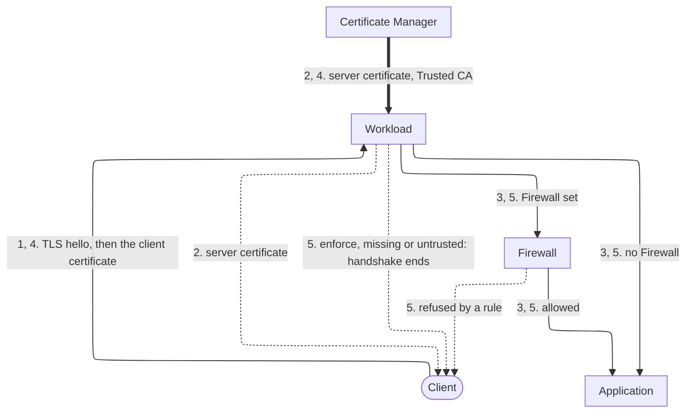

import DocButton from '~/components/webkit/DocButton.vue'
import DocCardGroup from '@aziontech/webkit/doc-card-group'
import DocCard from '@aziontech/webkit/doc-card'

**Certificate Manager** is a Platform Resource that stores the certificates a [Workload](/en/documentation/platform/workloads/) uses for Transport Layer Security (TLS) connections on Azion's distributed infrastructure. A certificate either proves to clients that a server holds a hostname, or lets that server verify the certificates clients present, for [mutual TLS (mTLS)](/en/documentation/platform/workloads/mtls/). Use Certificate Manager to serve HTTPS on your own domains, accept client certificates from your certificate authority (CA), or refuse the revoked ones.

Certificate Manager holds certificates you obtain yourself and certificates Azion obtains for you:

- [Certificates](/en/documentation/platform/certificate-manager/certificates/) let you bring a certificate a CA issued to you, with its private key, or request one through a certificate signing request (CSR). Certificate Manager also stores certificate revocation lists (CRLs) of revoked client certificates.
- [Issuance and renewal](/en/documentation/platform/certificate-manager/issuance-and-renewal/) lets Azion request a server certificate for a Workload's domains from Let's Encrypt and renew it before it expires. Every name on the certificate must belong to a domain your account has permission for.

<DocButton href="/en/documentation/platform/certificate-manager/quickstart/" label="Quickstart" size="medium" />
<DocButton href="/en/documentation/platform/certificate-manager/reference/" label="Certificate Manager reference" kind="secondary" size="medium" />

## Request path

Storing a certificate in Certificate Manager secures no hostname: a Workload uses a certificate only once that certificate is bound to that Workload. Certificate Manager then acts during the TLS handshake, before a [Firewall](/en/documentation/platform/firewall/) or an [Application](/en/documentation/platform/applications/) sees the request.

This diagram follows a handshake from the client's hello to the request that continues, with the certificates Certificate Manager supplies. Solid arrows carry the handshake and the request, and dotted arrows carry what goes back to the client. The thick arrow carries the certificates you bound before the request. Each label starts with the number of the step it belongs to.

1. The client opens a TLS connection to one of the Workload's hostnames and names that hostname through Server Name Indication (SNI).
2. The Workload presents its server certificate. For the [workload domain](/en/documentation/platform/workloads/how-it-works/#workload-domain-and-custom-domains), or with `tls.certificate` set to `null`, that is Azion's SAN certificate. For a custom domain with a server certificate bound, it is that certificate.
3. With mTLS off, the handshake completes, and the request continues to the Application, through the Firewall when the deployment sets one.
4. With mTLS on, the Workload requests a client certificate and checks it against the Trusted CA certificate in `mtls.config.certificate`.
5. In `enforce` mode, a client with no certificate, or with one another authority signed, cannot complete the handshake. In `permissive` mode, the handshake completes. When the deployment sets a Firewall, a rule that tests the Client Certificate Validation variable can refuse the request.

---

## Next steps

<DocCardGroup cols={2}>
  <DocCard title="Quickstart" href="/en/documentation/platform/certificate-manager/quickstart/" label="Upload your first certificate and bind it to a Workload." />
  <DocCard title="How it works" href="/en/documentation/platform/certificate-manager/how-it-works/" label="Understand what binding a certificate changes and what it costs." />
  <DocCard title="Guides and tutorials" href="/en/documentation/platform/certificate-manager/guides/" label="Complete a specific certificate task." />
  <DocCard title="Limits" href="/en/documentation/platform/certificate-manager/limits/" label="Look up where Certificate Manager stops and the value of each limit." />
  <DocCard title="Best practices" href="/en/documentation/platform/certificate-manager/best-practices/" label="Replace certificates before they expire and choose the right kind." />
  <DocCard title="Troubleshooting" href="/en/documentation/platform/certificate-manager/troubleshooting/" label="Find the cause when a certificate stays pending or is refused." />
  <DocCard title="Glossary" href="/en/documentation/platform/certificate-manager/glossary/" label="Look up a term the Certificate Manager pages use." />
</DocCardGroup>
