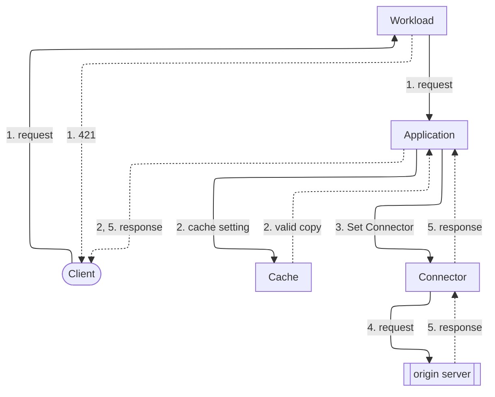

import FrameBox from '@aziontech/webkit/frame-box'
import ItemList from '@aziontech/webkit/item-list'
import DocItem from '@aziontech/webkit/doc-item'

A reverse proxy answers a client on behalf of a server you run. When it cannot answer from what it already holds, it opens its own connection to that server and forwards the request. On the way, it decides how to address the server: which hostname to send in the `Host` header, which path to ask for, and which protocol and port to use. The server answers the proxy, and the proxy answers the client.

On Azion, the proxy is an Application of [Applications](/en/documentation/platform/applications/), the Platform Resource that processes the requests your Workloads receive. [Connectors](/en/documentation/platform/connectors/) is the Platform Resource that routes requests from your Applications to the origins that hold your content. A Connector is the upstream of that proxy: where your content is, and how each request reaches it. A rule of the Application sets the Connector, and the Connector shapes each request it sends to the origin.

Three nested Platform Resources extend Connectors. [Load Balancer](/en/documentation/platform/connectors/load-balancer/) spreads requests across several addresses of one Connector, and [Origin Shield](/en/documentation/platform/connectors/origin-shield/) restricts your origin to Azion. [Live Ingest](/en/documentation/platform/connectors/live-ingest/) takes a live stream in through a Connector of type `live_ingest`.

This page covers the mechanisms rather than the fields: every field is on [Connector settings](/en/documentation/platform/connectors/settings/), and every bound is on [Connectors limits](/en/documentation/platform/connectors/limits/). The sections follow a request: the request path, the Connector types, how the Connector addresses the origin, the client address headers, connection reuse and timeouts, and propagation. Load Balancer, Origin Shield, and Live Ingest close the page, in that order.

---

## Request path

Creating a Connector sends it no traffic. A Connector receives requests only from an Application rule that sets it with the _Set Connector_ behavior, and until a rule sets one, the Application has no origin. The Application itself receives only the requests of a [Workload](/en/documentation/platform/workloads/) whose deployment sets it.

The diagram follows one request from the client to the origin. Solid arrows carry the request, and dotted arrows carry the response. Each label starts with the number of its step.



1. A client requests a domain of a Workload, and the Application that the Workload's deployment sets receives the request. When SNI Check enforcement is on, an HTTPS request can receive `421 Misdirected Request` before any Application runs.
2. The Application runs its Request Phase rules in order. When a rule applies a cache setting and Cache holds a valid copy of the origin response, that copy answers the client, and the request never reaches the Connector.
3. Otherwise, the request goes to the Connector that a matching _Set Connector_ rule sets. When several matching rules carry the behavior, only the last one runs.
4. The Connector opens a connection to the origin and sends the request, shaped by the Connector's settings.
5. The origin answers the Connector. The Application runs its Response Phase rules on the response, and the client receives it.

A rule holds the Connector's ID in `attributes.value`, and the Connector holds the address. Moving the origin therefore means editing one Connector, and every rule that sets it follows without a change. For example, when you change the Connector's `host` and `path_prefix`, the same rule sends requests to the origin with the new values. The cost is a dependency between the two entities: the API refuses to delete a Connector that a rule still sets, with `28000`.

On API v3, the origins of an Application carried this role. For that model, refer to [Origins](/en/documentation/platform/connectors/origins/). To write the rule that sets a Connector, refer to [Rules Engine for Applications](/en/documentation/platform/applications/rules-engine/). For when SNI Check answers `421`, refer to [SNI Check](/en/documentation/platform/connectors/sni-check/).

---

## Connector types

A Connector has one of three types, and the type decides what the Connector reaches and which settings it carries. In the API, they are `http`, `storage`, and `live_ingest`, and Azion Console labels them _HTTP_, _Object Storage_, and _Live Ingest_.

A Connector of type `http` reaches servers you run, by hostname or by IP address. It holds one address, or several when Load Balancer is on. It is the only type with connection options, so the `Host` header, the path prefix, the protocol, and the client address headers apply to it alone. Use it for any origin that answers HTTP: a cloud server, a server in your data center, or an S3-compatible storage endpoint.

A Connector of type `storage` reads objects from a bucket of [Object Storage](/en/documentation/platform/object-storage/) in your account. It holds no addresses and no connection options, because the origin is Azion's own storage, and there is no server for you to run. A prefix narrows the Connector to the objects under it, such as `images/`.

A Connector of type `live_ingest` takes a live stream that Azion ingests in a region you choose. It holds no addresses and no connection options. The Live Ingest section of this page describes how the stream reaches viewers.

For example, one Application can send requests for `/images/` to a Connector of type `storage` and every other path to a Connector of type `http`. Each rule matches its own paths, and each sets its own Connector. For the fields of each type, refer to [Connector settings](/en/documentation/platform/connectors/settings/#general).

---

## How the Connector addresses the origin

A Connector of type `http` decides four things about every request it forwards. They are the `Host` header, the path, the protocol and port, and how the Connector resolves and follows the origin's address. They shape the request the origin receives, not the URL the client requested.

### Host header

The `Host` header tells a server which site a request is for. One server can host several sites, called virtual hosts, and it reads `Host` to pick the site and locate its content. The `host` connection option decides the value the Connector sends.

By default, `host` is `${host}`, which sends the host the client requested. For example, a client that requests `www.example.com` makes the Connector send `Host: www.example.com`. This suits an origin that serves several virtual hosts and expects each request under its public name.

A literal value is sent as is, for every request. Set one when the origin answers a virtual host under a name other than the one the client used, such as `origin.example.com`. An origin that routes requests by name may not answer the client's host, so it needs its own name here.

Over HTTPS, the Connector also sends the `host` value as the Server Name Indication (SNI), the server name of its TLS handshake with the origin. One field sets both, so the `Host` header and the server name always carry the same value.

### Path prefix

The `path_prefix` connection option goes in front of the path the client requested. With `/anything`, a request for `/get` reaches the origin as `/anything/get`. The prefix never appears in the client's URL: the client asks for `/get` and receives the response to `/anything/get`.

Use a prefix when the content sits under a directory of the origin. An origin can also need a path segment, such as the bucket name on an S3-compatible endpoint. The default is no prefix, and the path reaches the origin unchanged.

### Protocol and ports

The connection from the Connector to the origin has its own protocol, independent of the one the client used to reach Azion. The **Transport Protocol Policy** decides it. _Preserve_, the default, keeps the scheme the client used, so an HTTPS request reaches the origin over HTTPS. _Force HTTPS_ and _Force HTTP_ use that protocol for every request, whatever the client used.

Forcing HTTPS protects the leg between Azion and the origin, and it costs a TLS handshake with the origin on every new connection. Forcing HTTP saves the handshake, and it sends the request to the origin unencrypted.

Each address carries its own ports, `http_port` and `https_port`, with defaults `80` and `443`. The address itself never carries a port or a protocol. For how to run an origin on other ports, refer to [Configure HTTP and HTTPS ports](/en/documentation/guides/application-development/getting-started/configure-ports/).

### DNS resolution and redirects

An address can be a hostname, and the Connector resolves it before it connects. The **DNS Resolution Policy** decides which addresses the Connector uses. _IPv4 and IPv6_, the default, allows both. _Force IPv4_ keeps the connection on IPv4 even when the hostname also resolves to IPv6, and _Force IPv6_ keeps it on IPv6.

An origin can answer with an HTTP redirect instead of the content. For redirects, the Connector has the **Following Redirect** setting, `following_redirect` in the API, and it is off by default.

For each of these settings and its default, refer to [Connector settings](/en/documentation/platform/connectors/settings/#connection-options).

---

## Client address headers

The origin receives the request over a connection that the Connector opens, so it sees Azion's address, not the client's. To pass the client's address on, the Connector adds two headers to every request of a Connector of type `http`.

By default, the origin receives the client IP address in `X-Real-IP` and the client port in `X-Real-PORT`. The `real_ip_header` and `real_port_header` connection options rename them. For example, with `real_ip_header` set to `X-Client-Real-IP`, the origin receives `X-Client-Real-IP` with the client address, and no `X-Real-IP`.

An origin that logs, rate-limits, or authorizes by client address reads it from that header. Some origins drop `X-Real-IP` themselves, before your code sees it. Renaming the header works around such an origin.

Alternatively, a rule can add the client IP to a header of your choice. For that approach, refer to [Send the client IP to the origin in a header](/en/documentation/support/original-ip-header/).

---

## Connection reuse and timeouts

The connection from Azion to the origin follows platform defaults that decide how long Azion waits and how long it keeps an idle connection open. Some come from Azion's global settings and some from the operating system. A Connector without Load Balancer exposes none of them as a setting.

This table lists the defaults of the connection to the origin:

| Connection behavior | Default |
| --- | --- |
| Complete TCP Connection | 60 seconds |
| TCP ACK Timeout | About 15 to 30 minutes |
| TCP Keep-Alive Interval | Off |
| Proxy Idle Timeout | 75 seconds |
| Proxy Read Timeout | 120 seconds |
| Proxy Write Timeout | 120 seconds |
| HTTP/2 Pings to Origin | Off |
| HTTP/2 Connection Idle | 75 seconds |

Timeouts and retries become settings only with Load Balancer on the Connector. Its **Connection Timeout** limits the wait for a connection to the origin, and its **Read/Write Timeout** limits the wait for data on an open connection. Its **Max Retries** counts the retry attempts on a connection failure.

In the API, `max_retries` defaults to `0`, so a request is not retried unless you raise it. For these fields, refer to [Connector settings](/en/documentation/platform/connectors/settings/#load-balancer).

When an HTTPS origin refuses the TLS handshake, the client receives `502` with the page titled `Azion - Default error page`, not a page from the origin:

```text
HTTP/2 502 
server: nginx
…
content-type: text/html
x-azion-request-id: <request-id>
…
    <title>Azion - Default error page</title>
```

---

## Propagation

A Connector change needs no new deployment, and it still takes time to reach traffic. Azion's distributed infrastructure receives it over several minutes, and each data center applies it at its own moment. The time is best-effort, with no guaranteed duration.

While a change spreads, a request can meet the old settings or the new ones, depending on the data center that answers. For example, right after you change the Connector's `host`, some requests reach the origin with the new `Host` header and others with the previous one. The same holds for a new rule that sets a Connector.

One request sent right after a change shows only what one data center holds. To confirm a change, send the request several times, until every answer reflects it. Plan each change so that both versions of the settings work while it spreads. For example, keep the old origin answering until every data center sends requests to the new one.

---

## Load Balancer

One server is one point of failure, and it carries all the load. Spreading requests across several servers that hold the same content keeps the site answering when one of them fails, and it shares the load among them. A balancer chooses, for each request, which server receives it.

With [Load Balancer](/en/documentation/platform/connectors/load-balancer/) on, a Connector of type `http` holds several addresses instead of one. A balancing method chooses the address for each request, and the weight and the server role of each address shape that choice. Rules still decide which requests reach the Connector, so any criterion of [Rules Engine for Applications](/en/documentation/platform/applications/rules-engine/), such as the path, decides which requests are balanced.

For where Load Balancer acts on a request, refer to the [Load Balancer overview](/en/documentation/platform/connectors/load-balancer/#request-path), and for how each method chooses an address, to [Balancing methods](/en/documentation/platform/connectors/load-balancer/balancing-methods/).

---

## Origin Shield

An origin on the public internet answers anyone who finds its address. A client can then bypass the proxy and every protection in front of it.

Two defenses close that path. The origin accepts connections only from the proxy's addresses. The origin also requires each request to carry a signature made with a secret that only the proxy holds.

[Origin Shield](/en/documentation/platform/connectors/origin-shield/) gives a Connector of type `http` either defense. With Origin IP ACL, your origin's firewall allows only the addresses of the `Azion Origin Shield` list in [Network Lists](/en/documentation/platform/firewall/network-shield/network-lists/), and refuses every other source. With HMAC, the Connector signs each request with AWS Signature Version 4 credentials, so an S3-compatible origin authenticates it.

For where Origin Shield acts on a request, refer to the [Origin Shield overview](/en/documentation/platform/connectors/origin-shield/#request-path), and for how Origin IP ACL and HMAC protect the origin, to [Origin IP ACL and HMAC](/en/documentation/platform/connectors/origin-shield/origin-ip-acl-and-hmac/).

---

## Live Ingest

A live broadcast starts at an encoder, which pushes the stream to an ingest point as it is produced. Viewers do not connect to the encoder. They fetch the stream over HTTP from servers that received it.

On Azion, the encoder pushes the stream to [Live Ingest](/en/documentation/platform/connectors/live-ingest/), and a Connector of type `live_ingest` takes it in the region you choose. The Application delivers it: a rule whose _Set Connector_ behavior sets that Connector sends the viewers' requests to the stream.

For where Live Ingest acts on a viewer's request, refer to the [Live Ingest overview](/en/documentation/platform/connectors/live-ingest/#request-path), and for how it takes a stream in and delivers it, to [Ingestion and delivery](/en/documentation/platform/connectors/live-ingest/ingestion-and-delivery/).

---

## Related resources

<FrameBox>
<ItemList>
  <DocItem title="Connector settings" href="/en/documentation/platform/connectors/settings/">Every field of a Connector by type, with the default and allowed values behind the mechanisms on this page.</DocItem>
  <DocItem title="Connectors quickstart" href="/en/documentation/platform/connectors/quickstart/">Create a Connector, set it with a rule, and send your first request through it to your origin.</DocItem>
  <DocItem title="Troubleshoot Connectors" href="/en/documentation/platform/connectors/troubleshooting/">Symptoms along the path from the rule to the origin, with their causes and fixes.</DocItem>
  <DocItem title="How Applications works" href="/en/documentation/platform/applications/how-it-works/">The rules, cache, and phases an Application runs before and after a request reaches a Connector.</DocItem>
</ItemList>
</FrameBox>
