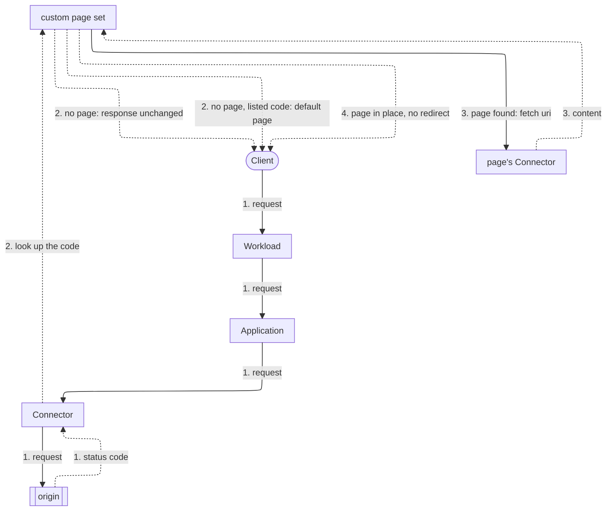

import DocButton from '~/components/webkit/DocButton.vue'
import DocCardGroup from '@aziontech/webkit/doc-card-group'
import DocCard from '@aziontech/webkit/doc-card'

**Custom Pages** is a Platform Resource that replaces the error response a [Connector](/en/documentation/platform/connectors/) returns with a page of your own, on Azion's distributed infrastructure. A custom error page is a document a site serves in place of a server's default error response for one status code, such as `404`. Use Custom Pages to show your own page for a missing resource or a timed-out origin, set its cache time, or change its status code. Also use [Custom page settings](/en/documentation/platform/custom-pages/settings/) to look up the fields of a set, its pages, and the status codes a page replaces.

<DocButton href="/en/documentation/platform/custom-pages/quickstart/" label="Quickstart" size="medium" />
<DocButton href="/en/documentation/platform/custom-pages/reference/" label="Custom Pages reference" kind="outlined" size="medium" />

## Request path

Creating a custom page set changes no response: a [Workload](/en/documentation/platform/workloads/) uses a custom page set only once that Workload's deployment sets that custom page set.

This diagram follows a response from the Connector's status code to what the client receives. Solid arrows carry requests, and dotted arrows carry responses. Each label starts with the number of the step it belongs to.

1. The Workload forwards the request to the [Application](/en/documentation/platform/applications/) that its deployment sets. The Application sends the request to the origin through a Connector, and the Connector answers with a status code.
2. Azion looks for a page with that code in the custom page set that the deployment sets. When the set has no page for the code, the client receives the Connector's response unchanged, except for the status codes `400`, `401`, `403`, `406`, `500`, `502`, `503`, and `504`, which receive Azion's default error page.
3. When a page matches, Azion fetches its content from the page's Connector at the page's `uri`. The page's `ttl` sets its cache time.
4. The client receives that content in place, with no redirect and no `Location` header. The status is the page's `custom_status_code`, when one is set.

---

## Next steps

<DocCardGroup cols={2}>
  <DocCard title="Quickstart" href="/en/documentation/platform/custom-pages/quickstart/" label="Replace your origin's 404 with a page of your own." />
  <DocCard title="How it works" href="/en/documentation/platform/custom-pages/how-it-works/" label="Understand which responses a custom page set replaces." />
  <DocCard title="Guides and tutorials" href="/en/documentation/platform/custom-pages/guides/" label="Complete a specific error page task." />
  <DocCard title="Limits" href="/en/documentation/platform/custom-pages/limits/" label="Look up where Custom Pages stops and the value of each limit." />
  <DocCard title="Troubleshooting" href="/en/documentation/platform/custom-pages/troubleshooting/" label="Find the cause when a set is refused or an error page does not appear." />
  <DocCard title="Glossary" href="/en/documentation/platform/custom-pages/glossary/" label="Look up a term the Custom Pages pages use." />
</DocCardGroup>
