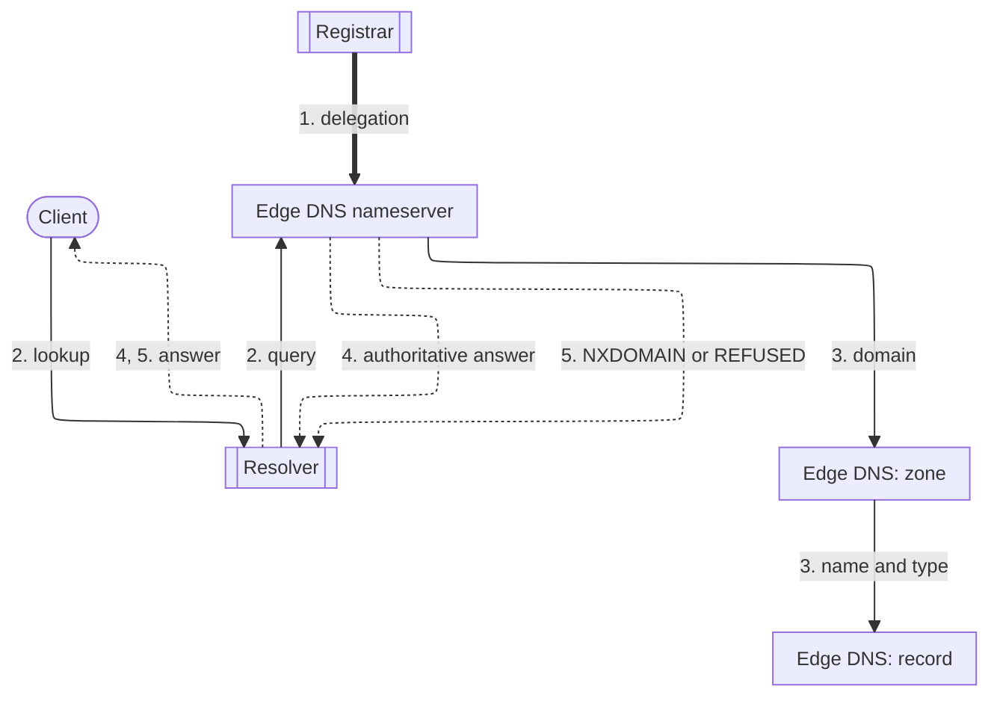
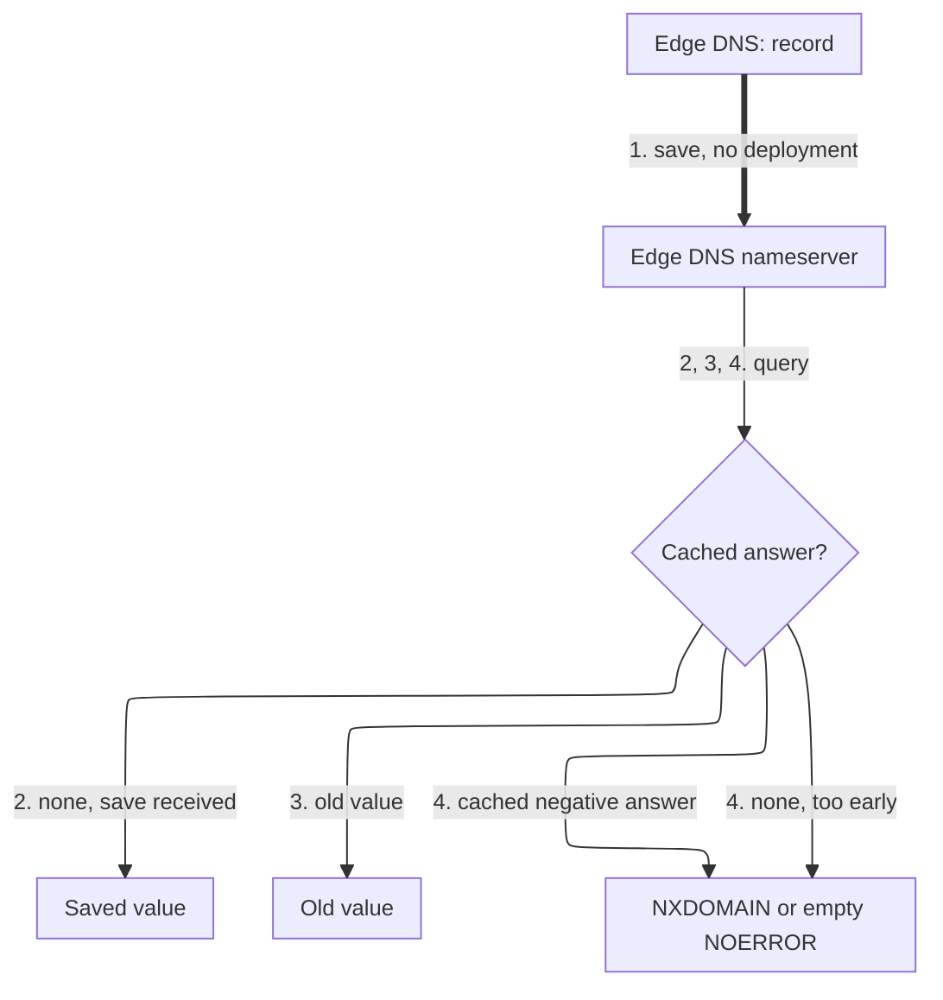
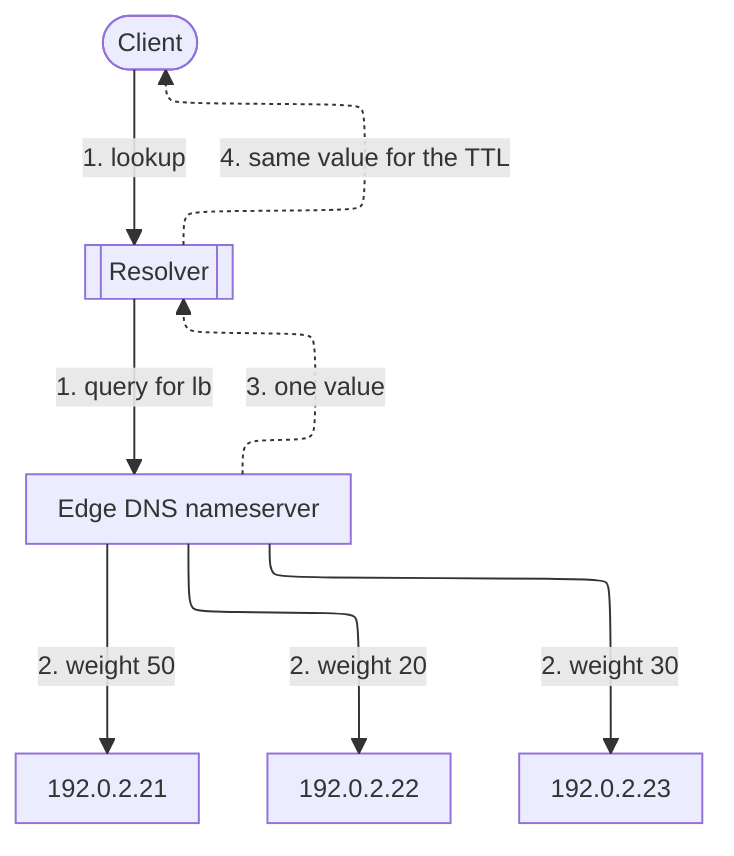
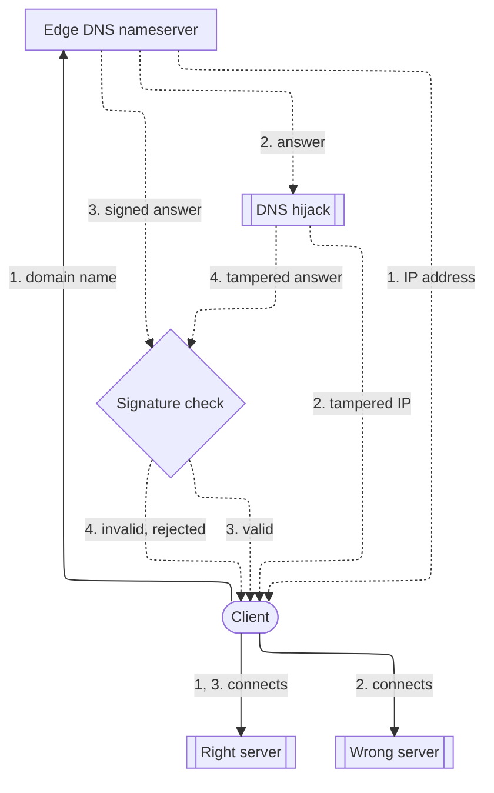

import FrameBox from '@aziontech/webkit/frame-box'
import ItemList from '@aziontech/webkit/item-list'
import DocItem from '@aziontech/webkit/doc-item'

[DNS](https://www.azion.com/en/learning/dns/what-is-dns/) answers lookups for the records of domain names, such as the IP address of a website, through a hierarchy of servers. An authoritative nameserver holds the records of a domain and answers questions about them. A resolver is a DNS server that looks up names for clients. It follows the domain's delegation to those nameservers, asks one of them, and caches the answer for its time to live (TTL).

[Edge DNS](/en/documentation/platform/edge-dns/) is a Platform Resource that hosts the DNS records of your domains and answers the queries for them. A zone holds the records of one domain's names, and each domain has one zone. Three nameservers on Azion's distributed infrastructure, `ns1.aziondns.net`, `ns2.aziondns.com`, and `ns3.aziondns.org`, answer for every zone. A domain is served by Edge DNS once its registrar delegates it to those nameservers.

The fields of a zone and a record are on [Zones and records](/en/documentation/platform/edge-dns/zones-and-records/). To create your first zone, refer to the [Edge DNS quickstart](/en/documentation/platform/edge-dns/quickstart/).

The sections follow a query to its answer: the resolution path, caching and propagation, record policies, ANAME at the apex, and DNSSEC.

---

## The resolution path

Edge DNS is an authoritative service, not a resolver. Azion's nameservers answer for the zones they host and do not perform recursion. Your users therefore keep querying their own resolvers, which reach Azion through the delegation.

The diagram follows a lookup of `www.example.com` from a client to the record that answers it. Solid arrows carry the query, dotted arrows carry the answer, and the thick arrow carries the delegation, which comes before any query. Each label starts with the number of the matching step.

1. At the domain's registrar, you delegate the domain to all three Edge DNS nameservers. Until the registrar publishes that delegation, public resolvers do not reach Azion. A domain delegated nowhere is answered `NXDOMAIN`, with the start of authority (SOA) record of the parent registry rather than Azion's.
2. A client asks its resolver for a name, such as `www.example.com`. The resolver follows the delegation and asks one of the three nameservers.
3. The nameserver finds the zone by its domain, then the record by name and type. Record names are relative to the zone: `www` answers for `www.example.com`, and `@` for `example.com` itself.
4. The nameserver returns the record's values as an authoritative answer, with a TTL that counts down from the record's TTL. The resolver caches the answer for that TTL and passes it to the client.
5. A name with no record in the zone is answered `NXDOMAIN`, unless a [wildcard record](/en/documentation/platform/edge-dns/record-types/#wildcards) matches it. A name that has its own record always wins over a wildcard. When the zone is inactive, or no zone holds the domain, the nameserver answers `REFUSED`. An inactive zone keeps its records.

The delegation is the only step of this path outside Azion. You can create a zone and its records before the registrar change, and ask `ns1.aziondns.net` directly to see what it answers. Wait about a minute after each save before that first query, as [Caching and propagation](#caching-and-propagation) explains. For the nameservers and the SOA values, refer to [Zones and records](/en/documentation/platform/edge-dns/zones-and-records/#nameservers-and-soa).

---

## Caching and propagation

A saved zone or record needs no deployment step: Azion stores it once the API, the Azion CLI, or Azion Console accepts the save.

Azion's nameservers, however, answer from a [cache](https://www.azion.com/en/learning/dns/how-dns-cache-works/) that counts each answer's TTL down. What a nameserver answers after a save depends on whether the save reaches it and on what its cache already holds for the name.

The diagram follows one query to one nameserver after you save a record. The thick arrow carries the save. Each label starts with the number of the matching step.

1. You save a record in Azion Console, the Azion CLI, or the API, and the nameservers serve it with no further action. A new name reaches every nameserver within about a minute of the save, and so does a new zone.
2. When the nameserver holds no answer for the name and the save already reached it, it answers with the saved value.
3. When the nameserver holds an answer with the old value, it serves that answer until its refresh. The refresh comes after the record's TTL or about 5 minutes, whichever is shorter. Until then, the TTL it serves counts down from the cached answer. A changed TTL or weight and a deactivated zone reach answers the same way, while a reactivated zone answers again within a minute.
4. When a nameserver was queried before the save reached it, that nameserver gave a negative answer. That answer is `NXDOMAIN` for a new name, and an empty `NOERROR` for a new type on an existing name. The nameserver keeps that answer for 1 hour, the SOA minimum of 3,600 seconds, with no 5-minute refresh. Even a query sent a few seconds after the save can arrive that early.

Behind Azion's nameservers, every resolver keeps its own copy of an answer for the TTL the answer carried. It keeps a negative answer for up to the SOA minimum. A change is therefore visible to all your users only after Azion's nameservers serve it and each resolver's copy expires. Asking `ns1.aziondns.net` directly skips your resolver's cache, not Azion's.

The cache is what makes answers fast, and it costs you the wait after a change. A long TTL lets resolvers ask less often, and a short TTL lets a change reach them sooner.

Lowering the TTL before a planned change shortens the wait at resolvers, and at Azion's nameservers too when the TTL is under 5 minutes. Waiting about a minute after the save avoids the cached negative answer, for a new name or a new type. Both practices are on [Best practices for Edge DNS](/en/documentation/platform/edge-dns/best-practices/).

---

## Record policies

A record's policy decides how its values become an answer. Every record has one: *Simple*, the default, or *Weighted*, set in **Policy Type** in the Console and in `policy` in the API.

A *Simple* record answers a query with every value it holds. A name and type hold one simple record, so several answers for one name go in that record's values. The *Weighted* policy lets several records share one name and type, each with its own weight from 0 to 255. Each answer carries one record's value, chosen in proportion to the record's weight over the sum of the weights.

The diagram follows a lookup of `lb.example.com`, where three weighted A records have the weights 50, 20, and 30 and a TTL of 20 seconds. Solid arrows carry the query, and dotted arrows carry the answer. Each label starts with the number of the matching step.

1. A client's resolver asks a nameserver for `lb.example.com`.
2. The nameserver picks one of the three records. The weights add up to 100, so each record's chance is 50, 20, or 30 percent.
3. The answer carries the value of the chosen record only. The nameserver returns that value for the record's TTL or about 5 minutes, whichever is shorter, then picks again and restarts the TTL.
4. The resolver keeps that one answer for the TTL it received, so its clients get the same address until then.

A weighted record does not split each client's traffic. The shares even out over many resolvers and many picks, not query by query. A short TTL, such as the 20 seconds of this example, lets resolvers choose again sooner, but it also makes them ask more often. Each query counts toward your Edge DNS usage, as [Pricing](/en/documentation/fundamentals/pricing/#edge-dns) shows.

A record with weight `0` stays in the zone and is never answered, which takes it out of rotation without deleting it. For the record types that accept the weighted policy, refer to [Record types](/en/documentation/platform/edge-dns/record-types/).

---

## ANAME at the apex

A domain's apex, such as `example.com`, already holds records that Azion writes: the zone's SOA and its NS set. A CNAME blocks every other type on its name, so a CNAME cannot sit at the apex. The API refuses a CNAME named `@` with `19005`. Pointing the apex at another hostname takes another record type.

An ANAME record points a name at an Azion hostname and is answered as an A record. Edge DNS looks up the target and answers the query with addresses. The apex can therefore point at a [Workload](/en/documentation/platform/workloads/) and keep its SOA, NS, MX, and TXT records.

An ANAME target is a name under `azioncdn.net`, `azionedge.net`, or `azionedge.com`, such as `<your-workload>.map.azionedge.net`, and the record's TTL is `20`. An ANAME is not limited to the apex: any name in the zone accepts one. For its rules, refer to [Record types](/en/documentation/platform/edge-dns/record-types/#aname).

A CNAME on another name follows the same idea inside the zone. When a CNAME points to a name in the same zone, Edge DNS returns the CNAME and the target's records in one response. The resolver then needs no second query.

---

## DNSSEC

A DNS answer travels from the nameserver to the client through resolvers and networks the client does not control. Nothing in a plain answer proves that it came from the authoritative nameserver unchanged. [DNSSEC](https://www.azion.com/en/learning/dns/what-is-dnssec/) adds digital signatures to the answers, which the recipient verifies.

The diagram follows one lookup and its answer, with and without a signature. Solid arrows carry the lookup and the connection, and dotted arrows carry the answer. Each label starts with the number of the matching step.

1. In a normal lookup, the client sends the domain name, and the nameserver returns the IP address. The client then connects to the server at that address.
2. In a hijack, an intermediary changes the IP address in the answer on its way to the client. The client connects to another destination, which can serve fraud.
3. With DNSSEC, the nameserver signs its answer. The recipient checks the signature: an unchanged answer passes, and the client reaches the right server.
4. A tampered answer no longer matches its signature. It fails the check and is rejected.

DNSSEC is a Feature of Edge DNS: once you turn it on for a zone, Edge DNS signs that zone. Azion generates two keys for the zone, a key-signing key and a zone-signing key, both with algorithm 13, `ECDSAP256SHA256`. Azion's nameservers publish the public keys as two `DNSKEY` records, with flags `257` for the key-signing key and `256` for the zone-signing key.

Each signed answer carries an `RRSIG` record, the signature over the records in that answer. Azion writes these records itself, and you add no DNSSEC record or key to the zone. In the API, the zone's DNSSEC setting carries only `enabled`, `status`, and `delegation_signer`, which holds the values of the delegation signer (DS) record.

The signatures prove nothing until a resolver trusts the keys. That trust comes from the parent zone, through the DS record. The DS record holds a hash, the digest, of the zone's key-signing key, and your registrar publishes it for the domain.

A validating resolver uses the DS record to verify the `DNSKEY` records, and the keys to verify the `RRSIG` of each answer. A verified signature shows that a record, such as an A, AAAA, CNAME, or PTR record, came from the authoritative nameserver with its content preserved. For the four values of the DS record, refer to [DNSSEC](/en/documentation/platform/edge-dns/dnssec/#ds-record).

The two halves of the chain happen at different times. The DNSSEC status reads `ready` once Azion signs the zone and generates the DS values, whether or not the registrar holds them. An `RRSIG` in an answer therefore shows that the zone is signed, not that resolvers validate it. Validation starts only when the registrar publishes the DS record.

Signing reaches answers through the nameservers' cache like any change. Answers cached before DNSSEC was turned on can therefore be served unsigned for about 5 minutes.

Turning DNSSEC off reaches answers the same way: each nameserver still serves the `RRSIG` and `DNSKEY` records for about 5 minutes. When DNSSEC is turned back on, the zone keeps the same DS values, and its signatures return within about 5 minutes. But a `DNSKEY` query answered while DNSSEC was off keeps its empty answer on that nameserver for up to 1 hour. In that window, a resolver that already holds the DS record can fail to validate the zone.

DNSSEC provides cryptographic authentication of data, data integrity, and authenticated denial of existence. For that last guarantee, the DNSSEC standard defines the `NSEC` and `NSEC3` records, which prove that a queried name does not exist.

DNSSEC does not encrypt anything. Answers and keys travel in plain text and can be cached, which keeps DNS fast, so DNSSEC does not keep a lookup confidential. To encrypt the traffic between a client and your application, use HTTPS.

---

## Related resources

<FrameBox>
<ItemList>
  <DocItem title="Zones and records" href="/en/documentation/platform/edge-dns/zones-and-records/">Every zone and record field, the nameservers and SOA values, and the API errors.</DocItem>
  <DocItem title="Record types" href="/en/documentation/platform/edge-dns/record-types/">The value format and rules of each record type, including ANAME, CNAME, and wildcards.</DocItem>
  <DocItem title="DNSSEC" href="/en/documentation/platform/edge-dns/dnssec/">The DNSSEC setting of a zone, its status values, and the DS record your registrar needs.</DocItem>
  <DocItem title="Best practices for Edge DNS" href="/en/documentation/platform/edge-dns/best-practices/">How to plan TTLs and changes so that new and changed records answer when you expect.</DocItem>
  <DocItem title="Weight records to balance traffic" href="/en/documentation/guides/application-security/dns/load-balance-dns/">Set weighted records on one name and read how the answers rotate.</DocItem>
</ItemList>
</FrameBox>
