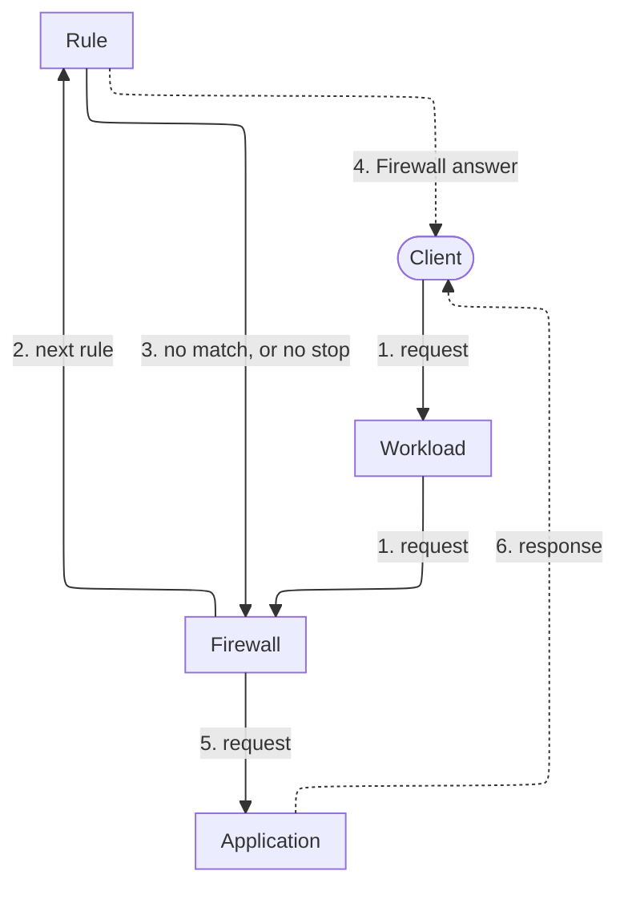

import FrameBox from '@aziontech/webkit/frame-box'
import ItemList from '@aziontech/webkit/item-list'
import DocItem from '@aziontech/webkit/doc-item'

A request to a website or an API can be refused before any of the application's code runs. A checkpoint in front of the application reads what the request carries: the address it comes from, the path it asks for, and the headers it sends. It compares them with conditions you wrote, and a request that meets one receives the action you attached to it. A request that meets none continues to the application unchanged.

On Azion, that checkpoint is a Firewall. [Firewall](/en/documentation/platform/firewall/) is a Platform Resource that inspects the requests to your Workloads before your Application receives them, on Azion's distributed infrastructure. The deployment of a [Workload](/en/documentation/platform/workloads/) sets one Firewall and one [Application](/en/documentation/platform/applications/), so every request to the Workload crosses the Firewall first. The conditions and actions are the rules of [Rules Engine for Firewall](/en/documentation/platform/firewall/rules-engine/), and each rule pairs criteria with behaviors.

Three nested Platform Resources widen what a rule can decide. With [Web Application Firewall (WAF)](/en/documentation/platform/firewall/waf/), a rule applies a rule set that scores a request against known attack patterns. [Network Shield](/en/documentation/platform/firewall/network-shield/) lets a rule compare the client address with a list, and [Bot Manager](/en/documentation/platform/firewall/bot-manager/) weighs whether the client behind the request is a script or a person.

This page covers the mechanisms rather than the fields: every criterion, operator, and behavior is on Rules Engine for Firewall, and every bound is on [Firewall limits](/en/documentation/platform/firewall/limits/). The sections follow the path a request travels, how rules run, and what the client receives. They then cover the nested resources and switches on a Firewall, Functions on a Firewall, propagation, and observability. WAF, Network Shield, and Bot Manager close the page, in that order.

---

## The path a request travels

A Firewall inspects nothing until the deployment of a Workload sets it. The relation lives on the deployment, in its `strategy.attributes.firewall` field, not on the Firewall and not on the Workload record. The same deployment sets the Application in `strategy.attributes.application`, so the Firewall and the Application always travel together.

Azion Console groups them, with a Custom Page, as **Deployment Settings** that several Workloads can reuse. To set a Firewall on a Workload, refer to [Set a Firewall on a Workload](/en/documentation/guides/application-security/firewall-and-waf/firewall-protect-your-domain/).

A Firewall carries no domain of its own. It inspects the requests of every Workload whose deployment sets it, and a Firewall that no deployment sets inspects no request.

The diagram follows one request, from the Workload it reaches to the answer it receives. Solid arrows carry the request, and dotted arrows carry the response. Each label starts with the number of its step below.



1. A client requests a domain of a Workload. The Firewall that the Workload's deployment sets takes the request before the Application does.
2. The Firewall runs its rules in order, and for each rule it compares the rule's criteria with the request.
3. A rule whose criteria do not match applies nothing. A rule whose criteria match applies its behaviors, in the order they are arranged. When no behavior stops the request, the Firewall moves to the next rule.
4. A behavior that stops the request, such as a deny, answers the client, and no later rule runs for that request.
5. A request that no rule stops reaches the Application that the deployment sets.
6. The Application processes the request, and its response reaches the client.

The refusal happens in the Firewall, so the Application never receives a request that a rule stops. For example, a rule that denies a list of addresses answers `403` to each of them, and the Application sees none of those requests.

The price is that order decides. The first rule that stops a request settles it, so where a rule sits matters as much as what it says. One Firewall can serve the deployments of several Workloads, and a change to its rules then reaches every one of them.

---

## How rules run

A rule pairs criteria, the conditions a request must meet, with behaviors, the actions taken when it meets them. The criteria sit in blocks. Inside a block, the first criterion opens with `if`, and each next one joins it with `and` or `or`.

When the criteria match the request, the rule applies its behaviors in the order they are arranged, and when they do not, the rule applies nothing. For every criterion, operator, and behavior, refer to [Rules Engine for Firewall](/en/documentation/platform/firewall/rules-engine/#criteria).

### Rule order

A Firewall runs its rules in sequence until one of them blocks or restricts the request, or until every rule has run. Each rule carries an `order`, which the API assigns in creation order starting at `0`. Azion Console, the API, and the CLI can reorder the rules. A behavior such as _Deny (403 Forbidden)_ finishes the execution of rules: no later behavior and no later rule runs for that request.

Order therefore changes outcomes that the rules alone do not show. For example, a rule that rate-limits a login path never counts the requests an earlier rule denies, because those requests never reach it.

Rule order also sets the order in which WAF, Network Shield, Bot Manager, and Functions act on a request. They have no fixed order of their own, because each acts only through a rule. Network Shield acts through a rule's _Network_ criterion, WAF through _Set WAF_, and Bot Manager and Functions through _Run Function_.

These nested resources and Functions therefore act in the order of the rules that call them, and none of them acts on a request an earlier rule stopped. Inside one rule, _Set WAF_ and _Run Function_ run in the order the rule arranges them. [DDoS Protection](/en/documentation/platform/workloads/ddos-protection/ddos-mitigation/), a Feature of the Azion Platform, acts on every Workload ahead of the Firewall, before any rule runs.

A rule belongs to the Firewall it was created on, and the API keeps it under that Firewall's `/v4/workspace/firewalls/<firewall-id>/request_rules`. A rule therefore cannot be shared with another Firewall. To start a Firewall from the rules of another, clone it from Azion Console or the API. The clone carries the rules, in the same order, and the Function Instances with their arguments.

### Behaviors that end the list

Most behaviors cannot be followed by another one in the same rule. Only _Run Function_ and _Set WAF_ can be followed by another behavior, and each of them can appear once per rule. Choosing _Deny (403 Forbidden)_, _Drop (Close Without Response)_, _Set Rate Limit_, or _Set Custom Response_ removes every behavior after it. A rule that runs a Function Instance and then denies the request is therefore valid, and a rule that denies and then runs a Function Instance is not.

_Set Custom Response_ also settles a request. When the criteria of several rules that carry it are met, the first of those rules answers the client.

### Rate limits

_Set Rate Limit_ counts requests per second or per minute, as its **Rate Limit Type** field sets. Its **Limit By** field counts them per client IP address or across all clients. The count belongs to the rule.

A rule whose criteria match more than one URI through `or` shares one rate limit across all of them. A separate limit for each URI therefore takes one rule for each URI.

A request over the rate is not refused at once. The **Maximum Burst Size** sets how many simultaneous requests are queued and released at the configured rate, and it applies only to a per-second rate. For example, with a rate of one request per second and a burst of one, requests sent one after another are each held about one second and then served. Only requests that arrive at the same time, beyond the burst, receive `429`.

A refused request carries `retry-after: 1` with a per-second rate, and no response carries an `x-ratelimit-` header. For the fields and their ranges, refer to [Set Rate Limit](/en/documentation/platform/firewall/rules-engine/#set-rate-limit).

---

## What the client receives

The behavior that stops a request decides what the client receives, and a request that no rule stops receives the Application's response. This table lists what each outcome returns:

| Outcome | API value | What the client receives |
| --- | --- | --- |
| _Deny (403 Forbidden)_ | `deny` | `403` and Azion's default error page, headed **Forbidden**. |
| _Drop (Close Without Response)_ | `drop` | No HTTP response: no status line and no body, at once. Over HTTP/2 the request's stream is reset, and over HTTP/1.1 the connection closes with nothing sent. |
| _Set Rate Limit_, beyond the burst | `set_rate_limit` | `429` and the default error page, headed **Too Many Requests**, with `retry-after: 1` on a per-second rate. |
| _Set Custom Response_ | `set_custom_response` | The status code, content type, and body the behavior sets. The status code ranges from 200 to 499. |
| _Set WAF_ in _Blocking_, with a score at its threshold | `set_waf` | `400` and the default error page, headed **Bad Request**. |
| _Run Function_ | `run_function` | Whatever the Function decides. A Bot Manager instance with `action` set to `deny` answers `403`. |
| No rule stops the request | — | The Application's response. |

A dropped request reaches `curl` as an error rather than as a status:

```text
$ curl -i https://<your-workload-domain>/
curl: (92) HTTP/2 stream 1 was not closed cleanly: PROTOCOL_ERROR (err 1)

$ curl --http1.1 -i https://<your-workload-domain>/
curl: (52) Empty reply from server
```

A script that reads the status code with `curl` gets `000`, and a browser shows a connection error rather than an Azion page. The Firewall closes a dropped request right after TLS completes, not on a timeout: observed requests closed 0.02 to 0.15 seconds after it. A `000` within a fraction of a second therefore marks a drop rather than a network fault.

Deny and drop differ in what the client learns. A deny tells the client it was refused, and its error page shows a request ID that a person blocked by mistake can report. A drop tells the client nothing. That leaves an automated client no status to react to, and it leaves a person blocked by mistake nothing to report.

---

## Nested resources and switches on a Firewall

A Firewall decides with the criteria and behaviors that its switches make available. It carries four switches, and the API holds them in the Firewall's `modules` object. A Firewall created with only a name starts with these values:

| Switch | API field | On a new Firewall |
| --- | --- | --- |
| DDoS Protection | `modules.ddos_protection.enabled` | On, and read-only |
| Functions | `modules.functions.enabled` | On |
| Network Shield | `modules.network_protection.enabled` | On |
| WAF | `modules.waf.enabled` | Off |

[DDoS Protection](/en/documentation/platform/workloads/ddos-protection/ddos-mitigation/) mitigates denial-of-service attacks on every Workload, ahead of the Firewall. Its switch on a Firewall carries the tag **Automatically enabled in all accounts** and cannot be turned off.

Each of the other three gates what a rule can use. A gated option stays visible in the Rules Engine form while its switch is off, disabled and relabeled with the nested resource it needs:

| Switch on the Firewall | What it adds to a rule | Label while the switch is off |
| --- | --- | --- |
| WAF | The criteria _Header Accept_, _Header Accept Encoding_, _Header Accept Language_, _Header Cookie_, _Header Origin_, _Header Referer_, _Header User Agent_, _Request Args_, and _Request Method_, and the behavior _Set WAF_ | _Set WAF - required WAF_, and the same suffix on each criterion |
| Network Shield | The criterion _Network_, `${network}` in the API | _Network - required Network Shield_ |
| Functions | The behavior _Run Function_ | _Run Function - required Functions_ |

The other criteria and behaviors need no particular switch, but a Firewall accepts rules only while at least one of WAF, Network Shield, or [Functions](/en/documentation/platform/functions/) is on. With all three off, the API refuses every rule with `25047`, even a _Deny (403 Forbidden)_ rule on _Host_. The API also accepts _Set WAF_ on a Firewall with WAF off and another switch on, although Azion Console offers it only with WAF on.

Bot Manager has no switch of its own. It runs as a Function Instance on the Firewall, so it needs Functions on.

Gating keeps a rule from depending on a nested resource the Firewall does not run. The cost is that rules and switches then depend on each other in both directions. The API refuses a rule that uses an option whose switch is off, with `25047`, and it refuses to turn Network Shield off while a rule uses the _Network_ criterion, with `24005`. For both errors, refer to [Rules Engine for Firewall](/en/documentation/platform/firewall/rules-engine/#errors).

---

## Functions on a Firewall

A Function on a Firewall runs in the request phase, the only phase a Firewall has: its rules are all request rules. Three entities stand between a Function and a request. The Function declares the `firewall` execution environment, a Function Instance on the Firewall carries its arguments, and a rule's _Run Function_ behavior runs that instance by its ID.

When the rule's criteria match, the behavior hands the request to Azion Runtime, which runs the Function and returns an outcome. Rules Engine for Firewall then resumes from the point where the behavior ran, based on that outcome. The Function can deny the request, drop it, or answer it itself. For the methods a Firewall Function calls on the request, refer to [Functions for Firewall](/en/documentation/platform/firewall/functions/#event-methods).

A Function carries default arguments, and the API copies them into an instance created without arguments. Arguments that an instance sets replace the defaults as a whole, so an instance created with `{}` stores `{}`.

The API checks only the shape and the size of the arguments: it refuses a value that is not a JSON object or array, with `23001`, and a payload past the size bound, with `23000`. It checks no key and no value type, so a misspelled key is stored, and the Function never reads it. For more information, refer to [Function instances for Firewall](/en/documentation/platform/firewall/functions-instances/#arguments).

One Function can back several instances on a Firewall, each with its own arguments and each run by its own rule. That is how one installed Function serves two slices of traffic with two configurations. An instance belongs to the Firewall it was created on, and a Function written for the `application` execution environment cannot be instantiated on a Firewall. For the bounds on an instance name and its arguments, refer to [Firewall limits](/en/documentation/platform/firewall/limits/#rules-and-function-instances).

---

## Propagation

A saved change does not reach traffic at once. It propagates across Azion's distributed infrastructure, and how long that takes depends on what changed. No duration is guaranteed:

| What changed | Time until requests show it |
| --- | --- |
| A rule added to a Firewall that already serves traffic | Several minutes. Observed: 262 to 319 seconds in most tests, and more than 528 seconds once |
| A Workload whose deployment newly sets a Firewall, until its first rule is enforced | Several minutes. Observed: 278 to 532 seconds, with answers still alternating up to about 630 seconds |
| The items of a Network List that rules already use | Up to a few minutes. Observed: 41 to 156 seconds |
| The arguments of a Function Instance | Up to a few minutes. Observed: 42 to 105 seconds |

Between the first changed answer and the last, requests alternate between the previous result and the changed one. A single request right after a change therefore proves little. For example, after you remove your own address from a blocklist, one request can pass and the next can still be refused.

A new Workload answers with Azion's placeholder `404` until its deployment propagates, and the Firewall can enter the path after the Application does. A domain that answers therefore does not mean the Firewall is in the path yet. Check a change by repeating the request until it answers as expected and the answers agree, never by one request.

---

## Observability

A Firewall decision leaves little in the response. No header names the Firewall, the rule, or the list that decided. Every response, stopped or not, carries an `x-azion-request-id` header, and Azion's default error page repeats that ID in its Request ID row. Its Your IP row shows the client address:

```text
$ curl -i https://<your-workload-domain>/
HTTP/2 403
server: nginx
date: Thu, 01 Jan 2026 12:00:00 GMT
content-type: text/html; charset=utf-8
content-security-policy: default-src 'none'; ...
x-content-type-options: nosniff
x-azion-request-id: <request-id>
x-azion-edge-location: <edge-location>
alt-svc: h3=":443"; ma=86400

<title>Azion - Default error page</title>
...
<h1 class="error-header__title">Forbidden</h1>
...
Your IP         <your-ip>
Request ID      <request-id>
Status Code     403
Edge Location   <edge-location>
```

The status tells the outcomes apart: `403` for a deny, `429` for a rate limit, `400` for a WAF block, and no response at all for a drop. A dropped request carries no header, so its client has no request ID to report.

Which rule decided is answered from the logs, and only while the Firewall's **Debug Rules** setting, `debug` in the API, is on. The setting logs the rules that run, and it is off on a new Firewall. With it on, [Real-Time Events](/en/documentation/platform/real-time-events/) and [Data Stream](/en/documentation/platform/data-stream/) show the rules a request ran in the `$traceback` field. The Real-Time Events GraphQL API shows them in the `stacktrace` field.

Keeping the rule out of the response means a client cannot learn which rule blocked it, and the lookup moves to you. A client can report a status and a request ID, and the rule behind them comes from the logs. For the procedure, refer to [Debug rules created with Rules Engine](/en/documentation/guides/application-development/getting-started/debug-rules/).

---

## WAF

A request can carry an attack in its query string, in a header, or in the body it posts. A web application firewall reads those parts before the application does and weighs what it finds against known attack patterns. When the evidence adds up, it refuses the request, and otherwise the request reaches the application unchanged.

On a Firewall, WAF acts through a rule: a _Set WAF_ behavior applies one rule set in one mode, and the rule's criteria decide which requests the rule set scores. The rule set holds what to detect and how strictly.

For where WAF acts on a request, refer to the [WAF overview](/en/documentation/platform/firewall/waf/#request-path), and for how it scores a request, to [Scoring and modes](/en/documentation/platform/firewall/waf/scoring-and-modes/).

---

## Network Shield

Some traffic is unwanted because of where it comes from rather than what it asks for. The source can be one address that abused a login form, a whole network, or a country your service does not operate in. Blocking by origin compares the client address of each request with a list, and it refuses the request before the application sees it. The list can change as often as the threats do, while the rule that reads it stays the same.

On a Firewall, Network Shield acts through one criterion of a rule: the _Network_ criterion, `${network}` in the API, compares the client address with a [Network List](/en/documentation/platform/firewall/network-shield/network-lists/). The rule's behavior decides what happens to a request that matches. A Network List decides nothing on its own: it matches traffic only once a rule uses it, on a Firewall that a Workload's deployment sets.

For where Network Shield acts on a request, refer to the [Network Shield overview](/en/documentation/platform/firewall/network-shield/#request-path), and for how a list matches a client address, when its items expire, and the lists Azion maintains, to [List matching](/en/documentation/platform/firewall/network-shield/list-matching/).

---

## Bot Manager

A script and a person reach an application the same way, over HTTP, and the request is all there is to tell them apart. Bot management weighs the evidence one request carries: the headers it sends, the address it comes from, and the session it presents. Each check that finds something adds points to one score. When the score reaches a figure you set, the request is acted on, and under that figure the application receives the request unchanged.

On a Firewall, Bot Manager acts as a Function Instance, not as a switch. A rule's _Run Function_ behavior runs the instance, whose arguments hold the score at which Bot Manager acts and the action it takes, and the rule's criteria decide which requests are scored at all. [Bot Manager Lite](/en/documentation/platform/firewall/bot-manager/bot-manager-lite/) is its self-serve edition, installed from Azion Marketplace.

For where Bot Manager acts on a request, refer to the [Bot Manager overview](/en/documentation/platform/firewall/bot-manager/#request-path), and for how it builds a score and acts on it, to [Bot scoring](/en/documentation/platform/firewall/bot-manager/bot-scoring/).

---

## Related resources

<FrameBox>
<ItemList>
  <DocItem title="Rules Engine for Firewall" href="/en/documentation/platform/firewall/rules-engine/">Every criterion, operator, and behavior a rule combines, with the fields behind the rule order on this page.</DocItem>
  <DocItem title="Functions for Firewall" href="/en/documentation/platform/firewall/functions/">The Firewall event and the methods a Function calls to deny, drop, or answer a request.</DocItem>
  <DocItem title="Function instances for Firewall" href="/en/documentation/platform/firewall/functions-instances/">The fields and arguments of an instance, and the Run Function behavior that runs it.</DocItem>
  <DocItem title="Firewall limits" href="/en/documentation/platform/firewall/limits/">The bounds these mechanisms operate within, for the Firewall and for WAF, Network Shield, and Bot Manager.</DocItem>
</ItemList>
</FrameBox>
