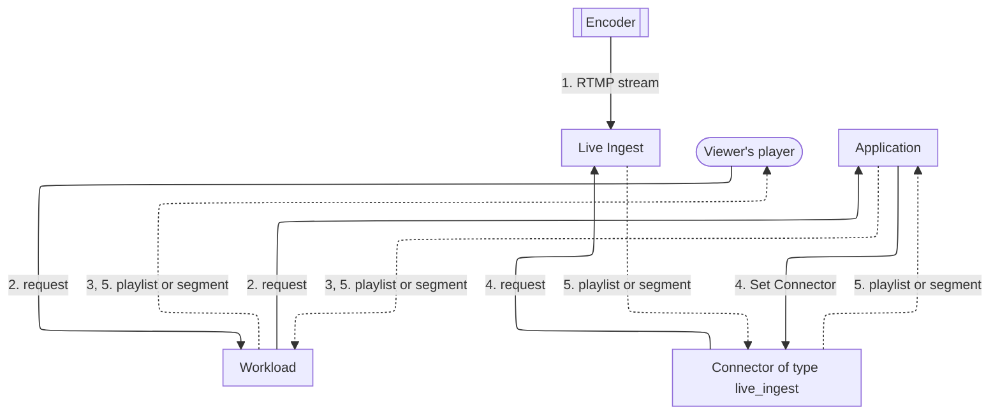

import FrameBox from '@aziontech/webkit/frame-box'
import ItemList from '@aziontech/webkit/item-list'
import DocItem from '@aziontech/webkit/doc-item'

A live broadcast is watched while it is produced. An encoder captures the audio and video and pushes the stream to an ingest point as it is captured. The ingest point packages the stream into files that a player fetches over HTTP, and a server delivers those files to every viewer. Live events, e-sports matches, and educational broadcasts reach their audience this way.

On Azion, the ingest point is [Live Ingest](/en/documentation/platform/connectors/live-ingest/), a Platform Resource nested in Connectors. Your encoder pushes the stream to it over Real-Time Messaging Protocol (RTMP), in the region of a Connector of type `live_ingest`, and Live Ingest converts the stream to HTTP Live Streaming (HLS). An [Application](/en/documentation/platform/applications/) delivers the stream to viewers through that Connector. For where Live Ingest acts on a viewer's request, refer to the [Live Ingest overview](/en/documentation/platform/connectors/live-ingest/#request-path).

The sections cover ingestion, the region, and delivery.

---

## Ingestion

Ingestion is the leg from your encoder to Azion. Live Ingest receives the stream over RTMP, so the encoder must support RTMP with username and password authentication. Azion provides the credentials and the ingestion URLs of a primary and a backup endpoint. You configure the encoder with them, so only an encoder that holds the credentials publishes to the endpoint.

Live Ingest converts the RTMP stream to HLS for delivery. The encoder therefore needs no HLS output of its own, and the stream it pushes is the source of every file the viewers fetch.

Azion may require supported or approved encoders, configurations, and endpoints.

For how Live Ingest is billed, refer to [Pricing](/en/documentation/fundamentals/pricing/#live-ingest).

---

## Region

A Connector of type `live_ingest` carries one attribute: the region where Live Ingest receives your stream. The encoder pushes the stream to that region. A region close to the encoder shortens the path the stream travels before Azion receives it, which lowers its latency.

The region is required. In Azion Console, **Region** is a required field of the _Live Ingest_ Connector type. In the API, the field is `attributes.region`. Both take a region such as `us-east-1` or `us-east-2`.

The region decides where the stream enters Azion, not where viewers connect. Viewers reach the Application through a Workload hostname, on Azion's distributed infrastructure. The choice therefore weighs the location of the encoder, not the location of the audience. For example, when you stream an event from one venue to viewers on several continents, choose the region with the shortest path from the venue.

A `POST` to `/v4/workspace/connectors` with this body creates a Connector of type `live_ingest` in `us-east-1`:

```json
{
  "name": "my-connector",
  "type": "live_ingest",
  "attributes": { "region": "us-east-1" }
}
```

The API answers `202` with `"state": "pending"`, and the Connector reads back with `"attributes": {"region": "us-east-1"}`. For the errors that a missing or unknown region returns, refer to [Connector settings](/en/documentation/platform/connectors/settings/#live-ingest).

---

## Delivery

A viewer's player requests the stream over HTTP from a hostname of a Workload, never from the encoder or from Live Ingest. The Application behind that Workload reaches the stream through a rule whose _Set Connector_ behavior sets the Connector of type `live_ingest`, and the Connector routes the viewers' requests to Live Ingest.

The diagram follows the stream from the encoder to Live Ingest, and a viewer's request for it. Solid arrows carry the stream and the request, and dotted arrows carry the playlist and the segments back. Each label starts with the number of its step.



1. The encoder pushes the stream over RTMP to Live Ingest, in the region that the Connector sets. Live Ingest converts the stream to HLS: a playlist and the segments it lists.
2. A viewer's player requests the playlist or a segment over HTTP from a hostname of the Workload, and the Application that the Workload's deployment sets receives the request.
3. When the Application holds a valid cached copy of that file, under the _Enforce HLS cache_ policy, the copy answers the player.
4. Otherwise, the Application's rule sets the Connector of type `live_ingest` with its _Set Connector_ behavior, and the Connector routes the request to Live Ingest.
5. Live Ingest returns the playlist or the segment, and the Application caches it and answers the player.

An HLS stream is two kinds of file. The playlist, `.m3u8`, is rewritten as the stream advances, and a player reads it to find the segments Live Ingest has already written. Each segment, `.ts`, is written once and never changes.

When you select a Live Ingest source in a rule, Azion adds the _Enforce HLS cache_ behavior to that Request Phase rule. The behavior bypasses the cache rules of the Application and applies the cache policy Azion defines for live HLS transmissions. That policy gives playlists a short cache time and segments a longer one. For the cache time of each file type, refer to [Rules Engine for Applications](/en/documentation/platform/applications/rules-engine/#enforce-hls-cache).

While a cached copy of a playlist or a segment is valid, the Application answers viewers from that copy, and their requests do not reach the Connector. One copy of a segment answers every viewer who requests it in that time. A large audience therefore does not send each of its requests to Live Ingest.

The short cache time of the playlist is the tradeoff. It keeps every viewer close to what Live Ingest has written, and it sends a new request for the playlist to the Connector each time the copy expires. To apply the policy to a stream, refer to [Enforce HLS cache for live streaming](/en/documentation/guides/media-and-streaming/streaming/enforce-hls-cache/).

To count the viewers of your streams, the Real-Time Metrics GraphQL API carries the `connectedUsersMetrics` dataset, with aggregated data on the users connected to your live streams. For more information, refer to [Real-Time Metrics](/en/documentation/platform/real-time-metrics/).

---

## Related resources

<FrameBox>
<ItemList>
  <DocItem title="Connector settings" href="/en/documentation/platform/connectors/settings/#live-ingest">The region field of a Connector of type live_ingest, with the errors that a missing or unknown region returns.</DocItem>
  <DocItem title="Enforce HLS cache for live streaming" href="/en/documentation/guides/media-and-streaming/streaming/enforce-hls-cache/">Cache settings and rules that give the playlist and the segments of an HLS stream their own cache times.</DocItem>
  <DocItem title="Connectors best practices" href="/en/documentation/platform/connectors/best-practices/#live-ingest">Recommendations for running a Connector, including the encoder, the endpoints, and the cache of a live stream.</DocItem>
  <DocItem title="Stream live events to large audiences" href="/en/documentation/use-cases/deliver-media-and-streaming/stream-live-events-to-large-audiences/">The architecture that combines an ingest component, an Application, and its cache to deliver a live stream.</DocItem>
</ItemList>
</FrameBox>
